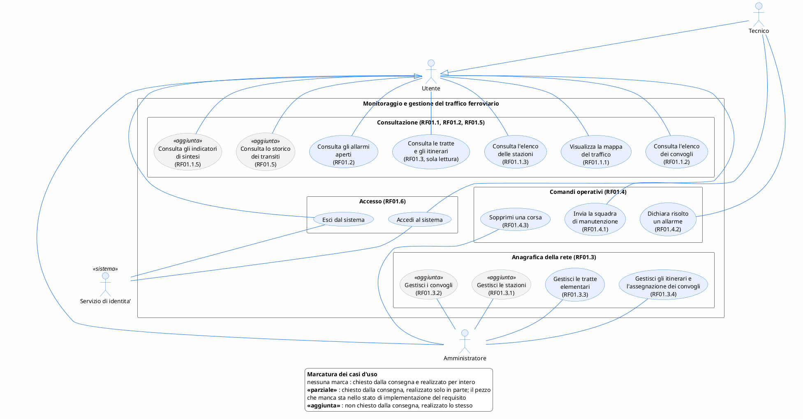
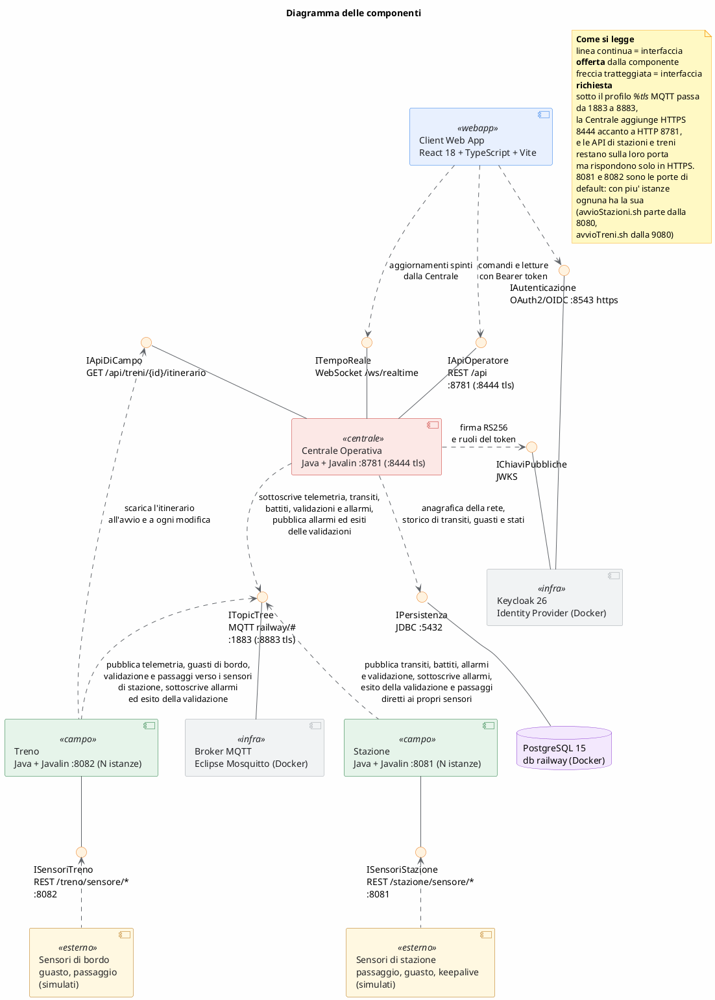
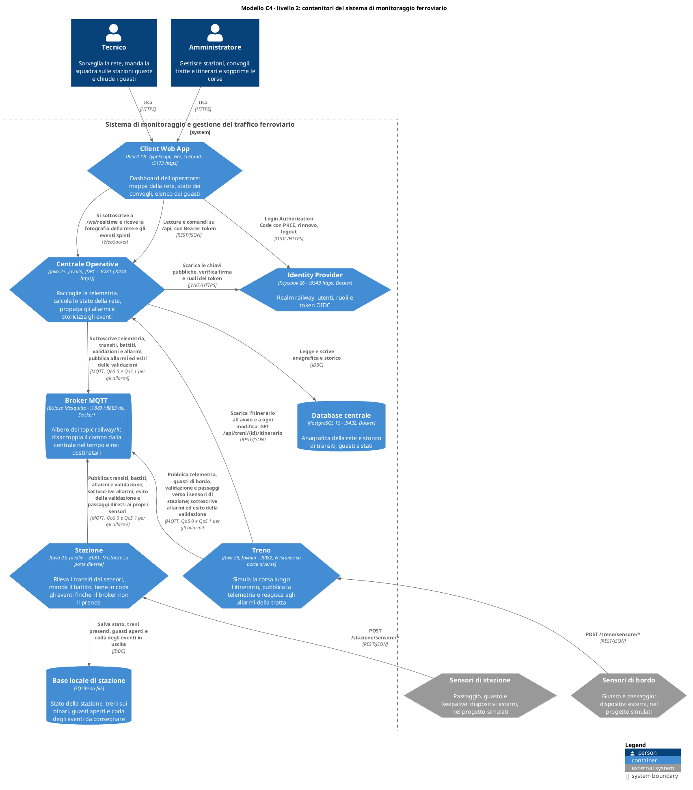
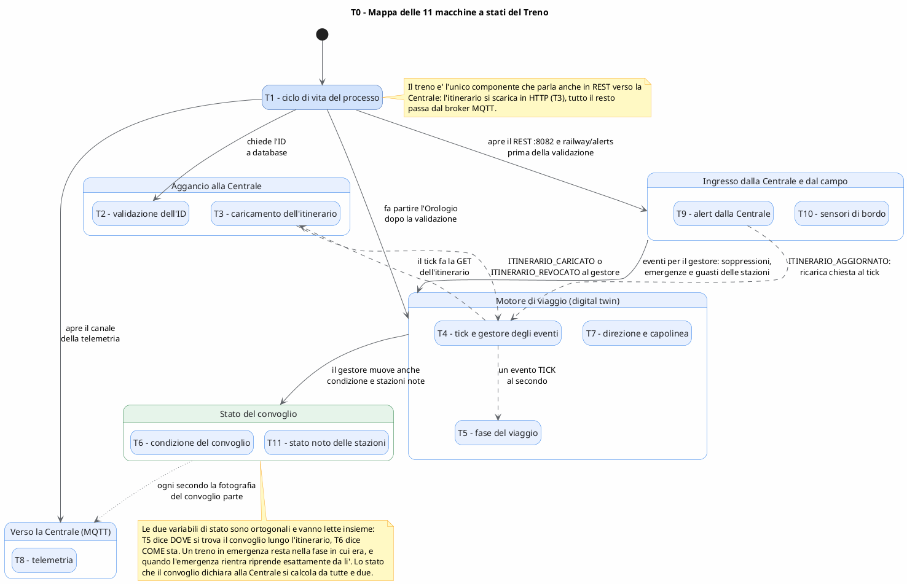
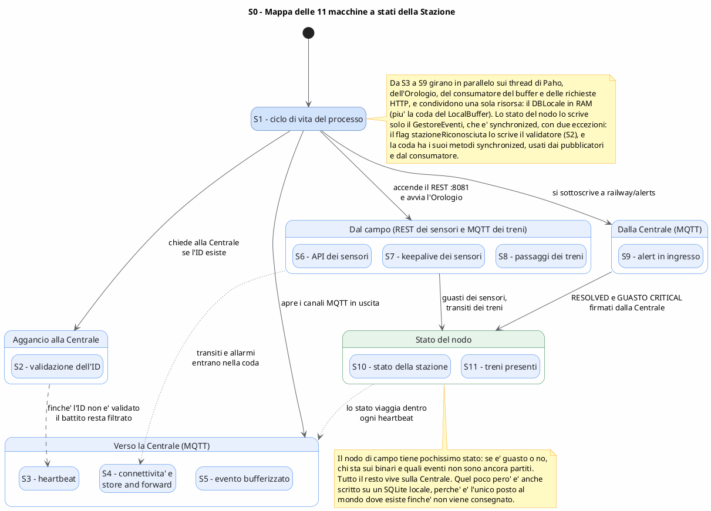
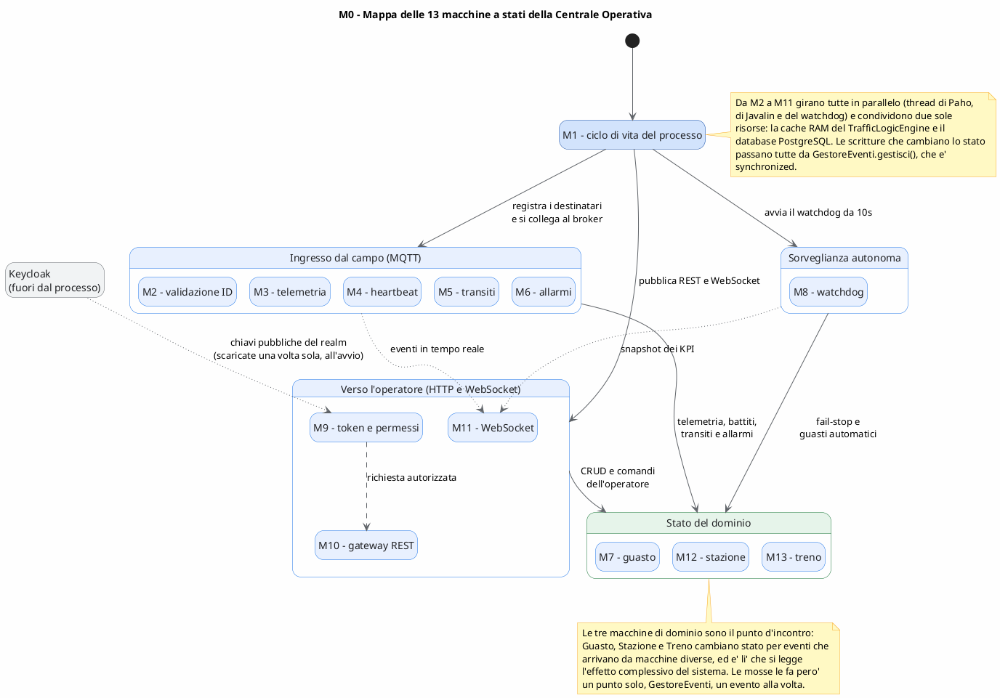
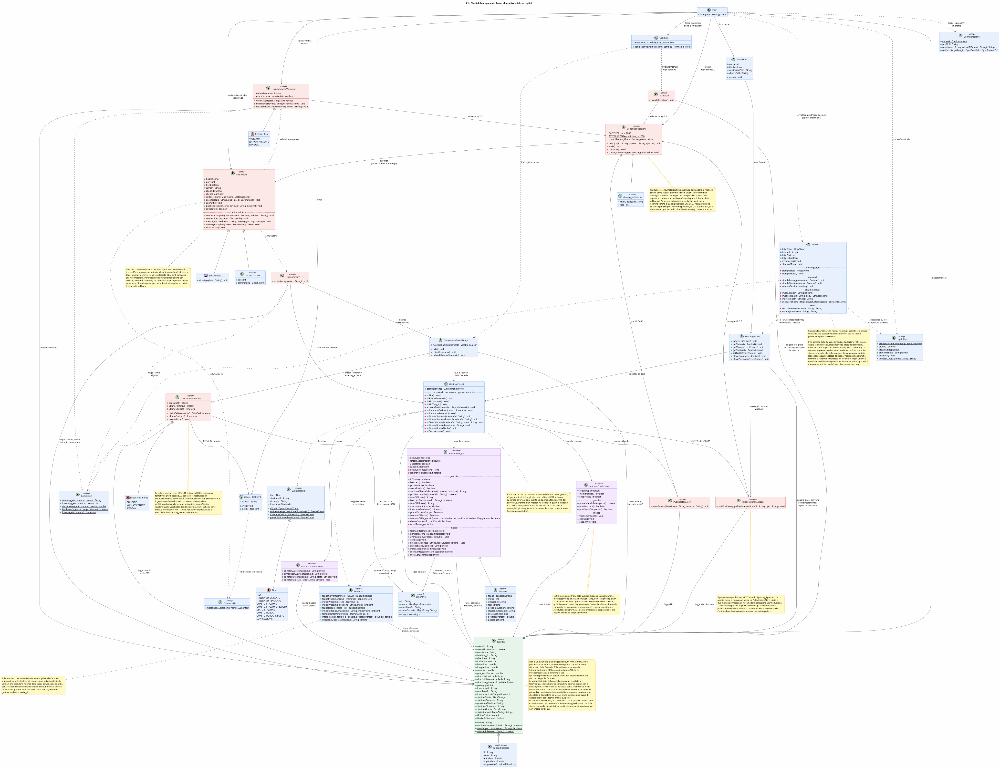
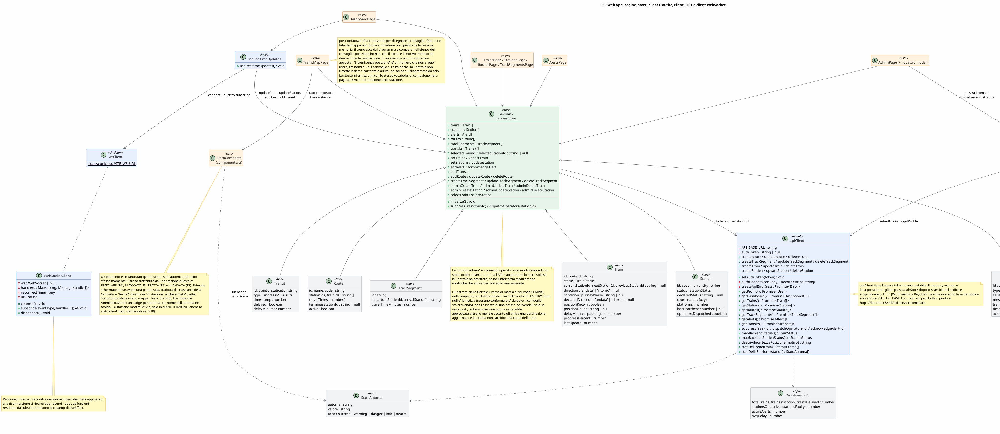
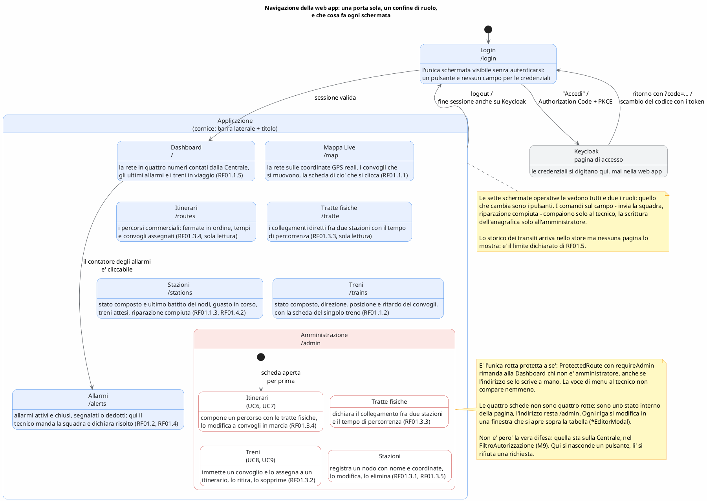

#+LATEX_HEADER: \usepackage{tabularx}
#+LATEX_HEADER: \usepackage{longtable}
#+LATEX_HEADER: \newcolumntype{Y}{>{\raggedright\arraybackslash}X}
#+LATEX_HEADER: \newcolumntype{L}[1]{>{\raggedright\arraybackslash}p{#1}}
#+LATEX_HEADER: \usepackage{titlesec}
#+LATEX_HEADER: \titleformat{\paragraph}[hang]{\normalfont\normalsize\bfseries}{\theparagraph}{1em}{}
#+LATEX_HEADER: \titlespacing*{\paragraph}{0pt}{3.25ex plus 1ex minus .2ex}{1.5ex plus .2ex}
#+LATEX_HEADER: \titleformat{\subparagraph}[hang]{\normalfont\normalsize\bfseries}{\thesubparagraph}{1em}{}
#+LATEX_HEADER: \titlespacing*{\subparagraph}{0pt}{3.25ex plus 1ex minus .2ex}{1.5ex plus .2ex}
#+LATEX_HEADER: \setcounter{secnumdepth}{5}
#+OPTIONS: H:5 toc:5
* Specifica
** Introduzione Descrizione Generale
Il sistema è al fine della gestione e del monitoraggio di una rete ferroviaria, in particolare
delle stazioni e dei treni che la compongono.
Tale servizio è Fornito attraverso una app web che fornisce il neccessarrio
** Modellazione per casi d'uso

#+begin_src  plantuml :file casi_uso_00_attori_e_casi_uso.png
@startuml UC0 - Attori e casi d'uso del sistema
' =========================================================================
'  MODELLAZIONE PER CASI D'USO
'
'  Il diagramma copre RF01 (i servizi che il sistema offre agli utenti) e la
'  ripartizione dei permessi di RF04.2, e segue la consegna: il tecnico
'  visualizza e manda gli operatori sulla stazione guasta, l'amministratore
'  visualizza, tiene l'anagrafica della rete e sopprime le corse.
'
'  Come e' costruito:
'    - Utente e' l'attore astratto che raccoglie cio' che i due ruoli reali
'      fanno entrambi (la consultazione e l'accesso); tecnico e
'      amministratore lo specializzano e ne ereditano le associazioni;
'    - ogni caso d'uso porta fra parentesi il requisito che lo enuncia;
'    - la marcatura dice quanto ne e' realizzato e se la consegna lo chiede
'      (vedi la legenda in fondo al diagramma).
'
'  I nodi di campo (convogli e stazioni) non compaiono: non sono utenti e
'  non si identificano con credenziali, il loro riconoscimento e' RF02.4.
' =========================================================================

top to bottom direction
skinparam backgroundColor #FEFEFE
skinparam shadowing false
skinparam usecase {
    BackgroundColor #E8F0FE
    BorderColor #1A73E8
    ArrowColor #1A73E8
}
skinparam usecase<<parziale>> {
    BackgroundColor #FEF7E0
    BorderColor #F29900
}
skinparam usecase<<aggiunta>> {
    BackgroundColor #F1F3F4
    BorderColor #9AA0A6
}
skinparam actor {
    BackgroundColor #E8F0FE
    BorderColor #1A73E8
}
skinparam rectangle {
    BorderColor #5F6368
}
skinparam legend {
    BackgroundColor #FFFFFF
    BorderColor #5F6368
}

actor "Tecnico" as TECNICO
actor "Utente" as UTENTE
actor "Amministratore" as ADMIN
actor "Servizio di identita'" as IDP <<sistema>>

TECNICO --|> UTENTE

rectangle "Monitoraggio e gestione del traffico ferroviario" {

  rectangle "Consultazione (RF01.1, RF01.2, RF01.5)" as G1 {
    usecase "Visualizza la mappa\ndel traffico\n(RF01.1.1)" as UC01
    usecase "Consulta l'elenco\ndei convogli\n(RF01.1.2)" as UC02
    usecase "Consulta l'elenco\ndelle stazioni\n(RF01.1.3)" as UC03
    usecase "Consulta le tratte\ne gli itinerari\n(RF01.3, sola lettura)" as UC06
    usecase "Consulta gli allarmi\naperti\n(RF01.2)" as UC05
    usecase "Consulta gli indicatori\ndi sintesi\n(RF01.1.5)" as UC04 <<aggiunta>>
    usecase "Consulta lo storico\ndei transiti\n(RF01.5)" as UC07 <<parziale>>
  }

  rectangle "Comandi operativi (RF01.4)" as G2 {
    usecase "Invia la squadra\ndi manutenzione\n(RF01.4.1)" as UC08
    usecase "Dichiara risolto\nun allarme\n(RF01.4.2)" as UC09
    usecase "Sopprimi una corsa\n(RF01.4.3)" as UC10
  }

  rectangle "Accesso (RF01.6)" as G4 {
    usecase "Accedi al sistema" as UC15
    usecase "Esci dal sistema" as UC16
  }

  rectangle "Anagrafica della rete (RF01.3)" as G3 {
    usecase "Gestisci le tratte\nelementari\n(RF01.3.3)" as UC13
    usecase "Gestisci gli itinerari e\nl'assegnazione dei convogli\n(RF01.3.4)" as UC14
    usecase "Gestisci le stazioni\n(RF01.3.1)" as UC11 <<aggiunta>>
    usecase "Gestisci i convogli\n(RF01.3.2)" as UC12 <<aggiunta>>
  }
}

' ---- cio' che i due ruoli fanno entrambi ----
UTENTE -- UC01
UTENTE -- UC02
UTENTE -- UC03
UTENTE -- UC04
UTENTE -- UC05
UTENTE -- UC06
UTENTE -- UC07
UTENTE -- UC15
UTENTE -- UC16

' ---- compito del tecnico: la stazione guasta e il suo ripristino ----
TECNICO -- UC08
TECNICO -- UC09

' ---- riservato all'amministratore ----
UC10 -- ADMIN
UC11 -- ADMIN
UC12 -- ADMIN
UC13 -- ADMIN
UC14 -- ADMIN
UTENTE <|-- ADMIN

' ---- le credenziali si digitano fuori dall'applicazione (RF04.1) ----
UC15 -- IDP
UC16 -- IDP

' ---- vincoli di sola impaginazione: distribuiscono i gruppi su tre file ----
UC01 -[hidden]down- UC08
UC02 -[hidden]down- UC09
UC03 -[hidden]down- UC10
UC06 -[hidden]down- UC15
UC05 -[hidden]down- UC16
UC08 -[hidden]down- UC13
UC09 -[hidden]down- UC14
UC10 -[hidden]down- UC11
UC15 -[hidden]down- UC12

legend bottom
  <b>Marcatura dei casi d'uso</b>
  nessuna marca : chiesto dalla consegna e realizzato per intero
  <b>«parziale»</b> : realizzato solo in parte; il pezzo che manca sta nello
  stato di implementazione del requisito (lo storico dei transiti e' anche
  un'aggiunta: la consegna chiede di conservarlo, non di mostrarlo)
  <b>«aggiunta»</b> : non chiesto dalla consegna, realizzato lo stesso
endlegend
@enduml
#+end_src

#+RESULTS:

** Glossario dei termini di dominio

- Stazione :: nodo della rete in cui i convogli entrano, sostano ed escono. Ha un nome, una
  posizione geografica e uno stato operativo.
- Tratta elementare :: collegamento diretto fra due stazioni adiacenti, senza fermate intermedie.
  E' l'unita' con cui si compone un percorso.
- Itinerario :: sequenza ordinata di stazioni che un convoglio deve percorrere, con il tempo di
  percorrenza previsto fra una tappa e la successiva. Nelle schermate e' chiamato anche *tratta*.
- Estremo dell'itinerario :: la prima e l'ultima stazione della sequenza. E' il punto in cui il
  convoglio inverte la marcia, a meno che quell'estremo sia anche il capolinea.
- Capolinea :: l'estremo su cui il servizio si chiude, deciso dall'amministratore quando compone
  l'itinerario. Il convoglio che ci arriva termina la corsa e resta fermo li'. E' una proprieta'
  dell'itinerario e non della stazione: la stessa stazione puo' chiudere un itinerario ed essere
  una fermata qualunque di un altro. Un itinerario senza capolinea si percorre senza fine.
- Direzione :: verso di percorrenza dell'itinerario, *andata* o *ritorno*.
- Corsa :: percorrenza dell'itinerario da un estremo all'altro in una direzione.
- Convoglio :: il treno in servizio, identificato da un numero. Ha una posizione, uno stato, un
  ritardo accumulato e un numero di passeggeri a bordo.
- Transito :: passaggio di un convoglio per una stazione. E' di due tipi, *entrata* e *uscita*, ed e'
  sempre riferito a un istante.
- Telemetria :: dichiarazione periodica con cui il convoglio comunica come sta e dove si trova.
- Battito :: segnale periodico con cui un nodo dichiara di essere vivo. Il suo valore informativo sta
  nell'assenza: e' il silenzio a dire qualcosa.
- Guasto :: condizione anomala aperta su una sorgente (una stazione, un convoglio, una tratta), con
  un tipo, una severita', un istante di apertura e uno stato di lavorazione.
- Allarme :: il guasto cosi' come viene presentato all'operatore.
- Ripristino :: dichiarazione che la condizione anomala e' rientrata e che cio' che era bloccato puo'
  riprendere.
- Ritardo :: differenza fra l'avanzamento previsto della corsa e quello effettivo, espressa in
  minuti e riferita al singolo convoglio.
- Sosta :: permanenza del convoglio in stazione fra l'entrata e l'uscita.
- Servizio di identita' :: la parte del sistema che custodisce gli utenti, ne verifica le
  credenziali e rilascia gli attestati di accesso. E' l'unico posto in cui una password viene
  digitata e l'unico che la conosce.
- Attestato di accesso :: cio' che l'utente ottiene identificandosi e che deve esibire a ogni
  richiesta successiva. Dice chi e' e che ruolo ha, ha una durata limitata e chi lo riceve puo'
  controllarne da solo l'autenticita', senza interpellare il servizio di identita'.
- Rinnovo :: sostituzione di un attestato in scadenza con uno nuovo, fatta senza chiedere di
  nuovo le credenziali all'utente. Serve perche' una sessione di lavoro dura piu' di un
  attestato.
** Requisiti funzionali
La numerazione è gerarchica per raggruppamenti e presenta anche le dipendenze

*** RF01 - Servizi offerti agli utenti

*Enunciato*: il sistema espone a tecnico e amministratore, attraverso un'unica applicazione web, la
situazione corrente della rete, la sua storia e i comandi previsti per il loro ruolo.

*Nota di lettura*: RF01 non stabilisce nessuna verita' sul dominio, la *espone*. Se lo stato
descritto da RF02 e' sbagliato, RF01 mostra correttamente un dato sbagliato: per questo ogni ramo di
RF01 dipende dal corrispondente ramo di RF02.

*Stato di implementazione*: parziale — la visualizzazione, l'amministrazione dei dati e l'accesso
ci sono per intero, e i tre comandi operativi di RF01.4 fanno quello che devono. Mancano la
ripartizione dei comandi per ruolo (RF04.2) e la schermata dello storico (RF01.5).

**** RF01.1 - Visualizzazione della situazione corrente

*Stato di implementazione*: completo, tutte e cinque le voci.

***** RF01.1.1 - Mappa del traffico
- enunciato: la posizione dei convogli e' rappresentata su una mappa geografica, insieme al percorso
  che stanno seguendo e al loro stato.
- dipende da: RF02.2.2.
- stato di implementazione: completo. Il convoglio viene disegnato sulla posizione interpolata fra
  le due stazioni della tratta che sta percorrendo, con sopra il percorso e il colore dello stato;
  il pannello di dettaglio ne mostra lo stato composto (vedi il vocabolario degli stati osservabili).
  Se la centrale non garantisce la posizione (RF02.2.2.1) il convoglio *non viene disegnato* ma
  elencato a parte, con il nome e il motivo: sulla mappa una posizione inventata non si
  distinguerebbe da una vera.

***** RF01.1.2 - Elenco dei convogli
- enunciato: per ogni convoglio sono visibili il numero, la stazione o la tratta su cui si trova, lo
  stato, il ritardo accumulato e i passeggeri a bordo.
- dipende da: RF02.2.
- stato di implementazione: completo. Lo stato e' quello composto, un valore per ogni automa del
  convoglio (condizione, fase del viaggio, verso), e non il riassunto che ne tiene la centrale. Dove
  la posizione non e' garantita l'elenco scrive un punto di domanda con il motivo: il trattino vuol
  dire "non si applica", il punto di domanda "c'e', ma non lo sappiamo".

***** RF01.1.3 - Elenco delle stazioni
- enunciato: per ogni stazione sono visibili lo stato operativo, i convogli fermi sui binari in quel
  momento, quelli attesi in ingresso e quelli attesi in uscita.
- dipende da: RF02.3.1.
- stato di implementazione: completo. Lo stato operativo lo tiene la centrale, i convogli sui binari
  li dichiara il nodo di stazione: la schermata mette insieme le due cose. Nel tabellone degli attesi
  il convoglio a posizione incerta resta in elenco, con un avviso accanto all'orario: la stima e'
  calcolata sull'ultima posizione certa.

***** RF01.1.4 - Aggiornamento continuo
- enunciato: le schermate si aggiornano da sole mentre l'operatore le guarda, senza che lui debba
  ricaricare la pagina o chiedere l'aggiornamento.
- esito atteso: un evento rilevante (un transito, un cambio di stato, un guasto, l'esito di un
  comando) e' visibile sulla schermata entro pochi secondi dal momento in cui accade; inoltre, ogni
  =P_ria=, la schermata riceve una fotografia completa dello stato corrente.
- *distinzione che conta*: l'aggiornamento e' *spinto dal sistema quando l'evento accade*, non
  ottenuto da interrogazioni a orologio da parte della schermata. La fotografia periodica non e' il
  meccanismo di aggiornamento: serve a riallineare chi si e' collegato dopo o ha perso qualcosa.
- stato di implementazione: completo, distinzione compresa: l'evento viene spinto sulla websocket
  quando accade, e la fotografia periodica viaggia sullo stesso canale.

***** RF01.1.5 - Indicatori di sintesi
- enunciato: una schermata di riepilogo riassume in pochi numeri i convogli in circolazione, le
  stazioni operative, i guasti aperti e il ritardo medio.
- rispetto alla consegna: e' un'aggiunta, la consegna non la chiede.
- stato di implementazione: completo. I numeri li calcola la centrale e viaggiano dentro la stessa
  fotografia periodica di RF01.1.4, quindi si aggiornano da soli come il resto.

**** RF01.2 - Visualizzazione dei guasti

*Stato di implementazione*: completo, entrambe le voci.

***** RF01.2.1 - Elenco degli allarmi aperti
- enunciato: sono visibili i guasti attivi con la sorgente (quale stazione, quale convoglio, quale
  tratta), il tipo, la severita' e l'istante di apertura.
- dipende da: RF02.1.
- stato di implementazione: completo.

***** RF01.2.2 - Distinzione fra guasto segnalato e guasto dedotto
- enunciato: l'elenco distingue il guasto *segnalato dal campo* (qualcuno lo ha dichiarato) da quello
  *dedotto dalla centrale* (un nodo ha smesso di dare notizie).
- *perche' e' un requisito e non un dettaglio*: sono due condizioni con cause diverse e con reazioni
  diverse. Un guasto segnalato indica un problema del nodo; un guasto dedotto puo' indicare anche
  soltanto un problema di collegamento, e chi decide se mandare la squadra deve poterli distinguere
  senza indovinare.
- dipende da: RF02.6.
- stato di implementazione: completo. L'API e gli eventi in tempo reale portano l'origine
  dell'allarme, e la schermata la mostra esplicitamente come "segnalato dal campo" oppure
  "dedotto dalla centrale".

**** RF01.3 - Amministrazione dei dati della rete

*Enunciato del ramo*: la creazione, la modifica e l'eliminazione dell'anagrafica della rete sono
riservate all'amministratore; il tecnico vede tutto ma non modifica nulla.

*Rispetto alla consegna*: la consegna chiede le tratte (RF01.3.3) e la modifica delle stazioni
attraversate (RF01.3.4). Stazioni (RF01.3.1) e convogli (RF01.3.2) sono un'aggiunta: la consegna da'
per scontata una rete gia' popolata, e serviva un posto in cui crearla.

*Stato di implementazione*: completo, tutte e cinque le voci.

***** RF01.3.1 - Stazioni
- enunciato: l'amministratore crea, modifica ed elimina le stazioni della rete.
- stato di implementazione: completo. Dal form si scelgono il codice (l'id della stazione, fisso in
  modifica), il nome e le coordinate; le coordinate lasciate vuote valgono 0, e la mappa piazza la
  stazione vicino a quelle collegate. Stato e binari non si scrivono: una stazione nuova nasce
  OFFLINE con un binario, poi lo stato lo decidono il battito del nodo e i comandi del tecnico. La
  PUT della Centrale accetterebbe ancora tutti e due, ma la web app non li manda.

***** RF01.3.2 - Convogli
- enunciato: l'amministratore crea, modifica ed elimina i convogli.
- stato di implementazione: completo. Dal form si scelgono il nome del convoglio, solo in
  creazione perche' e' la chiave primaria, e l'itinerario. Stato, ritardo e passeggeri no: lo stato
  lo tengono gli automi della Centrale con la telemetria, il ritardo lo misura la Centrale ai
  passaggi e i passeggeri li dichiara il convoglio. Un convoglio nuovo nasce "fermo"; la PUT della
  Centrale accetterebbe ancora lo stato, ma la web app non lo manda.

***** RF01.3.3 - Tratte elementari
- enunciato: l'amministratore crea, modifica ed elimina i collegamenti diretti fra due stazioni
  adiacenti.
- stato di implementazione: completo. Il form rifiuta un tempo di percorrenza sotto il minuto.

***** RF01.3.4 - Itinerari e assegnazione dei convogli
- enunciato: l'amministratore compone un itinerario come sequenza ordinata di stazioni con i tempi di
  percorrenza previsti, e vi assegna sopra i convogli che devono percorrerlo.
- *scelta di quanto dura il servizio*: sull'itinerario si puo' marcare un estremo come capolinea, e
  allora la corsa si chiude li' invece di ripartire all'incontrario. Quale dei due estremi non e'
  indifferente: l'ultima stazione chiude dopo la sola andata, la prima dopo andata e ritorno. Una
  fermata intermedia non e' ammessa, perche' spezzerebbe l'itinerario in due senza dire che ne e'
  del pezzo restante.
- dipende da: RF02.5, perche' la modifica deve restare corretta anche con convogli gia' in marcia.
- stato di implementazione: completo; quello che succede ai convogli gia' in marcia e' il ramo
  RF02.5. Il capolinea si marca e si toglie con la bandierina accanto alle due stazioni estreme, e
  toglierlo e' l'unico modo per rimettere in servizio un convoglio che ha gia' chiuso la corsa.

***** RF01.3.5 - Integrita' dei dati alle eliminazioni
- enunciato: l'eliminazione di un'entita' non lascia riferimenti pendenti, e non e' permessa finche'
  qualcosa la sta ancora usando.
- esito atteso: o l'eliminazione viene rifiutata con una spiegazione comprensibile, oppure viene
  eseguita insieme a tutto cio' che senza quell'entita' non avrebbe piu' significato.
- stato di implementazione: completo. Ogni eliminazione o viene rifiutata con il motivo (la
  stazione usata da una tratta; la tratta usata da un itinerario, da una riga di =Transiti= o come
  posizione corrente di un convoglio, mentre lo =Storico_Transiti= non la trattiene),
  oppure porta via i record che senza quell'entita' non significano piu' niente. Una parte della
  garanzia la tengono i vincoli del database.

**** RF01.4 - Comandi operativi

*Chi puo' dare quale comando*: la squadra la manda il *tecnico*, la corsa la sopprime
l'*amministratore* (comando facoltativo nella consegna). La chiusura dell'allarme la consegna non la
assegna: sta sul tecnico perche' e' il seguito dell'invio degli operatori.

*Stato di implementazione*: parziale, solo per i permessi. I tre comandi fanno per intero quello che
devono, ma il filtro dei permessi li concede a entrambi i ruoli: e' l'unico punto in cui il sistema
e' piu' permissivo della consegna (RF04.2).

***** RF01.4.1 - Invio della squadra di manutenzione
- enunciato: il tecnico manda la squadra su una stazione guasta; la stazione resta inutilizzabile
  per tutta la durata dell'intervento.
- soggetto: il tecnico, che nella consegna e' il ruolo a cui questo compito e' assegnato.
- precondizione: sulla stazione esiste almeno un guasto aperto. Non si mandano operatori su una
  stazione sana: il comando viene rifiutato con 409.
- esito atteso: la stazione risulta in MANUTENZIONE a chi la guarda, e ci resta finche' il tecnico
  non chiude il guasto; il campo viene informato e i guasti aperti /restano aperti/, perche' l'invio
  degli operatori apre l'intervento e non lo conclude.
- nota di progetto: MANUTENZIONE e' uno stato della Centrale e vale "guasta piu' squadra inviata":
  e' il "preso in carico" del guasto visto dal lato della stazione, quindi il guasto non ha bisogno
  di un terzo stato. Sul nodo lo stato resta GUASTA, ed e' quello che continua a trattenere i treni
  in ingresso. Ai convogli lo dice la Centrale con l'alert =STATO_STAZIONE=: per il twin di bordo
  GUASTA e MANUTENZIONE sono la stessa cosa, quei binari non si attraversano. Durante l'intervento
  nessun evento del campo riscrive lo stato: il battito (che arriva ancora come GUASTA) aggiorna solo
  l'ultimo contatto, e un alert di guasto nuovo non riporta la stazione a GUASTA. La regola sta in un
  punto solo, la scrittura dello stato in cache (M12): gli eventi del campo non escono dalla
  manutenzione, i comandi dell'operatore si'.
- stato di implementazione: completo. Il comando porta la stazione in MANUTENZIONE, scrive la riga
  di storico e avvisa il campo; il ritorno in servizio e' legato alla fine dell'intervento
  (RF01.4.2). L'intervento sopravvive a un riavvio della centrale: all'avvio la riga piu' recente di
  =Storico_Stato_Stazioni=, letta insieme ai guasti ancora aperti, dice quali stazioni erano in
  intervento.

***** RF01.4.2 - Chiusura dell'allarme e ripresa della circolazione
- enunciato: il tecnico dichiara concluso l'intervento; il guasto passa a chiuso e cio' che era
  trattenuto per causa sua riprende.
- soggetto: il tecnico, per la ragione scritta sopra al ramo: chiudere l'allarme e' il seguito
  dell'invio degli operatori.
- esito atteso: il guasto risulta risolto, la stazione torna ONLINE se non le restano altri guasti
  aperti, la transizione viene storicizzata e i convogli fermi in stazione ripartono.
- dipende da: RF01.4.1, di cui chiude l'intervallo.
- stato di implementazione: completo. La chiusura manda al campo il RESOLVED, che riporta il nodo a
  ONLINE, e lo =STATO_STAZIONE= che dichiara la stazione agibile: e' quest'ultimo a liberare i
  convogli. La riga di storico chiude il passaggio per MANUTENZIONE.
- limite dichiarato: non viene registrato /chi/ ha chiuso il guasto (=Guasto.operatore= resta
  vuoto); la consegna non lo chiede (RF02.1.3).

***** RF01.4.3 - Soppressione di un convoglio fermo in stazione
- enunciato: l'amministratore annulla una corsa; il convoglio passa in SOPPRESSO e non viaggia piu'.
- soggetto: l'amministratore, che nella consegna e' il ruolo a cui questo comando e' assegnato.
- precondizione: il convoglio e' fermo in una stazione.
- rispetto alla consegna: la consegna lo scrive fra parentesi, come comando facoltativo; e' stato
  realizzato lo stesso.
- stato di implementazione: completo. La precondizione e' una guardia del comando: un convoglio che
  non risulta fermo in una stazione non si sopprime, e l'operatore riceve un 400 con il motivo.

**** RF01.5 - Consultazione dello storico

- enunciato: sono consultabili i transiti passati, ciascuno con il convoglio, la stazione, la tratta,
  il verso (entrata o uscita) e l'istante.
- rispetto alla consegna: e' un'aggiunta. La consegna chiede alla centrale di *memorizzare* lo
  storico dei transiti, e quello e' RF02.7; mostrarlo in una schermata non lo chiede nessuno.
- dipende da: RF02.7.
- stato di implementazione: parziale. La Centrale serve lo storico (=GET /api/transiti=) e la web
  app lo carica nello store, ma nell'interfaccia non c'e' nessuna schermata che lo mostri.

**** RF01.6 - Accesso al sistema

- enunciato: l'uso dell'applicazione richiede di identificarsi; l'identita' accompagna tutte le
  operazioni successive e termina con l'uscita esplicita.
- l'identificazione avviene *fuori dall'applicazione*, sulla schermata del servizio di identita':
  l'applicazione non vede mai le credenziali, riceve solo l'attestato di accesso.
- rimando: il dettaglio dei permessi e' in RF04.
- stato di implementazione: completo.

*** RF02 - Correttezza dello stato rappresentato
*Enunciato*: lo stato che il sistema mostra e conserva corrisponde a quello che sta realmente
accadendo sulla rete, anche in presenza di guasti, di interruzioni del collegamento e di modifiche
fatte mentre il sistema e' in funzione.

*Stato di implementazione*: parziale. Sono completi il ramo dei convogli (RF02.2), quello delle
stazioni (RF02.3), l'identita' dei nodi di campo (RF02.4), la modifica dell'itinerario a sistema
acceso (RF02.5) e le anomalie che la centrale deduce da sola (RF02.6). Del guasto della stazione
restano scoperti due casi: i transiti prodotti mentre la centrale e' spenta e il broker acceso
(RF02.1.1.1.1) e il convoglio che entra in una stazione ancora guasta dopo la chiusura di uno solo
dei suoi allarmi (RF02.1.1.2.1). Delle conseguenze del guasto del convoglio sull'infrastruttura
(RF02.1.2.2) e' realizzata quella sulla stazione e non quella sulla tratta; sono parziali il ciclo
di vita del guasto, che non registra la presa in carico (RF02.1.3), e la memoria storica, che di
cinque cose ne scrive tre (RF02.7).

**** RF02.1 - Gestione dei guasti

*Stato di implementazione*: parziale — la chiusura automatica c'e'; del guasto della stazione
restano scoperti due casi (RF02.1.1.1.1, RF02.1.1.2.1), del guasto del convoglio manca la
conseguenza sulla tratta (RF02.1.2.2.2), e al ciclo di vita del guasto manca la presa in carico
(RF02.1.3).

***** RF02.1.1 - Guasto della stazione

*Stato di implementazione*: parziale, per RF02.1.1.1.1 e RF02.1.1.2.1.

****** RF02.1.1.1 - Interruzione del collegamento con la centrale

*Stato di implementazione*: parziale, per RF02.1.1.1.1.

******* RF02.1.1.1.1 - Nessun dato perduto durante l'interruzione
- enunciato: mentre il collegamento con la centrale non e' disponibile, la stazione conserva
  localmente tutto cio' che produce e lo consegna quando il collegamento torna.
- precondizione: la stazione continua a funzionare e i suoi sensori continuano a rilevare.
- esito atteso: al ritorno del collegamento la centrale riceve tutti gli eventi prodotti durante
  l'interruzione, nessuno escluso.
- stato di implementazione: parziale. Ogni transito e ogni allarme passa dalla coda del nodo, che
  a collegamento giu' si allunga e si svuota quando il collegamento torna; la coda ha una copia sul
  SQLite locale (tabella =bufferChache=), quindi regge anche a un riavvio del processo. La coda
  pero' garantisce la consegna al broker, non alla centrale: la riga si cancella appena il broker ha
  preso l'evento. Gli allarmi viaggiano a QoS 1 e il broker li tiene per la centrale spenta, che ha
  una sessione persistente; i transiti viaggiano a QoS 0 e il broker non li conserva
  (=queue_qos0_messages false= in =mosquitto.conf=), quindi un transito pubblicato mentre la
  centrale e' spenta e il broker acceso si perde. Il caso coperto e' la stazione che perde il
  collegamento (la leva =POST /stazione/rete/offline= di SV02), non la centrale che si ferma.

******* RF02.1.1.1.2 - Ordine di consegna preservato
- enunciato: la consegna differita rispetta l'ordine in cui gli eventi sono stati generati; se una
  singola consegna fallisce, l'evento non consegnato precede comunque quelli successivi.
- *perche' e' un requisito a se'*: senza questo vincolo l'entrata e l'uscita di uno stesso convoglio
  possono arrivare invertite, e lo storico racconterebbe un convoglio che esce da una stazione prima
  di entrarci.
- dipende da: RF02.7.
- stato di implementazione: completo. L'evento che non riesce a partire rientra in *testa* alla
  coda, ed e' esattamente questo che impedisce a un'uscita di precedere la propria entrata.

****** RF02.1.1.2 - Stazione non percorribile

*Stato di implementazione*: parziale, per RF02.1.1.2.1.

*Che cosa vuol dire "non percorribile"*: la stazione e' *guasta* (lo dice il campo) oppure in
*manutenzione* (la squadra mandata dalla centrale, RF01.4.1). Per il convoglio sono la stessa cosa;
a distinguerle serve solo all'operatore.

******* RF02.1.1.2.1 - Il convoglio diretto alla stazione non percorribile si ferma
- enunciato: se la prossima stazione dell'itinerario non e' percorribile, il convoglio non vi entra e
  resta fermo dove si trova.
- esito atteso: il convoglio risulta FERMO, la sua posizione non avanza e il ritardo cresce.
- dipende da: RF02.2.2.1.
- stato di implementazione: parziale. Il convoglio si ferma per tutte e due le condizioni, il
  guasto dichiarato dal campo e la manutenzione dichiarata dalla centrale con =STATO_STAZIONE=, ma
  resta scoperto un caso. Il =RESOLVED= di una stazione fa dimenticare al convoglio il guasto che si
  era annotato anche quando alla stazione resta un altro allarme aperto: lo pubblica il nodo quando
  tornano i sensori, e la centrale quando l'operatore chiude uno solo degli allarmi o quando torna
  il battito. Se la stazione era chiusa solo dal =GUASTO= del campo, per cui la centrale non manda
  nessuno =STATO_STAZIONE=, il convoglio che non era ancora fermo davanti la trova percorribile e ci
  entra; lo trattiene poi la stazione stessa, all'ingresso.

******* RF02.1.1.2.2 - Riparte solo al ripristino
- enunciato: il convoglio trattenuto riprende la corsa quando arriva il ripristino di quella
  stazione, non prima e non per scadenza di un tempo.
- stato di implementazione: completo, senza nessun tempo massimo. Il ripristino che conta e' quello
  dello *stato della stazione*, non la chiusura del singolo allarme: un =RESOLVED= che arriva mentre
  la squadra e' ancora sul posto lascia il convoglio dov'e'.

******* RF02.1.1.2.3 - Il blocco vale anche per chi e' gia' fermo li'
- enunciato: un convoglio gia' in sosta nella stazione che si guasta non riparte finche' il guasto e'
  aperto.
- *perche' e' un requisito a se'*: senza di esso il guasto bloccherebbe solo chi arriva dopo, e la
  stazione non risulterebbe davvero non percorribile.
- stato di implementazione: completo. Il convoglio tiene in memoria lo stato di ogni stazione che lo
  riguarda e lo ricontrolla prima di ogni partenza. Un convoglio acceso /dopo/ l'annuncio lo trova
  nell'itinerario scaricato all'avvio (campo =stato= di ogni tappa), perche' gli alert su un topic
  li sente solo chi era in ascolto.

***** RF02.1.2 - Guasto del convoglio

*Stato di implementazione*: parziale — il guasto viene registrato e chiude la stazione in cui il
convoglio e' fermo; la tratta invece resta percorribile.

****** RF02.1.2.1 - Il guasto viene registrato in centrale
- enunciato: quando un convoglio si guasta, la centrale apre e conserva il guasto corrispondente.
- stato di implementazione: completo.

****** RF02.1.2.2 - Conseguenze del guasto

*Stato di implementazione*: parziale — realizzato per il convoglio guasto in stazione, non per
quello guasto in tratta.

******* RF02.1.2.2.1 - Convoglio guasto *in stazione*: la stazione diventa non percorribile
- enunciato: se il convoglio si guasta mentre e' fermo in una stazione, quella stazione risulta
  guasta.
- dipende da: RF02.2.2.1, perche' la conseguenza si sceglie in base a dove si trova il convoglio.
- stato di implementazione: completo. Quando arriva il guasto critico di un convoglio che risulta
  in una stazione, la centrale porta anche quella stazione a GUASTA, apre su di lei un guasto dedotto
  (tipo =convoglio_guasto_in_stazione=) e lo pubblica sul campo: i convogli diretti li' si fermano e
  il nodo stazione si allinea. Il guasto dedotto si chiude insieme a quello del convoglio, quando
  l'operatore lo risolve, e la stazione torna ONLINE se non le resta nessun altro guasto aperto.

******* RF02.1.2.2.2 - Convoglio guasto *in tratta*: la tratta diventa non percorribile
- enunciato: se il convoglio si guasta fra due stazioni, e' la tratta elementare che sta percorrendo
  a risultare non percorribile; nessuna stazione cambia stato.
- dipende da: RF02.2.2.1.
- stato di implementazione: non realizzato. L'allarme si apre sul convoglio, ma la tratta non ha uno
  stato di percorribilita': resta libera e nessun altro convoglio viene fermato. Vale anche per
  l'allarme dedotto (RF02.6.2).

***** RF02.1.3 - Ciclo di vita del guasto
- enunciato: un guasto ha uno stato di lavorazione (aperto, preso in carico, chiuso), un
  assegnatario e una traccia di come e' evoluto; sulla stessa sorgente e per lo stesso motivo non
  esiste piu' di un guasto aperto per volta.
- *perche' l'unicita' e' un requisito*: le anomalie dedotte vengono ricontrollate a ritmo periodico,
  e senza unicita' la stessa condizione genererebbe un allarme nuovo a ogni controllo, rendendo
  l'elenco inutilizzabile proprio quando serve.
- stato di implementazione: parziale. L'unicita' c'e', per sorgente e tipo, e apertura e chiusura
  lasciano traccia nello storico. Gli stati pero' sono due (il guasto porta solo "risolto" vero o
  falso) e l'assegnatario non viene mai scritto: colonna e tabella delle assegnazioni restano vuote.
  In piu' il tipo non distingue sempre il motivo: =sensore_offline= vale sia per i sensori muti
  dichiarati dalla stazione sia per il battito perso dedotto dalla centrale, e =treno_fermo= sia per
  l'avaria di bordo sia per il convoglio fermo in linea. Con due motivi dello stesso tipo il secondo
  guasto non si apre e si aggiorna solo il messaggio del primo, che conserva severita' e origine.

***** RF02.1.4 - Chiusura automatica quando la causa rientra
- enunciato: un guasto aperto perche' un nodo taceva si chiude da solo quando il nodo torna a dare
  notizie, senza bisogno dell'intervento di un operatore.
- *perche'*: un guasto dedotto deve essere disfatto dalla stessa deduzione che lo ha creato,
  altrimenti l'elenco degli allarmi si riempie di condizioni gia' rientrate che nessuno chiude.
- precondizione: il guasto e' stato aperto per deduzione e non per segnalazione.
- dipende da: RF02.3.2.
- stato di implementazione: completo. Il battito che torna richiude il guasto dedotto sulla stazione,
  il convoglio che riprende a muoversi richiude il proprio.

**** RF02.2 - Gestione dei convogli

*Stato di implementazione*: completo.

***** RF02.2.1 - Ritardi

*Stato di implementazione*: completo.

****** RF02.2.1.1 - Il ritardo si accumula quando il convoglio e' fermo e dovrebbe circolare
- enunciato: finche' il convoglio e' trattenuto pur avendo una tappa da percorrere, il suo ritardo
  cresce; quando circola regolarmente non cresce.
- dipende da: RF02.1, perche' il fermo nasce dai guasti.
- stato di implementazione: completo.

***** RF02.2.2 - Informazioni di stato del convoglio

*Stato di implementazione*: completo, tutte e quattro le informazioni.

****** RF02.2.2.1 - Posizione
- enunciato: il convoglio dichiara in modo non ambiguo dove si trova: in quale stazione e' fermo,
  oppure fra quali due stazioni sta viaggiando e in quale direzione.
- esito atteso: la risposta alla domanda "il convoglio e' in stazione o in tratta?" e' sempre
  definita, in ogni istante della corsa.
- *nota*: e' il *predicato centrale della specifica*: ne dipendono la conseguenza di un guasto
  (stazione o tratta), la modifica dell'itinerario a sistema acceso e l'anomalia del convoglio fermo.
- stato di implementazione: completo. Il convoglio dichiara la stazione in cui e' fermo o la tratta
  che percorre con la direzione, e la centrale incrocia la dichiarazione con i passaggi rilevati a
  terra. Le due fonti possono non concordare: la telemetria dice dove il convoglio *crede* di
  essere, il passaggio dei sensori conferma da dove e' uscito davvero, ma se la stazione e' spenta
  nessuno lo registra. In quel caso la centrale non le compone: dichiara la posizione *incerta* con
  il motivo (non trasmette, nessun sensore conferma la partenza, fermata davanti non dichiarata,
  verso ignoto), e il verso non garantito resta nullo. Il predicato ha quindi tre esiti: in
  stazione, in tratta fra due estremi noti, oppure /non lo so/.

****** RF02.2.2.2 - Ritardo accumulato
- enunciato: il convoglio dichiara il ritardo accumulato dall'inizio della corsa.
- dipende da: RF02.2.1.
- stato di implementazione: completo.

****** RF02.2.2.3 - Stato del convoglio
- enunciato: il convoglio dichiara come sta, con uno dei valori del vocabolario degli stati, e questa
  informazione e' distinta dalla posizione.
- stato di implementazione: completo; a database la colonna dello stato accetta solo cinque
  valori, uno per ogni stato del vocabolario con i nomi del database (=attivo=, =fermo=, =rotto=,
  =in manutenzione= per SOPPRESSO, =capolinea=). Quei valori sono un riassunto: la telemetria porta anche condizione e fase
  del viaggio, ed e' quello che l'interfaccia mostra.

****** RF02.2.2.4 - Velocita' e passeggeri a bordo
- enunciato: il convoglio dichiara la velocita' corrente e il numero di passeggeri a bordo.
- *nota di ambito*: sono valori simulati che rendono leggibile la corsa sulla mappa; non provengono
  da nessuna rilevazione reale e non alimentano nessuna decisione del sistema.
- stato di implementazione: completo, nell'ambito dichiarato.

***** RF02.2.3 - Andata e ritorno sullo stesso itinerario
- enunciato: raggiunto un estremo dell'itinerario, il convoglio inverte la marcia e lo ripercorre in
  senso contrario; il tempo di percorrenza di ogni tappa e' quello previsto per il verso che sta
  percorrendo.
- esito atteso: la corsa e' continua, senza che il convoglio scompaia e riappaia all'altro estremo.
- eccezione: l'estremo marcato come capolinea (RF01.3.4) non e' un punto in cui girarsi ma quello in
  cui il servizio finisce, e li' l'inversione non avviene.
- stato di implementazione: completo.

***** RF02.2.4 - Passaggi asimmetrici in stazione
- enunciato: un convoglio puo' uscire da una stazione senza esservi entrato, e puo' entrare in una
  stazione senza uscirne.
- precondizione: il primo caso si presenta alla stazione da cui la corsa comincia, il secondo al
  capolinea in cui la corsa si conclude.
- *perche' va scritto*: e' il caso che rompe l'abbinamento ingenuo fra entrate e uscite nello
  storico. Chi conta le coppie deve sapere che la prima e l'ultima sono spaiate per costruzione, e
  che questo non e' un errore di rilevazione.
- stato di implementazione: completo. L'uscita senza entrata diventa un transito puntuale (entrata e
  uscita coincidono), l'entrata senza uscita resta un transito aperto: al capolinea di RF01.3.4 resta
  aperto finche' al convoglio non viene assegnato un altro itinerario. Nello storico i due casi non
  sono marcati a parte.

**** RF02.3 - Gestione delle stazioni

*Stato di implementazione*: completo.

***** RF02.3.1 - Informazioni rese dalla stazione
- enunciato: la stazione sa dire quali convogli ha sui binari in questo momento, chi e' entrato e
  quando, chi e' uscito e quando.
- dipende da: RF02.1.1.1.1 — l'informazione locale che serve alla visualizzazione *e' la stessa* che
  permette alla stazione di sopravvivere a un'interruzione del collegamento. Non sono due memorie
  distinte, ed e' un vincolo di specifica: se fossero due potrebbero divergere.
- stato di implementazione: completo, vincolo compreso.

***** RF02.3.2 - Segnale di vita verso la centrale
- enunciato: la stazione emette un battito periodico verso la centrale, con periodo =P_bat=, anche
  quando non ha nulla da dichiarare.
- *perche' anche quando non c'e' niente da dire*: senza un segnale emesso a prescindere dagli eventi,
  il silenzio di una stazione non e' distinguibile dall'assenza di traffico su quella stazione.
- stato di implementazione: completo.

***** RF02.3.3 - Segnale di vita dei sensori verso la stazione
- enunciato: i sensori dichiarano periodicamente alla stazione di essere vivi, con periodo =P_kal=;
  se uno smette, la stazione lo considera guasto e lo segnala alla centrale.
- esito atteso: la stazione con un sensore muto dichiara il proprio stato come GUASTA.
- stato di implementazione: completo. La stazione mette sotto osservazione all'avvio i sensori che
  si aspetta (uno per verso), quindi risulta guasto anche un sensore che non ha mai battuto.

***** RF02.3.4 - Stato che la stazione dichiara di se'
- enunciato: la stazione dichiara di se' soltanto ONLINE o GUASTA.
- rimando: la motivazione e' nella sezione sul vocabolario degli stati osservabili.
- stato di implementazione: completo: il nodo dichiara due stati, la centrale ne tiene quattro.

**** RF02.4 - Identita' del nodo di campo

*Stato di implementazione*: completo.

***** RF02.4.1 - L'identita' dichiarata viene verificata
- enunciato: un nodo che entra in servizio dichiara la propria identita' alla centrale, che la
  verifica sull'anagrafica della rete prima di accettarne qualsiasi dato.
- *perche'*: senza verifica un nodo con un'identita' inventata inquina lo stato della centrale con
  la telemetria di un convoglio che non esiste.
- stato di implementazione: completo. Il nodo non manda niente finche' la centrale non gli ha
  risposto.

***** RF02.4.2 - Esito negativo: il nodo non entra in servizio
- enunciato: se l'identita' non e' riconosciuta, il nodo non entra in servizio e termina, invece di
  restare attivo senza poter comunicare.
- *perche' terminare*: a chi guarda i processi un nodo acceso ma non riconosciuto sembra sano.
- stato di implementazione: completo: il nodo termina con codice di uscita 1.

***** RF02.4.3 - Portata della dipendenza
Non e' un requisito a se': senza RF02.4 nessun nodo entra in servizio, quindi da RF02.4 dipendono
per intero RF02.1, RF02.2 e RF02.3.

**** RF02.5 - Modifica dell'itinerario a sistema acceso
*Enunciato del ramo*: l'amministratore puo' cambiare le stazioni attraversate da un itinerario e i
convogli assegnati mentre i convogli sono gia' in marcia, e il sistema resta coerente.

*Stato di implementazione*: completo — sono gestiti sia il convoglio escluso, che si dichiara fermo
in attesa, sia quello che resta assegnato, che prosegue dal punto in cui la modifica lo ha colto.

***** RF02.5.1 - Convoglio escluso dall'itinerario
- enunciato: se dopo la modifica un convoglio non e' piu' assegnato ad alcun itinerario, smette di
  viaggiare e resta fermo in attesa di essere soppresso.
- esito atteso: il convoglio non produce piu' transiti e non avanza; resta visibile nelle schermate,
  perche' un convoglio fermo su un binario e' un fatto che l'operatore deve vedere.
- *punto delicato della specifica*: la notifica deve raggiungere *anche* i convogli esclusi, se no
  continuerebbero a percorrere l'itinerario vecchio mostrando uno stato plausibile ma falso.
- stato di implementazione: completo, punto delicato compreso.

***** RF02.5.2 - Convoglio ancora assegnato
- enunciato: se dopo la modifica il convoglio e' ancora assegnato all'itinerario, prosegue sul nuovo
  itinerario a partire dal punto in cui la modifica lo ha colto, conservando direzione e ritardo
  accumulato.
- precondizione: la stazione da cui il convoglio e' appena passato appartiene ancora al nuovo
  itinerario.
- esito atteso: la posizione mostrata non compie salti; il convoglio non ricomincia la corsa da capo.
- caso limite: se la stazione da cui e' appena passato non fa piu' parte dell'itinerario, il convoglio
  riprende dal capolinea del nuovo itinerario, perche' non esiste un punto di ripresa sensato.
- dipende da: RF02.2.2.1.
- stato di implementazione: completo, caso limite compreso (con una riga nel log del convoglio).
  Ricevuto l'avviso il convoglio riscarica l'itinerario senza buttare via quello che ha, cerca nella
  lista nuova la stazione in cui si trova e ci si riaggancia: ricalcola indice, direzione e prossima
  fermata, mentre ritardo, passeggeri e stato restano quelli di prima. Non pubblica nessun
  passaggio, perche' non si e' mosso.
- *scelta di progetto sul convoglio in mezzo a una tratta*: il percorso nuovo resta in attesa e
  sostituisce il vecchio quando il convoglio entra nella stazione di arrivo; riagganciarlo subito
  lo farebbe saltare indietro alla stazione di partenza, il salto che il requisito vieta.

**** RF02.6 - Anomalie dedotte dalla centrale

*Enunciato del ramo*: la centrale riconosce da sola le anomalie che i nodi di campo non sono in grado
di segnalare, a partire dalla propria caduta.

*Perche' esiste questo ramo*: un nodo guasto puo' non essere in condizione di dire di esserlo. Se il
sistema si fidasse solo delle segnalazioni, il caso peggiore (il nodo che smette del tutto) sarebbe
anche l'unico invisibile.

*Stato di implementazione*: completo, tutti e tre.

***** RF02.6.1 - Stazione silenziosa oltre la soglia
- enunciato: se una stazione non da' notizie di se' per piu' di =T_sil=, la centrale la considera
  caduta, la mostra come OFFLINE e apre un guasto su di essa.
- dipende da: RF02.3.2, perche' senza un segnale regolare non c'e' un silenzio da misurare.
- si chiude da solo per RF02.1.4.
- stato di implementazione: completo. Il guasto viene pubblicato anche verso il campo, ma con
  severita' WARNING, e il convoglio tiene chiusa una stazione solo per un =GUASTO= CRITICAL o per uno
  =STATO_STAZIONE= GUASTA o MANUTENZIONE, che la caduta non manda: i convogli diretti alla stazione
  caduta non si fermano e ci entrano. Se sulla stazione e' gia' aperto il guasto =sensore_offline=
  dei sensori muti, quello del silenzio non si apre, perche' ha lo stesso tipo (RF02.1.3).

***** RF02.6.2 - Convoglio fermo fuori stazione oltre la soglia
- enunciato: se un convoglio resta fermo fra due stazioni per piu' di =T_fer=, la centrale apre un
  allarme su di esso.
- precondizione: il convoglio non e' in una stazione e non e' soppresso.
- dipende da: RF02.2.2.1, perche' "fuori stazione" e' una domanda sulla posizione.
- stato di implementazione: completo; la tratta pero' resta percorribile (limite di RF02.1.2.2.2).

***** RF02.6.3 - Fotografia periodica dello stato
- enunciato: ogni =P_ria= la centrale rende disponibile alle schermate una fotografia completa dello
  stato corrente della rete.
- *a cosa serve*: a riallineare chi si e' collegato dopo che gli eventi erano gia' avvenuti, o chi ne
  ha persi. Non e' il meccanismo con cui le schermate si aggiornano (RF01.1.4), e' la rete di
  sicurezza sotto di esso.
- stato di implementazione: completo: la fotografia porta i numeri di sintesi e l'elenco completo
  di convogli e stazioni.

**** RF02.7 - Memoria storica

- enunciato: oltre allo stato corrente, il sistema conserva la traccia di cio' che e' accaduto:
  transiti, cambi di stato dei convogli e delle stazioni, guasti, assegnazioni degli operatori e
  itinerari percorsi.
- esito atteso: la storia e' consultabile anche dopo che i nodi che l'hanno prodotta sono stati
  spenti e riavviati.
- *regola di registrazione*: la storia registra i *cambiamenti*, non i campionamenti: un'ora di
  telemetria senza cambi di stato lascia una riga sola.
- stato di implementazione: parziale. Delle cinque cose ne vengono scritte tre (transiti, cambi di
  stato di convogli e stazioni, guasti), ai cambiamenti. Dei cambi di stato pero' non tutti: per le
  stazioni mancano il passaggio a OFFLINE deciso dal watchdog, il GUASTA dovuto all'alert CRITICAL
  della stazione e lo stato messo con la PUT; per i convogli la PUT (dettagli in M12 e M13).
  Itinerari percorsi e assegnazioni degli operatori no: le quattro tabelle relative esistono nello schema ma nessuno le scrive (elenco nel
  capitolo /Modello/).

*** RF03 - Contratti di interazione fra le parti
*Enunciato*: le parti del sistema interagiscono secondo obblighi dichiarati, in modo che ciascuna
possa funzionare, fallire e ripartire senza trascinare con se' le altre.

*Nota di lettura*: questo ramo non prescrive tecnologie. Prescrive proprieta' dell'interazione che si
osservano dall'esterno: chi deve poter sopravvivere a chi, quale informazione e' fonte di verita' per
cosa, che cosa una parte puo' e non puo' toccare dell'altra.

*Stato di implementazione*: completo.

**** RF03.1 - Autonomia dei nodi
- enunciato: ogni convoglio e ogni stazione sono parti autonome, avviabili, arrestabili e riavviabili
  una indipendentemente dall'altra.
- esito atteso: l'arresto di un nodo non ferma gli altri; la rete continua a funzionare in modo
  ridotto, con l'assenza segnalata come anomalia (RF02.6.1) e non come blocco generale.
- stato di implementazione: completo: ogni nodo e' un processo a se', avviato con il proprio
  identificativo.

**** RF03.2 - Disaccoppiamento fra campo e centrale
- enunciato: quando un nodo di campo comunica con la centrale non resta in attesa che la centrale sia
  presente per poter continuare a lavorare.
- esito atteso: con la centrale non raggiungibile, i nodi di campo continuano a rilevare, a
  registrare e ad accumulare cio' che dovranno consegnare; nessuna funzione locale si arresta.
- dipende da: RF02.1.1.1.1.
- stato di implementazione: completo. Fra campo e centrale c'e' sempre il broker, quindi nessuno dei
  due aspetta l'altro: il nodo pubblica e va avanti.

**** RF03.3 - Due fonti di verita' distinte per lo stesso passaggio
- enunciato: lo stesso passaggio fisico e' conosciuto per due vie indipendenti: la rilevazione a
  terra fatta dai sensori di stazione e la dichiarazione fatta dal convoglio. Le due vie non si
  sostituiscono a vicenda.
- ripartizione degli obblighi:
  - la rilevazione a terra e' la *fonte di verita' per la storia dei transiti*: esiste anche se il
    convoglio tace, ed e' quella che deve finire nello storico;
  - la dichiarazione del convoglio e' la *fonte di verita' per la posizione corrente*: e' disponibile
    prima e con piu' dettaglio, ed e' quella che alimenta il tempo reale.
- *perche' due e non una*: senza la prima si perde la storia quando il convoglio tace, senza la
  seconda il tempo reale fra due stazioni, dove nessun sensore vede niente.
- stato di implementazione: completo. La dichiarazione del convoglio arriva in centrale *soltanto*
  con la telemetria: l'annuncio del passaggio e' rivolto ai sensori di binario della stazione, non
  alla centrale. Cosi' il fail-stop di un sensore ha la conseguenza giusta: il transito non lo
  registra nessuno.
- *conseguenza*: il verso di marcia la centrale lo conosce solo dalla telemetria (ogni =P_tel=); fra
  un'inversione all'estremo e il frame successivo la fermata successiva viene cercata dalla parte
  sbagliata dell'itinerario.

**** RF03.4 - I sensori usano solo l'interfaccia pubblica del nodo
- enunciato: i sensori dichiarano cio' che rilevano attraverso l'interfaccia che il nodo espone
  verso l'esterno, senza nessun accesso privilegiato al suo stato interno.
- *perche' e' un requisito*: rende il nodo verificabile dall'esterno, con lo stesso comportamento
  in prova e in esercizio.
- esito atteso: una dichiarazione fatta a mano da uno strumento di prova e una fatta dal sensore reale
  producono nel nodo esattamente lo stesso effetto.
- stato di implementazione: completo, per i sensori di binario e di bordo; tutte le prove dei
  guasti si fanno da li'.

**** RF03.5 - L'itinerario e' fornito dalla centrale
- enunciato: il convoglio non conosce l'itinerario per conto proprio: lo riceve dalla centrale, che
  ne e' l'unica depositaria.
- due modalita' ammesse, entrambe valide:
  - il convoglio riceve l'itinerario completo quando entra in servizio e lo tiene per la corsa;
  - il convoglio chiede di volta in volta quale sia la prossima stazione, data la stazione in cui si
    trova e la direzione.
- *perche' l'unicita' della fonte conta*: se il convoglio conservasse un itinerario proprio, dopo una
  modifica fatta a sistema acceso esisterebbero due versioni dell'itinerario e RF02.5 non sarebbe
  garantibile.
- stato di implementazione: completo. Il convoglio usa la prima modalita' (itinerario intero
  all'avvio e di nuovo a ogni modifica); l'operazione della seconda esiste ma nessuno la usa.

*** RF04 - Accesso e protezione

*Stato di implementazione*: parziale — l'accesso e la protezione dei canali sono completi;
l'autorizzazione per ruolo vale per le letture e per l'anagrafica ma non distingue i ruoli sui tre
comandi operativi (RF04.2).

**** RF04.1 - Autenticazione
- enunciato: gli utenti sono registrati presso il servizio di identita' e accedono dichiarando li'
  le proprie credenziali; l'accesso produce un attestato che accompagna le operazioni successive.
- *requisito fondamentale*: le credenziali sono conosciute da una parte sola. Chi custodisce i dati
  della rete non conserva password: controlla solo che l'attestato sia autentico e non scaduto.
- l'attestato e' verificabile da solo, senza interrogare il servizio di identita' a ogni richiesta.
- l'attestato ha una durata limitata (=T_att=) e viene rinnovato senza disturbare l'utente finche'
  la sessione presso il servizio di identita' resta aperta (=T_ina=, =T_ses=).
- stato di implementazione: completo: la centrale controlla la firma dell'attestato. Se pero' nel
  momento del rinnovo il servizio di identita' non risponde, la web app chiude la sessione e torna
  alla schermata di accesso invece di riprovare.

**** RF04.2 - Autorizzazione per ruolo
- enunciato: ogni operazione e' permessa o negata in base al ruolo di chi la chiede: le letture sono
  permesse a entrambi i ruoli, la modifica dell'anagrafica della rete al solo amministratore, e
  ciascun comando operativo al ruolo che la consegna gli assegna — l'invio della squadra al tecnico,
  la soppressione della corsa all'amministratore (RF01.4).
- *requisito fondamentale*: il controllo dei permessi lo fa la parte che possiede i dati, non
  l'interfaccia: nascondere un comando non impedisce di mandare la stessa richiesta a mano.
- il ruolo e' scritto *dentro l'attestato* dal servizio di identita', non in una tabella della
  centrale: si cambia in un posto solo e vale dal primo attestato successivo.
- eccezioni dichiarate:
  - le richieste preliminari dei browser (preflight), che non portano identita';
  - le due sole letture che servono ai nodi di campo (RF03.5): i nodi non sono utenti, la loro
    verifica e' quella di RF02.4.
- stato di implementazione: parziale. Controllo lato centrale e ruolo letto dall'attestato ci sono,
  e su letture e anagrafica la ripartizione e' rispettata con le sole eccezioni qui sopra. I tre
  comandi operativi pero' sono concessi a entrambi i ruoli. Resta fuori anche la websocket, porta di
  sola lettura (limite dichiarato in /Progettazione/).

**** RF04.3 - Protezione dei canali
- enunciato: il sistema puo' funzionare con tutti i canali di comunicazione protetti, in modo che il
  contenuto scambiato fra le parti non sia leggibile ne' alterabile da un osservatore della rete.
- esito atteso: la protezione e' una condizione dell'*intero* sistema e non della singola parte: o
  tutti i canali sono protetti, o la garanzia non vale.
- *conseguenza da tenere presente*: un solo canale in chiaro fra canali protetti non si vede come
  errore di sicurezza ma come un nodo che non riesce a entrare in servizio.
- *il canale delle credenziali e' protetto sempre*: li' passano le password degli operatori, che
  chi le intercetta puo' riusare. Il servizio di identita' accetta solo connessioni protette, in
  qualunque profilo. Di conseguenza anche la pagina su cui torna l'attestato va servita protetta, e
  una pagina protetta non puo' chiamare indirizzi in chiaro: usare la schermata richiede il profilo
  di protezione su tutti i canali.
- stato di implementazione: completo. Con il profilo apposito sono protetti MQTT (porta cifrata,
  compresa la validazione dei nodi), l'HTTPS verso la centrale e quello delle interfacce dei nodi di
  campo. Le parti si riconoscono tramite un'autorita' di certificazione privata del progetto.
  Accanto ai canali cifrati pero' restano in ascolto quelli in chiaro: la centrale tiene l'HTTP
  sulla 8781 insieme all'HTTPS sulla 8444, e il broker la 1883 anonima insieme alla 8883, che a sua
  volta non chiede credenziali. Le parti del sistema sotto profilo non li usano, ma chi raggiunge
  quelle porte parla con la centrale e pubblica sul broker senza nessuna protezione.

** Requisiti non funzionali osservabili

Sono proprieta' del sistema nel suo insieme. Le tengo separate dai requisiti funzionali perche' non
descrivono una funzione, ma una qualita' che ogni funzione deve avere.

#+attr_latex: :align |p{0.07\textwidth}|p{0.17\textwidth}|p{0.31\textwidth}|p{0.29\textwidth}|
| #     | requisito                     | enunciato                                                                                       | come si verifica                                                                 |
|-------+-------------------------------+-------------------------------------------------------------------------------------------------+------------------------------------------------------------------------------------|
| RNF01 | prontezza                     | un evento accaduto sul campo e' visibile all'operatore entro pochi secondi                       | si cronometra la distanza fra l'evento provocato e la sua comparsa sulla schermata   |
| RNF02 | nessuna perdita dei transiti  | nessun transito rilevato va perduto, nemmeno in presenza di interruzioni del collegamento        | si contano i transiti provocati e li si ritrova tutti nello storico                  |
| RNF03 | degradazione per parti        | il guasto di una parte riduce le funzioni disponibili ma non ferma il sistema                    | si arrestano nodi uno alla volta e si controlla cosa resta funzionante               |
| RNF04 | riservatezza                  | il contenuto scambiato fra le parti non e' leggibile da un osservatore della rete                | si osserva il traffico con la protezione attiva                                      |
| RNF05 | numerosita' dei nodi          | il sistema regge piu' stazioni e piu' convogli contemporaneamente, senza modifiche               | si avviano piu' istanze e si controlla che ciascuna sia distinguibile e indipendente |
| RNF06 | riavviabilita'                | un nodo riavviato torna in servizio da solo e si riallinea, senza interventi manuali             | si arresta e si riavvia un nodo mentre il sistema e' in funzione                     |

** Scenari di verifica

Gli scenari servono a controllare i requisiti *insieme*, come li vede un utente. Ogni scenario e'
scritto con la situazione di partenza, l'evento che lo innesca e il comportamento atteso passo per
passo.

*** SV01 - Stazione non percorribile e successivo ripristino

- situazione :: un convoglio sta percorrendo la tratta che porta alla stazione B; in B c'e' gia' un
  altro convoglio in sosta.
- evento :: B viene dichiarata guasta.
- comportamento atteso ::
  1. B risulta GUASTA nelle schermate e compare un allarme con B come sorgente;
  2. il convoglio in arrivo si ferma prima di entrare in B e passa a FERMO;
  3. il convoglio gia' in sosta in B non riparte a fine sosta;
  4. il ritardo di entrambi cresce finche' restano fermi;
  5. il tecnico manda la squadra: B passa a MANUTENZIONE e i due convogli restano fermi, perche'
     una stazione in manutenzione non e' percorribile piu' di una guasta;
  6. il tecnico dichiara risolto il guasto: B torna ONLINE, l'allarme risulta chiuso e conservato
     nella storia;
  7. entrambi i convogli riprendono la corsa dal punto in cui erano, senza altri comandi.
- requisiti coperti :: RF01.1.3, RF01.2.1, RF01.4.1, RF01.4.2, RF02.1.1.2, RF02.1.3, RF02.2.1.1.

*** SV02 - Interruzione del collegamento fra stazione e centrale

- situazione :: la stazione A e' operativa e i convogli transitano regolarmente.
- evento :: il collegamento fra A e la centrale viene interrotto.
- comportamento atteso ::
  1. A continua a rilevare i transiti e a rispondere alle interrogazioni locali;
  2. la centrale, passato =T_sil=, mostra A come OFFLINE e apre un allarme;
  3. nel frattempo transitano dei convogli da A;
  4. il collegamento viene ripristinato;
  5. la centrale riceve tutti i transiti avvenuti durante l'interruzione, nell'ordine giusto;
  6. l'allarme aperto per silenzio si chiude da solo e A torna ONLINE.
- requisiti coperti :: RF02.1.1.1, RF02.1.4, RF02.3.2, RF02.6.1, RF02.7, RF03.2, RNF02.

*** SV03 - Guasto del convoglio, in stazione e in tratta

- situazione :: due convogli, uno fermo nella stazione C e uno a meta' della tratta D-E.
- evento :: entrambi dichiarano un guasto di bordo.
- comportamento atteso ::
  1. per il primo, la stazione C risulta non percorribile;
  2. per il secondo, e' la tratta D-E a risultare non percorribile, mentre D ed E restano operative;
  3. entrambi i convogli passano a EMERGENZA e restano dove sono;
  4. i due allarmi risultano segnalati dal campo e non dedotti.
- requisiti coperti :: RF01.2.2, RF02.1.2, RF02.2.2.1.

*** SV04 - Convoglio fermo fra due stazioni

- situazione :: un convoglio e' fermo fra due stazioni per una causa qualsiasi.
- evento :: passa il tempo =T_fer= senza che si muova.
- comportamento atteso ::
  1. la centrale apre da sola un allarme sul convoglio, senza che nessuno lo abbia segnalato;
  2. l'allarme risulta dedotto e non segnalato;
  3. finche' la condizione resta, non ne compaiono altri sulla stessa sorgente.
- requisiti coperti :: RF02.1.3, RF02.6.2, RF01.2.2.

*** SV05 - Modifica dell'itinerario a convogli in marcia

- situazione :: un itinerario con due convogli assegnati, entrambi in marcia in punti diversi.
- evento :: l'amministratore modifica la sequenza delle stazioni e toglie uno dei due convogli.
- comportamento atteso ::
  1. il convoglio rimasto assegnato prosegue sul nuovo itinerario dal punto in cui si trovava, senza
     salti di posizione e conservando il ritardo;
  2. il convoglio escluso si ferma e resta in attesa di soppressione, restando visibile;
  3. nessuno dei due continua a percorrere l'itinerario vecchio.
- requisiti coperti :: RF01.1.2, RF01.3.4, RF02.5, RF03.5.

*** SV06 - Corsa completa con inversione al capolinea

- situazione :: un convoglio all'inizio della corsa, nella stazione di partenza.
- evento :: la corsa viene svolta per intero, andata e ritorno.
- comportamento atteso ::
  1. dalla stazione di partenza risulta una uscita senza una entrata che la preceda;
  2. per ogni stazione intermedia risultano una entrata e una uscita, in quest'ordine;
  3. all'estremo dell'itinerario risulta una entrata; la direzione dichiarata passa da andata a
     ritorno;
  4. la corsa di ritorno percorre le stesse stazioni in ordine inverso;
  5. lo storico contiene tutti i transiti nell'ordine reale;
  6. se su quell'estremo e' marcato il capolinea non c'e' nessuna inversione: il convoglio si ferma,
     passa in stato capolinea e la sua entrata resta senza l'uscita corrispondente.
- requisiti coperti :: RF01.5, RF02.2.3, RF02.2.4, RF02.7.

*** Copertura dei requisiti da parte degli scenari

| requisito | scenari che lo verificano |
|-----------+---------------------------|
| RF01.1    | SV01, SV05                |
| RF01.2    | SV01, SV03, SV04          |
| RF01.3    | SV05                      |
| RF01.4    | SV01                      |
| RF01.5    | SV06                      |
| RF01.6    | tutti (accesso preliminare) |
| RF02.1    | SV01, SV02, SV03, SV04    |
| RF02.2    | SV01, SV03, SV06          |
| RF02.3    | SV02                      |
| RF02.4    | preliminare a tutti       |
| RF02.5    | SV05                      |
| RF02.6    | SV02, SV04                |
| RF02.7    | SV02, SV06                |
| RF03      | SV02, SV05                |
| RF04      | verifica dedicata (RF04.2, RF04.3) |

* Progettazione
** Diagramma delle componenti
#+begin_src  plantuml :file diagramma_delle_componenti.png
@startuml Diagramma delle componenti
' =========================================================================
'  DIAGRAMMA DELLE COMPONENTI
'
'  Solo i moduli, non il loro interno: le cinque componenti eseguibili del
'  sistema (web app, Centrale, Stazione, Treno, broker) piu' i due servizi
'  di supporto che girano in Docker, Keycloak e PostgreSQL.
'
'  I nomi delle interfacce non sono nomi di comodo: dentro ci sono i
'  percorsi e i topic veri, presi da
'    */src/main/resources/application.properties      (porte, topic, %tls)
'    ServeCentraleOperativa/.../gateway/              (/api, /ws/realtime)
'    Stazioni/.../ServerRest.java, StationIngestion.java (/stazione/sensore/*)
'    Treni/.../ServerRest.java, TrainIngestion.java      (/treno/sensore/*)
'
'  Convenzione: linea continua = interfaccia OFFERTA dalla componente,
'  freccia tratteggiata = interfaccia RICHIESTA (dipendenza).
'
'  Lo stereotipo <<esterno>> sta solo sui sensori: non sono moduli miei ne'
'  servizi di supporto, sono i dispositivi che stanno fuori dal sistema e
'  che nel progetto vengono simulati (le console dei sensori di treno e
'  stazione, e per la stazione il simulatore dei sensori di binario).
' =========================================================================

skinparam backgroundColor #FEFEFE
skinparam componentStyle uml2
skinparam wrapWidth 200
skinparam nodesep 30
skinparam ranksep 45
skinparam component {
    BackgroundColor #E8F0FE
    BorderColor #1A73E8
    FontColor #202124
    ArrowColor #5F6368
}
skinparam component<<centrale>> {
    BackgroundColor #FCE8E6
    BorderColor #C5221F
}
skinparam component<<campo>> {
    BackgroundColor #E6F4EA
    BorderColor #137333
}
skinparam component<<infra>> {
    BackgroundColor #F1F3F4
    BorderColor #9AA0A6
}
skinparam component<<esterno>> {
    BackgroundColor #FFF8E1
    BorderColor #B26A00
}
skinparam database {
    BackgroundColor #F3E8FD
    BorderColor #8430CE
}
skinparam interface {
    BackgroundColor #FFF3E0
    BorderColor #E8710A
}
skinparam note {
    BackgroundColor #FFF9C4
    BorderColor #F9A825
}

title Diagramma delle componenti

' =====================================================
'  COMPONENTI
' =====================================================
component "Client Web App\nReact 18 + TypeScript + Vite" <<webapp>> as WebApp
component "Keycloak 26\nIdentity Provider (Docker)" <<infra>> as Keycloak
component "Centrale Operativa\nJava + Javalin :8781 (:8444 tls)" <<centrale>> as Centrale
database "PostgreSQL 15\ndb railway (Docker)" as DB
component "Broker MQTT\nEclipse Mosquitto (Docker)" <<infra>> as Broker
component "Stazione\nJava + Javalin :8081 (N istanze)" <<campo>> as Stazione
component "Treno\nJava + Javalin :8082 (N istanze)" <<campo>> as Treno
component "Sensori di stazione\npassaggio, guasto, keepalive\n(simulati)" <<esterno>> as SensoriStaz
component "Sensori di bordo\nguasto, passaggio\n(simulati)" <<esterno>> as SensoriTreno

' =====================================================
'  INTERFACCE
' =====================================================
interface "IAutenticazione\nOAuth2/OIDC :8543 https" as IAuth
interface "IChiaviPubbliche\nJWKS" as IJwks
interface "IApiOperatore\nREST /api\n:8781 (:8444 tls)" as IApi
interface "ITempoReale\nWebSocket /ws/realtime" as IRealtime
interface "IApiDiCampo\nGET /api/treni/{id}/itinerario" as IApiCampo
interface "ITopicTree\nMQTT railway/#\n:1883 (:8883 tls)" as ITopic
interface "IPersistenza\nJDBC :5432" as IPersistenza
interface "ISensoriStazione\nREST /stazione/sensore/*\n:8081" as ISensStaz
interface "ISensoriTreno\nREST /treno/sensore/*\n:8082" as ISensTreno

' =====================================================
'  LATO OPERATORE
' =====================================================
WebApp .down.> IApi : comandi e letture\ncon Bearer token
WebApp .down.> IRealtime : aggiornamenti spinti\ndalla Centrale
WebApp .right.> IAuth : login PKCE, refresh,\nlogout
Keycloak -up- IAuth
Keycloak -up- IJwks
Centrale .right.> IJwks : firma RS256\ne ruoli del token

Centrale -up- IApi
Centrale -up- IRealtime
Centrale -up- IApiCampo

' =====================================================
'  PERSISTENZA
' =====================================================
Centrale .down.> IPersistenza : anagrafica della rete,\nstorico di transiti, guasti e stati
DB -up- IPersistenza

' =====================================================
'  CAMPO
' =====================================================
Centrale .down.> ITopic : sottoscrive telemetria, transiti,\nbattiti, validazioni e allarmi,\npubblica allarmi ed esiti\ndelle validazioni
Broker -up- ITopic
Stazione .up.> ITopic : pubblica transiti, battiti, allarmi\ne validazione, sottoscrive allarmi,\nesito della validazione e passaggi\ndiretti ai propri sensori
Treno .up.> ITopic : pubblica telemetria, guasti di bordo,\nvalidazione e passaggi verso i sensori\ndi stazione, sottoscrive allarmi\ned esito della validazione
Treno .up.> IApiCampo : scarica l'itinerario\nall'avvio e a ogni modifica

Stazione -down- ISensStaz
Treno -down- ISensTreno
SensoriStaz .up.> ISensStaz
SensoriTreno .up.> ISensTreno

note as Legenda
  <b>Come si legge</b>
  linea continua = interfaccia <b>offerta</b> dalla componente
  freccia tratteggiata = interfaccia <b>richiesta</b>
  sotto il profilo <i>%tls</i> MQTT passa da 1883 a 8883,
  la Centrale aggiunge HTTPS 8444 accanto a HTTP 8781,
  e le API di stazioni e treni restano sulla loro porta
  ma rispondono solo in HTTPS.
  8081 e 8082 sono le porte di default: con piu' istanze
  ognuna ha la sua (avvioStazioni.sh parte dalla 8080,
  avvioTreni.sh dalla 9080)
end note

@enduml
#+end_src

#+RESULTS:

** Diagramma dei microservizzi

#+begin_src  plantuml :file microservizi_00_c4_contenitori.png
@startuml Diagramma C4 dei contenitori
' =========================================================================
'  MODELLO C4 - LIVELLO 2 (CONTENITORI)
'
'  Disegnato con la libreria standard C4-PlantUML: le macro Person,
'  Container, ContainerDb, ContainerQueue e Rel sono quelle ufficiali del
'  modello, quindi colori, legenda e struttura sono quelli canonici e non
'  degli skinparam scritti a mano.
'
'  I contenitori sono esagoni e non rettangoli, come la figura della
'  consegna (Progetto finale 2025_26.pdf, pag. 6): la libreria lo permette
'  con $baseShape="hexagon", che vuole ENABLE_ALL_PLANT_ELEMENTS=1 prima
'  dell'include. Restano nella loro forma canonica il cilindro dei database
'  e la coda del broker, che nella figura della consegna sono disegnati
'  allo stesso modo.
'
'  Un contenitore = un processo eseguibile a se' stante (un microservizio o
'  un servizio di supporto), con la tecnologia con cui e' scritto e la porta
'  su cui risponde. Una relazione = una comunicazione che passa dalla rete,
'  con il protocollo indicato.
'
'  Dentro il confine c'e' il sistema consegnato; fuori restano gli attori
'  (livello 1, contesto) e i sensori, che nel progetto sono simulati.
'
'  Porte e topic sono quelli veri, presi da:
'    */src/main/resources/application.properties
'    BrokerMosquitto/doc/alberoDeiTopic.md
'  Fra parentesi la porta del profilo %tls.
' =========================================================================

!ENABLE_ALL_PLANT_ELEMENTS = 1
!include https://raw.githubusercontent.com/plantuml-stdlib/C4-PlantUML/master/C4_Container.puml

title Modello C4 - livello 2: contenitori del sistema di monitoraggio ferroviario

' =====================================================
'  LIVELLO 1: chi sta fuori dal sistema
' =====================================================
Person(operatore, "Tecnico", "Sorveglia la rete, manda la squadra sulle stazioni guaste e chiude i guasti")
Person(admin, "Amministratore", "Gestisce stazioni, convogli, tratte e itinerari e sopprime le corse")
System_Ext(sensoriStazione, "Sensori di stazione", "Passaggio, guasto e keepalive: dispositivi esterni, nel progetto simulati", $baseShape="hexagon")
System_Ext(sensoriTreno, "Sensori di bordo", "Guasto e passaggio: dispositivi esterni, nel progetto simulati", $baseShape="hexagon")

' =====================================================
'  LIVELLO 2: i contenitori dentro il confine
' =====================================================
System_Boundary(sistema, "Sistema di monitoraggio e gestione del traffico ferroviario") {

    Container(webapp, "Client Web App", "React 18, TypeScript, Vite, zustand - :5173 https", "Dashboard dell'operatore: mappa della rete, stato dei convogli, elenco dei guasti", $baseShape="hexagon")

    Container(centrale, "Centrale Operativa", "Java 25, Javalin, JDBC - :8781 (:8444 https)", "Raccoglie la telemetria, calcola lo stato della rete, propaga gli allarmi e storicizza gli eventi", $baseShape="hexagon")

    Container(stazione, "Stazione", "Java 25, Javalin - :8081, N istanze su porte diverse", "Rileva i transiti dai sensori, manda il battito, tiene in coda gli eventi finche' il broker non li prende", $baseShape="hexagon")

    Container(treno, "Treno", "Java 25, Javalin - :8082, N istanze su porte diverse", "Simula la corsa lungo l'itinerario, pubblica la telemetria e reagisce agli allarmi della tratta", $baseShape="hexagon")

    ContainerQueue(broker, "Broker MQTT", "Eclipse Mosquitto - :1883 (:8883 tls), Docker", "Albero dei topic railway/#: disaccoppia il campo dalla centrale nel tempo e nei destinatari")

    Container(keycloak, "Identity Provider", "Keycloak 26 - :8543 https, Docker", "Realm railway: utenti, ruoli e token OIDC", $baseShape="hexagon")

    ContainerDb(db, "Database centrale", "PostgreSQL 15 - :5432, Docker", "Anagrafica della rete e storico di transiti, guasti e stati")

    ContainerDb(sqlite, "Base locale di stazione", "SQLite su file", "Stato della stazione, treni sui binari, guasti aperti e coda degli eventi da consegnare")
}

' =====================================================
'  RELAZIONI
' =====================================================
Rel(operatore, webapp, "Usa", "HTTPS")
Rel(admin, webapp, "Usa", "HTTPS")

Rel(webapp, keycloak, "Login Authorization Code con PKCE, rinnovo, logout", "OIDC/HTTPS")
Rel(webapp, centrale, "Letture e comandi su /api, con Bearer token", "REST/JSON")
Rel_D(webapp, centrale, "Si sottoscrive a /ws/realtime e riceve la fotografia della rete e gli eventi spinti", "WebSocket")
Rel_R(centrale, keycloak, "Scarica le chiavi pubbliche, verifica firma e ruoli del token", "JWKS/HTTPS")

Rel(centrale, db, "Legge e scrive anagrafica e storico", "JDBC")
Rel(centrale, broker, "Sottoscrive telemetria, transiti, battiti, validazioni e allarmi; pubblica allarmi ed esiti delle validazioni", "MQTT, QoS 0 e QoS 1 per gli allarmi")

Rel_U(stazione, broker, "Pubblica transiti, battiti, allarmi e validazione; sottoscrive allarmi, esito della validazione e passaggi diretti ai propri sensori", "MQTT, QoS 0 e QoS 1 per gli allarmi")
Rel_U(treno, broker, "Pubblica telemetria, guasti di bordo, validazione e passaggi verso i sensori di stazione; sottoscrive allarmi ed esito della validazione", "MQTT, QoS 0 e QoS 1 per gli allarmi")
Rel_U(treno, centrale, "Scarica l'itinerario all'avvio e a ogni modifica: GET /api/treni/{id}/itinerario", "REST/JSON")
Rel(stazione, sqlite, "Salva stato, treni presenti, guasti aperti e coda degli eventi in uscita", "JDBC")

Rel_U(sensoriStazione, stazione, "POST /stazione/sensore/*", "REST/JSON")
Rel_U(sensoriTreno, treno, "POST /treno/sensore/*", "REST/JSON")

SHOW_LEGEND()

@enduml
#+end_src

#+RESULTS:

** Stack tecnologico

#+ATTR_LATEX: :environment longtable :align L{0.24\textwidth}L{0.36\textwidth}L{0.32\textwidth} :font \small
| a che serve                   | tecnologia                                                         | dove                                                        |
|-------------------------------+--------------------------------------------------------------------+-------------------------------------------------------------|
| runtime dei nodi              | Java 25, Maven (jar unico con maven-shade-plugin), nessun framework: il =main= crea gli oggetti e ne assegna i campi | Centrale, Stazioni, Treni                                   |
| messaggistica campo/centrale  | MQTT su Eclipse Mosquitto in Docker (1883, 8883 TLS), client Eclipse Paho 1.2.5, payload JSON con Gson | tutti i nodi                                                |
| chiamate sincrone             | Javalin 6.7 (+ =ssl-plugin= per l'HTTPS), JSON con Gson           | =/api= della Centrale, =/stazione= e =/treno= per i sensori  |
| aggiornamento della dashboard | WebSocket di Javalin (=app.ws=)                                    | =/ws/realtime= della Centrale                               |
| persistenza                   | PostgreSQL 15 in Docker, JDBC puro (driver =postgresql=), =schema.sql= eseguito all'avvio | solo Centrale                                               |
| stato dei nodi di campo       | oggetti in memoria, uno per processo; sulla stazione anche SQLite su file (=sqlite-jdbc=) | =TrainDB=, =DBLocale=, =LocalBuffer=, =PersistenzaLocale=   |
| compiti periodici             | =ScheduledExecutorService= del JDK                                 | =Orologio= (treno, stazione), =GeneratoreEventiTempo= (centrale) |
| log                           | =java.util.logging= (con =slf4j-jdk14= per le librerie)            | tutti i nodi                                                |
| interfaccia utente            | React 18, TypeScript, Vite, zustand                                | web app                                                     |
| identita' e autenticazione    | Keycloak 26 in Docker, OAuth2 / OIDC, Authorization Code + PKCE; verifica del token con pac4j (=javalin-pac4j=, =pac4j-jwt=) | realm =railway=, =SicurezzaKeycloak=, =src/api/keycloak.ts=  |
| autorizzazione                | ruoli di realm nel token, before-handler di Javalin sui percorsi   | =FiltroAutorizzazione=                                      |
| configurazione                | =application.properties= letto a mano, profilo con =-Dprofilo=tls= e chiavi =%tls.= | =Configurazione= in ognuno dei tre moduli                   |
| cifratura dei canali          | TLS con CA privata (=gen-certs.sh=)                                | profilo =tls= (MQTT 8883, HTTPS 8444 sulla Centrale, HTTPS sulle stesse porte per stazioni e treni), Keycloak e web app sempre in HTTPS (8543, 5173) |
| test                          | JUnit 5 (con il client HTTP del JDK), Vitest con Testing Library   | moduli Java, web app                                        |
| database dei test             | H2 in memoria in modalita' PostgreSQL, creato dallo stesso =schema.sql= a ogni prova | =CentraleDiProva= della Centrale                            |

Anche questa documentazione ha il suo piccolo stack: è scritta in org-mode ed esportata in
LaTeX, e i diagrammi (stati, sequenza, classi) sono sorgenti PlantUML tenuti dentro il
documento stesso e compilati in png.

** Scelte progettuali e giustifiacazioni
*** Metodi di interfacciamento tra microservizzi
*Il broker al posto delle chiamate REST periodiche.* I nodi di campo stanno in reti private: una
stazione dietro il NAT dell'ente ferroviario non è raggiungibile da fuori e un convoglio in
movimento cambia rete di continuo. Con REST sarebbe la Centrale a dover contattare ogni nodo,
quindi servirebbero un indirizzo stabile e una porta aperta per ciascuno; con il broker è il nodo
ad aprire la connessione verso l'esterno, e sul firewall basta permettere il traffico in uscita.
Il broker disaccoppia anche nel tempo — se la Centrale è giù la stazione continua a pubblicare e
gli allarmi, a QoS 1, restano in coda per lei nel broker; se è giù il broker, il =LocalBuffer= tiene
gli eventi e li ritenta, mentre un POST fallito sarebbe perso (i transiti, a QoS 0, il broker non li
tiene per la Centrale spenta: vedi RF02.1.1.1.1) — e nei destinatari: pubblicare su =railway/alerts= raggiunge tutti i treni interessati
senza che chi pubblica sappia quanti sono (RNF05), cosa che con REST costringerebbe la Centrale a
tenere l'elenco aggiornato dei nodi e a chiamarli uno per uno. Questo è il grande vantaggio del metodo uno a molti del pub/sub

*Perché MQTT e non AMQP o Kafka.* Il traffico è fatto di messaggi piccoli e frequenti: telemetria
ogni =P_tel= per convoglio, cioè circa 10.000 messaggi al secondo con diecimila treni, payload JSON
di qualche centinaio di byte. MQTT ha un header fisso di 2 byte, mentre ogni richiesta HTTP ne
porterebbe centinaia fra intestazioni e handshake. AMQP aggiunge exchange e instradamenti che qui
non servono, Kafka è pensato per conservare e rileggere flussi enormi ed è sovradimensionato per
una rete di sensori. I vincoli di tempo sono soft real-time, dell'ordine dei secondi (=P_tel=,
=T_sil=): non serve una garanzia dura sulla latenza, bastano la consegna almeno-una-volta e il
keepalive che si accorge della caduta.

*Il resto.* REST resta per rapidità implementativa dove la risposta serve subito e su richiesta (l'itinerario che il treno
scarica all'avvio, le API dell'operatore); verso il browser si usa WebSocket, perché la dashboard
deve ricevere aggiornamenti spontanei e il polling sprecherebbe banda su dati che spesso non
cambiano. PostgreSQL sta solo sulla Centrale, dove lo storico cresce senza limite; alla stazione
basta SQLite, che è un file e non un servizio. Keycloak evita di scriversi in casa utenti,
password e ruoli, e parla OIDC standard: lo stesso token vale per la web app e per la Centrale.

*** Sul metodo di repository
Lo stato corrente della rete sta in RAM e non sul database

Il =TrafficLogicEngine= tiene tre mappe in memoria (treni, stazioni, guasti aperti) e le API di
lettura rispondono da lì. La domanda naturale è perché non interrogare direttamente PostgreSQL.

*Primo: per buona parte di quei dati il database non è un'alternativa*, perché non li contiene.
Posizione, velocità, ritardo corrente, passeggeri, progresso, condizione e fase del viaggio del
convoglio, stato runtime e ultimo battito della stazione non hanno colonne nello schema: la mappa
in RAM è il posto in cui quello stato vive, e al riavvio la rete riparte OFFLINE e lo riscopre dai
messaggi del campo. I cinque campi con cui la Centrale dichiara la posizione del convoglio
(=partenzaCorrente=, =arrivoCorrente=, =direzioneCorrente=, =posizioneNota=,
=incertezzaPosizione=) poi sono un *giudizio* rifatto a ogni lettura, che scade dopo =T_pos=:
persisterlo non avrebbe senso.

*Secondo: la memoria cresce con la topologia, non con il tempo.* Una entry per stazione e una per
convoglio: con i numeri di una rete vera (circa 2.200 stazioni e 10.000 treni al giorno in Italia)
e 400-500 byte per =Treno=, diecimila convogli stanno in circa 5 MB. Quello che cresce senza
limite è lo storico, e sta su PostgreSQL.

*Terzo: l'alternativa costerebbe un UPDATE per ogni telemetria*, circa 10.000 al secondo con
diecimila treni, per dati che invecchiano in pochi secondi. Per un sistema a nodo singolo una
=ConcurrentHashMap= è la semplificazione ragionevole.

*** Sul sistema di validazione
I test hanno un database loro, non quello di lavoro
Questo perchè i test che si creano i dati da soli e li cancellano appena hanno finito, se il test si interrompesse prima di cancellare i dati, tali avrebbero sporcato lo stato persistente.
I test della Centrale accendono una Centrale vera, =CentraleDiProva=: gli stessi oggetti collegati
come nel =main=, con tre sostituzioni. Il database e' un *H2 in memoria* in modalita' PostgreSQL,
nuovo per ogni prova e creato dallo stesso =schema.sql= della Centrale vera, quindi viene buttato
via alla fine; in =pom.xml= la dipendenza =h2= sta in scope =test=. Il broker non c'e': la coda
delle pubblicazioni e la WebSocket sono sostituite da due versioni che registrano quello che
uscirebbe, e i messaggi del campo si consegnano direttamente a =IngestionService=, come farebbe il
client MQTT. Keycloak non c'e': le chiavi del realm sono una coppia RSA generata sul momento, e
pac4j verifica i token di prova esattamente come quelli veri. Il server Javalin invece e' vero e
ascolta su una porta libera, quindi le richieste passano da HTTP, dal filtro e dal convertitore
JSON come in esercizio.

Cosi' =./mvnw test= non ha bisogno di Postgres, del broker ne' di Keycloak accesi, che era il
motivo per cui i test erano stati scritti: poterli lanciare senza avere il sistema in piedi.

** Parametri temporali

I requisiti che parlano di tempo si riferiscono a questi parametri e non a numeri fissi. Il valore
predefinito e' quello con cui il sistema e' consegnato; cambiarlo non cambia la specifica.

#+attr_latex: :align |p{0.10\textwidth}|p{0.60\textwidth}|p{0.16\textwidth}|
| simbolo | significato                                                                   | valore predefinito |
|---------+-------------------------------------------------------------------------------+--------------------|
| P_tel   | periodo con cui il convoglio dichiara la propria telemetria                   | 1 s                |
| P_bat   | periodo del battito della stazione verso la centrale                          | 10 s               |
| P_kal   | periodo del segnale di vita dei sensori verso la stazione                     | 5 s                |
| T_sil   | silenzio oltre il quale la centrale considera caduta una stazione             | 30 s               |
| T_fer   | permanenza di un convoglio fuori stazione oltre la quale scatta l'anomalia    | 90 s               |
| T_pos   | silenzio di un convoglio oltre il quale la centrale non garantisce piu' la sua posizione | 15 s    |
| P_ria   | periodo della fotografia completa spinta verso le schermate                   | 10 s               |
| T_ric   | intervallo fra due tentativi di recupero dell'itinerario da parte del convoglio | 15 s             |
| T_att   | durata dell'attestato di accesso, scaduta la quale va rinnovato                | 30 min             |
| T_ina   | inattivita' oltre la quale il servizio di identita' chiude la sessione        | 60 min             |
| T_ses   | durata massima di una sessione, anche se l'utente sta lavorando               | 10 h               |

Vincolo fra i parametri: deve valere =T_sil > P_bat=, con un margine che tolleri almeno un battito
perso, altrimenti una singola consegna in ritardo verrebbe scambiata per una caduta. Fra =T_fer= e
i tempi di percorrenza invece non serve un vincolo: il convoglio in marcia dichiara una velocita'
diversa da zero, e la centrale lo conta come immobile solo quando dichiara velocita' nulla fuori da
una stazione o quando non trasmette da piu' di =T_fer=.

=T_fer= vale sia come durata minima dell'immobilita' prima dell'anomalia, sia come soglia oltre la
quale una telemetria non aggiornata conta come immobilita'.

Vale =P_tel < T_pos < T_fer=: passato =T_pos= senza frame il convoglio diventa a posizione incerta,
passato =T_fer= comincia a contare come immobile, e l'allarme scatta quando l'immobilita' dura a sua
volta =T_fer= (il watchdog guarda ogni 10 s): per un convoglio che sparisce mentre corre, circa due
=T_fer= dopo l'ultimo frame. Un convoglio che sparisce in linea viene quindi prima *dichiarato
ignoto* e solo dopo *segnalato*; se sparisce mentre risulta in una stazione, l'allarme non scatta.

Sui parametri dell'accesso vale =T_att < T_ina < T_ses=: l'attestato scade molto prima della
sessione, e la sessione ha comunque una fine.

** Modello
Il sistema non ha un database unico ma tre livelli di persistenza, uno per tipo di nodo.
Il database centrale è quello della Centrale (PostgreSQL, schema in
=ServeCentraleOperativa/src/main/resources/schema.sql=, che la Centrale esegue a ogni avvio: sono
tutte =CREATE ... IF NOT EXISTS=, quindi su un database vuoto crea le tabelle e su uno già popolato
non tocca niente; lo esegue anche =popola_db.sh= prima di caricare i dati demo): è lì che stanno
l'anagrafica della rete e tutto lo storico. La Centrale ci parla
in JDBC puro, e tutte le query stanno in una classe sola, =RailwayRepository=. La stazione ha un suo database locale, un file SQLite con lo schema
di =Stazioni/src/main/resources/schema.sql=, gestito dalla classe =PersistenzaLocale=. Il
treno invece tiene tutto in memoria dentro =TrainDB=, un oggetto solo per processo, e non ha
database.

La differenza fra i due nodi di campo dipende da che cosa tengono in mano. Il treno non possiede
niente di unico: l'itinerario lo riscarica dalla Centrale e un riavvio gli costa il viaggio in
corso, non un dato. La stazione invece tiene dati che esistono solo li' finche' non li consegna
(transiti e guasti accumulati a collegamento giu'), ed e' l'unica a sapere di essere guasta: se
ripartisse dai valori di default si direbbe ONLINE e farebbe entrare i treni in una stazione
inagibile. Per questo la persistenza locale c'e' sulla stazione e non sul treno.

*** Il database della Centrale
Le tabelle si dividono in tre gruppi.

Anagrafica (i dati che l'amministratore crea dalla dashboard):
- =Stazione=: id, nome, tipo (capolinea / partenza / normale) e, come estensione,
  latitudine, longitudine e numero di binari per poterle disegnare sulla mappa (i binari dalla
  dashboard non si scelgono: una stazione creata li' ne ha uno)
- =Tratte=: un arco fra due stazioni (=StazionePartenzaFK= -> =StazioneArrivoFK=) più il
  tempo nominale di percorrenza in minuti, che serve poi al calcolo del ritardo
- =Itinerari= e =Itinerario_Tratta=: l'itinerario di per sè è un id e poco altro, il percorso
  vero è nella tabella associativa, che lega itinerario e tratta e in più tiene la colonna
  =ordine=. È l'unico modo per dire che la stessa tratta può stare in più itinerari e che
  dentro un itinerario le tratte hanno una sequenza. L'unica colonna propria è =capolinea=
  (estensione), la stazione su cui il servizio si chiude: se è nulla il percorso si ripete
  all'infinito, se è valorizzata il convoglio che ci arriva termina la corsa. Sta qui e non su
  =Stazione= perché è una proprietà del percorso: la stessa stazione può chiudere un itinerario ed
  essere una fermata qualunque di un altro, e infatti non va confusa con
  =Stazione.tipoCapolineaPartenzaoNormale=, che descrive invece la stazione in sé
- =Treni=: stato del convoglio (attivo / fermo / rotto / in manutenzione / capolinea, cioe' i
  cinque stati del vocabolario con i nomi del database: "in manutenzione" e' la corsa soppressa),
  itinerario assegnato e posizione corrente. Da notare che =id_convoglio= è insieme chiave primaria e
  nome del treno (es. "IC 351"): non c'è una colonna nome separata, così il nome è univoco
  per costruzione, però diventa immutabile (per rinominare un convoglio va cancellato e
  ricreato)
- =Utenti=: anagrafica degli operatori (nome, cognome, matricola univoca, tipo), *senza password*:
  credenziali e ruoli stanno nel realm di Keycloak. Serve alla chiave esterna dell'operatore di
  =Guasti_Pervenuti_da_treni_o_Staz= verso =id_utente= (gli storici invece copiano id, nome e
  matricola senza chiavi esterne); il legame con l'utente di Keycloak è la *matricola*, che viaggia
  nel token

Operative (le scrive il sistema, non l'amministratore):
- =Transiti=: un treno dentro una stazione, con =tempoEntrata= e =tempoUscita=. La riga
  nasce quando la stazione segnala l'entrata e viene chiusa alla segnalazione dell'uscita,
  quindi finché =tempoUscita= è null il treno è ancora in stazione. I due istanti sono quelli
  scritti dalla stazione nel messaggio, non quelli di arrivo: con lo store and forward i transiti
  accodati tornano tutti insieme. La colonna =ritardoMinuti= (estensione) congela il ritardo
  *nell'istante* del passaggio
- =Guasti_Pervenuti_da_treni_o_Staz=: i guasti, aperti e chiusi (=Stato_RisoltoONO=), con tipo,
  severità, sorgente (STAZIONE o TRENO più l'id), origine (segnalato dal campo o dedotto dalla
  Centrale), messaggio, timestamp di apertura e di risoluzione e l'operatore che se ne sta
  occupando, colonna che pero' non viene mai scritta (RF02.1.3)
- =eventi_stazioni=: log degli eventi di stazione, estensione. Ci scrive solo la Centrale quando
  apre un guasto dedotto su una stazione: il battito perso (=HEARTBEAT_LOST=) e il convoglio guasto
  in stazione (=CONVOGLIO_GUASTO=)

Le estensioni (=ritardoMinuti=, le coordinate delle stazioni, =capolinea= degli itinerari e il
valore =capolinea= nel CHECK di =Treni.stato=) stanno tutte in =schema.sql=, quindi un database
creato da =schema.sql= (a mano o da =popola_db.sh=) le ha gia'.

Storici: sono tabelle separate in sola aggiunta, ognuna con la sua chiave =BIGSERIAL= e un campo
=ts_storicizzazione=. La scelta è stata di non versionare le tabelle operative con dei flag
ma di copiare la riga in una tabella gemella quando lo stato cambia: le query della
dashboard sul dato corrente restano semplici e lo storico non le appesantisce.
=Storico_Transiti= porta la stessa colonna =ritardoMinuti= di =Transiti=, ed è la tabella che
=GET /api/transiti= legge (nella web app un valore nullo vale zero).

Le tabelle di storico sono otto, ma ne vengono scritte quattro, tutte dal =RailwayRepository=:

#+ATTR_LATEX: :environment longtable :align L{0.34\textwidth}L{0.14\textwidth}L{0.46\textwidth} :font \small
| tabella                          | scritta | quando                                            |
|----------------------------------+---------+---------------------------------------------------|
| =Storico_Transiti=               | sì      | a ogni entrata e a ogni uscita, con il ritardo di quel momento |
| =Storico_Guasti=                 | sì      | all'apertura e alla chiusura di un guasto         |
| =Storico_Stato_Treni=            | sì      | ai cambi di stato del convoglio che passano da =scriviStatoTreno=; il passaggio (M5) lo lascia al frame dopo, la PUT dell'amministratore non lo scrive (M13) |
| =Storico_Stato_Stazioni=         | sì      | a una parte dei cambi di stato della stazione, manutenzione compresa; mancano OFFLINE dal watchdog, GUASTA da alert CRITICAL della stazione e lo stato messo con la PUT (M12) |
| =Storico_Itinerari=              | no      | la tabella la crea =schema.sql=, nessuno ci scrive |
| =Storico_Itinerari_Tratte=       | no      | idem: è la gemella dell'associativa               |
| =Storico_Assegnazioni_Guasti=    | no      | servirebbe a dire quale operatore ha preso in carico un guasto, ed è il pezzo di RF02.1.3 che resta scoperto |
| =Storico_Interventi_Manutenzione= | no     | l'intervento è già raccontato dallo storico di stato della stazione |

Non c'è nessuna tabella per i singoli frame di telemetria, per scelta: sarebbero migliaia di righe
al secondo per un dato che invecchia in pochi secondi (vedi /Sul metodo di repository/).

*** I db locali dei nodi di campo
Il treno non ha un db locale: la fotografia di dove si trova il convoglio (direzione, stato,
stazione corrente, prossima stazione e tratta) è l'oggetto =TrainDB= in memoria, la stessa che
viene spedita in telemetria, per il motivo detto sopra.

La stazione ne ha di più perchè deve sopravvivere alla disconnessione, e il suo schema è
davvero eseguito: all'avvio =PersistenzaLocale= apre il file =Stazioni/data/stazione-{id}.db=
e ci lancia dentro le =CREATE TABLE IF NOT EXISTS= di =schema.sql=.
- =Stato=: nome, regione, se è funzionante e i timestamp dell'ultimo guasto. È la riga che
  fa ripartire GUASTA una stazione che si era guastata prima di spegnersi
- =Tratte=: copia locale delle tratte che toccano la stazione (stessi id del db centrale).
  La tabella viene creata ma resta vuota: il nodo non ragiona per tratte, il grafo della rete
  è roba della Centrale
- =Guasto_Locale_Momentaneo= e la associativa =Tratta_Guasto= (vuota): il registro dei guasti
  aperti della stazione, quelli dichiarati dal nodo e quelli con cui la Centrale la chiude. Una
  riga si chiude con il RESOLVED della Centrale oppure, per i guasti dei sensori, quando i sensori
  tornano a battere. L'allarme con cui la stazione trattiene un treno appena entrato non apre
  righe. Al riavvio dal registro si ricostruisce anche se la stazione era guasta solo per i sensori
- =Treno=: i treni presenti al momento, con tempo di entrata e di partenza. Chi ha il tempo
  di partenza a NULL è ancora fermo sui binari, ed è da questa query che al riavvio si
  ricostruisce la mappa dei presenti
- =bufferChache=: la coda degli eventi non ancora consegnati alla Centrale. Nel codice è la
  classe =LocalBuffer=, il buffer FIFO di uno schema produttore/consumatore, in cui ogni elemento
  porta il canale di destinazione ("transit" o "alert"). Ci passano tutti i transiti e gli
  allarmi: la riga si cancella appena il broker ha preso l'evento

Il criterio: sul disco va solo quello che al riavvio non si sa più ricavare. Stato operativo,
treni sui binari e coda vengono riletti; connessione MQTT, validazione dell'ID e keepalive dei
sensori si rifanno da capo (rileggere battiti vecchi di ore farebbe dichiarare guasti sensori
sani).

** Topic
La comunicazione fra i nodi passa da un broker Mosquitto (localhost:1883, oppure 8883 con
TLS sotto il profilo =tls=, cioè lanciando i nodi con =-Dprofilo=tls=). Ogni nodo ha una sola
connessione, fatta con il client Eclipse Paho e chiusa dentro la classe =ClientMqtt=. Tutti i topic stanno sotto il prefisso =railway/= e sono
organizzati per nodo: =railway/train/{id}/...= e =railway/station/{id}/...=. Ogni nodo pubblica
sul proprio topic, la Centrale si iscrive con la wildcard =+= (per esempio
=railway/train/+/telemetry=) e riceve i messaggi di tutti senza sapere quanti nodi ci sono. Il
payload è sempre JSON.

Topic del treno, tutti sotto il prefisso =railway/train/{id}/=:

#+ATTR_LATEX: :environment longtable :align L{0.25\textwidth}L{0.22\textwidth}L{0.38\textwidth} :font \small
| suffisso            | flusso                       | contenuto                                    |
|---------------------+------------------------------+----------------------------------------------|
| validation          | treno -> centrale            | richiesta di validazione dell'id all'avvio   |
| validation-response | centrale -> treno            | esito: se l'id non è a db il nodo non entra  |
| telemetry           | treno -> centrale            | posizione, velocità, progresso, stato, condizione e fase del viaggio, passeggeri, fermate e direzione (il ritardo no: lo calcola la centrale da stazione e progresso) |

Il treno pubblica anche =railway/treno-simulatoriSensori/{id}=, che alla Centrale non arriva: è il
modo con cui la simulazione mette il convoglio davanti ai *sensori di binario* della stazione. Le
stazioni si iscrivono con =railway/treno-simulatoriSensori/+= e tengono solo i messaggi con il
proprio =stazioneId=.

Topic della stazione, sotto il prefisso =railway/station/{id}/=:

#+ATTR_LATEX: :environment longtable :align L{0.25\textwidth}L{0.22\textwidth}L{0.38\textwidth} :font \small
| suffisso            | flusso               | contenuto                                       |
|---------------------+----------------------+-------------------------------------------------|
| validation          | stazione -> centrale | come sopra, lato stazione                       |
| validation-response | centrale -> stazione | esito della validazione                         |
| heartbeat           | stazione -> centrale | battito periodico, il silenzio vale come guasto |
| transit             | stazione -> centrale | passaggio del treno visto dai sensori           |

Le coppie =validation= / =validation-response= sono l'unico scambio richiesta-risposta: la
Centrale ascolta le richieste con un filtro per tipo di nodo (=railway/train/+/validation= e
=railway/station/+/validation=), cerca l'id a database e risponde sul topic del mittente.

Fuori da questi due gruppi c'è un unico topic senza id, =railway/alerts=: il canale broadcast dei
guasti, a cui sono iscritti tutti e tre i tipi di nodo, perché un guasto di stazione interessa
tutti i treni. Il tipo di messaggio sta nel campo =tipoEvento=. Negli alert che genera la Centrale
mette il marcatore ="origine": "CENTRALE"=, con cui scarta l'eco dei propri messaggi; la stazione,
al contrario, reagisce solo agli alert che lo portano.

La qualità del servizio non è la stessa per tutti. =railway/alerts= viaggia a QoS 1, cioè con la
conferma del broker, e ogni nodo si collega con una sessione persistente (=cleanSession=false= e un
client-id fisso: =treno-<ID>=, =stazione-<ID>=, =centrale-operativa=): gli alert arrivati mentre un
nodo era staccato il broker glieli consegna alla riconnessione, perché nessuno li ripete. Per
questo i destinatari si registrano *prima* di collegarsi. Tutto il resto (telemetria, battiti,
passaggi, transiti, validazioni) va a QoS 0: si ripete da solo o, per i transiti, resta nella coda
della stazione finché non lo prende il broker, che pero' non lo tiene per una Centrale spenta
(RF02.1.1.1.1). Nessun nodo pubblica dal thread delle callback di Paho: i messaggi in uscita passano
da una coda (=CodaPubblicazioni= sul treno e sulla Centrale, =LocalBuffer= sulla stazione) svuotata
da un thread suo, perché una pubblicazione a QoS 1 aspetta la conferma che porta proprio quel
thread. Fanno eccezione il battito e la richiesta di validazione della stazione, che sono a QoS 0 e
partono direttamente dal thread dell'orologio e da quello del =main=.

Un messaggio =GUASTO= porta =sorgenteTipo= (STAZIONE o TRENO), =sorgenteId=, =severita=,
=messaggio= e =timestamp=, più un campo facoltativo =tipoGuasto= con cui *chi segnala dichiara di
che guasto si tratta*. La stazione lo valorizza in due casi: =sensore_offline=, dedotto in
automatico quando scade il keepalive di un sensore di binario, e =binario_guasto=, dichiarato
dall'operatore tramite la CLI della stazione (endpoint =/stazione/sensore/guasto=) quando a
guastarsi non è l'intera stazione ma un singolo binario o scambio — la stessa CLI, con
l'altra scelta, dichiara =stazione_guasta=. Con questo campo la Centrale classifica l'allarme senza
indovinarlo dal testo; se manca, il tipo lo decide il tipo di sorgente.

Un messaggio =RITARDO= è l'unico del canale che non parla di guasti: la Centrale comunica al
convoglio il ritardo che gli ha misurato. Porta =target= (il treno destinatario, come =STOP= e
=ITINERARIO_AGGIORNATO=), =ritardoMinuti= con il totale, =variazioneMinuti=, =causa=
(=ARRIVO_IN_RITARDO= se il tempo si è perso in linea, =SOSTA_PROLUNGATA= se in banchina) e
=sorgenteId=, la stazione del passaggio in cui è stato misurato. Serve perché la consegna vuole il
convoglio *"in grado di ricevere informazioni (guasti o ritardi)"*, e l'orario di servizio ce l'ha
solo la Centrale. A bordo il numero si ferma al display. L'alert parte solo quando il ritardo
misurato cambia.

Un messaggio =STATO_STAZIONE= dice *in che stato la Centrale ha messo* una stazione. Porta
=sorgenteId= e =stato= (uno dei quattro del vocabolario) e parte dall'invio della squadra, dalla
PUT della stazione, dalla conferma della MANUTENZIONE quando durante l'intervento arriva un guasto
nuovo, e dal ritorno a ONLINE quando alla stazione non resta nessun allarme aperto: alla chiusura
dell'allarme da parte dell'operatore, al rientro dichiarato dal nodo (il =RESOLVED= dei sensori) e
al battito che dichiara la stazione agibile. Non parte invece quando la Centrale la porta a GUASTA
(ai treni arriva gia' il =GUASTO=, del campo o quello dedotto per il convoglio in stazione) ne'
quando il watchdog la mette OFFLINE.
Serve perché la MANUTENZIONE non nasce da nessun =GUASTO= del campo: senza questo annuncio i treni
non la vedrebbero.

Ne segue che il =RESOLVED= di un guasto *non è mai* il permesso di ripartire: sulla stazione può
esserci ancora la squadra o un secondo allarme aperto, e quel messaggio lo pubblica anche il nodo di
terra quando i sensori tornano a battere. A liberare i treni è soltanto lo =STATO_STAZIONE= che
dichiara la stazione ONLINE. Il =RESOLVED= pero' non viene nemmeno ignorato: il convoglio che non e'
fermo li' cancella il guasto che si era annotato, ed e' il caso scoperto di RF02.1.1.2.1.

Lo stesso passaggio fisico attraversa tre canali in fila: su =railway/treno-simulatoriSensori/{id}=
(MQTT) il convoglio *passa*, con =POST /stazione/sensore/treno= (REST) il sensore di binario
*rileva*, su =railway/station/{id}/transit= (MQTT) la stazione *certifica* alla Centrale. Se il
sensore è morto il transito non lo registra nessuno, ed è per questo che una stazione senza sensori
è una stazione guasta (RF03.3).

** Vocabolario degli stati osservabili

*** Stato del convoglio

#+attr_latex: :align |p{0.22\textwidth}|p{0.68\textwidth}|
| stato      | significato                                                                    |
|------------+--------------------------------------------------------------------------------|
| FERMO      | e' in sosta in una stazione, e' trattenuto e non puo' ripartire, oppure non ha un itinerario da percorrere |
| IN_VIAGGIO | sta percorrendo una tratta elementare fra due stazioni                         |
| EMERGENZA  | e' aperto un guasto che lo riguarda; la corsa e' sospesa dove si trovava        |
| SOPPRESSO  | la corsa e' stata annullata: il convoglio non viaggia piu' e non riprendera'    |
| CAPOLINEA  | e' arrivato all'estremo che chiude il servizio: la corsa e' finita, il convoglio sta bene |

*** Stato operativo della stazione

La stazione e' vista da due punti di osservazione, che dispongono di informazione diversa. Non e' una
contraddizione: e' la conseguenza di che cosa ciascuno dei due puo' sapere.

#+attr_latex: :align |p{0.26\textwidth}|p{0.20\textwidth}|p{0.40\textwidth}|
| stato        | chi lo puo' dichiarare | significato                                                              |
|--------------+------------------------+--------------------------------------------------------------------------|
| ONLINE       | la stazione, la centrale | la stazione e' viva, raggiungibile e percorribile                        |
| GUASTA       | la stazione, la centrale | la stazione non e' percorribile: i convogli non ci entrano e non ne escono |
| OFFLINE      | solo la centrale       | la stazione non da' piu' notizie di se'                                   |
| MANUTENZIONE | solo la centrale       | la squadra e' sul posto e sta lavorando: non e' percorribile, come GUASTA |

*** Stato composto mostrato dall'interfaccia

I cinque valori dello stato del convoglio sono un *riassunto*: =TrainDB.stato()= li calcola dalla
condizione (T6) e dalla fase del viaggio (T5), e nel calcolo si perde qualcosa. FERMO vale per il
convoglio in sosta al binario, per quello trattenuto al binario, per quello trattenuto a meta'
tratta e per quello senza itinerario; EMERGENZA e SOPPRESSO nascondono la fase in cui il convoglio
si e' fermato. Un elemento pero' non sta mai
in uno stato solo: sta in uno stato per ognuno dei suoi automi, tutti nello stesso momento, ed e'
questo *stato composto* che l'interfaccia stampa, un badge per automa.

Per il convoglio i valori arrivano dalla telemetria, che oltre al riassunto porta =condizione= e
=faseViaggio=; il verso c'era gia'.

#+attr_latex: :align |p{0.22\textwidth}|p{0.68\textwidth}|
| automa                | che cosa si stampa                                                              |
|-----------------------+---------------------------------------------------------------------------------|
| T6 condizione         | REGOLARE, EMERGENZA o SOPPRESSO                                                 |
| T5 fase del viaggio   | una delle sei fasi: SENZA_ITINERARIO, IN_STAZIONE, IN_VIAGGIO, BLOCCATO_IN_STAZIONE, BLOCCATO_IN_TRATTA, FERMO_CAPOLINEA |
| T7 verso di marcia    | ANDATA o RITORNO, solo nelle quattro fasi in cui il convoglio percorre l'itinerario: senza itinerario un verso non c'e', e al capolinea T7 si e' chiusa |

Il convoglio trattenuto da una stazione guasta davanti a lui, per esempio, si legge REGOLARE,
BLOCCATO_IN_TRATTA, ANDATA. Finche' un convoglio non ha trasmesso dopo l'avvio della centrale
resta il valore della colonna Treni.stato (M13).

Per la stazione lo stato composto e' quello di M12 e, solo in MANUTENZIONE, anche quello che il
nodo dichiara nel battito (S10): negli altri stati la centrale accetta quello che il nodo dichiara
e i due coincidono, in MANUTENZIONE no (=accettaDalCampo=). Da OFFLINE il nodo non batte, e il suo
ultimo stato non si stampa.

** Diagrammi degli stati

*Come si leggono.* Nessun componente è una macchina sola: il treno ne ha 11, la stazione 11, la
centrale 13, e ogni diagramma ritaglia una variabile o un flusso. I richiami alle altre macchine
sono le giunzioni fra un ritaglio e l'altro, e sono quattro:

- =T2 - evento= in testa all'etichetta :: il *trigger* nasce altrove, ma l'arco resta qui: partenza
  e arrivo sono stati di questo diagramma.
- =(T11)= in coda, dopo la barra :: l'*effetto* cambia una variabile di un'altra macchina, dove lo
  stesso fatto è disegnato come transizione vera.
- riquadro grigio =<<esterna>>= raggiunto da una freccia tratteggiata :: l'arco *esce*: quel
  riquadro non è uno stato ma il segnaposto di un'altra macchina, spesso in un altro processo.
- =[... T9]= dentro una guardia :: la condizione *legge* una variabile di un'altra macchina.

Nessuno stato è condiviso fra due macchine: ogni stato è il valore di una variabile che appartiene a
una macchina sola, e i nomi che si ripetono (=Ascolto=, =Attesa=, =Errore=) sono omonimi locali.
=ONLINE= e =GUASTA= stanno sia in S10 sia in M12 perché sono due copie in processi diversi, che
devono poter divergere.

*Le tre mappe* (T0, S0, M0) non sono macchine a stati ma l'indice del gruppo: i riquadri sono
macchine e non stati, e la freccia vuol dire "avvia" o "alimenta", mai "transita in". Il processo non
lascia mai T1, e infatti in T1 le altre macchine stanno *dentro* i suoi stati: le API REST e gli alert
gia' mentre aspetta la validazione, il tick e la telemetria solo nello stato "Servizio operativo".

*** Del Treno
- nota : gli stati del treno sono simulati, al posto delle simulazioni degli eventi nella realta tali dovrebbero essere implementati attraverso l'ascolto dei sensori di bordo
- il componente e' stato astratto in 11 macchine, ognuna con la sua sezione; la mappa qui sotto dice chi avvia chi
- si leggono in quattro gruppi: l'aggancio alla centrale (T2 e T3), il motore di viaggio che simula il convoglio (T4, T5, T7), i canali verso e dalla centrale (T8, T9, T10) e lo stato del dominio (T6, T11)
- le due variabili di stato non vanno confuse: T5 dice DOVE sta il convoglio lungo l'itinerario (faseViaggio), T6 dice COME sta (condizione: regolare, in emergenza, soppresso). Sono due campi distinti del TrainDB e cambiano per cause diverse, ed e' esattamente l'ortogonalita' che la specifica chiede in RF02.2.2.1 e RF02.2.2.3. Lo stato che il convoglio dichiara fuori (FERMO, IN_VIAGGIO, EMERGENZA, SOPPRESSO, CAPOLINEA) non e' una terza variabile: TrainDB.stato() lo calcola da quelle due
- nel codice le macchine che cambiano lo stato del convoglio sono classi con soltanto guardie (metodi che leggono) e mosse (metodi che scrivono): AutomaViaggio per T5 e T7, AutomaCondizione per T6, AutomaStazioniNote per T11. Le muove solo GestoreEventi (T4, dove sono descritte le tre fasi di ogni evento), con gli eventi di tre generatori: GeneratoreEventiTempo (T4 e T3), TrainGateway (T9) e TrainIngestion (T10)
**** mappa delle macchine
- requisiti coperti: nessuno in proprio, e' l'indice delle altre undici: i requisiti veri stanno scritti sopra le singole macchine
#+begin_src  plantuml :file treno_00_mappa_delle_macchine.png
@startuml T0 - Mappa delle macchine a stati del Treno
' =========================================================================
'  MAPPA DELLE MACCHINE A STATI DEL COMPONENTE "TRENO"
'  (modulo Treni, Java + Javalin, una istanza per ogni convoglio)
'
'  Questo file non descrive un comportamento: dice chi avvia chi e quali
'  macchine fanno cambiare stato al convoglio.
'
'    T1  main + ciclo di attesa della validazione
'    T2  TrainDatabaseValidator
'    T3  CaricatoreItinerario + GeneratoreEventiTempo (REST verso la Centrale)
'    T4  GeneratoreEventiTempo#tick + GestoreEventi#gestisci
'    T5  AutomaViaggio (TrainDB.faseViaggio)
'    T6  AutomaCondizione (TrainDB.condizione)
'    T7  AutomaViaggio (TrainDB.direzione e indiceStazione)
'    T8  TrainElab.inviaTelemetria
'    T9  TrainGateway.riceviAlert
'    T10 Sensori + TrainIngestion + ServerRest (REST :8082)
'    T11 AutomaStazioniNote (TrainDB.stazioniGuaste + statoStazioni)
'
'  Lato Centrale le stesse conversazioni sono descritte nella mappa M0
' =========================================================================

skinparam backgroundColor #FEFEFE
skinparam state {
    BackgroundColor #E8F0FE
    BorderColor #1A73E8
    FontColor #202124
    ArrowColor #5F6368
    StartColor #34A853
}
skinparam state<<radice>> {
    BackgroundColor #D2E3FC
    BorderColor #174EA6
}
skinparam state<<dominio>> {
    BackgroundColor #E6F4EA
    BorderColor #137333
}
skinparam note {
    BackgroundColor #FFF9C4
    BorderColor #F9A825
}
hide empty description

title T0 - Mappa delle 11 macchine a stati del Treno

[*] --> T1
state "T1 - ciclo di vita del processo" as T1 <<radice>>

state "Aggancio alla Centrale" as Aggancio {
    state "T2 - validazione dell'ID" as T2
    state "T3 - caricamento dell'itinerario" as T3
}

state "Motore di viaggio (digital twin)" as Motore {
    state "T4 - tick e gestore degli eventi" as T4
    state "T5 - fase del viaggio" as T5
    state "T7 - direzione e capolinea" as T7
}

state "Ingresso dalla Centrale e dal campo" as Ingresso {
    state "T9 - alert dalla Centrale" as T9
    state "T10 - sensori di bordo" as T10
}

state "Verso la Centrale (MQTT)" as Uscita {
    state "T8 - telemetria" as T8
}

state "Stato del convoglio" as Dominio <<dominio>> {
    state "T6 - condizione del convoglio" as T6
    state "T11 - stato noto delle stazioni" as T11
}

T1 --> T2 : chiede l'ID\na database
T1 --> Motore : fa partire l'Orologio\ndopo la validazione
T1 --> Ingresso : apre il REST :8082 e railway/alerts\nprima della validazione
T1 --> Uscita : apre il canale\ndella telemetria

Ingresso --> Motore : eventi per il gestore: soppressioni,\nemergenze e guasti delle stazioni
Motore --> Dominio : il gestore muove anche\ncondizione e stazioni note
Dominio -[dotted]-> Uscita : ogni secondo la fotografia\ndel convoglio parte
T4 -[dashed]-> T5 : un evento TICK\nal secondo
T4 -[dashed]-> T3 : il tick fa la GET\ndell'itinerario
T3 -[dashed]-> T4 : ITINERARIO_CARICATO o\nITINERARIO_REVOCATO al gestore
T9 -[dashed]-> T4 : ITINERARIO_AGGIORNATO:\nricarica chiesta al tick

note bottom of Dominio
  Le due variabili di stato sono ortogonali e vanno lette insieme:
  T5 dice DOVE si trova il convoglio lungo l'itinerario, T6 dice
  COME sta. Un treno in emergenza resta nella fase in cui era, e
  quando l'emergenza rientra riprende esattamente da li'. Lo stato
  che il convoglio dichiara alla Centrale si calcola da tutte e due.
end note

note right of T1
  Il treno e' l'unico componente che parla anche in REST verso la
  Centrale: l'itinerario si scarica in HTTP (T3), tutto il resto
  passa dal broker MQTT.
end note

@enduml

#+end_src

#+RESULTS:

**** T1 ciclo di vita del processo treno
- e' la macchina radice: legge l'ID dagli args o dalla property, crea gli oggetti e ne assegna i campi, accende il server REST e il client MQTT, aspetta il via libera della centrale e solo allora fa partire l'Orologio, che da quel momento fa girare il tick del viaggio e la telemetria (main)
- requisiti coperti: RF02.4.1 e RF02.4.2 parzialmente, qui c'e' solo la guardia all'avvio e la scelta di terminare invece di restare acceso senza poter comunicare; RF03.1 parzialmente, il convoglio e' un processo a se', avviabile e arrestabile da solo. La conversazione vera e' in T2
#+begin_src  plantuml :file treno_01_macchina_ciclo_vita_treno.png
@startuml T1 - Ciclo di vita del processo Treno
' =========================================================================
'  MACCHINA T1 - Ciclo di vita del processo Treno
'
'  Codice astratto:
'    it.uni.reti2.main#main                       (creazione e collegamento degli oggetti)
'    it.uni.reti2.Configurazione#carica           (application.properties, -Dprofilo, -D)
'    it.uni.reti2.ServerRest#avvia                (Javalin, porta 8082)
'    it.uni.reti2.ClientMqtt#ascolta, #connetti   (Paho, client-id treno-<ID>)
'    it.uni.reti2.CodaPubblicazioni#avvia         (thread pubblicatore-mqtt)
'    it.uni.reti2.Orologio#ogniSecondo            (tick del viaggio e telemetria)
'
'  E' la macchina radice: le altre girano dentro i suoi stati, il REST e
'  gli alert gia' durante l'attesa della validazione, il tick e la
'  telemetria solo in "Servizio operativo". Mappa generale: T0
' =========================================================================

skinparam backgroundColor #FEFEFE
skinparam state {
    BackgroundColor #E8F0FE
    BorderColor #1A73E8
    FontColor #202124
    ArrowColor #5F6368
    StartColor #34A853
    EndColor #EA4335
}
skinparam state<<esterna>> {
    BackgroundColor #F1F3F4
    BorderColor #5F6368
}
skinparam note {
    BackgroundColor #FFF9C4
    BorderColor #F9A825
}
hide empty description

title T1 - Ciclo di vita del processo Treno

state "Avvio\n(oggetti creati e collegati)" as Boot
state "Terminazione con errore" as Errore

state "API REST accese sulla 8082" as Rest {
    state "T10 - API REST dei sensori di bordo" as T10 <<esterna>>
    state "Collegamento al broker" as Broker

    state "Collegato al broker" as Collegato {
        state "T9 - alert dalla Centrale" as T9 <<esterna>>
        state "Attesa della validazione" as Attesa

        state "Servizio operativo" as Operativo {
            state "T3 - caricamento dell'itinerario" as T3 <<esterna>>
            state "T4 - tick e gestore degli eventi" as T4 <<esterna>>
            state "T8 - telemetria verso la Centrale" as T8 <<esterna>>
            state "T10 - console dei sensori" as Console <<esterna>>
        }
    }
}

state "Arresto" as Arresto

[*] --> Boot : main(args) /\nID = args[0]; se manca o e' "null"\nresta la property treno.id (default TRN001)
Boot --> Broker : / server REST acceso sulla 8082,\ndestinatari registrati (ascolta)
Broker --> Broker : broker non raggiungibile /\nsleep 5s e riprova
Broker --> Attesa : connessione riuscita /\nsottoscrizioni fatte,\nparte il thread che pubblica
Attesa --> Attesa : T2 - esito RIPROVA /\nsleep 5s e richiedi ancora
Attesa --> Errore : T2 - esito ID_NON_PRESENTE /\nSystem.exit(1)
Attesa --> Operativo : T2 - esito VALIDATO /\nOrologio: tick e telemetria ogni secondo,\nconsole dei sensori se c'e' un terminale
Rest --> Arresto : SIGTERM
Errore --> [*]
Arresto --> [*]

note right of Boot
  Nessun framework: il main crea gli oggetti con new e ne assegna a
  mano i campi con cui si parlano, gli stessi che assegnano i test.
  I destinatari dei topic si registrano PRIMA di collegarsi: con la
  sessione persistente (cleanSession=false) il broker consegna gli
  alert rimasti in coda appena ci si collega, e senza il destinatario
  al suo posto uno STOP arrivato a treno spento andrebbe perso.
end note

note left of Attesa
  Mentre si aspetta la validazione il treno e' gia' raggiungibile:
  un alert (T9) o una POST dei sensori (T10) passano dal gestore
  degli eventi come sempre. Uno STOP rimasto in coda sul broker
  sopprime il convoglio prima ancora che parta, e una POST di guasto
  manda alla Centrale un GUASTO con un ID non ancora confermato.
  L'Orologio invece parte solo dopo la validazione, e tick() e la
  telemetria controllano comunque trenoRiconosciuto per primo.
end note

note bottom of Operativo
  La console dei sensori parte su un thread daemon separato e solo
  se System.console() non e' null: dentro un container o con
  l'output rediretto lo Scanner avrebbe letto a vuoto bruciando
  CPU. Senza terminale i sensori restano attivabili via POST.
  Il main a questo punto finisce, ma il processo resta vivo: il
  server REST (Jetty) e l'Orologio hanno thread non daemon, e la
  JVM non si chiude finche' ci sono.
end note

@enduml

#+end_src

**** T2 validazione dell'id sul database centrale
- richiesta e risposta su MQTT: il processo prosegue solo se la centrale conferma che l'ID esiste a database, altrimenti termina con codice 1 (TrainDatabaseValidator)
- requisiti coperti: RF02.4.1 e RF02.4.2 completi per la parte del treno, l'altra meta' della conversazione e' M2 lato centrale
#+begin_src  plantuml :file treno_02_macchina_validazione_id.png
@startuml T2 - Validazione dell'ID del treno
' =========================================================================
'  MACCHINA T2 - Validazione dell'ID del treno sul database centrale
'
'  Codice astratto:
'    it.uni.reti2.TrainDatabaseValidator#verificaSeNecessario
'    it.uni.reti2.TrainDatabaseValidator#inviaRichiestaValidazione
'    it.uni.reti2.TrainDatabaseValidator#gestisciRispostaValidazione
'
'  Topic: -> railway/train/{id}/validation           (dalla CodaPubblicazioni)
'         <- railway/train/+/validation-response      (ClientMqtt.ascolta nel main)
'  Interlocutore: M2 della Centrale (ExistIdForEdge)
' =========================================================================

skinparam backgroundColor #FEFEFE
skinparam state {
    BackgroundColor #E8F0FE
    BorderColor #1A73E8
    FontColor #202124
    ArrowColor #5F6368
    StartColor #34A853
    EndColor #EA4335
}
skinparam state<<esterna>> {
    BackgroundColor #F1F3F4
    BorderColor #5F6368
}
skinparam note {
    BackgroundColor #FFF9C4
    BorderColor #F9A825
}
hide empty description

title T2 - Validazione dell'ID del treno (richiesta e risposta MQTT)

[*] --> NonVerificato

state "Non verificato\n(esito = RIPROVA)" as NonVerificato
state "Riconosciuto\n(trenoRiconosciuto = true)" as Riconosciuto
state "ID non presente\n(esito = ID_NON_PRESENTE)" as NonPresente
state "M2 - validazione lato Centrale" as M2 <<esterna>>

NonVerificato --> NonVerificato : T1 - chiede l'esito ogni 5s /\n[se e' il primo giro o sono passati 15s\ndall'ultimo invio] richiesta {"trenoId": id}\nmessa in coda (QoS 0); esito RIPROVA;\noppure risposta di un altro treno / ignorata
NonVerificato --> Riconosciuto : risposta con il mio trenoId\ne esisteNelDb = true
NonVerificato --> NonPresente : risposta con il mio trenoId\ne esisteNelDb = false o assente
NonVerificato -[dashed]-> M2 : richiesta di validazione

Riconosciuto --> [*] : T1 - esito VALIDATO al giro dopo:\nil processo prosegue, sblocca\nil motore (T4) e la telemetria (T8)
NonPresente --> [*] : T1 - esito ID_NON_PRESENTE:\nerrore fatale, System.exit(1)

note right of NonVerificato
  Il main ripete la domanda ogni 5 secondi, ma il validatore
  mette in coda al massimo una richiesta ogni 15: sono due
  ritmi diversi, e il secondo serve a non intasare il broker
  quando la Centrale e' spenta e i convogli accesi sono tanti.

  Richiesta e attesa della risposta sono lo stesso stato: il
  validatore non tiene traccia di una domanda in volo e accetta
  la risposta in qualunque momento, finche' l'esito e' RIPROVA.
  La richiesta a QoS 0 la consegna il thread della coda: se il
  broker e' giu' si perde, e la si ripete dopo 15 secondi.
  La sottoscrizione e' railway/train/+/validation-response, quindi
  arrivano anche le risposte agli altri convogli: si scartano
  confrontando il trenoId.
end note

note bottom of Riconosciuto
  E' l'unica forma di autenticazione dei nodi. Il flag
  trenoRiconosciuto non ferma solo il main, filtra anche la
  telemetria e il motore di viaggio: senza quei filtri il primo
  frame telemetrico potrebbe farsi creare la riga a database e il
  treno si auto-validerebbe, rendendo inutile tutto il controllo.
  Non filtra invece gli alert in arrivo e le API REST, che sono gia'
  attivi durante l'attesa (T1).
end note

@enduml

#+end_src

**** T3 caricamento dell'itinerario
- unica conversazione REST del treno verso la centrale: GET /api/treni/{id}/itinerario, con retry ogni 15s finche' l'itinerario manca e una ricarica completa quando l'operatore cambia la tratta (una sola: se fallisce non si ripete). La chiamata la fa CaricatoreItinerario, chiamato da GeneratoreEventiTempo fuori dal gestore degli eventi (puo' durare fino a 5 secondi), e l'esito diventa un evento: ITINERARIO_CARICATO con il percorso, oppure ITINERARIO_REVOCATO per il 404. Che cosa farne lo decide GestoreEventi (T4)
- finche' l'itinerario manca il convoglio resta nella fase SENZA_ITINERARIO (T5), che e' quella da cui parte il processo e quella in cui lo mette il 404: si dichiara fermo, se no continuerebbe a mandare telemetria da treno in marcia stando immobile
- requisiti coperti: RF03.5 completo lato treno, il convoglio non conosce l'itinerario per conto proprio ma lo riceve dalla centrale, che ne resta l'unica depositaria; RF02.5.2 completo, il gestore decide che cosa fare del percorso appena scaricato e AutomaViaggio.fermataDiRiaggancio() rimette il convoglio nella stazione in cui si trova invece di far ripartire il viaggio dalla prima tappa; il 404 (convoglio sganciato) e' l'unico caso in cui l'itinerario in memoria viene buttato via
#+begin_src  plantuml :file treno_03_macchina_caricamento_itinerario.png
@startuml T3 - Caricamento dell'itinerario dalla Centrale
' =========================================================================
'  MACCHINA T3 - Caricamento dell'itinerario dalla Centrale
'
'  Codice astratto:
'    it.uni.reti2.CaricatoreItinerario#caricaSeNecessario, #azzeraAttesa
'    it.uni.reti2.GeneratoreEventiTempo#tick, #chiediItinerario, #richiediRicaricaItinerario
'    it.uni.reti2.GestoreEventi#suItinerarioCaricato, #suItinerarioRevocato
'    it.uni.reti2.AutomaViaggio#installa, #mettiInAttesa, #restaSenzaItinerario
'    it.uni.reti2.Itinerario
'    it.uni.reti2.SecureHttpClient
'    centrale.url = http://localhost:8781            (application.properties)
'
'  Unica conversazione REST del treno: GET /api/treni/{id}/itinerario
'  verso M10 della Centrale. Tutto il resto passa da MQTT.
' =========================================================================

skinparam backgroundColor #FEFEFE
skinparam state {
    BackgroundColor #E8F0FE
    BorderColor #1A73E8
    FontColor #202124
    ArrowColor #5F6368
    StartColor #34A853
}
skinparam state<<esterna>> {
    BackgroundColor #F1F3F4
    BorderColor #5F6368
}
skinparam note {
    BackgroundColor #FFF9C4
    BorderColor #F9A825
}
hide empty description

title T3 - Caricamento dell'itinerario (GET /api/treni/{id}/itinerario)

[*] --> Senza

state "Senza itinerario\n(lista vuota)" as Senza
state "Richiesta in corso\n(senza percorso, timeout 5s)" as Richiesta
state "Itinerario caricato\n(tappe, coordinate, tempi, capolinea\ne stato delle fermate)" as Caricato
state "Ricarica in corso\n(sul percorso in uso, timeout 5s)" as Ricarica
state "M10 - gateway REST della Centrale" as M10 <<esterna>>

Senza --> Senza : T4 - tick da 1s [nessuna ricarica richiesta\ne meno di 15s dall'ultimo tentativo] /\nnessuna chiamata, nessun TICK
Senza --> Richiesta : T4 - tick da 1s [15s passati,\noppure ricarica richiesta da T9] /\nGET verso la Centrale
Richiesta --> Senza : esito RIPROVA (Centrale irraggiungibile,\nHTTP diverso da 200 e da 404, meno di 2 tappe) /\nlog e nuovo tentativo fra 15s;\noppure HTTP 404 / evento ITINERARIO_REVOCATO,\nla fase resta SENZA_ITINERARIO (T5)
Richiesta --> Caricato : HTTP 200 e almeno 2 tappe /\nevento ITINERARIO_CARICATO: il gestore\nlo scrive, l'avvio lo fa il TICK (T5)
Richiesta -[dashed]-> M10 : GET /api/treni/{id}/itinerario

Caricato --> Caricato : T4 - tick da 1s [nessuna ricarica\nrichiesta] / nessuna chiamata, evento TICK
Caricato --> Ricarica : T4 - tick da 1s [ricarica richiesta da T9] /\nflag abbassato, attesa azzerata, GET
Ricarica --> Caricato : HTTP 200 e almeno 2 tappe / evento\nITINERARIO_CARICATO: il gestore lo scrive,\nlo mette in attesa o riaggancia (T5);\noppure esito RIPROVA / resto sul percorso\nin uso, nessun nuovo tentativo
Ricarica --> Senza : HTTP 404 / evento ITINERARIO_REVOCATO:\npercorso buttato via, fase SENZA_ITINERARIO (T5)
Ricarica -[dashed]-> M10 : GET /api/treni/{id}/itinerario

note bottom of Ricarica
  Una ricarica fallita non si ripete: il flag della richiesta e'
  gia' stato abbassato e, con un itinerario in memoria, il tick non
  chiama piu' il caricatore. Il treno continua sul percorso vecchio,
  e quello nuovo arriva solo con il prossimo ITINERARIO_AGGIORNATO.
  Dopo la ricarica lo stesso giro del tick prosegue e, se un
  itinerario c'e', manda anche il TICK.
end note

note bottom of Caricato
  Nella risposta viaggia anche capolineaId: la stazione in cui il
  servizio si chiude, oppure null se l'itinerario va percorso senza
  fine. Si scrive sempre insieme alle tappe e mai da solo, se no il
  convoglio si fermerebbe in un punto che sul percorso in uso non
  chiude niente. E' anche l'unico canale da cui il treno lo puo'
  sapere: la decisione e' dell'amministratore e sta in centrale.

  Ogni tappa porta poi il proprio stato (ONLINE, GUASTA,
  MANUTENZIONE, OFFLINE), che il gestore annota in T11 anche quando il
  percorso resta in attesa. Serve perche' gli alert su un topic li
  sente solo chi era acceso quando sono passati: un convoglio che
  entra in servizio adesso, senza questo campo, non saprebbe che una
  fermata della sua tratta e' chiusa e ci andrebbe dentro. E' la
  fotografia con cui comincia.
end note

note right of Caricato
  Il percorso vecchio non si butta via alla notifica ma solo davanti a
  un 404, cioe' quando la Centrale dice che il convoglio non e' piu'
  assegnato (RF02.5.1). Se lo si svuotasse subito il treno passerebbe
  per SENZA_ITINERARIO anche quando un istante dopo arriva il percorso
  nuovo, e la telemetria racconterebbe un convoglio fermo che fermo non
  e'. Chi resta assegnato non ricomincia dal capolinea: il gestore lo
  rimette nella stazione in cui si trova (RF02.5.2), e se era in mezzo
  a una tratta il percorso nuovo aspetta l'arrivo.
end note

note right of Senza
  Senza itinerario il convoglio non si muove, ma non basta: deve anche
  DICHIARARSI fermo, cioe' stare nella fase SENZA_ITINERARIO (T5), da
  cui lo stato che dichiara alla Centrale e' FERMO e la velocita' 0.
  La telemetria parte lo stesso: se il convoglio restasse IN_VIAGGIO
  racconterebbe alla Centrale di essere in marcia a una velocita'
  inventata mentre la posizione non si muove di un metro, uno stato
  plausibile ma falso che nemmeno il watchdog potrebbe smentire,
  perche' cerca convogli a velocita' zero.
  La Centrale risponde 404 finche' l'operatore non gliene assegna uno,
  e il generatore riprova ogni 15 secondi; intanto non manda nemmeno
  il TICK, perche' non c'e' niente da far muovere.
end note

note bottom of Caricato
  L'itinerario si scarica una volta sola e vive in RAM. Quando
  l'operatore lo cambia, la Centrale non spinge la nuova tratta:
  manda solo ITINERARIO_AGGIORNATO su railway/alerts e il treno
  torna a chiederla lui. Cosi' il messaggio resta minuscolo e la
  fonte della verita' resta una sola, il database centrale.
end note

note left of Richiesta
  La GET la fa CaricatoreItinerario, che restituisce solo un
  EsitoCaricamento: CARICATO, NON_ASSEGNATO (il 404) o RIPROVA
  (tutto il resto). Le frecce che escono dai due stati di richiesta
  sono lo switch di GeneratoreEventiTempo.chiediItinerario() su
  quell'esito: i primi due casi diventano un evento per il gestore
  (T4), RIPROVA non fa niente e il treno resta dov'era, senza
  percorso o su quello in uso. La GET sta fuori
  dal gestore perche' il gestore tiene il lock per tutta la durata di
  un evento, e un alert non deve aspettare 5 secondi di timeout.

  Il controllo sulle due tappe evita una divisione per zero e un
  viaggio senza destinazione. Sotto profilo tls la stessa GET
  diventa HTTPS sulla 8444 e il certificato viene validato contro
  la CA privata del progetto, senza cambiare una riga di questa
  macchina.
end note

@enduml

#+end_src

**** T4 tick e gestore degli eventi
- il battito da 1 secondo del digital twin e il punto da cui passano tutte le mosse delle macchine del convoglio. GeneratoreEventiTempo.tick() fa tre controlli e poi manda l'evento TICK; GestoreEventi.gestisci() lo gestisce insieme a tutti gli altri eventi (l'itinerario di T3, gli alert di T9, il guasto di bordo di T10), uno alla volta
- ogni evento attraversa tre fasi fisse: guardie, assegnamenti, azioni. Le guardie di tutte le macchine coinvolte si valutano prima di scrivere qualsiasi cosa (il punto in cui si ritrovera' il convoglio si calcola in variabili locali): se l'evento non ha nessuna mossa possibile si esce senza aver toccato niente, e quando ne ha piu' d'una un no esclude solo la sua, mentre le altre si fanno lo stesso. In nessun caso resta una mossa a meta'. Le azioni (passaggi, guasti, log) partono dopo le scritture e vedono lo stato gia' coerente
- le macchine non si chiamano mai fra loro: quando un evento ne muove piu' d'una, come l'arrivo in stazione che installa anche l'itinerario rimasto in attesa, e' il gestore a elencarle, e le loro guardie stanno tutte nella prima fase
- requisiti coperti: nessuno per intero, e' l'orchestratore: RF02.5.1 parzialmente (da soppresso il TICK non muove piu' niente), RF02.5.2 parzialmente (da qui parte la ricarica, e all'arrivo in stazione viene installato l'itinerario rimasto in attesa perche' il treno era a meta' tratta) e RF02.1.2.2 parzialmente (l'EMERGENZA congela l'avanzamento, pero' congela il convoglio e non l'infrastruttura, quindi RF02.1.2.2.1 e RF02.1.2.2.2 restano scoperti)
#+begin_src  plantuml :file treno_04_macchina_tick_motore_viaggio.png
@startuml T4 - Tick e gestore degli eventi
' =========================================================================
'  MACCHINA T4 - Tick del motore di viaggio e gestore degli eventi
'
'  Codice astratto:
'    it.uni.reti2.Orologio#ogniSecondo         (ScheduledExecutorService, 1s)
'    it.uni.reti2.GeneratoreEventiTempo#tick   (chiamato dall'Orologio)
'    it.uni.reti2.GestoreEventi#gestisci       (synchronized: un evento alla volta)
'    it.uni.reti2.GestoreEventi#suTick         (quale mossa fa un TICK)
'    it.uni.reti2.EventoTreno                  (tipo dell'evento e dati)
'
'  Il tick non decide niente: fa passare il tempo. Che cosa succede a
'  ogni TICK lo decide il gestore guardando la fase (T5) e la
'  condizione (T6), e lo stesso vale per ogni altro evento.
' =========================================================================

skinparam backgroundColor #FEFEFE
skinparam state {
    BackgroundColor #E8F0FE
    BorderColor #1A73E8
    FontColor #202124
    ArrowColor #5F6368
    StartColor #34A853
}
skinparam state<<esterna>> {
    BackgroundColor #F1F3F4
    BorderColor #5F6368
}
skinparam note {
    BackgroundColor #FFF9C4
    BorderColor #F9A825
}
hide empty description

title T4 - Tick del motore di viaggio e gestore degli eventi

state "GeneratoreEventiTempo" as Generatore {
    state "In attesa del tick" as Attesa
    state "Tick in esecuzione" as Tick
    [*] --> Attesa
    Attesa --> Tick : ogni 1s (Orologio)
    Tick --> Attesa : /\n[se il treno non e' riconosciuto o l'ID e' vuoto]\nnessun evento; altrimenti, nell'ordine:\n[se T9 ha chiesto la ricarica] GET (T3),\npoi [se l'itinerario e' vuoto] GET (T3)\ne nessun TICK, se no evento TICK
}

state "GestoreEventi (un evento alla volta)" as Gestore {
    state "Libero" as Libero
    state "Guardie\nsi legge e si decide tutto,\nsenza scrivere niente" as Guardie
    state "Stato scritto\ncoerente, azioni da fare" as Scritto
    [*] --> Libero
    Libero --> Guardie : evento / lock preso
    Guardie --> Libero : [l'evento non ha nessuna mossa\nne' azione: la guardia della sola\nmossa dice di no] / lock rilasciato
    Guardie --> Scritto : [almeno una mossa o un'azione] /\nassegnamenti: le mosse decise su\nT5, T7, T6 e T11, senza piu' controllare
    Scritto --> Libero : / azioni: passaggi, guasti, log;\nlock rilasciato
}

state "T9 - alert dalla Centrale" as T9 <<esterna>>
state "T10 - sensori di bordo" as T10 <<esterna>>

[*] --> Generatore
Tick -[dashed]-> Libero : TICK, ITINERARIO_CARICATO,\nITINERARIO_REVOCATO
T9 -[dashed]-> Libero : SOPPRESSIONE, GUASTO_STAZIONE,\nSTATO_STAZIONE e i due RISOLTO
T10 -[dashed]-> Libero : GUASTO_BORDO

note right of Guardie
  Che cosa fa un TICK dipende da dove si trova il convoglio (T5) e da
  come sta (T6): da SOPPRESSO niente; in SENZA_ITINERARIO l'avvio, se
  l'itinerario c'e'; in stazione la partenza, se il treno e' REGOLARE
  e la sosta e' finita, o il blocco se una stazione davanti e' chiusa;
  in tratta l'avanzamento, o l'arrivo se e' al 100%; fermo in tratta,
  perche' bloccato o in EMERGENZA, il congelamento. Al massimo una
  mossa per tick.

  Gli eventi con piu' mosse non escono alla prima guardia che dice
  di no: GUASTO_STAZIONE e STATO_STAZIONE annotano sempre la stazione
  (T11) anche quando il treno non si ferma, ITINERARIO_CARICATO
  scrive sempre il percorso e gli stati delle fermate, GUASTO_BORDO
  pubblica sempre l'alert anche da un treno gia' in emergenza o
  soppresso.

  Se una mossa chiamasse quella di un'altra macchina, la guardia della
  seconda starebbe dentro la prima insieme alle sue scritture, e non
  ci sarebbe piu' un momento in cui tutte le guardie sono state
  valutate e nessuno si e' ancora mosso. Per questo le mosse laterali
  le elenca il gestore.
end note

note left of Libero
  gestisci() e' synchronized: il tick, gli alert e le richieste REST
  arrivano su thread diversi, e le risposte delle guardie valgono solo
  se nessuno scrive fra le guardie e gli assegnamenti. Dentro non c'e'
  niente di lento: la GET dell'itinerario la fa il generatore prima di
  chiamare, e le pubblicazioni MQTT non aspettano il broker.
end note

note bottom of Attesa
  Il tick lo fa girare l'Orologio con scheduleAtFixedRate, dentro un
  try/catch: senza, la prima eccezione avrebbe cancellato tutti i giri
  successivi e il treno sarebbe rimasto fermo senza dirlo. Se
  un giro e' lento (la GET puo' aspettare 5 secondi) i tick successivi
  partono in ritardo e poi arrivano uno dietro l'altro: sosta e
  avanzamento si misurano con l'orologio, quindi non cambia niente, ed
  e' anzi quello che serve al congelamento della tratta, che sposta
  l'inizio di un secondo per tick.
end note

@enduml

#+end_src

**** T5 fase del viaggio
- il cuore della simulazione, cioe' dove si trova il convoglio lungo l'itinerario: comprende il trattenimento per stazione chiusa e l'attesa di un percorso quando l'itinerario non c'e'
- le fasi ammesse sono sei, e sono i valori che =TrainDB.faseViaggio= puo' assumere: SENZA_ITINERARIO, IN_STAZIONE, IN_VIAGGIO, BLOCCATO_IN_STAZIONE, BLOCCATO_IN_TRATTA e FERMO_CAPOLINEA. Il blocco e' diviso in due perche' le due situazioni si comportano in modo diverso: al binario il treno aspetta e basta, a meta' tratta ha un avanzamento da congelare, e allo sblocco riprende la sosta oppure la marcia
- la scrive solo AutomaViaggio, e solo quando glielo chiede il gestore degli eventi (T4). La condizione del convoglio (T6) e' un'altra variabile: qui la si legge nelle guardie, ma nessuna mossa di questa macchina la scrive, quindi un blocco o un avvio non possono cancellare un'EMERGENZA
- requisiti coperti: RF02.2.2.1 completo (dove si trova il convoglio); RF02.2.1.1 completo insieme alla Centrale: il convoglio trattenuto resta fermo pur avendo una tappa da percorrere, e il ritardo lo fa crescere la Centrale (M3), che dalla telemetria vede la sosta allungarsi o l'avanzamento fermo mentre l'orario corre; RF02.1.1.2.1 e RF02.1.1.2.2 completi insieme a T9 e T11: non entra nella stazione non percorribile e riparte solo al ripristino, non per scadenza di un tempo; RF02.5.1 completo per la parte del convoglio, che con la fase SENZA_ITINERARIO smette davvero di viaggiare invece di dichiararsi in marcia stando fermo
#+begin_src  plantuml :file treno_05_macchina_fase_viaggio.png
@startuml T5 - Fase del viaggio
' =========================================================================
'  MACCHINA T5 - Fase del viaggio del convoglio
'
'  Codice astratto:
'    it.uni.reti2.TrainDB#faseViaggio              (default "SENZA_ITINERARIO")
'    it.uni.reti2.AutomaViaggio
'        guardie: #puoAvviarsi, #sostaScaduta, #stazioneChiusaInPartenza,
'                 #puoBloccarsiPer, #bloccatoDa, #avanzamento,
'                 #primaFermata, #fermataDiArrivo, #fermataDiRiaggancio
'        mosse:   #fermaIn, #parti, #avanza, #congela, #blocca, #sblocca,
'                 #installa, #mettiInAttesa, #restaSenzaItinerario
'    it.uni.reti2.GestoreEventi#suTick, #arrivoInStazione, #suItinerarioCaricato,
'                              #suItinerarioRevocato, #suGuastoStazione,
'                              #suStatoStazione
'
'  E' il cuore del digital twin: dice DOVE si trova il convoglio lungo
'  l'itinerario. Come sta invece lo dice T6, che e' una variabile
'  diversa e ortogonale a questa: qui compare solo nelle guardie.
' =========================================================================

skinparam backgroundColor #FEFEFE
skinparam state {
    BackgroundColor #E8F0FE
    BorderColor #1A73E8
    FontColor #202124
    ArrowColor #5F6368
    StartColor #34A853
}
skinparam note {
    BackgroundColor #FFF9C4
    BorderColor #F9A825
}
hide empty description

title T5 - Fase del viaggio (TrainDB.faseViaggio)

[*] --> SENZA : avvio del processo

state "SENZA_ITINERARIO\nnessun percorso, o non ancora\npartito: fermo in attesa" as SENZA

state "Con un itinerario" as Servizio {
    state "IN_STAZIONE\nin sosta al binario" as IN_STAZIONE
    state "IN_VIAGGIO\nin marcia tra due tappe" as IN_VIAGGIO
    state "BLOCCATO_IN_STAZIONE\ntrattenuto al binario" as BLOCCATO_S
    state "BLOCCATO_IN_TRATTA\nfermo sul binario,\navanzamento congelato" as BLOCCATO_T
    state "FERMO_CAPOLINEA\ncorsa chiusa all'estremo marcato" as CAPOLINEA
}

SENZA --> SENZA : T3 - ITINERARIO_CARICATO /\nlo scrive e basta: l'avvio lo fa il TICK
SENZA -down-> IN_STAZIONE : T4 - TICK [itinerario presente, autostart,\nnon SOPPRESSO T6] / prima tappa (T7)

IN_STAZIONE --> IN_VIAGGIO : T4 - TICK [REGOLARE T6, sosta scaduta,\nbinari liberi T11] / pubblica USCITA,\navvia il cronometro della tratta
IN_STAZIONE --> BLOCCATO_S : T4 - TICK [REGOLARE T6, sosta scaduta,\ncorrente o prossima chiusa T11];\noppure T9 - GUASTO_STAZIONE o STATO_STAZIONE\nGUASTA/MANUTENZIONE [e' la corrente o\nla prossima, non SOPPRESSO T6] /\nstazioneBloccante = quella chiusa
IN_VIAGGIO --> IN_VIAGGIO : T4 - TICK [REGOLARE T6 e non ancora arrivato,\noppure EMERGENZA T6] / REGOLARE: posizione\ninterpolata; EMERGENZA: tratta congelata;\noppure T3 - ITINERARIO_CARICATO [fermate nuove,\nnon SOPPRESSO T6] / il percorso nuovo aspetta l'arrivo
IN_VIAGGIO --> IN_STAZIONE : T4 - TICK [REGOLARE T6, avanzamento >= 100,\nla tappa di arrivo non chiude la corsa] /\nENTRATA; con un itinerario in attesa lo installa\ne si riaggancia qui, se no avanza l'indice (T7)\ne rinnova i passeggeri
IN_VIAGGIO --> CAPOLINEA : T4 - TICK [REGOLARE T6, avanzamento >= 100,\nla tappa di arrivo e' il capolinea del percorso\nche vale dopo l'arrivo] / ENTRATA, passeggeri 0,\nnessuna prossima fermata

IN_VIAGGIO --> BLOCCATO_T : T9 - GUASTO_STAZIONE o STATO_STAZIONE\nGUASTA/MANUTENZIONE [e' la prossima,\nnon SOPPRESSO T6] / stazioneBloccante = la prossima
BLOCCATO_T --> BLOCCATO_T : T4 - TICK [non SOPPRESSO T6] / tratta congelata;\noppure T3 - ITINERARIO_CARICATO [fermate nuove,\nnon SOPPRESSO T6] / il percorso nuovo aspetta l'arrivo;\noppure T9 - GUASTO_STAZIONE_RISOLTO / resto fermo
BLOCCATO_S --> BLOCCATO_S : T9 - GUASTO_STAZIONE_RISOLTO /\nresto fermo: i binari li riapre solo ONLINE;\noppure T3 - ITINERARIO_CARICATO [fermate nuove,\nnon SOPPRESSO T6, la stazione c'e' ancora e ha\ndavanti una stazione chiusa] / riaggancio, resto fermo
BLOCCATO_S --> IN_STAZIONE : T9 - STATO_STAZIONE ONLINE [e' la stazione\nche mi trattiene, non SOPPRESSO T6] / sblocco;\noppure T3 - ITINERARIO_CARICATO [fermate nuove,\nnon SOPPRESSO T6, nessuna stazione chiusa davanti\no stazione assente dal percorso nuovo] / riaggancio,\nanche se il capolinea nuovo e' questa stazione
BLOCCATO_T --> IN_VIAGGIO : T9 - STATO_STAZIONE ONLINE [e' la stazione\nche mi trattiene, non SOPPRESSO T6] / sblocco

IN_STAZIONE --> IN_STAZIONE : T3 - ITINERARIO_CARICATO\n[fermate nuove, non SOPPRESSO T6,\nqui non chiude niente] / riaggancio qui\n(o da capo), sosta riaperta
IN_STAZIONE --> CAPOLINEA : T3 - ITINERARIO_CARICATO [fermate nuove,\nnon SOPPRESSO T6, il capolinea nuovo e'\nquesta stazione] / riaggancio, la corsa si chiude qui
CAPOLINEA --> CAPOLINEA : T3 - ITINERARIO_CARICATO\n[non SOPPRESSO T6, il capolinea e' ancora\nquesta stazione] / la corsa resta chiusa
CAPOLINEA --> IN_STAZIONE : T3 - ITINERARIO_CARICATO\n[non SOPPRESSO T6, qui non chiude\npiu' niente] / riaggancio (o da capo)

Servizio -up-> SENZA : T3 - ITINERARIO_REVOCATO (404) /\npercorso buttato via, velocita' 0,\nnessuna prossima fermata ne' stazione bloccante

note right of BLOCCATO_S
  Il blocco e' una fase vera e non un semplice "non partire": serve
  perche' GET /treno/viaggio dica anche QUALE stazione trattiene il
  convoglio (stazioneBloccante), e perche' allo sblocco si sappia da
  dove riprendere senza tenere da parte la fase di prima: dal binario
  si torna in sosta, dalla tratta si torna in marcia.

  Il nome vale anche quando a fermare il convoglio e' la manutenzione
  e non un guasto: per chi viaggia e' lo stesso identico blocco, cambia
  solo il motivo per cui quei binari non sono suoi.
end note

note right of BLOCCATO_T
  Congelare la tratta vuol dire spostare avanti di un secondo per
  tick l'istante di inizio: il tempo percorso resta quello, quindi il
  progressPercent non cresce. E' piu' semplice che sospendere il
  cronometro e non lascia buchi quando il viaggio riprende. Lo stesso
  succede in IN_VIAGGIO quando il convoglio e' in EMERGENZA.
end note

note bottom of IN_STAZIONE
  Il controllo sulle stazioni chiuse si ripete a ogni partenza, non
  solo quando arriva l'allarme: se il guasto e' stato annunciato
  mentre il treno era altrove, nessuno lo aveva bloccato, perche' la
  stazione non era ne' la corrente ne' la prossima. Senza questo
  secondo controllo sarebbe partito verso un binario inagibile.

  "Sosta scaduta" si misura in millisecondi e non in secondi interi.
  Con un troncamento a secondi una sosta di 2s verrebbe letta come
  "1 secondo trascorso" ogni volta che il tick non cade esatto sul
  secondo - cioe' quasi sempre - e il convoglio aspetterebbe un tick
  in piu'. Un secondo reale, col fattore 100, vale quasi due minuti
  di orario: sarebbe ritardo preso a ogni singola fermata senza che
  sia successo niente.
end note

note left of IN_VIAGGIO
  Alla primissima partenza non viene pubblicata nessuna ENTRATA,
  solo la USCITA: il convoglio compare all'inizio dell'itinerario
  gia' fermo al binario, quindi per la Centrale "esce senza essere
  mai entrato". Le partenze successive sono invece sempre precedute
  dalla ENTRATA del giro prima.

  All'arrivo la fermata (indice, direzione, prossima tappa, sosta) si
  calcola nelle guardie, sul percorso che varra' dopo l'arrivo, e la
  ENTRATA parte solo dopo averla scritta: porta quindi la direzione
  gia' invertita, anche quando a farla girare e' il riaggancio a un
  itinerario nuovo. Se la stazione di arrivo nel percorso nuovo non
  c'e', si riparte subito dalla sua prima tappa.
end note

note right of CAPOLINEA
  E' l'unica fase da cui non si esce da soli: il convoglio ha finito
  il servizio, non e' rotto e non e' stato soppresso, quindi non c'e'
  nessun evento che prima o poi lo rimetta in moto. Ci vuole un
  itinerario nuovo, o lo stesso con il capolinea tolto o spostato, e
  infatti il TICK per questa fase non fa nulla del tutto. Anche i
  guasti delle stazioni non la toccano: un treno che ha finito la
  corsa non ha binari davanti da cui farsi trattenere.

  Il controllo che tiene fermo il treno quando l'itinerario viene
  risalvato senza cambiare niente serve davvero: ITINERARIO_AGGIORNATO
  arriva a TUTTI i convogli della tratta, quindi basterebbe agganciarne
  un altro per far ripartire questo.

  Il riaggancio pero' guarda il capolinea solo per un treno libero:
  per uno trattenuto (BLOCCATO_IN_STAZIONE) conta soltanto se ha
  davanti una stazione chiusa. Se il percorso nuovo chiude la corsa
  proprio nella stazione in cui e' trattenuto, il treno resta bloccato
  o torna in sosta, e alla ripartenza va avanti: la corsa si chiude
  solo quando ci rientra alla fine di una tratta. Da IN_STAZIONE lo
  stesso itinerario lo porta invece subito qui.
end note

note top of SENZA
  E' la fase che realizza RF02.5.1: il convoglio escluso da un
  itinerario "smette di viaggiare e resta fermo in attesa di essere
  soppresso", e resta visibile perche' un treno fermo su un binario
  e' un fatto che l'operatore deve vedere. Dice anche PERCHE' e'
  fermo, e GET /treno/viaggio la espone: non e' arrivato al
  capolinea e non si e' rotto, non ha un percorso.

  La condizione (T6) non c'entra: un convoglio in EMERGENZA o
  SOPPRESSO che perde l'itinerario finisce qui lo stesso, e resta in
  avaria o soppresso, perche' lo stato che dichiara fuori lo decide
  prima la condizione e solo dopo la fase.

  Gli ITINERARIO_CARICATO che non compaiono negli archi non cambiano
  fase: si scrive il percorso e basta. Succede da SOPPRESSO in
  qualunque fase, anche a meta' tratta (niente riaggancio e niente
  attesa dell'arrivo), e con le stesse identiche fermate in ogni fase
  tranne FERMO_CAPOLINEA, da cui ci si riaggancia sempre. "Da capo"
  vuol dire che la stazione non c'e' nel percorso nuovo: il treno
  viene messo alla sua prima tappa.
end note

@enduml

#+end_src

**** T6 condizione del convoglio
- macchina di dominio: come sta il convoglio, cioe' =TrainDB.condizione= (REGOLARE, EMERGENZA, SOPPRESSO). Dove si trova lo dice T5, e le due variabili non cambiano mai con lo stesso evento: la condizione la scrive solo AutomaCondizione, e le mosse di T5 la leggono soltanto
- lo stato che il convoglio dichiara fuori (telemetria e REST) non e' una terza variabile: =TrainDB.stato()= lo calcola da questa macchina e da T5. Con EMERGENZA o SOPPRESSO vale la condizione, che vince su tutto; da REGOLARE si legge la fase: IN_VIAGGIO da' IN_VIAGGIO, FERMO_CAPOLINEA da' CAPOLINEA, tutto il resto FERMO. Sulla centrale questi cinque valori vengono normalizzati in quelli ammessi dalla colonna Treni.stato (M13)
- requisiti coperti: RF02.2.2.3 completo, e' lo stato del convoglio tenuto distinto dalla posizione che sta in T5, come la specifica richiede; RF02.1.2 parzialmente, qui nasce l'EMERGENZA ma la registrazione in centrale (RF02.1.2.1) sta in M6 e M13; RF02.5.1 parzialmente, SOPPRESSO e' lo stato definitivo del convoglio fermato in attesa di soppressione
#+begin_src  plantuml :file treno_06_macchina_stato_convoglio.png
@startuml T6 - Condizione del convoglio
' =========================================================================
'  MACCHINA T6 - Condizione del convoglio
'
'  Codice astratto:
'    it.uni.reti2.TrainDB#condizione              (default "REGOLARE")
'    it.uni.reti2.TrainDB#stato                   (lo stato dichiarato fuori, calcolato)
'    it.uni.reti2.AutomaCondizione                (guardie e mosse)
'    it.uni.reti2.GestoreEventi#suGuastoBordo, #suGuastoBordoRisolto, #suSoppressione
'    it.uni.reti2.PubblicatoreAlert#inviaGuasto
'
'  E' una macchina di dominio: dice COME sta il convoglio, mentre T5
'  dice DOVE si trova. Sono due variabili distinte e vanno lette
'  insieme. La proiezione sul database centrale e' in M13
' =========================================================================

skinparam backgroundColor #FEFEFE
skinparam state {
    BackgroundColor #E8F0FE
    BorderColor #1A73E8
    FontColor #202124
    ArrowColor #5F6368
    StartColor #34A853
}
skinparam note {
    BackgroundColor #FFF9C4
    BorderColor #F9A825
}
hide empty description

title T6 - Condizione del convoglio (TrainDB.condizione)

[*] --> REGOLARE : avvio del processo

state "REGOLARE\nin servizio, puo' muoversi" as REGOLARE
state "EMERGENZA\navaria di bordo,\nfermo dov'e'" as EMERGENZA
state "SOPPRESSO\ncorsa cancellata\n(definitivo)" as SOPPRESSO

REGOLARE --> EMERGENZA : T10 - GUASTO_BORDO /\nvelocita' 0 e GUASTO su railway/alerts
EMERGENZA --> EMERGENZA : T10 - GUASTO_BORDO /\nsolo il GUASTO su railway/alerts
EMERGENZA --> REGOLARE : T9 - GUASTO_BORDO_RISOLTO\n(RESOLVED per questo treno)
REGOLARE --> SOPPRESSO : T9 - SOPPRESSIONE\n(STOP con target questo treno) / velocita' 0
EMERGENZA --> SOPPRESSO : T9 - SOPPRESSIONE / velocita' 0
SOPPRESSO --> SOPPRESSO : T10 - GUASTO_BORDO /\nsolo il GUASTO su railway/alerts

note right of EMERGENZA
  L'emergenza non tocca la fase del viaggio: il convoglio resta
  esattamente dove era, e se era a meta' tratta il TICK si limita a
  congelarla. Quando l'operatore risolve il guasto la condizione torna
  REGOLARE e il treno riprende dalla fase in cui si era fermato, senza
  che nessuno debba riscriverla.

  Per lo stesso motivo nessuna mossa di T5 la puo' cancellare: il
  blocco per una stazione chiusa, lo sblocco, l'avvio e il riaggancio
  scrivono solo la fase. Se le due cose stessero nella stessa
  variabile basterebbe un blocco per rimettere FERMO un treno in
  avaria, che poi ripartirebbe alla riapertura della stazione con il
  suo allarme ancora aperto.
end note

note bottom of SOPPRESSO
  E' l'unico stato senza uscita: la corsa cancellata non riparte
  nemmeno se la Centrale risolve il guasto o riassegna al convoglio un
  itinerario. Da qui il TICK non muove piu' niente (il gestore lo
  esclude prima ancora di guardare la fase), lo STATO_STAZIONE ONLINE
  non sblocca e un itinerario nuovo si scrive senza riagganciare (T5).

  Il guasto di bordo si segnala alla Centrale da qualsiasi
  condizione: e' un fatto nuovo, anche per un treno gia' fermo per
  un'altra avaria.
end note

note left of REGOLARE
  Lo stato dichiarato fuori si calcola (TrainDB.stato()): SOPPRESSO
  o EMERGENZA se la condizione lo dice, altrimenti dalla fase:
  IN_VIAGGIO se il treno e' in marcia, CAPOLINEA se la corsa e'
  chiusa, FERMO in tutti gli altri casi. La Centrale non registra
  questi valori cosi' come sono: la colonna Treni.stato ha un CHECK e
  li normalizza in attivo, fermo, rotto, in manutenzione e capolinea
  (M3 e M13). Il vocabolario ricco vive qui, a bordo; a database ne
  resta la proiezione.
end note

@enduml

#+end_src

**** T7 direzione di marcia e capolinea
- andata e ritorno sullo stesso itinerario: all'estremo la direzione si inverte e la sosta raddoppia, e il tempo di percorrenza si legge sulla tappa opposta; se pero' quell'estremo e' il capolinea dell'itinerario non ci si gira, la corsa finisce li'
- indice e direzione li ricalcola anche il riaggancio a un itinerario nuovo, che gira il treno se la stazione in cui si trova e' diventata un estremo e lo rimette in andata alla prima tappa se quella stazione nel percorso nuovo non c'e' piu'
- requisiti coperti: RF02.2.3 completo (raggiunto il capolinea la marcia si inverte e ogni tappa usa il tempo di percorrenza del verso che sta percorrendo) e RF02.2.4 parzialmente, perche' e' qui che nascono i passaggi spaiati dei due capolinea; e' inoltre di supporto a RF02.2.2.1, perche' tiene coerenti indice, direzione e tempo di percorrenza, senza i quali la posizione riportata sarebbe sbagliata
#+begin_src  plantuml :file treno_07_macchina_direzione_capolinea.png
@startuml T7 - Direzione di marcia e chiusura della corsa
' =========================================================================
'  MACCHINA T7 - Direzione di marcia, inversione e chiusura della corsa
'
'  Codice astratto:
'    it.uni.reti2.TrainDB#direzione, #indiceStazione, #capolineaId
'    it.uni.reti2.AutomaViaggio#primaFermata, #fermataDiArrivo, #fermataDiRiaggancio
'    it.uni.reti2.GestoreEventi#arrivoInStazione
'    it.uni.reti2.Percorso#tappaProssima, #direzioneOpposta, #tempoTrattaMinuti
'    viaggio.sosta.secondi = 2                     (application.properties)
'      il valore consegnato e' 2 secondi REALI, che con il fattore di
'      accelerazione 100 valgono poco piu' di tre minuti di orario; lo
'      stesso numero sta nelle properties della Centrale, che sull'orario
'      di servizio ci calcola i ritardi
'
'  E' la macchina che realizza le tratte di andata e ritorno chieste dal
'  testo: l'itinerario e' memorizzato una volta sola e al ritorno viene
'  percorso al contrario.
' =========================================================================

skinparam backgroundColor #FEFEFE
skinparam state {
    BackgroundColor #E8F0FE
    BorderColor #1A73E8
    FontColor #202124
    ArrowColor #5F6368
    StartColor #34A853
}
skinparam state<<esterna>> {
    BackgroundColor #F1F3F4
    BorderColor #5F6368
}
skinparam note {
    BackgroundColor #FFF9C4
    BorderColor #F9A825
}
hide empty description

title T7 - Direzione di marcia, inversione e chiusura della corsa

[*] --> Andata : T5 - avvio alla prima tappa /\nindiceStazione = 0

state "Andata\nindici crescenti" as Andata
state "Ritorno\nindici decrescenti" as Ritorno

Andata --> Andata : T5 - arrivo in una tappa intermedia /\nindice + 1, sosta normale (2s);\noppure T5 - arrivo nell'ultima tappa [e' il capolinea] /\nniente inversione, la corsa si chiude (T5 FERMO_CAPOLINEA);\noppure T5 - riaggancio [nel percorso nuovo la stazione\nha ancora una tappa avanti] / indice ricalcolato;\noppure T5 - riaggancio [la stazione non c'e'\nnel percorso nuovo], o avvio dopo un 404 /\nda capo, indice 0
Ritorno --> Ritorno : T5 - arrivo in una tappa intermedia /\nindice - 1, sosta normale (2s);\noppure T5 - arrivo nella prima tappa [e' il capolinea] /\nniente inversione, la corsa si chiude (T5 FERMO_CAPOLINEA);\noppure T5 - riaggancio [nel percorso nuovo la stazione\nha ancora una tappa indietro] / indice ricalcolato

Andata --> Ritorno : T5 - arrivo con indice = ultima tappa\n[non e' il capolinea] / inversione e sosta doppia;\noppure T5 - riaggancio [nel percorso nuovo\nla stazione non ha piu' tappe avanti] /\ninversione, indice ricalcolato, sosta normale
Ritorno --> Andata : T5 - arrivo con indice = 0\n[non e' il capolinea] / inversione e sosta doppia;\noppure T5 - riaggancio [nel percorso nuovo\nla stazione non ha piu' tappe indietro] /\ninversione, indice ricalcolato, sosta normale;\noppure T5 - riaggancio [la stazione non c'e'\nnel percorso nuovo] / da capo, indice 0;\noppure T5 - avvio alla prima tappa dopo un 404 / indice 0

note right of Ritorno
  Senza capolinea marcato il viaggio non finisce mai: all'estremo il
  convoglio inverte e ricomincia, ed e' per questo che la simulazione
  puo' restare accesa per tutta la durata della demo.

  Al capolinea la direzione resta quella con cui il treno e' arrivato:
  la fase passa a FERMO_CAPOLINEA (T5), ma qui non cambia niente, e da
  li' il treno riparte solo con un riaggancio.

  Il riaggancio a un itinerario nuovo (T5: in stazione, oppure
  all'arrivo con un percorso in attesa) cerca la stazione nel percorso
  nuovo e ricalcola l'indice; se nel verso di marcia non ci sono piu'
  tappe inverte, con la sosta normale e prima di guardare il
  capolinea, quindi un treno riagganciato su un capolinea resta fermo
  con la direzione gia' girata. Se la stazione nel percorso nuovo non
  c'e', riparte da capo: prima tappa, in andata. Lo stesso fa l'avvio
  dopo un 404, perche' SENZA_ITINERARIO non azzera la direzione.

  Il capolinea e' l'unico modo di chiudere una corsa senza dichiarare
  un guasto o una soppressione, e il controllo viene PRIMA
  dell'inversione: un estremo marcato non e' un punto in cui girarsi.
end note

note bottom of Andata
  Il tempo di percorrenza sta sulla tappa di partenza, ma solo in
  andata: al ritorno il segmento e' lo stesso percorso al contrario,
  quindi il tempo va letto sulla tappa di ARRIVO. Senza questa
  asimmetria l'ultima tappa avrebbe avuto tempo 0 e il ritorno
  sarebbe stato istantaneo (oltre a dividere per zero).
end note

note left of Andata
  La sosta doppia al capolinea non e' un dettaglio estetico: e' il
  tempo materiale per far scendere tutti, invertire la marcia e far
  risalire i passeggeri, che il motore rigenera a ogni ENTRATA.
end note

@enduml

#+end_src

**** T8 telemetria verso la centrale
- il frame ogni secondo con posizione, velocita', progresso, stato e passeggeri: e' cio' che alimenta la mappa dell'operatore (TrainElab, fatto girare dall'Orologio). Il frame non si pubblica direttamente: entra nella CodaPubblicazioni e lo consegna al broker il suo thread
- oltre allo stato, riassunto calcolato da =TrainDB.stato()=, il frame porta =condizione= (T6) e =faseViaggio= (T5): dal riassunto non si torna indietro (FERMO vale sia in sosta al binario sia a meta' tratta), e con i due campi l'interfaccia stampa lo stato composto (T6, T5 e il verso di T7)
- requisiti coperti: RF02.2.2.1 e RF02.2.2.4 parzialmente (posizione, velocita' e passeggeri: qui c'e' la sorgente del dato, mentre la correttezza e la visualizzazione si chiudono in M3 e M11; il ritardo invece nel frame non c'e': la centrale lo rifa' a ogni frame in M3 a partire dalla stazione o dalla quota di tratta dichiarate, lo misura al passaggio in M5 e lo comunica al convoglio in T9), RF03.3 parzialmente perche' la dichiarazione del convoglio e' la fonte di verita' per la posizione corrente, quella che alimenta il tempo reale
#+begin_src  plantuml :file treno_08_macchina_telemetria.png
@startuml T8 - Telemetria del treno verso la Centrale
' =========================================================================
'  MACCHINA T8 - Telemetria del treno verso la Centrale
'
'  Codice astratto:
'    it.uni.reti2.TrainElab#inviaTelemetria   (Orologio, ogni secondo)
'    it.uni.reti2.CodaPubblicazioni#metti     (QoS 0)
'
'  Topic: -> railway/train/{id}/telemetry (un frame ogni secondo)
'  Fa transitare: M3 e M13 lato Centrale (posizione e stato del convoglio)
' =========================================================================

skinparam backgroundColor #FEFEFE
skinparam state {
    BackgroundColor #E8F0FE
    BorderColor #1A73E8
    FontColor #202124
    ArrowColor #5F6368
    StartColor #34A853
}
skinparam state<<esterna>> {
    BackgroundColor #F1F3F4
    BorderColor #5F6368
}
skinparam note {
    BackgroundColor #FFF9C4
    BorderColor #F9A825
}
hide empty description

title T8 - Telemetria del treno (un frame al secondo)

state "Compito della telemetria (thread dell'Orologio)" as Compito {
    state "In attesa del tick" as Attesa
    state "Frame in preparazione" as Prep
    [*] --> Attesa
    Attesa --> Prep : ogni secondo
    Prep --> Attesa : / [se trenoRiconosciuto = false] nessun frame;\naltrimenti velocita' simulata, poi il frame con\nposizione, stato, condizione e fase del viaggio,\nprogresso, passeggeri, stazione corrente e\nprossima, direzione, passato alla coda
}

state "Un frame (CodaPubblicazioni, thread pubblicatore-mqtt)" as Frame {
    state "In coda\ndietro ai messaggi gia' in attesa" as InCoda
    state "Consegnato al broker" as Consegnato
    state "Scartato" as Scartato
    [*] --> InCoda : [c'e' posto] / messo in coda, QoS 0
    [*] --> Scartato : [coda piena, 1000 messaggi] / log
    InCoda --> Consegnato : il thread lo pubblica
    InCoda --> Scartato : [broker non raggiungibile] /\nnessun nuovo tentativo
    Consegnato --> [*]
    Scartato --> [*]
}

state "M3 - ingestione della telemetria" as M3 <<esterna>>

Prep -[dashed]-> Frame : coda.metti
Consegnato -[dashed]-> M3 : la Centrale aggiorna\nla cache e lo storico

note right of Prep
  Le coordinate arrivano dal motore di viaggio, che le interpola
  tra le due tappe. L'unico dato simulato qui e' la velocita'
  istantanea, che questo compito scrive nel TrainDB fuori dal
  gestore degli eventi: 0 se il convoglio non e' in marcia e un
  valore tra 80 e 160 km/h se lo e'.

  Il ramo casuale e' legato allo stato IN_VIAGGIO, che non e'
  scritto da nessuno: TrainDB.stato() lo calcola dalla fase (T5) e
  dalla condizione (T6). Un convoglio senza itinerario sta in
  SENZA_ITINERARIO e dichiara FERMO, quindi qui riceve velocita' 0,
  e non una velocita' da treno in corsa con la posizione ferma.
end note

note bottom of Frame
  Un frame a QoS 0 che non si riesce a consegnare si butta: fra un
  secondo ne arriva uno piu' fresco, e riprovare quello vecchio
  farebbe solo arrivare in ritardo una posizione superata.
  Il compito della telemetria non se ne accorge: quando il thread
  della coda prova a consegnare, il suo giro e' gia' finito, quindi
  con il broker spento i frame continuano a entrare in coda e a
  essere scartati uno per uno. Se davanti c'e' un messaggio a QoS 1
  (un guasto di bordo) i frame aspettano dietro di lui finche' il
  collegamento non torna. Un'eccezione dentro il compito invece non
  spegne la telemetria, perche' l'Orologio lo chiama dentro un
  try/catch.
end note

note left of Attesa
  Il filtro sull'ID validato non e' una formalita': senza, un
  processo lanciato con un ID inventato comincerebbe a mandare frame
  e si farebbe creare la riga a database dalla telemetria,
  auto-validandosi al giro dopo. Oggi l'Orologio parte solo dopo la
  validazione (T1), quindi il filtro non scatta mai: resta come
  difesa se il compito venisse avviato prima.
end note

@enduml

#+end_src

**** T9 alert in ingresso dalla centrale
- il treno in ascolto su railway/alerts: soppressioni, guasti delle stazioni, stati dichiarati dalla centrale, ripristini, itinerari aggiornati e il ritardo che la Centrale gli comunica (TrainGateway.riceviAlert)
- il listener non decide come reagire: filtra gli alert che riguardano questo treno e li traduce in eventi per il gestore (T4). Se la stazione e' la corrente o la prossima, se il convoglio si blocca o riparte, lo decidono le guardie di T5 e T6
- requisiti coperti: RF02.5.1 completo lato treno (lo STOP con il mio target), RF02.1.1.2.1, RF02.1.1.2.2 e RF02.2.1.1 parzialmente (porta al gestore gli eventi da cui nascono il blocco e lo sblocco, decisi ed eseguiti in T5), RF02.1.2 parzialmente (dal RESOLVED si esce dall'emergenza), RF02.5.2 parzialmente (qui arriva solo l'avviso, la ricarica e' T3), RF01.4.1 lato treno perche' e' da qui che il convoglio viene a sapere della squadra di manutenzione; e' anche il punto in cui si chiude la richiesta della consegna di un convoglio capace di ricevere "guasti o ritardi", perche' il ramo RITARDO e' la seconda meta'
#+begin_src  plantuml :file treno_09_macchina_alert_in_ingresso.png
@startuml T9 - Alert in ingresso dalla Centrale
' =========================================================================
'  MACCHINA T9 - Alert in ingresso dalla Centrale
'
'  Codice astratto:
'    it.uni.reti2.TrainGateway#riceviAlert  (destinatario di ClientMqtt, QoS 1)
'
'  Topic: <- railway/alerts (topic CONDIVISO: il treno vi
'  pubblica e vi e' anche sottoscritto, il discriminante e' "tipoEvento")
'  Manda eventi a T4, il gestore, che muove T5 (fase), T6 (condizione) e
'  T11 (stazioni conosciute); a T3 chiede solo la ricarica dell'itinerario
' =========================================================================

skinparam backgroundColor #FEFEFE
skinparam state {
    BackgroundColor #E8F0FE
    BorderColor #1A73E8
    FontColor #202124
    ArrowColor #5F6368
    StartColor #34A853
}
skinparam state<<esterna>> {
    BackgroundColor #F1F3F4
    BorderColor #5F6368
}
skinparam note {
    BackgroundColor #FFF9C4
    BorderColor #F9A825
}
hide empty description

title T9 - Alert in ingresso dalla Centrale (railway/alerts)

[*] --> Ascolto

state "In ascolto\n<- railway/alerts" as Ascolto
state "Alert da classificare" as Classificazione
state "Corsa soppressa" as Stop
state "Stazione dichiarata guasta" as GuastoStazione
state "Stato di stazione dichiarato\ndalla Centrale" as StatoStazione
state "Ripristino di una stazione" as ResolvedStazione
state "Rientro dall'emergenza" as ResolvedTreno
state "Itinerario da ricaricare" as Itinerario
state "Ritardo comunicato" as Ritardo

Ascolto --> Classificazione : messaggio ricevuto
Classificazione --> Ascolto : [payload non interpretabile]\noppure [evento non gestito] / log, ack;\noppure [non mi riguarda: target o sorgente\ndi un altro treno, GUASTO WARNING o di un\ntreno, sorgenteId vuoto] / ack, nessun log
Classificazione --> Stop : [STOP con target = il mio ID]
Classificazione --> GuastoStazione : [GUASTO, sorgenteTipo STAZIONE,\nsorgenteId presente, severita'\nCRITICAL o assente]
Classificazione --> StatoStazione : [STATO_STAZIONE, sorgenteTipo\nSTAZIONE, sorgenteId presente]
Classificazione --> ResolvedStazione : [RESOLVED, sorgenteTipo STAZIONE]
Classificazione --> ResolvedTreno : [RESOLVED, sorgenteTipo TRENO,\nsorgenteId = il mio ID]
Classificazione --> Itinerario : [ITINERARIO_AGGIORNATO\ncon target = il mio ID]
Classificazione --> Ritardo : [RITARDO con target = il mio ID] /\nminuti, stazione e ora della misura\ncopiati a bordo

Stop --> Ascolto : / evento SOPPRESSIONE (T4), ack
GuastoStazione --> Ascolto : / evento GUASTO_STAZIONE (T4): la\nannota (T11) e, se e' la corrente o la\nprossima, ferma il treno (T5), ack
StatoStazione --> Ascolto : / evento STATO_STAZIONE (T4) con lo\nstato dichiarato: GUASTA o MANUTENZIONE\nfermano, ONLINE fa ripartire (T5), ack
ResolvedStazione --> Ascolto : / evento GUASTO_STAZIONE_RISOLTO (T4):\nil guasto si dimentica, ma chi e' fermo\nresta fermo (T11), ack
ResolvedTreno --> Ascolto : / evento GUASTO_BORDO_RISOLTO (T4):\nfine dell'emergenza (T6), ack
Itinerario --> Ascolto : / ricarica chiesta al tick (T3), ack
Ritardo --> Ascolto : / ack

note right of Classificazione
  Il filtro tiene solo i guasti CRITICAL (un GUASTO senza severita'
  conta come CRITICAL): un allarme WARNING non inibisce il binario e
  il convoglio tira dritto. Non e' un
  controllo teorico, e' quello che tiene in piedi la rete quando
  una stazione smette di battere: il guasto che il watchdog della
  Centrale deduce dal silenzio (M8) e' warning apposta, perche' una
  stazione di cui non si hanno piu' notizie non e' una stazione
  chiusa. Dal campo, invece, partono solo CRITICAL: la' chi
  segnala il guasto lo sta vedendo.
end note

note bottom of Ascolto
  Il topic e' condiviso da tutti i nodi, quindi il treno risente
  anche i guasti che ha pubblicato lui stesso: il caso GUASTO
  reagisce solo a sorgenteTipo STAZIONE, quindi i propri passano
  senza effetto. Il target, invece, e' l'unica cosa che distingue
  una soppressione destinata a me da quella di un altro convoglio.
end note

note left of Ritardo
  Il ritardo il convoglio non lo calcola: lo riceve. L'orario di
  servizio ce l'ha la Centrale, che e' anche l'unica a sapere quando
  il treno DOVEVA passare, quindi il numero nasce li' e arriva qui
  gia' fatto. A bordo non decide niente, finisce solo nello stato
  del twin e nelle sue REST: e' l'informazione che un display di
  bordo mostra ai passeggeri. Per questo non passa dal gestore: non
  muove nessuna macchina e nessuna guardia lo legge, e lo scrive
  direttamente il gateway. Non ci passa nemmeno ITINERARIO_AGGIORNATO,
  che alza soltanto il flag della ricarica nel generatore del tempo:
  al gestore arriva dopo, come esito della GET (T3).
end note

note left of ResolvedTreno
  Il treno non si ripara da solo: dall'emergenza si esce solo con
  un RESOLVED della Centrale, cioe' quando l'operatore ha davvero
  chiuso il guasto. E' la stessa regola della stazione (S9).
end note

note right of StatoStazione
  E' l'unico evento del canale con cui la Centrale non racconta un
  fatto ma dichiara una decisione sua: in che stato ha messo una
  stazione. Serve perche' la MANUTENZIONE non nasce da nessun guasto
  segnalato dal campo, quindi prima di questo messaggio il convoglio
  non aveva modo di sapere che i tecnici erano sui binari, e ci
  entrava dentro.

  Per il twin GUASTA e MANUTENZIONE sono lo stesso blocco. La
  conseguenza si vede sul ramo RESOLVED qui accanto: chiudere il
  guasto non libera nessuno, perche' guasto chiuso e binari liberi
  sono due cose diverse - sulla stazione puo' esserci ancora la
  squadra, o un secondo allarme aperto. A saperlo e' solo la
  Centrale, quindi e' questo il messaggio che rimette in moto un
  convoglio trattenuto, ed e' l'unico.

  Per lo stesso motivo lo stato ONLINE cancella anche il guasto che
  il treno si era segnato: i due messaggi sono distinti e arrivano
  nell'ordine che capita (la Centrale annuncia lo stato prima di
  pubblicare la chiusura), quindi se la memoria vecchia restasse
  valida il convoglio non ripartirebbe piu'.
end note

@enduml

#+end_src

**** T10 sensori di bordo e api rest
- i sensori di bordo non toccano il modello: passano sempre dalle API REST della 8082, sia dalla console interattiva sia da un chiamante esterno
- requisiti coperti: RF03.4 completo lato treno, i sensori di bordo non toccano il modello ma passano sempre dall'interfaccia pubblica del nodo, ed e' cio' che rende il nodo verificabile dall'esterno; RF02.1.2.1 parzialmente, e' il punto in cui il guasto del convoglio nasce, mentre la registrazione e le conseguenze sono lato centrale
#+begin_src  plantuml :file treno_10_macchina_sensori_bordo.png
@startuml T10 - Sensori di bordo e API REST del treno
' =========================================================================
'  MACCHINA T10 - Sensori di bordo e API REST del treno
'
'  Codice astratto:
'    it.uni.reti2.Sensori#avviaMenu        (console interattiva, thread daemon)
'    it.uni.reti2.ServerRest#avvia         (Javalin, rotte /treno/..., porta 8082)
'    it.uni.reti2.TrainIngestion           (i gestori delle rotte)
'    it.uni.reti2.GestoreEventi#gestisci       (evento GUASTO_BORDO)
'    it.uni.reti2.PubblicatoreAlert#inviaGuasto
'    it.uni.reti2.PubblicatorePassaggi#notificaPassaggioStazione
'
'  I sensori di bordo non toccano il modello direttamente: passano sempre
'  dalle API REST, come farebbe un vero computer di bordo esterno.
' =========================================================================

skinparam backgroundColor #FEFEFE
skinparam state {
    BackgroundColor #E8F0FE
    BorderColor #1A73E8
    FontColor #202124
    ArrowColor #5F6368
    StartColor #34A853
}
skinparam state<<esterna>> {
    BackgroundColor #F1F3F4
    BorderColor #5F6368
}
skinparam note {
    BackgroundColor #FFF9C4
    BorderColor #F9A825
}
hide empty description

title T10 - Sensori di bordo e API REST (http://localhost:8082/treno)

state "Console dei sensori\n(solo con un terminale interattivo)" as Console {
    state "menu a video" as Menu
    state "GET verso le API del treno" as Get
    state "POST verso le API del treno" as Post
    [*] --> Menu
    Menu --> Get : 1 - stato del convoglio\noppure 2 - tratta e itinerario
    Get --> Menu : GET /treno/viaggio,\nrisposta stampata a video
    Menu --> Post : 3 - guasto di bordo\n(sensore e descrizione)
    Post --> Menu : POST /treno/sensore/guasto,\nesito stampato a video
    Menu --> Menu : 4 - log su file o di nuovo a video\noppure scelta non valida
    Menu --> [*] : 0 o q - esci
}

state "API REST" as Api {
    state "In ascolto sulla 8082" as Ascolto
    state "Richiesta in esame" as Esame
    state "Richiesta rifiutata\n(400 Bad Request)" as Errore
    state "Effetto applicato\n(200 OK)" as Applicato

    [*] --> Ascolto
    Ascolto --> Esame : richiesta HTTP
    Esame --> Ascolto : GET /info, /stato, /viaggio, /tratta /\nsola lettura del TrainDB
    Esame --> Errore : POST /sensore/passaggio senza\nstazioneId o tipo, oppure una POST\ncon un corpo che non e' JSON
    Esame --> Applicato : POST /sensore/guasto / evento GUASTO_BORDO (T4):\n[se REGOLARE] EMERGENZA (T6), in ogni caso\nGUASTO CRITICAL su railway/alerts;\noppure POST /sensore/passaggio con i due campi /\npassaggio messo in coda per MQTT;\noppure POST /tratta / sovrascrive\nstazioniTratta e prossimaStazione
    Errore --> Ascolto
    Applicato --> Ascolto
}

Console -[dashed]-> Api : localhost:8082

note bottom of Api
  Il passaggio forzato via REST pubblica il messaggio ma non muove
  il motore di viaggio, nemmeno la stazione corrente: la posizione la
  scrive solo T5. La Centrale vedrebbe un convoglio in una stazione
  dove il twin non e'. Resta perche' e' comodo per provare la catena
  dei transiti senza aspettare il viaggio simulato.

  POST /tratta viene dallo scheletro del progetto e sovrascrive a
  mano stazioniTratta e prossimaStazione, quindi serve solo per le
  prove. E' una delle scritture del TrainDB che non passano dal
  gestore degli eventi, insieme al ritardo comunicato (T9), alla
  velocita' simulata dalla telemetria (T8) e al flag
  trenoRiconosciuto (T2).
end note

note right of Console
  La console e' solo una comodita' da terminale: non modifica il
  modello di nascosto, fa le stesse chiamate REST che farebbe un
  sensore esterno. Cosi' la simulazione manuale e quella automatica
  passano esattamente per lo stesso codice.

  Il passaggio in stazione dalla console non c'e': il metodo
  simulaPassaggio esiste in Sensori, ma nessuna voce del menu lo
  chiama, quindi il passaggio forzato si fa solo con una POST.
end note

note left of Api
  Nessun endpoint del treno e' protetto: il nodo si fida di chi sta
  sulla sua rete di bordo. L'autenticazione esiste solo verso
  l'operatore, sulla Centrale (M9). Sotto profilo tls il canale
  pero' e' cifrato: il server risponde solo in HTTPS, sulla stessa
  porta, con server-treno.crt firmato dalla CA del progetto.
end note

@enduml

#+end_src

**** T11 stato delle stazioni noto al treno
- macchina di entita': la storia di una stazione nella memoria del convoglio, cioe' il motivo per cui il treno non riparte verso un binario ancora inagibile
- le memorie sono due e restano separate apposta: l'insieme delle stazioni che il treno ha visto dichiararsi guaste (dal campo) e la mappa dello stato che la centrale ha dichiarato per ciascuna. Una stazione puo' avere il guasto risolto e i tecnici ancora sul posto, e in quel caso il convoglio non deve ripartire
- di conseguenza le due memorie non hanno lo stesso peso: la chiusura di un allarme non e' un permesso di ripartire, mentre lo =STATO_STAZIONE= agibile lo e' - ed e' l'unico, tanto che cancella anche il guasto rimasto nell'insieme
- gli stati della macchina sono le quattro combinazioni delle due memorie (guasto nell'insieme si' o no, stato dichiarato che chiude i binari si' o no); il blocco e lo sblocco del convoglio non sono stati di questa macchina ma mosse di T5, e qui compaiono come effetto degli stessi eventi
- requisiti coperti: RF02.1.1.2.1, RF02.1.1.2.2 e RF02.1.1.2.3 completi insieme a T5 e T9: e' la memoria che fa fermare il convoglio anche quando l'annuncio era arrivato mentre stava altrove, e quella che gli fa trovare la fotografia gia' giusta se si accende dopo
#+begin_src  plantuml :file treno_11_macchina_stazioni_guaste.png
@startuml T11 - Stazione guasta vista dal treno
' =========================================================================
'  MACCHINA T11 - Stato di una stazione come lo conosce il treno
'
'  Codice astratto:
'    it.uni.reti2.TrainDB#stazioniGuaste      (Set concorrente)
'    it.uni.reti2.TrainDB#statoStazioni       (Map concorrente, alert STATO_STAZIONE
'                                              e stato di ogni tappa dell'itinerario)
'    it.uni.reti2.TrainDB#stazioneImpercorribile, #statoImpercorribile
'    it.uni.reti2.AutomaStazioniNote            (le mosse: annota e dimentica)
'    it.uni.reti2.GestoreEventi#suGuastoStazione, #suStatoStazione,
'                              #suGuastoStazioneRisolto, #suItinerarioCaricato
'    it.uni.reti2.AutomaViaggio#stazioneChiusaInPartenza, #puoBloccarsiPer,
'                              #bloccatoDa  (le guardie di T5 che la leggono)
'
'  E' una macchina di entita': la storia di UNA stazione nella memoria di
'  QUESTO convoglio. Lo stato vero del nodo e' in S10
' =========================================================================

skinparam backgroundColor #FEFEFE
skinparam state {
    BackgroundColor #E8F0FE
    BorderColor #1A73E8
    FontColor #202124
    ArrowColor #5F6368
    StartColor #34A853
}
skinparam state<<esterna>> {
    BackgroundColor #F1F3F4
    BorderColor #5F6368
}
skinparam note {
    BackgroundColor #FFF9C4
    BorderColor #F9A825
}
hide empty description

title T11 - Stato di una stazione visto dal treno (stazioniGuaste + statoStazioni)

[*] --> Agibile

state "Agibile\nnon nell'insieme dei guasti, stato\ndichiarato ONLINE, OFFLINE o nessuno" as Agibile

state "Impercorribile (stazioneImpercorribile = true)" as Chiusa {
    state "Chiusa dal campo\nnell'insieme dei guasti,\nstato dichiarato che non chiude" as Campo
    state "Chiusa dalla Centrale\nstato dichiarato GUASTA o\nMANUTENZIONE, insieme senza guasto" as Centrale
    Campo -[hidden]right-> Centrale
    state "Chiusa da tutti e due\nnell'insieme dei guasti e\nGUASTA o MANUTENZIONE" as Entrambe
}

Agibile -down-> Campo : T9 - GUASTO_STAZIONE / annotaGuasto;\n[e' la mia corrente o la mia prossima,\nin sosta o in marcia, non SOPPRESSO]\nblocco immediato (T5)
Agibile -down-> Centrale : T9 - STATO_STAZIONE GUASTA o MANUTENZIONE /\nannotaStato; [stessa guardia] blocco immediato (T5);\noppure T3 - ITINERARIO_CARICATO con la fermata\nGUASTA o MANUTENZIONE / annotaStati, nessun blocco\nimmediato (un treno gia' trattenuto la ricontrolla\nnel riaggancio, T5)
Campo -down-> Entrambe : T9 - STATO_STAZIONE GUASTA o MANUTENZIONE /\nannotaStato; [stessa guardia] blocco (T5);\noppure T3 - fermata GUASTA o MANUTENZIONE / annotaStati
Centrale -down-> Entrambe : T9 - GUASTO_STAZIONE / annotaGuasto;\n[stessa guardia] blocco (T5)

Campo -up-> Agibile : T9 - GUASTO_STAZIONE_RISOLTO / dimenticaGuasto;\nchi era trattenuto resta fermo (T5)
Entrambe -up-> Centrale : T9 - GUASTO_STAZIONE_RISOLTO /\ndimenticaGuasto
Centrale -up-> Agibile : T9 - STATO_STAZIONE OFFLINE / annotaStato;\noppure T3 - fermata ONLINE o OFFLINE / annotaStati;\nchi era trattenuto resta fermo (T5)
Entrambe -up-> Campo : T9 - STATO_STAZIONE OFFLINE / annotaStato;\noppure T3 - fermata ONLINE o OFFLINE / annotaStati:\nil guasto nell'insieme resta
Chiusa -up-> Agibile : T9 - STATO_STAZIONE ONLINE / annotaStato e\ndimenticaGuasto; [e' la stazione che mi trattiene,\nnon SOPPRESSO] sblocco e ripresa della fase (T5)

note right of Chiusa
  Il treno ricorda anche le stazioni chiuse che non sono sulla sua
  rotta immediata: quando arrivera' a doverle affrontare le trovera'
  ancora chiuse e si fermera' alla partenza (T5, TICK a sosta
  scaduta). Se dimenticasse gli allarmi "non miei" partirebbe verso
  un binario inagibile solo perche' l'annuncio e' arrivato mentre era
  altrove. Un GUASTO_STAZIONE o uno STATO_STAZIONE GUASTA/MANUTENZIONE
  che arriva per una stazione gia' chiusa non cambia stato qui, ma
  la guardia del blocco si valuta lo stesso.

  OFFLINE, e lo stato ONLINE o OFFLINE che arriva con l'itinerario,
  sovrascrivono GUASTA o MANUTENZIONE nella mappa: se nell'insieme non
  c'e' un guasto la stazione torna percorribile per chi non e' ancora
  trattenuto, anche quando e' una stazione in manutenzione che tace.
  Lo stato ONLINE che arriva con l'itinerario, a differenza di quello
  di T9, non toglie il guasto dall'insieme.
end note

note bottom of Chiusa
  Il blocco non e' uno stato di questa macchina: e' la stazione
  scritta in stazioneBloccante, che scrive AutomaViaggio (T5) quando
  cambia fase. Serve perche' allo sblocco si riparta solo se a tornare
  agibile e' proprio quella che trattiene il convoglio. Un convoglio
  trattenuto riparte solo con lo STATO_STAZIONE ONLINE di quella
  stazione, oppure esce dal blocco per un riaggancio (T3) o per un
  404 (T5). Il RESOLVED non lo libera mai: lo pubblica anche il nodo
  di terra quando i suoi sensori tornano a battere, e il nodo non sa
  se sui binari ci sia ancora una squadra al lavoro.
end note

note left of Agibile
  L'insieme e la mappa li scrive solo AutomaStazioniNote, dentro il
  gestore degli eventi, e li leggono le guardie di T5 nello stesso
  posto: un evento alla volta, anche se il tick e gli alert arrivano
  su due thread diversi. Sono strutture concorrenti anche se, letti e
  scritti cosi', basterebbero un set e una mappa normali.
end note

@enduml

#+end_src

*** Della Stazione
- il componente e' stato astratto in 11 macchine, ognuna con la sua sezione; la mappa qui sotto dice chi avvia chi
- si leggono in quattro gruppi: l'avvio e l'aggancio alla centrale (S1 e S2), i canali verso la centrale con il caching locale (S3, S4, S5), cio' che arriva dal campo e dall'operatore (S6, S7, S8, S9) e lo stato del nodo (S10, S11)
- la stazione e' il nodo che deve sopravvivere alla caduta della rete: S4 e S5 sono esattamente la parte che il testo chiede, cioe' il caching locale con reinvio (RF02.1.1.1.1 per il non perdere niente, RF02.1.1.1.2 per il consegnarlo nell'ordine giusto)
**** mappa delle macchine
- requisiti coperti: nessuno in proprio, e' l'indice delle altre undici: i requisiti veri stanno scritti sopra le singole macchine
#+begin_src  plantuml :file stazione_00_mappa_delle_macchine.png
@startuml S0 - Mappa delle macchine a stati della Stazione
' =========================================================================
'  MAPPA DELLE MACCHINE A STATI DEL COMPONENTE "STAZIONE"
'  (modulo Stazioni, Java + Javalin, una istanza per ogni nodo di campo)
'
'  Questo file non descrive un comportamento: dice chi avvia chi e quali
'  macchine fanno cambiare stato al nodo.
'
'    S1  01_macchina_ciclo_vita_stazione.puml     main
'    S2  02_macchina_validazione_id.puml          StationDatabaseValidator
'    S3  03_macchina_heartbeat.puml               HeartbeatGenerator.generaHeartbeat (Orologio)
'    S4  04_macchina_connettivita_centrale.puml   AutomaConnessione + ConsumatoreBuffer
'    S5  05_macchina_evento_bufferizzato.puml     entita' LocalBuffer.EventoBufferizzato
'    S6  06_macchina_sensori_rest.puml            StationIngestion + ServerRest (REST :8081)
'    S7  07_macchina_keepalive_sensori.puml       AutomaSensori (+ GeneratoreEventiTempo)
'    S8  08_macchina_ingestione_passaggi.puml     StationGateway.riceviPassaggio + SimulatoreSensori
'    S9  09_macchina_alert_in_ingresso.puml       StationGateway.riceviAlert
'    S10 10_macchina_stato_stazione.puml          AutomaStatoStazione (DBLocale.stato)
'    S11 11_macchina_presenza_treno.puml          AutomaTreniPresenti (DBLocale.treniPresenti)
'
'  Le mosse di S4, S7, S10 e S11 le fa un punto solo, GestoreEventi,
'  un evento alla volta (guardie, assegnamenti, azioni), come nel treno.
'
'  Lato Centrale le stesse conversazioni sono descritte in
'  ../ServerCentrale/00_mappa_delle_macchine.puml
' =========================================================================

skinparam backgroundColor #FEFEFE
skinparam state {
    BackgroundColor #E8F0FE
    BorderColor #1A73E8
    FontColor #202124
    ArrowColor #5F6368
    StartColor #34A853
}
skinparam state<<radice>> {
    BackgroundColor #D2E3FC
    BorderColor #174EA6
}
skinparam state<<dominio>> {
    BackgroundColor #E6F4EA
    BorderColor #137333
}
skinparam note {
    BackgroundColor #FFF9C4
    BorderColor #F9A825
}
hide empty description

title S0 - Mappa delle 11 macchine a stati della Stazione

[*] --> S1
state "S1 - ciclo di vita del processo" as S1 <<radice>>

state "Aggancio alla Centrale" as Aggancio {
    state "S2 - validazione dell'ID" as S2
}

state "Verso la Centrale (MQTT)" as VersoCentrale {
    state "S3 - heartbeat" as S3
    state "S4 - connettivita' e\nstore and forward" as S4
    state "S5 - evento bufferizzato" as S5
}

state "Dal campo (REST dei sensori e MQTT dei treni)" as DalCampo {
    state "S6 - API dei sensori" as S6
    state "S7 - keepalive dei sensori" as S7
    state "S8 - passaggi dei treni" as S8
}

state "Dalla Centrale (MQTT)" as DallaCentrale {
    state "S9 - alert in ingresso" as S9
}

state "Stato del nodo" as Dominio <<dominio>> {
    state "S10 - stato della stazione" as S10
    state "S11 - treni presenti" as S11
}

S1 --> Aggancio : chiede alla Centrale\nse l'ID esiste
S1 --> VersoCentrale : apre i canali MQTT in uscita
S1 --> DalCampo : accende il REST :8081\ne avvia l'Orologio
S1 --> DallaCentrale : si sottoscrive a railway/alerts

DalCampo --> Dominio : guasti dei sensori,\ntransiti dei treni
DallaCentrale --> Dominio : RESOLVED e GUASTO CRITICAL\nfirmati dalla Centrale

Aggancio -[dashed]-> S3 : finche' l'ID non e' validato\nil battito resta filtrato
Dominio -[dotted]-> VersoCentrale : lo stato viaggia dentro\nogni heartbeat
DalCampo -[dotted]-> S4 : transiti e allarmi\nentrano nella coda

note bottom of Dominio
  Il nodo di campo tiene pochissimo stato: se e' guasto o no,
  chi sta sui binari e quali eventi non sono ancora partiti.
  Tutto il resto vive sulla Centrale. Quel poco pero' e' anche
  scritto su un SQLite locale, perche' e' l'unico posto al
  mondo dove esiste finche' non viene consegnato.
end note

note right of S1
  Da S3 a S9 girano in parallelo sui thread di Paho,
  dell'Orologio, del consumatore del buffer e delle richieste
  HTTP, e condividono una sola risorsa: il DBLocale in RAM
  (piu' la coda del LocalBuffer). Lo stato del nodo lo scrive
  solo il GestoreEventi, che e' synchronized, con due eccezioni:
  il flag stazioneRiconosciuta lo scrive il validatore (S2), e
  la coda ha i suoi metodi synchronized, usati dai pubblicatori
  e dal consumatore.
end note

@enduml

#+end_src

#+RESULTS:

**** S1 ciclo di vita del processo stazione
- e' la macchina radice: legge l'ID dagli args o dalla property, rimette il nodo dov'era leggendo il db locale, accende il server REST dei sensori, si collega al broker, fa partire l'Orologio e solo alla fine aspetta il via libera della centrale (main)
- requisiti coperti: RF02.4.1 e RF02.4.2 parzialmente, come in T1 qui c'e' solo la guardia all'avvio e la terminazione del nodo non riconosciuto; RF03.1 parzialmente, ogni stazione e' un processo a se'. La conversazione vera e' in S2
#+begin_src  plantuml :file stazione_01_macchina_ciclo_vita_stazione.png
@startuml S1 - Ciclo di vita del processo Stazione
' =========================================================================
'  MACCHINA S1 - Ciclo di vita del processo Stazione
'
'  Codice astratto:
'    it.uni.reti2.main#main                       (creazione e collegamento degli oggetti)
'    it.uni.reti2.Configurazione#carica           (application.properties, -Dprofilo, -D)
'    it.uni.reti2.PersistenzaLocale#apri          (SQLite data/stazione-<ID>.db)
'    it.uni.reti2.DBLocale#ripristinaDaDisco, LocalBuffer#ripristinaDaDisco
'    it.uni.reti2.AutomaSensori#sorveglia, AutomaStatoStazione#ripristinaCausa
'    it.uni.reti2.ServerRest#avvia                (Javalin, porta 8081)
'    it.uni.reti2.ClientMqtt#ascolta, #connetti   (Paho, client-id stazione-<ID>)
'    it.uni.reti2.ConsumatoreBuffer#avvia         (thread consumatore-buffer)
'    it.uni.reti2.Orologio#ogni                   (controllo sensori, keepalive, heartbeat)
'
'  E' la macchina radice: entrando in "Nodo acceso" fa girare in parallelo
'  le altre, mentre il main aspetta ancora la validazione.
'  Mappa generale: 00_mappa_delle_macchine.puml
' =========================================================================

skinparam backgroundColor #FEFEFE
skinparam state {
    BackgroundColor #E8F0FE
    BorderColor #1A73E8
    FontColor #202124
    ArrowColor #5F6368
    StartColor #34A853
    EndColor #EA4335
}
skinparam state<<esterna>> {
    BackgroundColor #F1F3F4
    BorderColor #5F6368
}
skinparam note {
    BackgroundColor #FFF9C4
    BorderColor #F9A825
}
hide empty description

title S1 - Ciclo di vita del processo Stazione

[*] --> Avvio : main(args) /\nID = args[0]; se manca o e' "null"\nresta la property stazione.id (default S1)

state "Lettura della configurazione e dell'ID" as Avvio
state "Ripristino da disco\n(stato, treni presenti, coda,\ncausa del guasto)" as Ripristino
state "Avvio dei canali" as Canali
state "Terminazione con errore" as Errore

state "Nodo acceso" as Acceso {
    state "Attesa della validazione" as Attesa
    state "ID validato\n(il main e' finito)" as Validato
    [*] --> Attesa
    Attesa --> Attesa : S2 - esito RIPROVA /\nsleep 5s e richiedi ancora
    Attesa --> Validato : S2 - esito VALIDATO /\nconsole dei sensori se c'e' un terminale
    --
    state "S3 - heartbeat verso la Centrale\n(filtrato finche' l'ID non e' validato)" as S3 <<esterna>>
    state "S4 - connettivita' e store and forward" as S4 <<esterna>>
    state "S6 - API REST dei sensori" as S6 <<esterna>>
    state "S7 - keepalive dei sensori di binario" as S7 <<esterna>>
    state "S8 - passaggi dei treni" as S8 <<esterna>>
    state "S9 - alert dalla Centrale" as S9 <<esterna>>
}

state "Arresto" as Arresto

Avvio --> Errore : [ID vuoto] /\nSystem.exit(1)
Avvio --> Ripristino : [ID valorizzato] /\napre il SQLite data/stazione-<ID>.db
Ripristino --> Canali : / sensori attesi sotto osservazione,\ncon il timeout che parte da adesso
Canali --> Acceso : / REST :8081 acceso, destinatari registrati,\nbroker collegato (riprova ogni 5s),\nconsumatore del buffer e Orologio avviati,\nshutdown hook registrato
Attesa --> Arresto : S2 - esito ID_NON_PRESENTE /\nSystem.exit(1)
Acceso --> Arresto : SIGTERM, Ctrl-C
Errore --> [*] : nessuno shutdown hook registrato:\nnon c'e' ancora niente da chiudere
Arresto --> [*] : shutdown hook /\nferma il REST, scollega MQTT,\nchiude il file SQLite

note right of Canali
  Nessun framework: il main crea gli oggetti con new e ne assegna a
  mano i campi, gli stessi che assegnano i test. Tutto parte PRIMA
  della validazione: il REST, il consumatore del buffer e l'Orologio
  (giro di controllo dei sensori ogni 5s, keepalive dei sensori
  simulati ogni 5s, heartbeat ogni 10s). Il REST risponde gia'
  mentre connetti() aspetta il broker; consumatore e Orologio
  partono quando il broker ha risposto.
  I destinatari dei topic si registrano prima di connetti(): con la
  sessione persistente gli alert rimasti in coda nel broker arrivano
  appena ci si collega.
end note

note bottom of Acceso
  Le due regioni girano insieme: mentre il main aspetta la
  validazione, le macchine dei canali lavorano gia', e il gestore
  degli eventi accetta transiti, guasti e alert. Cio' che manca e'
  l'autorizzazione a parlare, non il thread: S3 filtra i battiti
  finche' stazioneRiconosciuta resta false, e la validazione sblocca
  solo il battito e la console. Poi il main finisce, ma il processo
  resta vivo: il server REST (Jetty) e l'Orologio hanno thread non
  daemon. La RAM e' la copia di lavoro, non l'originale: stato,
  treni presenti, registro dei guasti e coda degli eventi non
  inviati sono scritti anche su un SQLite locale, quindi un riavvio
  del nodo non se li porta via.
end note

note left of Ripristino
  La causa del guasto (guastoDaSensori) sta in RAM: al riavvio la si
  ricostruisce dal registro dei guasti aperti. Se il nodo si era
  spento guasto per dei sensori muti, tutti i sensori attesi
  ripartono "muti": quali tacevano non si sa piu', e il primo
  battito di ognuno lo rimette a posto (S7).
end note

@enduml

#+end_src

**** S2 validazione dell'id sul database centrale
- stesso pattern del treno, richiesta e risposta su MQTT: il nodo parte solo se la centrale conferma che l'ID esiste a database (StationDatabaseValidator)
- requisiti coperti: RF02.4.1 e RF02.4.2 completi per la parte della stazione, l'altra meta' della conversazione e' M2 lato centrale
#+begin_src  plantuml :file stazione_02_macchina_validazione_id.png
@startuml S2 - Validazione dell'ID della stazione
' =========================================================================
'  MACCHINA S2 - Validazione dell'ID della stazione sul database centrale
'
'  Codice astratto:
'    it.uni.reti2.StationDatabaseValidator#verificaSeNecessario
'    it.uni.reti2.StationDatabaseValidator#inviaRichiestaValidazione
'    it.uni.reti2.StationDatabaseValidator#gestisciRispostaValidazione
'
'  Topic: -> railway/station/{id}/validation           (ClientMqtt.pubblica, QoS 0)
'         <- railway/station/+/validation-response      (ClientMqtt.ascolta nel main)
'  Interlocutore: M2 della Centrale (ExistIdForEdgeStazione)
' =========================================================================

skinparam backgroundColor #FEFEFE
skinparam state {
    BackgroundColor #E8F0FE
    BorderColor #1A73E8
    FontColor #202124
    ArrowColor #5F6368
    StartColor #34A853
    EndColor #EA4335
}
skinparam state<<esterna>> {
    BackgroundColor #F1F3F4
    BorderColor #5F6368
}
skinparam note {
    BackgroundColor #FFF9C4
    BorderColor #F9A825
}
hide empty description

title S2 - Validazione dell'ID della stazione (richiesta e risposta MQTT)

[*] --> Attesa : S1 - prima richiesta dell'esito\n(ultimo invio = EPOCH) /\npubblica {"stazioneId": id}

state "In attesa della risposta\n(esito = RIPROVA)" as Attesa
state "Riconosciuta\n(stazioneRiconosciuta = true)" as Riconosciuta
state "ID non presente\n(esito = ID_NON_PRESENTE)" as NonPresente
state "M2 - validazione lato Centrale" as M2 <<esterna>>

Attesa --> Attesa : S1 - chiede l'esito ogni 5s / esito RIPROVA;\n[se sono passati 15s dall'ultimo invio]\npubblica di nuovo la richiesta
Attesa --> Riconosciuta : risposta con il mio stazioneId\ne esisteNelDb = true (thread di Paho)
Attesa --> NonPresente : risposta con il mio stazioneId\ne esisteNelDb = false (thread di Paho)
Attesa -[dashed]-> M2 : richiesta di validazione

Riconosciuta --> [*] : S1 - al giro dopo il main\nesce dal ciclo
NonPresente --> [*] : S1 - al giro dopo\nerrore fatale, System.exit(1)

note right of Attesa
  Due tempi diversi che spesso si confondono: il main ripete la
  domanda ogni 5 secondi, ma il validatore pubblica sul broker al
  massimo una richiesta ogni 15 secondi. Senza questo freno una
  Centrale spenta farebbe pubblicare una richiesta ogni 5 secondi
  per ogni nodo di campo acceso. Se la pubblicazione non riesce,
  l'errore finisce nel log e la richiesta riparte al giro dei 15
  secondi; una risposta destinata a un'altra stazione non fa
  uscire da qui.
end note

note bottom of Riconosciuta
  La risposta arriva sul topic con la wildcard, quindi ogni stazione
  riceve anche le risposte destinate alle altre: il confronto con il
  proprio stazioneId e' obbligatorio, altrimenti un nodo si
  validerebbe con la risposta di un vicino. Il flag lo scrive il
  thread di Paho appena la risposta arriva, e il battito (S3) lo
  legge da solo: non aspetta il giro del main.
  La validazione non e' autenticazione vera, e' solo la prova che
  l'ID esiste a database: e' pero' l'unica cosa che impedisce a un
  processo lanciato con un ID inventato di entrare nella rete.
end note

@enduml

#+end_src

**** S3 heartbeat verso la centrale
- il battito ogni 10 secondi tiene viva la stazione lato centrale, che ne prende lo stato dichiarato, e il suo silenzio e' proprio cio' che il watchdog legge come caduta del nodo (HeartbeatGenerator, fatto girare dall'Orologio)
- il battito non passa dal buffer: vale solo adesso, e rimandarne uno vecchio di minuti direbbe alla centrale che la stazione era viva in un momento in cui non lo era. Se non parte si perde, e dieci secondi dopo ne parte un altro. Legge lo stato e non muove nessun automa, quindi non passa nemmeno dal gestore degli eventi
- requisiti coperti: RF02.3.2 completo lato nodo, il battito parte ogni P_bat anche quando non c'e' niente da dichiarare, ed e' proprio questo che rende il silenzio di una stazione distinguibile dall'assenza di traffico; da solo non gestisce niente, e' il segnale il cui silenzio M8 legge come caduta (RF02.6.1)
#+begin_src  plantuml :file stazione_03_macchina_heartbeat.png
@startuml S3 - Heartbeat della stazione verso la Centrale
' =========================================================================
'  MACCHINA S3 - Heartbeat della stazione verso la Centrale
'
'  Codice astratto:
'    it.uni.reti2.Orologio#ogni                       (ogni 10 secondi)
'    it.uni.reti2.HeartbeatGenerator#generaHeartbeat  (pubblica diretto, QoS 0)
'    it.uni.reti2.HeartbeatGenerator#generatePayload  (interfaccia HeartbeatKA)
'
'  Topic: -> railway/station/{id}/heartbeat (un battito ogni 10s)
'  Fa transitare: M4 e M12 lato Centrale (stazione ONLINE / OFFLINE)
' =========================================================================

skinparam backgroundColor #FEFEFE
skinparam state {
    BackgroundColor #E8F0FE
    BorderColor #1A73E8
    FontColor #202124
    ArrowColor #5F6368
    StartColor #34A853
    EndColor #EA4335
}
skinparam state<<esterna>> {
    BackgroundColor #F1F3F4
    BorderColor #5F6368
}
skinparam note {
    BackgroundColor #FFF9C4
    BorderColor #F9A825
}
hide empty description

title S3 - Heartbeat della stazione (un battito ogni 10 secondi)

[*] --> Attesa

state "In attesa dell'Orologio" as Attesa
state "Battito sospeso" as Soppresso
state "Invio al broker" as Invio
state "Battito pubblicato\n-> railway/station/{id}/heartbeat" as Pubblicato
state "Battito perso" as Errore
state "M4 - ingestione heartbeat" as M4 <<esterna>>

Attesa --> Soppresso : ogni 10s\n[stazioneRiconosciuta = false\noppure connessioneCentrale = false] /\nil motivo nel log, una volta sola
Attesa --> Invio : ogni 10s [ID validato e collegata] /\n{stazioneId, stato, timestamp,\ntipoEvento HEARTBEAT, bufferSize}
Invio --> Pubblicato : publish riuscito (QoS 0)
Invio --> Errore : eccezione di Paho (broker giu') /\nlog una volta sola
Soppresso --> Attesa
Pubblicato --> Attesa
Errore --> Attesa : il giro dopo si riprova\n(Paho si ricollega da solo)
Pubblicato -[dashed]-> M4 : la Centrale prende lo stato dichiarato\n(tranne in MANUTENZIONE); se la stazione\nera OFFLINE chiude il guasto "Heartbeat assente"

note right of Soppresso
  Le due sospensioni hanno significati opposti. Con l'ID non
  ancora validato il silenzio e' voluto e temporaneo: al primo
  giro dopo la conferma il battito riparte da solo, senza che
  S2 debba chiamare nessuno. Con la rete simulata giu' il
  silenzio e' proprio il comportamento da dimostrare: dopo 30
  secondi il watchdog della Centrale (M8) dichiara la stazione
  OFFLINE e apre un guasto warning. Warning e non critical
  apposta: la stazione non da' piu' notizie di se', ma questo
  non vuol dire che i suoi binari siano chiusi, e i convogli
  in rotta non devono fermarsi per un collegamento caduto.
  Quando il battito riparte la Centrale chiude quel guasto e ne
  pubblica il RESOLVED, che S9 tratta come un ripristino.
end note

note bottom of Errore
  Un errore non spegne il battito: l'eccezione di Paho la prende
  generaHeartbeat stesso, e il giro dopo si riprova. L'Orologio ha
  comunque un try/catch attorno a ogni compito, perche' con
  scheduleAtFixedRate la prima eccezione uscita dal compito ne
  cancellerebbe tutti i giri successivi, e la Centrale vedrebbe la
  stazione OFFLINE fino al riavvio del processo. Il broker giu' non
  cambia il flag del collegamento (S4): quello lo cambiano solo le
  POST /rete.
end note

note left of Pubblicato
  Nel battito viaggia anche bufferSize, cioe' quanti eventi la
  stazione non e' ancora riuscita a consegnare: e' il modo piu'
  economico per far vedere alla Centrale che il nodo e' vivo ma
  arretrato.
end note

@enduml

#+end_src

**** S4 connettivita' verso la centrale e store and forward
- lo stato del collegamento e lo svuotamento della coda: e' il caching locale con reinvio richiesto dal testo, con le due POST /rete per simulare la caduta durante la demo
- la coda e' uno schema produttore/consumatore: i produttori (i due pubblicatori, chiamati dal gestore degli eventi) accodano e tornano subito; il consumatore e' un thread solo che guarda la testa, la pubblica e solo se il broker l'ha presa la toglie. Non c'e' nessun job periodico che passa a svuotarla: riparte da sola appena si puo'
- il flag del collegamento lo cambiano soltanto le due POST /rete (AutomaConnessione). Una caduta vera del broker non passa da qui: la assorbe la coda, perche' la testa che non riesce a partire resta dov'e' e si riprova ogni secondo mentre Paho si ricollega
- requisiti coperti: RF02.1.1.1.1 e RF02.1.1.1.2 completi per la caduta del collegamento della stazione, simulata con le POST /rete o del broker (nessun dato perduto e ordine di consegna preservato); non coprono la centrale spenta con il broker acceso, perche' i transiti vanno a QoS 0 e il broker non li tiene da parte (S5); RF03.2 completo lato stazione, il nodo continua a rilevare e a registrare mentre la centrale non c'e': e' esattamente il caching locale dei dati con reinvio in massa alla ripresa della connessione chiesto dal testo
#+begin_src  plantuml :file stazione_04_macchina_connettivita_centrale.png
@startuml S4 - Connettivita' verso la Centrale (store and forward)
' =========================================================================
'  MACCHINA S4 - Connettivita' verso la Centrale e store and forward
'
'  Codice astratto:
'    it.uni.reti2.AutomaConnessione#collegata, #isola, #ricollega
'    it.uni.reti2.GestoreEventi#suReteGiu, #suReteSu   (eventi RETE_GIU, RETE_SU)
'    it.uni.reti2.StationIngestion#reteOffline, #reteOnline
'    it.uni.reti2.ConsumatoreBuffer#consuma, #pubblica (thread consumatore-buffer)
'    it.uni.reti2.LocalBuffer#attendiTesta, #confermaInvio
'
'  E' la macchina che realizza il caching locale con reinvio chiesto dal
'  testo: quando il collegamento cade la stazione continua a lavorare e
'  accumula, quando torna riconsegna tutto in ordine.
'  Ciclo di vita del singolo evento: 05_macchina_evento_bufferizzato.puml
' =========================================================================

skinparam backgroundColor #FEFEFE
skinparam state {
    BackgroundColor #E8F0FE
    BorderColor #1A73E8
    FontColor #202124
    ArrowColor #5F6368
    StartColor #34A853
    EndColor #EA4335
}
skinparam state<<esterna>> {
    BackgroundColor #F1F3F4
    BorderColor #5F6368
}
skinparam note {
    BackgroundColor #FFF9C4
    BorderColor #F9A825
}
hide empty description

title S4 - Connettivita' verso la Centrale (store and forward)

[*] --> Collegata : avvio del processo\n(connessioneCentrale = true)

state "Collegata" as Collegata {
    state "Coda vuota\n(il consumatore aspetta)" as Vuota
    state "Pubblica la testa" as Pubblica
    state "Broker non raggiungibile\n(la testa resta dov'e')" as Riprova
    state ingresso <<choice>>
    [*] --> ingresso
    ingresso --> Vuota : [coda vuota]
    ingresso --> Pubblica : [eventi in coda, anche\nrimasti su disco dall'ultima accensione]
    Vuota --> Pubblica : un pubblicatore accoda /\nnotifyAll sveglia il consumatore
    Pubblica --> Pubblica : publish riuscito [restano eventi] /\nconfermaInvio: tolta dalla RAM\ne dal db locale
    Pubblica --> Vuota : publish riuscito [coda vuota] /\nconfermaInvio
    Pubblica --> Riprova : eccezione di Paho
    Riprova --> Pubblica : dopo 1s
}

state "Isolata\nnessun tentativo di invio,\nnessun heartbeat" as Isolata

Collegata --> Isolata : S6 - POST /rete/offline\n(RETE_GIU, caduta simulata)
Isolata --> Isolata : un pubblicatore accoda /\nla coda cresce (con una testa da mandare\nil consumatore guarda il flag ogni secondo,\na coda vuota resta in wait)
Isolata --> Collegata : S6 - POST /rete/online\n(RETE_SU) / la coda riparte\ndalla testa, in ordine

note right of Isolata
  Da sola la stazione non si dichiara mai isolata ne' di nuovo
  collegata: il flag lo cambiano solo le due POST /rete, ed e' la
  leva della demo. Un invio fallito non lo tocca, se no dopo un
  riavvio del broker la stazione resterebbe isolata.
end note

note bottom of Riprova
  La caduta vera del broker la assorbe la coda: la testa resta in
  testa, dietro aspettano gli altri, e appena Paho si e' ricollegato
  il tentativo successivo va a buon fine. Nessun job periodico:
  il consumatore e' sempre li', e si blocca con wait() solo quando
  non c'e' niente da mandare.
end note

note left of Collegata
  Mentre la stazione e' isolata l'invio non viene nemmeno tentato:
  tentare e fallire per ogni evento vorrebbe dire pagare il
  timeout del broker su ogni transito.
  I topic: i transiti su railway/station/{id}/transit a QoS 0, gli
  allarmi su railway/alerts a QoS 1, con la conferma del broker.
  Per i transiti "publish riuscito" vuol dire solo che Paho ha
  scritto il messaggio sulla connessione (S5).
end note

@enduml

#+end_src

**** S5 ciclo di vita di un evento della stazione
- macchina di entita': la storia di un singolo transito o allarme dalla generazione alla consegna. L'evento esce dalla coda solo dopo che il publish e' riuscito: fino a quel momento resta in testa, e quelli dietro aspettano
- requisiti coperti: RF02.1.1.1.1 e RF02.1.1.1.2 completi, e' il dettaglio sul singolo evento di quello che S4 fa sull'intera coda: nessun dato prodotto durante la caduta del collegamento della stazione va perso (per la centrale spenta vale la nota sui transiti), e il fatto che la testa si tolga solo a invio riuscito e' cio' che impedisce a una uscita di precedere la propria entrata
#+begin_src  plantuml :file stazione_05_macchina_evento_bufferizzato.png
@startuml S5 - Ciclo di vita di un evento della stazione
' =========================================================================
'  MACCHINA S5 - Ciclo di vita di un evento prodotto dalla stazione
'
'  Codice astratto:
'    it.uni.reti2.PubblicatoreTransiti#inviaTransito   (canale "transit")
'    it.uni.reti2.PubblicatoreAlert#inviaGuasto, #inviaRipristino (canale "alert")
'    it.uni.reti2.LocalBuffer#add, #attendiTesta, #confermaInvio, #ripristinaDaDisco
'    it.uni.reti2.LocalBuffer.EventoBufferizzato       (id, canale, payload, idGuasto, idTreno)
'    it.uni.reti2.ConsumatoreBuffer#consuma
'    it.uni.reti2.PersistenzaLocale#salvaEventoBuffer, #rimuoviEventoBuffer (tabella bufferChache)
'
'  E' una macchina di entita': non descrive un thread ma la storia di un
'  singolo transito o di un singolo allarme, dalla generazione fino alla
'  consegna alla Centrale. Stato del canale: 04_macchina_connettivita_centrale.puml
' =========================================================================

skinparam backgroundColor #FEFEFE
skinparam state {
    BackgroundColor #E8F0FE
    BorderColor #1A73E8
    FontColor #202124
    ArrowColor #5F6368
    StartColor #34A853
    EndColor #EA4335
}
skinparam state<<esterna>> {
    BackgroundColor #F1F3F4
    BorderColor #5F6368
}
skinparam note {
    BackgroundColor #FFF9C4
    BorderColor #F9A825
}
hide empty description

title S5 - Ciclo di vita di un evento (transito o allarme)

state accodato <<choice>>
[*] --> accodato : S8 - transito di un treno (e allarme del\ntreno trattenuto), S6/S7 - guasto o ripristino /\nadd: addLast e riga in bufferChache

state "In coda\n(dietro ad altri eventi)" as InCoda
state "In testa alla coda" as InTesta
state "Uscito dalla coda\n(publish riuscito)" as Uscito

accodato --> InCoda : [altri eventi davanti]
accodato --> InTesta : [coda vuota]
InCoda --> InTesta : gli eventi davanti\nsono usciti dalla coda
InCoda --> InCoda : riavvio del nodo /\nripristinaDaDisco, stesso ordine
InTesta --> Uscito : [collegata] publish sul topic\ndel suo canale / confermaInvio:\ntolto dalla RAM e dal db locale
InTesta --> InTesta : [isolata] oppure eccezione di Paho /\nresta in testa, si riprova dopo 1s;\noppure riavvio del nodo / ripristinaDaDisco

Uscito --> [*] : la Centrale storicizza il transito,\napre o chiude il guasto

note right of InTesta
  La testa si guarda (peekFirst) e si toglie (pollFirst) solo dopo
  che il publish e' andato a buon fine. Togliendola prima, un invio
  fallito o un blackout fra l'estrazione e la spedizione si
  porterebbero via l'evento; rimettendola in fondo diventerebbe il
  piu' recente, e la Centrale potrebbe ricevere l'USCITA di un treno
  prima della sua ENTRATA: uno storico impossibile da leggere.
end note

note bottom of Uscito
  Uscito non vuol dire arrivato alla Centrale. Gli allarmi vanno a
  QoS 1: il publish torna con la conferma del broker, che con la
  sessione persistente li tiene da parte anche per una Centrale
  spenta. I transiti vanno a QoS 0: il publish torna appena Paho
  ha scritto il messaggio sulla connessione, senza conferma, e il
  broker non accoda messaggi QoS 0 per chi e' scollegato
  (queue_qos0_messages false). Se in quel momento la Centrale e'
  spenta il transito e' gia' fuori dalla coda e si perde.
end note

note left of InCoda
  Ogni evento si porta dietro il proprio canale logico ("transit"
  oppure "alert"): e' da li' che il consumatore sa su quale topic
  pubblicarlo. L'id e' progressivo e la lettura da disco e'
  ordinata per id, quindi il FIFO regge anche attraverso un
  riavvio. La coda vive in RAM ma ogni evento viene scritto anche
  sulla tabella bufferChache del SQLite locale, e cancellato solo
  dopo il publish: il caching regge cosi' anche a una caduta di
  alimentazione della stazione.
end note

@enduml

#+end_src

**** S6 api rest dei sensori di stazione
- i sensori di binario parlano REST, come deciso nel contratto di integrazione: qui entrano transiti, guasti, keepalive e le leve di simulazione della rete
- requisiti coperti: RF03.4 completo lato stazione (i sensori di binario dichiarano cio' che rilevano solo attraverso l'interfaccia pubblica del nodo), RF02.3.1 parzialmente (e' la porta da cui entrano i transiti, la storicizzazione e' in M5), RF02.3.3 parzialmente (qui arrivano i segnali di vita dei sensori) e RF02.1.1.2 parzialmente, perche' da qui si dichiara il guasto che rende la stazione non percorribile
#+begin_src  plantuml :file stazione_06_macchina_sensori_rest.png
@startuml S6 - API REST dei sensori di stazione
' =========================================================================
'  MACCHINA S6 - API REST del nodo Stazione (sensori e diagnostica)
'
'  Codice astratto:
'    it.uni.reti2.ServerRest#avvia            (Javalin, rotte /stazione/..., porta 8081)
'    it.uni.reti2.StationIngestion            (i gestori delle rotte)
'
'  I sensori di binario non parlano MQTT: chiamano il nodo in REST, come
'  deciso nel contratto di integrazione. Questa macchina e' il punto in cui
'  il mondo fisico entra nel sistema.
' =========================================================================

skinparam backgroundColor #FEFEFE
skinparam state {
    BackgroundColor #E8F0FE
    BorderColor #1A73E8
    FontColor #202124
    ArrowColor #5F6368
    StartColor #34A853
}
skinparam state<<esterna>> {
    BackgroundColor #F1F3F4
    BorderColor #5F6368
}
skinparam note {
    BackgroundColor #FFF9C4
    BorderColor #F9A825
}
hide empty description

title S6 - API REST dei sensori di stazione (http://localhost:8081/stazione)

[*] --> Ascolto

state "In ascolto sulla 8081" as Ascolto
state "Lettura" as Lettura
state "Dichiarazione di un sensore" as Sensore
state "Leva delle prove" as Leva

Ascolto --> Lettura : GET /info, /stato, /buffer,\n/sensori, /treni, /persistenza
Ascolto --> Sensore : POST /sensore/treno,\n/sensore/guasto, /sensore/heartbeat
Ascolto --> Leva : POST /sensori/{id}/stop e /start,\n/rete/offline e /rete/online

Lettura --> Ascolto : / 200, sola lettura\n(la coda come copia)
Sensore --> Ascolto : / [corpo che non e' un oggetto JSON;\ntreno senza trenoId o tipo, o con tipo diverso\nda ENTRATA e USCITA; heartbeat senza sensoreId] 400;\naltrimenti evento per il gestore e 200:\nTRANSITO (S8, S11), GUASTO_RILEVATO (S10),\nBATTITO_SENSORE (S7)
Leva --> Ascolto : / stop e start: [sensore inesistente] 404,\naltrimenti il sensore simulato smette o riprende\na battere e a rilevare, 200; /rete: evento\nRETE_GIU o RETE_SU per il gestore (S4), 200

note right of Sensore
  Nessuno di questi endpoint e' protetto: il nodo di campo si fida
  di chi sta sulla sua rete locale. E' una semplificazione voluta,
  l'autenticazione esiste solo verso l'operatore, sulla Centrale (M9).
  Sotto profilo tls il canale pero' e' cifrato: il server risponde
  solo in HTTPS, sulla stessa porta, con server-stazione.crt firmato
  dalla CA del progetto. Gli endpoint dei sensori e quelli della rete
  non decidono niente: traducono la richiesta in un EventoStazione
  per il gestore. Il guasto non ha campi obbligatori (descrizione e
  tipoGuasto sono facoltativi).
end note

note bottom of Leva
  Le due POST su /rete servono soltanto alla dimostrazione: sono la
  leva per staccare e riattaccare il nodo dalla Centrale senza dover
  spegnere davvero il broker, ed e' cosi' che si fa vedere il
  caching locale con reinvio richiesto dal testo. Stop e start non
  sono un evento della stazione: spengono e riaccendono il
  dispositivo simulato, che sta dall'altra parte del filo.
end note

note left of Lettura
  GET /stazione/buffer restituisce una COPIA della coda. Serve
  perche' la serializzazione JSON dell'endpoint gira mentre il
  consumatore svuota la stessa coda, e senza copia la lettura
  fallirebbe con una ConcurrentModificationException.
end note

@enduml

#+end_src

**** S7 sorveglianza dei sensori di binario
- il fail-stop dei sensori: ogni sensore deve farsi vivo con una POST /stazione/sensore/heartbeat entro il timeout (30s), e un giro di controllo ogni 5 secondi guarda chi ha smesso. Il giro lo scandisce GeneratoreEventiTempo (evento CONTROLLO_SENSORI), il battito lo porta StationIngestion (evento BATTITO_SENSORE), e le decisioni le prende GestoreEventi muovendo AutomaSensori e, quando serve, AutomaStatoStazione (S10)
- il sensore muto non viene dimenticato: resta sotto osservazione anche da guasto, ed e' il ritorno del suo battito, non il giro di controllo, a rimettere la stazione operativa
- requisiti coperti: RF02.3.3 completo, il sensore che smette di dichiararsi vivo oltre la soglia porta la stazione a GUASTA, che e' esattamente l'esito atteso dal requisito, e il rientro automatico e' il seguito
#+begin_src  plantuml :file stazione_07_macchina_keepalive_sensori.png
@startuml S7 - Sorveglianza dei sensori di binario
' =========================================================================
'  MACCHINA S7 - Sorveglianza dei keepalive dei sensori di binario
'
'  Codice astratto:
'    it.uni.reti2.Orologio#ogni                          (sensori.controllo.secondi = 5)
'    it.uni.reti2.GeneratoreEventiTempo#controllaSensori (evento CONTROLLO_SENSORI)
'    it.uni.reti2.StationIngestion#heartbeatSensore      (evento BATTITO_SENSORE)
'    it.uni.reti2.GestoreEventi#suControlloSensori, #suBattito
'    it.uni.reti2.AutomaSensori#nuoviMuti, #muto, #ultimoMuto,
'                              #registraBattito, #segnaMuti, #azzeraMuti
'    it.uni.reti2.DBLocale#sensoriUltimoBattito, #sensoriGuasti
'    sensori.timeout.secondi = 30                        (application.properties)
'
'  E' il watchdog locale: sorveglia i sensori di binario, che sono l'unica
'  cosa che la stazione puo' vedere cadere e la Centrale no.
'  Fa transitare: S10 (stato della stazione, con la causa del guasto)
' =========================================================================

skinparam backgroundColor #FEFEFE
skinparam state {
    BackgroundColor #E8F0FE
    BorderColor #1A73E8
    FontColor #202124
    ArrowColor #5F6368
    StartColor #34A853
    EndColor #EA4335
}
skinparam state<<esterna>> {
    BackgroundColor #F1F3F4
    BorderColor #5F6368
}
skinparam note {
    BackgroundColor #FFF9C4
    BorderColor #F9A825
}
hide empty description

title S7 - Sorveglianza dei keepalive dei sensori (giro ogni 5s, timeout 30s)

state avvio <<choice>>
[*] --> avvio : sorveglia() all'avvio:\ni sensori attesi nella mappa,\nil timeout parte da adesso

state "Vivo\n(non in sensoriGuasti)" as Vivo
state "Muto\n(in sensoriGuasti, ancora osservato)" as Muto
state "S10 - stato della stazione" as S10 <<esterna>>

avvio --> Vivo : [altrimenti]
avvio --> Muto : [il nodo riparte GUASTA con\nguasti dei sensori aperti] /\nsegnaMuti su tutti i sensori attesi

Vivo --> Vivo : BATTITO_SENSORE / registraBattito\noppure CONTROLLO_SENSORI\n[ultimo battito entro 30s]
Vivo --> Muto : CONTROLLO_SENSORI\n[silenzio oltre 30s] /\nsegnaMuti, guasto nel registro locale,\nallarme CRITICAL sensore_offline\n(una volta sola); se la stazione era\nONLINE diventa GUASTA per i sensori
Muto --> Muto : CONTROLLO_SENSORI /\nnessun secondo allarme
Muto --> Vivo : BATTITO_SENSORE / registraBattito;\n[se era l'ultimo muto] RESOLVED sensore_offline\nalla Centrale e, se la stazione era guasta\nsolo per i sensori, torna ONLINE, se no\nsi chiudono i soli guasti dei sensori\noppure S9 - RESOLVED della Centrale\n[stazione GUASTA] / azzeraMuti
Muto -[dashed]-> S10 : da ONLINE a GUASTA\n(guastoDaSensori = true);\nda GUASTA la causa non cambia

note right of Vivo
  I sensori attesi si registrano all'avvio: un dispositivo gia'
  morto quando il nodo si accende non manderebbe niente, e non ci
  sarebbe nulla da mettere in timeout. La mappa pero' accetta anche
  il battito di un id che non si aspetta: registraBattito lo
  aggiunge, e da quel momento anche quel sensore e' sorvegliato,
  e se smette di battere guasta la stazione.

  Il sensore muto resta nella mappa: l'allarme parte una volta sola
  (lo tiene fermo l'insieme sensoriGuasti), ma l'osservazione
  continua, ed e' quello che permette il rientro automatico.
  Il rientro si fa sul battito e non al giro successivo: la
  "rinnovata ricezione" e' l'evento che rimette in servizio la
  stazione, e aspettare il giro vorrebbe dire tenerla guasta
  qualche secondo in piu' senza motivo.

  azzeraMuti svuota sensoriGuasti ma non tocca l'ultimo battito:
  un sensore ancora spento ha gia' sforato il timeout, e al giro
  di controllo successivo torna Muto, con un nuovo allarme e la
  stazione di nuovo GUASTA.
end note

note bottom of Muto
  La severita' e' CRITICAL perche' il testo chiede che una stazione
  che non riceve piu' i keepalive dai propri sensori si dichiari
  guasta: e' l'unico modo per far trattenere i treni in arrivo
  finche' non arriva la squadra di manutenzione. Il tipo
  ("sensore_offline") e' dichiarato, non lasciato indovinare alla
  Centrale.

  Il ripristino e' prudente: la stazione torna ONLINE da sola solo
  se il guasto era davvero dei sensori (guastoDaSensori) e nessun
  altro sensore e' ancora muto. Se nel frattempo si e' aggiunto un
  altro guasto resta GUASTA, e a rimetterla in servizio sara' la
  Centrale (S9).
end note

@enduml

#+end_src

**** S8 ingestione dei passaggi dei treni
- consumo di railway/treno-simulatoriSensori/+ con filtro sul proprio ID, consegna al sensore di binario competente e transito ufficiale verso la centrale (StationGateway.riceviPassaggio, SimulatoreSensori.rilevaPassaggio, StationIngestion.rilevaTransitoTreno, GestoreEventi.suTransito)
- il convoglio annuncia il proprio passaggio ma non lo registra nessuno finche' un sensore non lo vede: fra il messaggio e il transito ci sono un dispositivo e una chiamata REST, ed e' li' che il fail-stop del sensore ha effetto
- requisiti coperti: RF02.3.1 parzialmente (produce il transito ufficiale che poi M5 storicizza), RF03.3 parzialmente perche' e' la rilevazione a terra, cioe' la fonte di verita' per la storia dei transiti, RF03.4 perche' il passaggio entra nel nodo solo dalla sua interfaccia pubblica, e RF02.1.1.2.3 parzialmente: se la stazione e' GUASTA e il convoglio entra lo stesso, pubblica l'alert che lo trattiene
#+begin_src  plantuml :file stazione_08_macchina_ingestione_passaggi.png
@startuml S8 - Dal passaggio del treno al transito certificato
' =========================================================================
'  MACCHINA S8 - Ingestione dei passaggi dei treni
'
'  Codice astratto:
'    it.uni.reti2.StationGateway#riceviPassaggio          (destinatario di ClientMqtt)
'    it.uni.reti2.SimulatoreSensori#rilevaPassaggio       (-> POST /stazione/sensore/treno)
'    it.uni.reti2.StationIngestion#rilevaTransitoTreno    (S6, evento TRANSITO)
'    it.uni.reti2.GestoreEventi#suTransito
'    it.uni.reti2.AutomaTreniPresenti#entra, #esce        (S11)
'    it.uni.reti2.PubblicatoreTransiti#inviaTransito      (-> LocalBuffer, S5)
'
'  Topic: <- railway/treno-simulatoriSensori/+  (wildcard su tutti i treni)
'         -> railway/station/{id}/transit       (dal ConsumatoreBuffer)
'  Fa transitare: S11 (treni presenti) e, se il nodo e' guasto, S5 (allarme)
'
'  Il messaggio del treno NON e' il transito: e' il convoglio che passa
'  davanti al binario. Chi lo vede e' il sensore (S7), che lo dichiara alla
'  stazione dalle sue API REST (S6) come farebbe il dispositivo vero.
' =========================================================================

skinparam backgroundColor #FEFEFE
skinparam state {
    BackgroundColor #E8F0FE
    BorderColor #1A73E8
    FontColor #202124
    ArrowColor #5F6368
    StartColor #34A853
}
skinparam state<<esterna>> {
    BackgroundColor #F1F3F4
    BorderColor #5F6368
}
skinparam note {
    BackgroundColor #FFF9C4
    BorderColor #F9A825
}
hide empty description

title S8 - Ingestione dei passaggi dei treni (dal binario alla Centrale)

[*] --> Ascolto

state "In ascolto\n<- railway/treno-simulatoriSensori/+" as Ascolto
state "Messaggio da filtrare" as Filtro
state "Passaggio mio" as Mio
state "Rilevato dal sensore\n(POST /stazione/sensore/treno)" as Rilevato
state "Transito in coda\n-> railway/station/{id}/transit" as Notificato
state "S11 - treni presenti" as S11 <<esterna>>

Ascolto --> Filtro : messaggio di passaggio
Filtro --> Ascolto : [payload non interpretabile, oppure\nstazioneId di un altro nodo] /\nlog di errore, oppure ignorato
Filtro --> Mio : [stazioneId = il mio] /\ntrenoId e tipo dal messaggio
Mio --> Ascolto : [nessun sensore competente per il tipo,\noppure quello competente e' in fail-stop] /\nnessuno ha visto niente, solo un log
Mio --> Rilevato : [sensore competente attivo] /\nil dispositivo dichiara il transito\ndalle API REST del nodo (S6), in asincrono
Rilevato --> Ascolto : [la POST non arriva o viene rifiutata] /\nlog del sensore, il transito non c'e'
Rilevato --> Notificato : evento TRANSITO /\naggiorna i treni presenti e accoda il transito;\n[se ENTRATA con la stazione GUASTA]\naccoda anche l'allarme CRITICAL\nche trattiene il treno
Notificato --> Ascolto
Rilevato -[dashed]-> S11 : ENTRATA aggiunge,\nUSCITA rimuove

note right of Filtro
  Il topic ha la wildcard sul treno, non sulla stazione: ogni nodo
  riceve i passaggi di TUTTI i convogli e tiene solo i propri. E'
  il prezzo di non avere un topic per coppia treno-stazione, che
  sarebbe stato ingestibile con N treni e M stazioni.
end note

note bottom of Rilevato
  Il salto da "passaggio" a "transito" non e' una formalita': il
  primo e' il convoglio che passa, il secondo e' l'infrastruttura
  che certifica di averlo visto. I sensori sono due, uno per verso
  (INGRESSO vede le ENTRATA, USCITA vede le USCITA), e se quello
  competente e' spento il transito non lo registra nessuno.

  E' il motivo per cui la stazione senza sensori vivi e' una
  stazione guasta (S7).
end note

note bottom of Notificato
  Alla Centrale arriva solo questo messaggio
  (railway/station/{id}/transit): il treno non le dichiara il
  passaggio per conto suo. E' la fonte unica dello storico dei
  transiti (M5).
end note

note left of Mio
  Se la stazione e' guasta ogni treno che entra fa nascere un nuovo
  allarme: e' il modo con cui il nodo chiede alla Centrale di
  trattenerlo. La deduplica di quegli allarmi identici sta lato
  Centrale (M6), qui non si tiene traccia di chi e' gia' stato
  segnalato. Trattenerlo o no lo decide il gestore quando arriva
  il TRANSITO, guardando lo stato prima di muovere S11.
end note

@enduml

#+end_src

**** S9 alert in ingresso dalla centrale
- la stazione in ascolto su railway/alerts: la riguardano solo gli alert che parlano di lei e che portano la firma della centrale ("origine": "CENTRALE"), cioe' il ripristino, il guasto dedotto dalla centrale e l'invio della squadra; tutto il resto del topic condiviso, compresa l'eco dei suoi stessi allarmi, viene scartato
- il listener non decide come reagire: traduce l'alert in un evento per il gestore (RIPRISTINO_DALLA_CENTRALE o GUASTO_DALLA_CENTRALE), che muove S10 e S7
- requisiti coperti: RF02.1.1.2.2 parzialmente, la stazione da sola non si ripara: torna percorribile solo con un RESOLVED della centrale, che pero' puo' essere anche quello automatico con cui M4 chiude il guasto "Heartbeat assente"; RF02.1.2.2.1 lato campo, perche' e' da qui che il nodo apprende di essere stato chiuso da un convoglio guasto sui suoi binari; RF01.4.1 lato campo, perche' e' qui che arriva l'invio della squadra di manutenzione: il nodo lo registra e basta, il suo stato locale resta GUASTA ed e' quello che continua a trattenere i treni per tutta la durata dell'intervento
#+begin_src  plantuml :file stazione_09_macchina_alert_in_ingresso.png
@startuml S9 - Alert in ingresso dalla Centrale
' =========================================================================
'  MACCHINA S9 - Alert in ingresso dalla Centrale
'
'  Codice astratto:
'    it.uni.reti2.StationGateway#riceviAlert  (destinatario di ClientMqtt, QoS 1)
'    it.uni.reti2.GestoreEventi#suRipristino, #suGuastoDallaCentrale
'
'  Topic: <- railway/alerts (topic CONDIVISO: la stazione vi pubblica e vi
'  e' anche sottoscritta, il discriminante e' "tipoEvento")
'  Fa transitare: S10 (stato della stazione) e S7 (sensori muti azzerati)
' =========================================================================

skinparam backgroundColor #FEFEFE
skinparam state {
    BackgroundColor #E8F0FE
    BorderColor #1A73E8
    FontColor #202124
    ArrowColor #5F6368
    StartColor #34A853
    EndColor #EA4335
}
skinparam state<<esterna>> {
    BackgroundColor #F1F3F4
    BorderColor #5F6368
}
skinparam note {
    BackgroundColor #FFF9C4
    BorderColor #F9A825
}
hide empty description

title S9 - Alert in ingresso dalla Centrale (railway/alerts)

[*] --> Ascolto

state "In ascolto\n<- railway/alerts" as Ascolto
state "Alert da classificare" as Classificazione
state "Alert della Centrale\nper questa stazione" as Mio
state "Ripristino" as Ripristino
state "Guasto dedotto\ndalla Centrale" as GuastoCentrale
state "Squadra in arrivo" as Manutenzione
state "S10 - stato della stazione" as S10 <<esterna>>

Ascolto --> Classificazione : messaggio ricevuto
Classificazione --> Ascolto : [payload non interpretabile, un altro\nnodo, oppure senza "origine": "CENTRALE"] /\nlog di errore, oppure scartato
Classificazione --> Mio : [sorgente STAZIONE con il mio id\ne "origine": "CENTRALE"]
Mio --> Ascolto : [GUASTO non CRITICAL, RITARDO,\nSTATO_STAZIONE o altro tipo] /\nnessuna azione
Mio --> Ripristino : [RESOLVED] /\nevento RIPRISTINO_DALLA_CENTRALE
Mio --> GuastoCentrale : [GUASTO CRITICAL] /\nevento GUASTO_DALLA_CENTRALE
Mio --> Manutenzione : [MAINTENANCE_DISPATCHED] /\nsolo un log informativo
Ripristino --> Ascolto
GuastoCentrale --> Ascolto
Manutenzione --> Ascolto
Ripristino -[dashed]-> S10 : [se GUASTA] torna ONLINE,\nsi chiudono tutti i guasti\ndel registro (e S7 azzera i muti)
GuastoCentrale -[dashed]-> S10 : ONLINE diventa GUASTA,\nguasto nel registro locale

note right of Classificazione
  railway/alerts e' un unico topic condiviso da tutti: la stazione
  risente anche i guasti e i RESOLVED che ha appena pubblicato lei,
  uguali a quelli della Centrale tranne che per il marcatore
  "origine": li scarta, se no un RESOLVED suo rimasto nel buffer
  potrebbe rimettere ONLINE una stazione tornata GUASTA nel
  frattempo. La Centrale fa lo stesso controllo, al contrario.
  STOP e ITINERARIO_AGGIORNATO non hanno sorgenteTipo: si fermano
  qui. Il GUASTO WARNING che il watchdog apre per una stazione
  OFFLINE arriva fino alla classificazione e non fa niente.
end note

note bottom of Ripristino
  Il guasto lo dichiara la stazione, ma a chiuderlo e' la Centrale:
  un nodo che si auto-riparasse farebbe ripartire i treni senza che
  nessuno sia andato a controllare i binari. E' l'unico modo che la
  stazione ha di tornare ONLINE per un guasto che non sia dei sensori.

  La stazione pero' non guarda quale guasto e' stato chiuso (il
  guastoId non lo legge): qualunque RESOLVED firmato dalla Centrale
  per questa stazione la rimette ONLINE e chiude tutti i guasti del
  registro. Lo manda l'operatore quando risolve l'allarme (M10), ma
  anche la Centrale da sola (M4) quando la stazione torna a battere
  dopo essere stata OFFLINE e il guasto "Heartbeat assente" si
  chiude: una stazione GUASTA per un guasto suo, staccata o spenta
  per piu' di 30 secondi, al ritorno riceve quel RESOLVED e torna
  ONLINE senza che nessuno abbia chiuso il suo guasto.
end note

note left of Manutenzione
  MAINTENANCE_DISPATCHED non cambia nulla nel nodo, e nemmeno lo
  STATO_STAZIONE con cui la Centrale dice ai treni che la stazione
  e' in manutenzione: il nodo di se' conosce solo ONLINE e GUASTA
  (RF02.3.4), e passando in manutenzione smetterebbe di trattenere
  i convogli proprio mentre i tecnici lavorano. Sara' il successivo
  RESOLVED a rimetterlo in servizio.
end note

@enduml

#+end_src

**** S10 stato operativo della stazione
- gli stati ONLINE e GUASTA come li vede il nodo: sono due e non quattro come nella cache della centrale (M12), perche' OFFLINE e MANUTENZIONE la stazione non puo' conoscerli di se stessa
- insieme allo stato l'automa tiene la causa del guasto (guastoDaSensori) e il registro dei guasti ancora aperti (la tabella Guasto_Locale_Momentaneo del db locale). La causa decide chi puo' rimettere in servizio la stazione: se e' guasta soltanto per i sensori muti basta il ritorno dei loro battiti, per qualsiasi altro guasto serve un RESOLVED della centrale per questa stazione (quello dell'operatore, ma vale anche quello automatico del guasto "Heartbeat assente", S9)
- la scrive solo AutomaStatoStazione, e solo quando glielo chiede il gestore degli eventi
- requisiti coperti: RF02.3.4 completo, il nodo dichiara di se' soltanto ONLINE e GUASTA, mentre OFFLINE e MANUTENZIONE sono giudizi che si possono dare solo da fuori e li tiene la centrale (M12)
#+begin_src  plantuml :file stazione_10_macchina_stato_stazione.png
@startuml S10 - Stato operativo della stazione
' =========================================================================
'  MACCHINA S10 - Stato operativo della stazione (come lo vede il nodo)
'
'  Codice astratto:
'    it.uni.reti2.AutomaStatoStazione#puoGuastarsi, #puoTornareOnline,
'                                    #puoRientrareDaSola           (guardie)
'    it.uni.reti2.AutomaStatoStazione#guasta, #aggiungiAltraCausa, #annotaGuasto,
'                                    #chiudiGuastiDeiSensori, #tornaOnline (mosse)
'    it.uni.reti2.GestoreEventi#suGuastoRilevato, #suControlloSensori, #suBattito,
'                              #suGuastoDallaCentrale, #suRipristino
'    it.uni.reti2.DBLocale#stato, #guastoDaSensori      (default "ONLINE", false)
'    it.uni.reti2.PersistenzaLocale                     (tabelle Stato, Guasto_Locale_Momentaneo)
'
'  E' una macchina di dominio con due soli valori. La proiezione della
'  stessa stazione vista dalla Centrale ne ha quattro (ONLINE, OFFLINE,
'  GUASTA, MANUTENZIONE) ed e' descritta in
'  ../ServerCentrale/12_macchina_stato_stazione.puml
' =========================================================================

skinparam backgroundColor #FEFEFE
skinparam state {
    BackgroundColor #E8F0FE
    BorderColor #1A73E8
    FontColor #202124
    ArrowColor #5F6368
    StartColor #34A853
    EndColor #EA4335
}
skinparam state<<esterna>> {
    BackgroundColor #F1F3F4
    BorderColor #5F6368
}
skinparam note {
    BackgroundColor #FFF9C4
    BorderColor #F9A825
}
hide empty description

title S10 - Stato operativo della stazione (DBLocale.stato)

[*] --> ONLINE : [primo avvio, oppure il nodo\nsi era spento ONLINE]
[*] --> GUASTA : [il nodo si era spento GUASTA] /\nstato letto da disco, causa\nricostruita dal registro

state "ONLINE\nbinari agibili" as ONLINE
state "GUASTA\nnodo inagibile,\ntreni trattenuti" as GUASTA

ONLINE --> GUASTA : S6 - POST /sensore/guasto\noppure S7 - un sensore di binario\nnon batte da oltre 30s\noppure S9 - GUASTO CRITICAL della Centrale /\nguasto nel registro; guastoDaSensori = true\nsolo per S7; allarme CRITICAL alla Centrale\nper S6 e S7 (sensore_offline)
GUASTA --> GUASTA : S6 o S9 - un altro guasto / aggiungiAltraCausa:\nguastoDaSensori = false, nuova riga nel registro\n(allarme CRITICAL solo per S6)\noppure S7 - tace un altro sensore / nuova riga,\nallarme sensore_offline, la causa non cambia\noppure S7 - torna a battere l'ultimo sensore muto\n[non guastoDaSensori] / si chiudono i soli\nguasti dei sensori, RESOLVED sensore_offline\noppure S8 - un treno entra / allarme CRITICAL\nper trattenerlo (nessuna riga nel registro)
GUASTA --> ONLINE : S7 - torna a battere l'ultimo sensore muto\n[guastoDaSensori] / si chiudono i guasti\ne parte il RESOLVED sensore_offline\noppure S9 - RESOLVED della Centrale\nper questa stazione / si chiudono\ntutti i guasti del registro

note left of GUASTA
  Da GUASTA un guasto nuovo non riscrive lo stato: se lo facesse,
  un secondo allarme a stazione gia' guasta sposterebbe in avanti
  l'inizio del fault, e il tempo di fuori servizio risulterebbe piu'
  corto del vero.

  L'allarme del treno trattenuto non apre una riga nel registro:
  la stazione era gia' guasta, e quello e' solo il modo con cui
  chiede alla Centrale di fermare il convoglio. Se aprisse una riga,
  al riavvio sembrerebbe un secondo guasto, e una stazione guasta per
  i soli sensori non potrebbe piu' rientrare da sola.

  Il RESOLVED della Centrale vale qualunque sia il guasto chiuso,
  anche quello automatico del guasto "Heartbeat assente" (S9).
end note

note bottom of ONLINE
  Questo stato viaggia dentro ogni heartbeat (S3), quindi la
  Centrale lo legge anche mentre il nodo e' guasto: una stazione
  GUASTA continua a battere: e' rotta, non spenta.
  I due stati che qui non esistono sono proprio quelli che il nodo
  non puo' conoscere di se stesso: OFFLINE lo decide il watchdog
  della Centrale quando il battito manca, MANUTENZIONE lo decide
  l'operatore quando manda la squadra.
end note

@enduml

#+end_src

**** S11 presenza di un treno sui binari
- macchina di entita': la fotografia dei treni fermi sui binari, quella che risponde alla GET /stazione/treni
- requisiti coperti: RF02.3.1 completo lato nodo (quali convogli ci sono sui binari in questo momento, con l'ora di entrata e di uscita) e RF01.1.3 parzialmente, e' la fotografia che risponde alla GET /stazione/treni, tenuta in RAM e rispecchiata sulla tabella Treno del db locale
#+begin_src  plantuml :file stazione_11_macchina_presenza_treno.png
@startuml S11 - Presenza di un treno sui binari
' =========================================================================
'  MACCHINA S11 - Presenza di un treno sui binari della stazione
'
'  Codice astratto:
'    it.uni.reti2.DBLocale#treniPresenti          (trenoId -> istante di ENTRATA)
'    it.uni.reti2.AutomaTreniPresenti#entra, #esce  (mosse chiamate da GestoreEventi#suTransito)
'    it.uni.reti2.StationIngestion#getTreniPresenti  (GET /stazione/treni)
'
'  E' una macchina di entita': la storia di UN convoglio rispetto a QUESTA
'  stazione. Il blocco vero del treno non avviene qui ma a bordo, in
'  ../Treno/05_macchina_fase_viaggio.puml
' =========================================================================

skinparam backgroundColor #FEFEFE
skinparam state {
    BackgroundColor #E8F0FE
    BorderColor #1A73E8
    FontColor #202124
    ArrowColor #5F6368
    StartColor #34A853
    EndColor #EA4335
}
skinparam state<<esterna>> {
    BackgroundColor #F1F3F4
    BorderColor #5F6368
}
skinparam note {
    BackgroundColor #FFF9C4
    BorderColor #F9A825
}
hide empty description

title S11 - Presenza di un treno sui binari (mappa treniPresenti)

[*] --> Assente

state "Assente\nnon e' sui miei binari" as Assente
state "Presente\ndentro da <istante>" as Presente
state "T5 - fase del viaggio del treno" as T5 <<esterna>>

Assente --> Presente : S8 - ENTRATA /\ntrenoId e istante nella mappa e nella\ntabella Treno, transito verso la Centrale;\n[se la stazione e' GUASTA] allarme\nCRITICAL che lo trattiene
Presente --> Assente : S8 - USCITA /\ntrenoId tolto dalla mappa, ora di uscita\nnella tabella Treno, transito verso la Centrale
Presente --> Presente : S8 - un'altra ENTRATA dello stesso treno /\nl'istante si riscrive, transito verso la Centrale;\n[se la stazione e' GUASTA] allarme CRITICAL
Assente --> Assente : S8 - USCITA di un treno non presente\n(per esempio con l'ENTRATA non vista) /\nla mappa non cambia, il transito parte lo stesso
Presente -[dashed]-> T5 : l'allarme fa fermare\nil convoglio a bordo

note right of Presente
  La mappa e' la fotografia del binario ed e' quello che risponde
  GET /stazione/treni. Non c'e' nessuna scadenza: se il messaggio
  di USCITA si perde, il treno resta "presente" per sempre. Con
  QoS 0 sul broker e' un caso possibile, e la fotografia locale
  puo' restare piu' ottimista della realta'.
end note

note bottom of Assente
  La stazione non tiene memoria dei treni trattenuti: pubblica un
  allarme per ognuno e finisce li'. Chi si ferma davvero e' il
  convoglio, che ascolta lo stesso topic e si mette in una delle due
  fasi BLOCCATO (T5). E' un accoppiamento voluto: il nodo di
  terra non comanda i treni, dichiara solo di essere inagibile.
end note

@enduml

#+end_src

*** Del Server Centrale
- nota: ci sono anche due macchine relative a stazione e treno sarebbero la proiezione lato della centrale operativa
- il componente e' stato astratto in 13 macchine, ognuna con la sua sezione; la mappa qui sotto dice chi avvia chi
- si leggono in tre gruppi: quelle che consumano i topic MQTT dal campo (M2-M6), quella che sorveglia la rete da sola (M8) e quelle che servono l'operatore (M9-M11). Le ultime tre (M7, M12, M13) sono lo stato del dominio, cioe' il punto dove si vede l'effetto di tutte le altre
- M8 e' l'unica macchina che non reagisce a un messaggio ma a un silenzio: e' quella che realizza RF02.6, le anomalie che i nodi di campo non sono in grado di segnalare da soli
- nel codice lo stesso schema del treno e della stazione: le tre macchine di dominio sono classi che offrono soltanto guardie e mosse (AutomaGuasto per M7, AutomaStazione per M12, AutomaTreno per M13), a farle muovere e' un punto solo, GestoreEventi, e gli eventi glieli portano tre generatori: IngestionService (i messaggi MQTT del campo, M3-M6), GeneratoreEventiTempo (il tick del watchdog, M8) e RestApiGateway (i comandi dell'operatore, M10). Le anagrafiche (CRUD) creano ed eliminano treni e stazioni ma non ne cambiano lo stato, e restano fuori dal gestore insieme alla validazione degli id (M2); lo stato scelto a mano con una PUT invece entra nel gestore come evento
- ogni evento si gestisce in tre fasi: le guardie (si legge la cache e, quando serve, il database, e si decide tutto senza scrivere niente), gli assegnamenti (prima il database, in una transazione, poi le mosse degli automi sulla cache) e le azioni (WebSocket verso il browser e MQTT verso il campo). Il database va prima apposta: se il commit fallisce l'eccezione esce prima delle mosse, e la cache non mostra niente che sul database non ci sia. Tre eventi pero' non seguono quest'ordine, e ognuno lo dice nella sua macchina: il passaggio (M5), dove il ritardo da congelare sulla riga del transito lo calcola la mossa del treno, che quindi viene prima; il guasto di un convoglio fermo in una stazione (M6), il cui guasto dedotto sulla stazione si scrive dopo le mosse; il silenzio di una stazione (M8), che va OFFLINE in cache prima che si scriva il suo guasto. gestisci() e' synchronized, perche' gli eventi arrivano dal thread di Paho, da quelli di Javalin e dal watchdog
**** mappa delle macchine
- requisiti coperti: nessuno in proprio, e' l'indice delle altre tredici: i requisiti veri stanno scritti sopra le singole macchine
#+begin_src  plantuml :file 00_mappa_delle_macchine.png
@startuml M0 - Mappa delle macchine a stati della Centrale Operativa
' =========================================================================
'  MAPPA DELLE MACCHINE A STATI DEL COMPONENTE "SERVER CENTRALE"
'  (modulo ServeCentraleOperativa, Java + Javalin, JDBC, Paho)
'
'  Questo file non descrive un comportamento: dice chi avvia chi e quali
'  macchine fanno cambiare stato al dominio.
'
'    M1  01_macchina_ciclo_vita_centrale.puml      main + TrafficLogicEngine.carica
'    M2  02_macchina_validazione_id_edge.puml      ExistIdForEdge / ExistIdForEdgeStazione
'    M3  03_macchina_ingestione_telemetria.puml    IngestionService.onTelemetry -> GestoreEventi.suTelemetria
'    M4  04_macchina_ingestione_heartbeat.puml     IngestionService.onHeartbeat -> GestoreEventi.suHeartbeat
'    M5  05_macchina_ingestione_transiti.puml      IngestionService.onTransit -> GestoreEventi.suPassaggio
'    M6  06_macchina_ingestione_allarmi.puml       IngestionService.onAlert -> GestoreEventi.suGuasto*
'    M7  07_macchina_ciclo_vita_guasto.puml        AutomaGuasto (Guasto.risolto)
'    M8  08_macchina_watchdog.puml    GeneratoreEventiTempo -> GestoreEventi.suControllo*
'    M9  09_macchina_sessione_autorizzazione.puml  SicurezzaKeycloak (pac4j) + FiltroAutorizzazione
'    M10 10_macchina_gateway_rest.puml             RestApiGateway (+ GestoreEventi per i comandi)
'    M11 11_macchina_websocket_realtime.puml       RealtimeWebSocket + NotificatoreRealtime
'    M12 12_macchina_stato_stazione.puml           AutomaStazione (stato runtime della Stazione)
'    M13 13_macchina_stato_treno.puml              AutomaTreno (stato del Treno)
' =========================================================================

skinparam backgroundColor #FEFEFE
skinparam state {
    BackgroundColor #E8F0FE
    BorderColor #1A73E8
    FontColor #202124
    ArrowColor #5F6368
    StartColor #34A853
}
skinparam state<<radice>> {
    BackgroundColor #D2E3FC
    BorderColor #174EA6
}
skinparam state<<dominio>> {
    BackgroundColor #E6F4EA
    BorderColor #137333
}
skinparam state<<esterno>> {
    BackgroundColor #F1F3F4
    BorderColor #5F6368
}
skinparam note {
    BackgroundColor #FFF9C4
    BorderColor #F9A825
}
hide empty description

title M0 - Mappa delle 13 macchine a stati della Centrale Operativa

[*] --> M1
state "M1 - ciclo di vita del processo" as M1 <<radice>>

state "Ingresso dal campo (MQTT)" as Campo {
    state "M2 - validazione ID" as M2
    state "M3 - telemetria" as M3
    state "M4 - heartbeat" as M4
    state "M5 - transiti" as M5
    state "M6 - allarmi" as M6
}

state "Sorveglianza autonoma" as Sorveglianza {
    state "M8 - watchdog" as M8
}

state "Verso l'operatore (HTTP e WebSocket)" as Operatore {
    state "M9 - token e permessi" as M9
    state "M10 - gateway REST" as M10
    state "M11 - WebSocket" as M11
}

state "Keycloak\n(fuori dal processo)" as IDP <<esterno>>

state "Stato del dominio" as Dominio <<dominio>> {
    state "M7 - guasto" as M7
    state "M12 - stazione" as M12
    state "M13 - treno" as M13
}

M1 --> Campo : registra i destinatari\ne si collega al broker
M1 --> Sorveglianza : avvia il watchdog da 10s
M1 --> Operatore : pubblica REST e WebSocket

Campo --> Dominio : telemetria, battiti,\ntransiti e allarmi
Sorveglianza --> Dominio : fail-stop e\nguasti automatici
Operatore --> Dominio : CRUD e comandi\ndell'operatore

M9 -[dashed]-> M10 : richiesta autorizzata
Campo -[dotted]-> M11 : eventi in tempo reale
Sorveglianza -[dotted]-> M11 : snapshot dei KPI
IDP -[dotted]-> M9 : chiavi pubbliche del realm\n(scaricate una volta sola, all'avvio)

note bottom of Dominio
  Le tre macchine di dominio sono il punto d'incontro:
  Guasto, Stazione e Treno cambiano stato per eventi che
  arrivano da macchine diverse, ed e' li' che si legge
  l'effetto complessivo del sistema. Le mosse le fa pero'
  un punto solo, GestoreEventi, un evento alla volta.
end note

note right of M1
  Da M2 a M11 girano tutte in parallelo (thread di Paho,
  di Javalin e del watchdog) e condividono due sole
  risorse: la cache RAM del TrafficLogicEngine e il
  database PostgreSQL. Le scritture che cambiano lo stato
  passano tutte da GestoreEventi.gestisci(), che e'
  synchronized.
end note

@enduml

#+end_src

#+RESULTS:

**** M1 ciclo di vita del processo della centrale
- e' la macchina radice: il main crea gli oggetti e li collega assegnandone i campi, riempie la cache dal database e poi accende in quest'ordine la coda delle pubblicazioni, la verifica dei token, il server HTTP e il watchdog; il collegamento al broker parte per ultimo, su un thread a parte (main)
- l'ordine conta: la cache si carica prima di aprire MQTT e le API REST, cosi' il primo messaggio che arriva trova gia' tutti i treni e le stazioni; e i destinatari dei topic si registrano prima di collegarsi, perche' con la sessione persistente gli alert arrivati a Centrale spenta vengono consegnati appena ci si collega
- requisiti coperti: nessuno in modo diretto, e' l'infrastruttura che fa partire tutte le altre: se non parte lei cadono tutti i requisiti, ma da sola non ne implementa nessuno
#+begin_src  plantuml :file 01_macchina_ciclo_vita_centrale.png
@startuml M1 - Ciclo di vita del processo Centrale Operativa
' =========================================================================
'  MACCHINA M1 - Ciclo di vita del processo della Centrale Operativa
'
'  Codice astratto:
'    it.uni.reti2.main#main                              (creazione e collegamento degli oggetti)
'    it.uni.reti2.Configurazione#carica                  (application.properties, -Dprofilo, -D)
'    it.uni.reti2.persistence.Database#creaTabelleMancanti (schema.sql, CREATE ... IF NOT EXISTS)
'    it.uni.reti2.elaboration.TrafficLogicEngine#carica, #riprendiInterventiAperti
'    it.uni.reti2.ingestion.CodaPubblicazioni#avvia      (thread pubblicatore-mqtt)
'    it.uni.reti2.gateway.SicurezzaKeycloak#avvia        (chiavi del realm in sottofondo)
'    it.uni.reti2.gateway.ServerRest#avvia               (Javalin: REST :8781, HTTPS :8444 sotto tls,
'                                                         WebSocket /ws/realtime)
'    it.uni.reti2.elaboration.GeneratoreEventiTempo#avvia (thread watchdog, 10s)
'    it.uni.reti2.ingestion.ClientMqtt#ascolta, #connetti (thread collegamento-mqtt)
'
'  E' la macchina radice: entrando in "Servizio operativo" fa partire in
'  parallelo tutte le altre. Mappa generale: 00_mappa_delle_macchine.puml
' =========================================================================

skinparam backgroundColor #FEFEFE
skinparam state {
    BackgroundColor #E8F0FE
    BorderColor #1A73E8
    FontColor #202124
    ArrowColor #5F6368
    StartColor #34A853
    EndColor #EA4335
}
skinparam state<<esterna>> {
    BackgroundColor #F1F3F4
    BorderColor #5F6368
}
skinparam note {
    BackgroundColor #FFF9C4
    BorderColor #F9A825
}
hide empty description

title M1 - Ciclo di vita del processo Centrale Operativa

[*] --> Avvio

state "Avvio del processo" as Avvio
state "Caricamento della cache" as Cache
state "Accensione dei servizi" as Servizi

state "Servizio operativo" as Operativo {
    state "M2 - validazione ID dei nodi di campo" as M2 <<esterna>>
    state "M3 - telemetria dei treni" as M3 <<esterna>>
    state "M4 - heartbeat delle stazioni" as M4 <<esterna>>
    state "M5 - transiti e passaggi" as M5 <<esterna>>
    state "M6 - allarmi dal campo" as M6 <<esterna>>
    state "M8 - watchdog" as M8 <<esterna>>
    state "M9 - token e autorizzazione" as M9 <<esterna>>
    state "M10 - gateway REST" as M10 <<esterna>>
    state "M11 - WebSocket realtime" as M11 <<esterna>>
}

state "Arresto" as Arresto

Avvio --> Cache : / configurazione letta, Database creato\ne schema.sql eseguito (crea solo le tabelle\nche mancano), poi creati e collegati\ntutti gli altri oggetti
Cache --> Servizi : carica() /\nstazioni, treni e guasti ancora aperti,\ninterventi di manutenzione ripresi
Servizi --> Operativo : / coda delle pubblicazioni, chiavi di Keycloak\n(in sottofondo), REST e WebSocket, watchdog;\ndestinatari registrati e collegamento al broker\nsu un thread a parte (riprova ogni 5s)
Operativo --> Arresto : SIGTERM, Ctrl-C
Arresto --> [*] : shutdown hook /\nferma il watchdog e il server

note left of Cache
  Le stazioni partono tutte OFFLINE con
  ultimoHeartbeat nullo: marcarle ONLINE
  farebbe vedere per 30 secondi una rete
  tutta operativa anche a nodi spenti.
  L'unica eccezione e' la MANUTENZIONE:
  se l'ultima riga di storico la dice
  e il guasto e' ancora aperto, la
  stazione riparte in MANUTENZIONE.
end note

note bottom of Operativo
  Il main a questo punto finisce, ma il processo resta vivo: i
  thread di Jetty non sono daemon. Le nove macchine girano in
  parallelo sui thread di Paho, di Javalin e del watchdog, e
  comunicano solo attraverso la cache RAM e il database; le mosse
  che cambiano lo stato passano tutte da GestoreEventi. Le API
  REST rispondono anche col broker spento, perche' il collegamento
  MQTT sta su un thread suo. Le sessioni degli operatori non
  stanno qui dentro: vivono in Keycloak, quindi un riavvio della
  Centrale non butta fuori nessuno.
end note

note right of Arresto
  Lo spegnimento non aspetta nessun ciclo: il main e' gia' finito,
  e lo shutdown hook ferma il watchdog e il server. E' quello che
  rende RNF06 vero anche sulla Centrale: arrestata e riavviata,
  ricarica la cache dal database e i nodi di campo, che nel
  frattempo hanno continuato a lavorare, ritrovano la loro
  sessione MQTT.
end note

@enduml

#+end_src

**** M2 validazione dell'id dei nodi di campo
- lato centrale della verifica dell'id gia' vista nei diagrammi del treno e della stazione (ExistIdForEdge / ExistIdForEdgeStazione)
- requisiti coperti: RF02.4.1 e RF02.4.2 completi lato centrale, e' il pezzo che va davvero a leggere l'anagrafica e chiude la conversazione aperta da T2 e S2
#+begin_src  plantuml :file 02_macchina_validazione_id_edge.png
@startuml M2 - Validazione dell'ID dei nodi di campo
' =========================================================================
'  MACCHINA M2 - Validazione dell'ID dei nodi di campo (treni e stazioni)
'
'  Codice astratto:
'    it.uni.reti2.DbValidator.ExistIdForEdge#sottoscrivi, #interrogaIlDPerValidazione (treni)
'    it.uni.reti2.DbValidator.ExistIdForEdgeStazione#interrogaIlDbPerValidazione      (stazioni)
'    it.uni.reti2.persistence.RailwayRepository#esisteTreno, #esisteStazione
'    it.uni.reti2.ingestion.CodaPubblicazioni#metti  (la risposta, QoS 0)
'
'  E' una domanda e una risposta, non un evento: non cambia lo stato di
'  niente, quindi non passa dal GestoreEventi.
'
'  E' l'unica forma di autenticazione dei nodi edge: all'avvio un processo
'  Treno o Stazione chiede se il proprio ID esiste a database e parte solo
'  se riceve esisteNelDb = true. La macchina e' la stessa per i due tipi di
'  nodo, cambiano soltanto il topic e la tabella interrogata.
'
'  Lato campo: ../Treno/02_macchina_validazione_id.puml
'              ../Stazione/02_macchina_validazione_id.puml
' =========================================================================

skinparam backgroundColor #FEFEFE
skinparam state {
    BackgroundColor #E8F0FE
    BorderColor #1A73E8
    FontColor #202124
    ArrowColor #5F6368
    StartColor #34A853
}
skinparam note {
    BackgroundColor #FFF9C4
    BorderColor #F9A825
}
hide empty description

title M2 - Validazione dell'ID dei nodi di campo

[*] --> Ascolto

state "In ascolto\n<- railway/train/+/validation\n<- railway/station/+/validation" as Ascolto
state "Richiesta in elaborazione" as Verifica
state "Risposta in coda\n-> .../validation-response" as Risposta

Ascolto --> Verifica : richiesta di validazione
Verifica --> Ascolto : [payload non JSON, ID assente\noppure errore del database] /\nlog di errore, nessuna risposta
Verifica --> Risposta : [ID presente e query riuscita] /\nesisteNelDb = esito della SELECT COUNT(*)\nsulla tabella Treni o Stazione, risposta messa\nnella coda delle pubblicazioni
Risposta --> Ascolto : / la pubblica il thread della coda\n(pubblicatore-mqtt), QoS 0

note right of Risposta
  Effetto sul nodo di campo:
    esisteNelDb = true   il nodo parte
    esisteNelDb = false  il nodo termina con codice 1
    nessuna risposta     il nodo riprova ogni 15 secondi
end note

note bottom of Ascolto
  Il corpo sta tutto in un try/catch: un payload malformato, o un
  errore del database, si perde con una riga di log e la Centrale
  continua a validare gli altri nodi. La risposta a QoS 0 puo' perdersi: e' il nodo a ripetere la
  domanda dopo 15 secondi.
end note

@enduml

#+end_src

**** M3 ingestione della telemetria dei treni
- consumo del topic railway/train/+/telemetry, aggiornamento della cache e storicizzazione solo al cambio di stato: IngestionService.onTelemetry traduce il frame nell'evento TELEMETRIA, GestoreEventi.suTelemetria decide e scrive, AutomaTreno.telemetria muove la copia in cache
- e' anche il punto in cui la centrale si accorge che un convoglio dato per fermo ha ripreso a muoversi, e chiude da sola il guasto che si era aperta
- dal frame si copiano in cache anche =condizione= e =faseViaggio= (T6 e T5): non vanno a database e non cambiano nessuna decisione della centrale, servono solo allo stato composto della web app
- a ogni frame si rifa' anche il ritardo, che nel frame non c'e': e' quello misurato ai passaggi (M5) piu' quello che il convoglio sta perdendo adesso, cioe' la sosta oltre il previsto oppure, in tratta, il tempo trascorso dalla partenza meno quello che l'orario assegna alla quota di tratta dichiarata (PrevisioneArrivi.aggiornaRitardo). Cosi' il ritardo di un treno trattenuto cresce finche' resta fermo, e al passaggio successivo la stima lascia il posto alla misura dello stesso tempo. Il convoglio che compare fermo nella prima stazione senza esserci entrato apre li' la sua sosta: e' la partenza della corsa, da cui esce senza ENTRATA. A corsa finita (capolinea, soppressione, convoglio sganciato dall'itinerario) il ritardo resta quello raggiunto
- requisiti coperti: RF02.2.2.1 e RF02.2.2.3 completi lato centrale (posizione e stato in cache), RF02.2.1.1 completo lato centrale (il ritardo del convoglio fermo dove non dovrebbe cresce a ogni frame), RF02.2.2.2 parzialmente (qui si rifanno la previsione di arrivo e la quota di ritardo in corso, la misura la fa M5 al passaggio), RF02.1.4 completo per i convogli (il guasto dedotto si richiude quando la causa rientra, gemello di quello che M4 fa per le stazioni), RF02.7 parzialmente perche' storicizza solo al cambio di stato e non a ogni frame, che e' la regola di registrazione chiesta dal requisito, RF01.1.1 e RF01.1.2 parzialmente (il dato sta qui, la spinta al browser e' M11), RF02.1.2.1 parzialmente (normalizza lo stato nei valori ammessi da M13)
#+begin_src  plantuml :file 03_macchina_ingestione_telemetria.png
@startuml M3 - Ingestione della telemetria dei treni
' =========================================================================
'  MACCHINA M3 - Ingestione della telemetria dei treni
'
'  Codice astratto:
'    it.uni.reti2.ingestion.IngestionService#onTelemetry         (destinatario di ClientMqtt)
'    it.uni.reti2.ingestion.payload.TelemetriaMsg#da            (StatiCanonici.trenoDalCampo)
'    it.uni.reti2.elaboration.GestoreEventi#suTelemetria, #trattaDaRiallineare,
'                                          #guastiTrenoFermoDaChiudere, #dedottiAperti,
'                                          #scriviStatoTreno, #annunciaChiusure
'    it.uni.reti2.elaboration.AutomaTreno#telemetria
'    it.uni.reti2.elaboration.AutomaGuasto#apertoPer, #chiudi
'    it.uni.reti2.entity.Guasto#MSG_TRENO_FERMO, #dedottoConPrefisso
'    it.uni.reti2.elaboration.NavigazioneItinerario#trattaVerso, #estremoVersoCuiSiViaggia
'    it.uni.reti2.elaboration.PrevisioneArrivi#aggiornaPrevisione, #aggiornaRitardo
'    it.uni.reti2.elaboration.TrafficLogicEngine#aggiornaTreno (-> #certificaPosizione)
'    it.uni.reti2.elaboration.PosizioneConvoglio#valuta
'    it.uni.reti2.persistence.RailwayRepository#trovaTreno, #aggiornaPosizioneTreno,
'                                              #aggiornaStatoTreno, #salvaStoricoStatoTreno,
'                                              #guastiApertiDi, #chiudiGuasto
'    it.uni.reti2.gateway.NotificatoreRealtime#telemetria, #allarme
'
'  Topic: <- railway/train/+/telemetry (un frame al secondo per treno, QoS 0)
'  Le tre fasi di GestoreEventi sono i tre passi della macchina: le guardie
'  in "Frame in elaborazione", gli assegnamenti (prima il DB, poi la cache)
'  sulla transizione che entra in "Treno aggiornato", le azioni su quella
'  che torna in ascolto.
'  Fa transitare: M13 (13_macchina_stato_treno.puml) e M7 (guasto dedotto chiuso)
' =========================================================================

skinparam backgroundColor #FEFEFE
skinparam state {
    BackgroundColor #E8F0FE
    BorderColor #1A73E8
    FontColor #202124
    ArrowColor #5F6368
    StartColor #34A853
}
skinparam state<<esterna>> {
    BackgroundColor #F1F3F4
    BorderColor #5F6368
}
skinparam note {
    BackgroundColor #FFF9C4
    BorderColor #F9A825
}
hide empty description

title M3 - Ingestione della telemetria dei treni

[*] --> Ascolto

state "In ascolto\n<- railway/train/+/telemetry" as Ascolto
state "Frame in elaborazione" as Elaborazione
state "Treno aggiornato\n(DB e cache)" as Aggiornato
state "M13 - stato del treno" as M13 <<esterna>>
state "M7 - ciclo di vita del guasto" as M7 <<esterna>>

Ascolto --> Ascolto : frame [JSON illeggibile] /\nperso nel catch di onTelemetry, log
Ascolto -down-> Elaborazione : frame [JSON leggibile] /\nTelemetriaMsg con lo stato gia' tradotto\nnei valori ammessi, evento TELEMETRIA
Elaborazione -up-> Ascolto : [treno non in cache] /\nscarta il frame, log
Elaborazione -down-> Aggiornato : [treno in cache] /\nprima il DB, in una transazione:\n- tratta dedotta sulla riga del treno [se c'e'],\n- stato e storico [se lo stato e' cambiato],\n- guasti "Convoglio fermo:" chiusi [se ce ne sono];\npoi la cache:\n- dal frame stato, condizione, fase del viaggio,\n  posizione, velocita', progresso, passeggeri,\n  stazione corrente, prossima stazione e verso,\n- calcolati dalla Centrale ultimo aggiornamento,\n  tratta dedotta, previsione di arrivo, ritardo\n  e posizione certificata,\n- i guasti chiusi anche in RAM
Aggiornato -up-> Ascolto : /\nbroadcast TELEMETRY sulla websocket;\nper ogni guasto chiuso RESOLVED\nsu railway/alerts e ALERT sulla websocket
Aggiornato -[dashed]down-> M13 : [stato del frame diverso da quello\nsulla riga del treno] /\nUPDATE di Treni.stato e\nriga di Storico_Stato_Treni
Aggiornato -[dashed]down-> M7 : [velocita' > 0 oppure in stazione,\ne c'e' un "Convoglio fermo:" aperto] /\nguasto chiuso a DB e in cache

note right of Elaborazione
  E' la fase delle guardie di suTelemetria: si legge e
  si decide, senza scrivere niente.
  - Il treno e' in cache?
  - La tratta in cache porta alla fermata che il frame
    dichiara, o va dedotta dall'itinerario?
  - Com'e' la riga del treno a database? (lo storico
    confronta lo stato del frame con questa)
  - C'e' un guasto "Convoglio fermo:" da chiudere?
  Le scritture vengono dopo, tutte sulla transizione
  che entra in "Treno aggiornato", e usano queste
  risposte.

  La telemetria non crea il treno: la cache e' la
  fotografia della tabella Treni, quindi un processo
  lanciato con un ID inventato viene ignorato. Se lo
  creasse, la verifica dell'ID di M2 si auto-validerebbe,
  perche' il primo frame scriverebbe da solo la riga a
  database.
end note

note left of Aggiornato
  Il ritardo non viaggia nel frame: la centrale lo rifa'
  qui. E' quello misurato ai passaggi (M5) piu' quello che
  il convoglio sta perdendo adesso: la sosta oltre il
  previsto, oppure il tempo dalla partenza meno quello che
  l'orario assegna alla quota di tratta dichiarata. Cosi'
  cresce mentre il treno resta fermo, non solo quando riparte.
end note

note right of Aggiornato
  La tratta in corso non la scrive solo il passaggio
  rilevato dai sensori di terra: se una stazione del
  percorso e' spenta il suo transito non arriva mai, e il
  campo resterebbe indietro di un segmento ("sta fra
  Bologna e Firenze" per un convoglio che Firenze l'ha
  gia' superata). La fermata che il treno dichiara di
  avere davanti basta a dedurre la tratta, e arriva a
  ogni frame.

  Il ricalcolo costa una lettura dell'itinerario, quindi
  si fa solo quando serve: se la tratta gia' in cache
  porta a quella fermata e' quella giusta e il database
  non si tocca. A regime succede una volta per tratta
  percorsa.
end note

note bottom of Aggiornato
  Prima il database e poi la cache: se la transazione
  fallisce viene annullata, l'eccezione esce dal gestore
  prima che la cache cambi e il catch di onTelemetry la
  scrive nel log. Cosi' la cache (quindi la REST e la
  mappa) non mostra mai valori che a database non ci sono.

  Lo stato arriva gia' tradotto da TelemetriaMsg.da nei
  valori ammessi dal CHECK sulla colonna: IN_VIAGGIO/attivo,
  FERMO/fermo, EMERGENZA/rotto, SOPPRESSO/in manutenzione,
  CAPOLINEA/capolinea; un valore gia' ammesso resta com'e',
  qualunque altra cosa/fermo.
  Dei dati del frame a database va solo lo stato, e solo
  quando cambia: altrimenti lo storico avrebbe una riga al
  secondo per ogni convoglio.

  La posizione certificata e' il giudizio che la Centrale
  da' su cio' che ha appena ricevuto: PosizioneConvoglio
  scrive sul treno in cache se dei due estremi della tratta
  si puo' rispondere oppure no. Gira alla fine
  dell'aggiornamento della cache (aggiornaTreno) e anche a
  ogni LETTURA della cache, perche' una delle condizioni e'
  il tempo: un convoglio il cui processo si spegne non
  produce piu' nessuna scrittura, e senza il controllo in
  lettura resterebbe per sempre nell'ultima posizione
  dichiarata, marcata come certa.
end note

note left of M7
  E' il gemello per i convogli di cio' che M4 fa per le stazioni
  (RF02.1.4): il treno che riprende a muoversi chiude da solo il
  guasto che il watchdog gli aveva aperto. Vengono chiusi soltanto
  quelli il cui messaggio comincia per "Convoglio fermo:", cioe'
  i guasti DEDOTTI dalla Centrale; un'avaria di bordo dichiarata
  dal convoglio la chiude un operatore, esattamente come per le
  stazioni. Senza questa chiusura l'allarme resterebbe aperto per
  sempre, e la deduplica impedirebbe di aprirne altri per quel
  convoglio.

  Il primo controllo e' sulla cache in RAM e non costa niente: se
  li' non c'e' un guasto aperto del tipo giusto non si tocca il
  database, se no sarebbe una query al secondo per ogni convoglio
  della rete. La chiusura sta nella stessa transazione dello stato
  del treno, e il RESOLVED parte solo dopo, nella fase delle azioni.
end note

@enduml

#+end_src

**** M4 ingestione degli heartbeat delle stazioni
- consumo del topic railway/station/+/heartbeat e chiusura automatica dei guasti aperti dal watchdog quando il battito torna: IngestionService.onHeartbeat traduce il battito nell'evento HEARTBEAT, GestoreEventi.suHeartbeat decide e scrive, AutomaStazione muove la copia in cache
- il battito dice che il nodo e' vivo, non in che stato si trova: durante un intervento aggiorna il solo istante di ultimo contatto, perche' dal campo la stazione continua a dichiararsi GUASTA e il primo battito cancellerebbe la manutenzione (M12). E' la guardia AutomaStazione.accettaDalCampo
- lo stato scritto nel battito si annota sempre in =Stazione.statoDichiarato=, anche quando la guardia lo rifiuta: e' lo stato di S10, che la web app mostra accanto a MANUTENZIONE
- quando il nodo si dichiara di nuovo sano e non gli resta aperto nessun allarme, il ritorno viene annunciato al campo con =STATO_STAZIONE=, l'unico messaggio che rimette in marcia i convogli trattenuti (T9)
- requisiti coperti: RF02.3.2 completo lato centrale e RF02.1.4 completo: il battito che torna riporta la stazione ONLINE e chiude da solo, senza intervento di un operatore, il guasto che il watchdog aveva dedotto dal silenzio
#+begin_src  plantuml :file 04_macchina_ingestione_heartbeat.png
@startuml M4 - Ingestione degli heartbeat delle stazioni
' =========================================================================
'  MACCHINA M4 - Ingestione degli heartbeat delle stazioni
'
'  Codice astratto:
'    it.uni.reti2.ingestion.IngestionService#onHeartbeat   (destinatario di ClientMqtt)
'    it.uni.reti2.ingestion.payload.HeartbeatMsg#da
'    it.uni.reti2.elaboration.GestoreEventi#suHeartbeat, #dedottiAperti,
'                                          #restanoGuastiAperti, #annunciaChiusure
'    it.uni.reti2.elaboration.AutomaStazione#accettaDalCampo, #dalCampo, #battito
'    it.uni.reti2.elaboration.AutomaGuasto#chiudi
'    it.uni.reti2.persistence.RailwayRepository#trovaStazione, #salvaStoricoStatoStazione,
'                                              #guastiApertiDi, #chiudiGuasto
'    it.uni.reti2.ingestion.PubblicatoreAlert#pubblicaRisoluzione, #pubblicaStatoStazione
'    it.uni.reti2.gateway.NotificatoreRealtime#heartbeat, #allarme
'
'  Topic: <- railway/station/+/heartbeat (un battito ogni 10s, QoS 0)
'  E' il contrappeso del watchdog M8: qui si chiude cio' che M8 ha aperto.
'  Le tre fasi di GestoreEventi sono i tre passi della macchina: le guardie
'  in "Battito in elaborazione", gli assegnamenti (prima il DB, poi la
'  cache) sulla transizione che entra in "Stazione aggiornata", le azioni su
'  quella che torna in ascolto.
'  Fa transitare: M12 (stato stazione) e M7 (ciclo di vita del guasto)
' =========================================================================

skinparam backgroundColor #FEFEFE
skinparam state {
    BackgroundColor #E8F0FE
    BorderColor #1A73E8
    FontColor #202124
    ArrowColor #5F6368
    StartColor #34A853
}
skinparam state<<esterna>> {
    BackgroundColor #F1F3F4
    BorderColor #5F6368
}
skinparam note {
    BackgroundColor #FFF9C4
    BorderColor #F9A825
}
hide empty description

title M4 - Ingestione degli heartbeat delle stazioni

[*] --> Ascolto

state "In ascolto\n<- railway/station/+/heartbeat" as Ascolto
state "Battito in elaborazione" as Elaborazione
state "Stazione aggiornata\n(DB e cache)" as Aggiornata
state "M12 - stato della stazione" as M12 <<esterna>>
state "M7 - ciclo di vita del guasto" as M7 <<esterna>>

Ascolto --> Ascolto : battito [JSON illeggibile] /\nperso nel catch di onHeartbeat, log
Ascolto -down-> Elaborazione : battito [JSON leggibile] /\nHeartbeatMsg, evento HEARTBEAT
Elaborazione -up-> Ascolto : [stazione non in cache] /\nscarta il battito, log
Elaborazione -down-> Aggiornata : [stazione in cache] /\nprima il DB, in una transazione:\n- storico [se lo stato cambia],\n- guasti "Heartbeat assente:" chiusi [se era OFFLINE];\npoi la cache:\n- stato = quello dichiarato [se non c'e' un intervento],\n- ultimoHeartbeat = adesso,\n- statoDichiarato = quello del battito (sempre),\n- i guasti chiusi anche in RAM
Aggiornata -up-> Ascolto : /\nper ogni guasto chiuso RESOLVED su\nrailway/alerts e ALERT sulla websocket;\nSTATO_STAZIONE al campo [se lo stato e'\ncambiato, non trattiene i treni e non le\nresta nessun allarme]; broadcast HEARTBEAT
Aggiornata -[dashed]down-> M12 : [stato dichiarato diverso\ne nessun intervento in corso] /\nONLINE o GUASTA
Aggiornata -[dashed]down-> M7 : [la stazione era OFFLINE] /\nchiude i guasti automatici\ncol messaggio "Heartbeat assente:"

note right of Elaborazione
  E' la fase delle guardie di suHeartbeat: si legge e si
  decide, senza scrivere niente, guardando lo stato di
  PRIMA del battito.
  - La stazione e' in cache?
  - Era OFFLINE? (e' il rientro dal fail-stop)
  - La guardia di M12 (accettaDalCampo) accetta lo stato
    dichiarato, o c'e' un intervento in corso?
  - Lo stato cambia? Solo allora si legge la riga della
    stazione a database, che serve allo storico.
  - Quali guasti "Heartbeat assente:" sono aperti?
  - Le resta aperto qualche altro allarme?
  "Era OFFLINE" si decide qui e non dopo: dopo lo stato e'
  gia' quello del battito.
end note

note left of Aggiornata
  Lo storico si scrive solo al cambio di stato: a ogni
  battito sarebbero circa 8.600 righe identiche al
  giorno per stazione.

  Prima il database e poi la cache: se la transazione
  fallisce viene annullata, l'eccezione esce dal gestore
  prima che la cache cambi e il catch di onHeartbeat la
  scrive nel log.
end note

note right of M7
  Si chiudono solo i guasti aperti dal watchdog, riconosciuti
  dal prefisso del messaggio. Quelli dichiarati dalla stazione
  stessa restano aperti e li chiude un operatore: il fatto che
  un nodo torni a respirare non significa che il guasto che
  aveva segnalato sia stato riparato.
end note

@enduml

#+end_src

**** M5 ingestione dei transiti
- ciclo di vita del transito di un treno in una stazione: la notizia arriva da una strada sola, quella del sensore di terra (onTransit, evento PASSAGGIO), e viene usata per due cose diverse, aggiornare la posizione del convoglio sull'itinerario e scrivere il transito con il suo storico (GestoreEventi.suPassaggio)
- l'ora e il ritardo scritti nel transito sono quelli del passaggio e non quelli dell'elaborazione: sono due dati che invecchiano, e lo storico deve conservarli come erano
- il passaggio e' il momento in cui il ritardo si misura: all'ingresso si confronta l'ora vera con quella fissata all'uscita precedente e si apre la sosta, all'uscita si conta la sosta oltre il previsto (doppia agli estremi dell'itinerario) e si fissa l'orario per la fermata dopo. La misura prende il posto della quota che M3 aveva stimato dall'ultimo passaggio, quindi lo stesso tempo non si conta due volte, e solo lei arriva al treno con l'alert RITARDO
- requisiti coperti: RF02.3.1 e RF01.5 completi lato centrale (convoglio, stazione, tratta e orario di entrata e di uscita, a db e in cache), RF03.3 parzialmente perche' e' la via della rilevazione a terra, quella che fa la storia dei transiti, mentre l'altra via e' la telemetria (M3), RF02.7 e RF02.2.2.1 parzialmente (la posizione sulla tratta e la prossima stazione si aggiornano al passaggio)
#+begin_src  plantuml :file 05_macchina_ingestione_transiti.png
@startuml M5 - Ingestione dei transiti
' =========================================================================
'  MACCHINA M5 - Transiti rilevati dai sensori di terra
'
'  Codice astratto:
'    it.uni.reti2.ingestion.IngestionService#onTransit      (destinatario di ClientMqtt)
'    it.uni.reti2.elaboration.GestoreEventi#suPassaggio, #scriviTransito, #nuovoTransito
'    it.uni.reti2.elaboration.AutomaTreno#cambiaFaseAlPassaggio, #passaggio
'    it.uni.reti2.elaboration.AutomaStazione#entraTreno, #esceTreno
'    it.uni.reti2.elaboration.NavigazioneItinerario#dopoIlPassaggio
'    it.uni.reti2.elaboration.PrevisioneArrivi#registraArrivo, #programmaArrivo
'    it.uni.reti2.persistence.RailwayRepository#trovaTreno, #trovaStazione, #trovaTransitoAperto,
'          #aggiornaPosizioneTreno, #salvaTransito, #chiudiTransito, #salvaStoricoTransito
'    it.uni.reti2.ingestion.PubblicatoreAlert#pubblicaRitardo
'    it.uni.reti2.gateway.NotificatoreRealtime#transito
'
'  Topic: <- railway/station/+/transit  (sorgente: STAZIONE, QoS 0)
'
'  Una strada sola e due effetti: la mossa di AutomaTreno misura il ritardo
'  e sposta il convoglio sull'itinerario, e solo dopo il gestore apre o
'  chiude la riga del Transito congelandoci sopra quel ritardo.
'  Il treno non dichiara il passaggio alla Centrale: lo annuncia ai
'  sensori della stazione (S8) e in Centrale entra solo quello che il
'  sensore ha certificato.
' =========================================================================

skinparam backgroundColor #FEFEFE
skinparam state {
    BackgroundColor #E8F0FE
    BorderColor #1A73E8
    FontColor #202124
    ArrowColor #5F6368
    StartColor #34A853
}
skinparam note {
    BackgroundColor #FFF9C4
    BorderColor #F9A825
}
hide empty description

title M5 - Ciclo di vita del transito di un treno in una stazione

[*] --> Nessuno

state "Nessuna riga\n(il convoglio non e' in stazione)" as Nessuno
state "Transito aperto\n(tempoUscita ancora nullo)" as Aperto
state "Transito chiuso\n(la riga non cambia piu')" as Chiuso

Nessuno --> Aperto : ENTRATA /\nnuova riga con l'ora del payload\ne il ritardo appena misurato, storicizza,\ntreniInStazione + 1
Aperto --> Chiuso : USCITA /\nvalorizza tempoUscita e ritardoMinuti,\nstoricizza, treniInStazione - 1
Nessuno --> Chiuso : USCITA senza transito aperto /\nriga puntuale, entrata = uscita\n(tipico della stazione di partenza)
Nessuno --> Nessuno : passaggio [treno o stazione\nnon presenti a DB] /\nnessuna riga, log
Chiuso --> [*]

note right of Aperto
  Che cosa succede a ogni passaggio (GestoreEventi.suPassaggio),
  in quest'ordine:

  guardie  la direzione dalla cache, la riga del treno e quella
     della stazione a DB, la posizione dopo il passaggio
     sull'itinerario, il transito aperto (solo per l'uscita),
     se il passaggio puo' alternare attivo e fermo.

  1. la tratta in corso sulla riga del treno, in una transazione
     sua, poi anche sulla riga letta.

  2. AutomaTreno.passaggio, sulla cache: misura il ritardo (al
     posto della stima che M3 faceva dall'ultimo passaggio),
     sposta il convoglio sulla tratta giusta dell'itinerario,
     ricalcola la prossima stazione e alterna attivo e fermo.

  3. GestoreEventi.scriviTransito, in una seconda transazione:
     apre o chiude la riga del Transito e la storicizza con il
     ritardo appena misurato. Poi AutomaStazione aggiorna il
     contatore dei treni presenti.

  4. azioni: se il ritardo misurato e' cambiato lo si dice al
     treno con un alert RITARDO, e parte il broadcast TRANSIT
     verso la dashboard.

  Qui la cache si muove PRIMA della seconda scrittura a
  database, al contrario degli altri eventi, perche' il
  ritardo da congelare sulla riga lo calcola proprio la mossa
  del treno: se si scrivesse prima la riga, il ritardo
  congelato sarebbe quello del passaggio precedente. Il prezzo
  e' che, se la seconda transazione fallisce, la cache ha gia'
  il ritardo e la posizione nuovi e la riga non c'e'.
  La mossa del treno, il contatore e il TRANSIT ci sono anche
  quando la riga non si scrive (treno o stazione assenti a DB).
end note

note bottom of Chiuso
  Il verso di marcia non viaggia in questo messaggio: la stazione
  certifica che il treno e' passato, non da che parte stesse
  andando. La Centrale lo legge dalla cache, aggiornata dall'ultima
  telemetria, con "andata" come ripiego. Nella finestra fra
  un'inversione all'estremo dell'itinerario e il frame successivo
  (fino a P_tel) quel verso e' ancora quello vecchio: e' il prezzo
  dichiarato del fatto che il treno non dichiara il passaggio alla
  Centrale (RF03.3).
end note

note left of Aperto
  Due dati vengono presi dal momento del passaggio e non da
  quello dell'elaborazione:

  l'ORA la scrive la stazione nel payload. Con lo store and
     forward (SV02) i transiti accodati durante un'interruzione
     tornano tutti insieme: datarli all'istante del rientro
     schiaccerebbe dieci minuti di passaggi sullo stesso minuto.

  il RITARDO viene copiato dalla cache del convoglio adesso e
     congelato nella colonna ritardoMinuti, perche' lo storico
     deve dire quanto era in ritardo il treno quando e' passato.
     Rileggendolo dalla cache al momento della consultazione
     tutte le righe dello stesso convoglio mostrerebbero lo
     stesso numero, e dopo ogni riavvio della Centrale degli zeri.

  L'evento TRANSIT porta anche la tratta (RF01.5): la stazione
  non sa su quale arco si trovi il convoglio, lo sa solo la
  Centrale dalla sua posizione corrente.
end note

@enduml

#+end_src

**** M6 ingestione degli allarmi dal campo
- railway/alerts e' un topic condiviso, quindi la centrale deve filtrare i messaggi che ha pubblicato lei stessa (IngestionService.onAlert, marcatore "origine"); del campo interessano due eventi: il GUASTO che un nodo segnala (GUASTO_SEGNALATO) e il RESOLVED con cui un nodo dichiara rientrato un guasto che aveva segnalato lui (GUASTO_RIENTRATO), oggi mandato dalla stazione quando i sensori tornano a battere
- il tipo del guasto lo dichiara la sorgente nel campo =tipoGuasto=
- una stazione guasta manda un alert per ogni treno che entra: la deduplica tiene un solo guasto aperto per sorgente e tipo, e la marcatura della sorgente passa dalla guardia di M12, che durante un intervento non la riporta a GUASTA
- se a guastarsi e' un convoglio fermo in una stazione, la stazione diventa non percorribile anche lei: il gestore apre su di lei un guasto dedotto e lo pubblica sul campo
- requisiti coperti: RF02.1.2.1 completo (il guasto dichiarato dal campo finisce a db), RF02.1.2.2.1 completo (il convoglio guasto in stazione chiude la stazione), RF02.1.1.2 completo per la parte di stazione (l'alert CRITICAL con sorgenteTipo STAZIONE la porta a GUASTA), RF01.4.1 per la parte di difesa dell'intervento in corso, RF01.2.2 parzialmente perche' e' qui che un guasto viene marcato come segnalato dal campo e non dedotto; la storia del guasto e' M7
#+begin_src  plantuml :file 06_macchina_ingestione_allarmi.png
@startuml M6 - Ingestione degli allarmi dal campo
' =========================================================================
'  MACCHINA M6 - Ingestione degli allarmi provenienti dal campo
'
'  Codice astratto:
'    it.uni.reti2.ingestion.IngestionService#onAlert        (destinatario di ClientMqtt, QoS 1)
'    it.uni.reti2.ingestion.payload.AlertMsg#dallaCentrale, #segnalaGuasto, #segnalaRisoluzione
'    it.uni.reti2.elaboration.GestoreEventi#suGuastoSegnalato, #suGuastoRientrato,
'                                          #annunciaStazioneChiusaDalConvoglio, #scriviStatoTreno,
'                                          #scriviGuastoDedotto, #stazioneCheTornaOnline,
'                                          #annunciaStatoAlCampo
'    it.uni.reti2.elaboration.AutomaGuasto#tipoPerFrontend, #apertoPer, #nuovo, #nuovoDedotto,
'                                         #apri, #aggiornaMessaggio, #chiudi
'    it.uni.reti2.elaboration.AutomaStazione#accettaDalCampo, #trattieneITreni, #inManutenzione,
'                                           #guasta, #tornaOnline
'    it.uni.reti2.elaboration.AutomaTreno#rompi
'    it.uni.reti2.ingestion.PubblicatoreAlert#pubblicaGuasto, #pubblicaStatoStazione
'    it.uni.reti2.gateway.NotificatoreRealtime#statoStazione, #statoTreno, #allarme
'
'  Topic: <- railway/alerts (topic condiviso in ingresso e uscita)
'  Fa transitare: M7 (ciclo di vita del guasto), M12 (stato stazione) e M13 (treno rotto)
' =========================================================================

skinparam backgroundColor #FEFEFE
skinparam state {
    BackgroundColor #E8F0FE
    BorderColor #1A73E8
    FontColor #202124
    ArrowColor #5F6368
    StartColor #34A853
    EndColor #EA4335
}
skinparam state<<esterna>> {
    BackgroundColor #F1F3F4
    BorderColor #5F6368
}
skinparam note {
    BackgroundColor #FFF9C4
    BorderColor #F9A825
}
hide empty description

title M6 - Ingestione degli allarmi dal campo

[*] --> Ascolto

state "In ascolto\n<- railway/alerts" as Ascolto
state "Messaggio da classificare" as Classificazione
state "Guasto in elaborazione\n(GUASTO_SEGNALATO)" as Guasto
state "Guasto registrato\n(DB e cache)" as Registrato
state "Rientro in elaborazione\n(GUASTO_RIENTRATO)" as Rientro
state "Guasto chiuso\n(DB e cache)" as Chiuso
state "M7 - ciclo di vita del guasto" as M7 <<esterna>>
state "M12 - stato della stazione" as M12 <<esterna>>
state "M13 - stato del treno" as M13 <<esterna>>

Ascolto --> Ascolto : messaggio [JSON illeggibile] /\nperso nel catch di onAlert, log
Ascolto -down-> Classificazione : messaggio [JSON leggibile] /\nAlertMsg
Classificazione -up-> Ascolto : [origine = CENTRALE] oppure\n[STOP, RITARDO, STATO_STAZIONE,\nMAINTENANCE_DISPATCHED...] / ignora
Classificazione -down-> Guasto : [GUASTO venuto dal campo] /\nevento GUASTO_SEGNALATO
Classificazione -down-> Rientro : [RESOLVED venuto dal campo] /\nevento GUASTO_RIENTRATO

Guasto -down-> Registrato : /\nprima il DB, in una transazione:\n- il guasto: nuovo con il suo storico, oppure\n  [gia' aperto per sorgente e tipo] solo il messaggio,\n- [CRITICAL di un treno in cache] stato rotto e storico;\npoi la cache:\n- il guasto aperto, o il messaggio aggiornato,\n- [CRITICAL di una stazione fuori da un intervento]\n  stazione GUASTA,\n- [CRITICAL di un treno in cache] treno rotto,\n- [il treno e' in una stazione che non trattiene\n  gia' i treni] quella stazione GUASTA;\ninfine, in una seconda transazione, il guasto dedotto\nsulla stazione del convoglio [se non ne ha gia' uno],\ncon audit e storico, in cache solo se scritto
Registrato -up-> Ascolto : /\n[CRITICAL di una stazione in MANUTENZIONE]\nSTATO_STAZIONE MANUTENZIONE ripubblicato;\nSTATION_STATUS della stazione, TELEMETRY\ndel treno rotto; per la stazione del convoglio\nSTATION_STATUS, ALERT e il guasto dedotto\nsu railway/alerts; ALERT del guasto

Rientro -up-> Ascolto : [nessun guasto aperto di quel tipo,\noppure la squadra e' sul posto] /\nignora, log
Rientro -down-> Chiuso : [guasto aperto e nessuna squadra] /\nprima il DB, in una transazione: guasto\nchiuso e [se alla stazione non resta\nnessun altro guasto] storico ONLINE;\npoi la cache: guasto chiuso, [stessa\ncondizione] stazione ONLINE con\nultimoHeartbeat rinnovato
Chiuso -up-> Ascolto : /\n[se e' tornata ONLINE] STATION_STATUS\ne STATO_STAZIONE al campo;\nALERT del guasto chiuso

Registrato -[dashed]down-> M7 : apre o aggiorna\n(anche il guasto dedotto)
Registrato -[dashed]down-> M12 : [stazione che diventa GUASTA]
Registrato -[dashed]down-> M13 : [CRITICAL di un treno] rotto
Chiuso -[dashed]down-> M7 : chiude
Chiuso -[dashed]down-> M12 : [nessun altro guasto] ONLINE

note right of Classificazione
  railway/alerts e' condiviso: la Centrale vi pubblica e vi e'
  anche sottoscritta. Senza il filtro sull'origine si riascolterebbe
  da sola e creerebbe un secondo guasto per un allarme appena
  scritto dal watchdog.

  Il TIPO del guasto lo dichiara chi segnala, nel campo
  tipoGuasto del payload (la stazione lo valorizza per i sensori
  di binario); se manca decide il tipo di sorgente. Non si
  ricava dal testo del messaggio.
end note

note left of Guasto
  E' la fase delle guardie di suGuastoSegnalato: qui si decide
  tutto, senza scrivere niente. Il guasto e' gia' aperto per la
  stessa sorgente e lo stesso tipo? E' CRITICAL? Se viene da una
  stazione, la guardia di M12 (accettaDalCampo) accetta GUASTA?
  Se viene da un treno, il treno e' in cache, e si trova in una
  stazione che non trattiene gia' i treni? Quella stazione ha
  gia' un guasto "convoglio in stazione" aperto?

  Le domande sono indipendenti: la stazione va a GUASTA e il
  treno a rotto anche quando il guasto era gia' aperto e cambia
  solo il messaggio. Solo i guasti CRITICAL fermano la sorgente:
  i WARNING restano allarmi e non contraddicono gli heartbeat
  ONLINE del nodo.
end note

note bottom of Registrato
  La deduplica serve perche' una stazione guasta manda un alert
  per ogni treno che entra: con N righe aperte identiche il
  comando "risolvi" ne chiuderebbe una sola.
  Il passaggio a GUASTA viene anche spinto sulla websocket con
  un evento STATION_STATUS (M11), se no la mappa resterebbe
  verde fino al successivo ricaricamento della pagina.
  Il guasto dedotto sulla stazione del convoglio si scrive dopo
  le mosse sulla cache, in una transazione sua: se non viene
  scritto la stazione resta GUASTA in cache senza quel guasto,
  e non parte nessuna notifica che lo riguardi.
end note

note right of Rientro
  Con la squadra ancora sul posto l'allarme resta aperto: a
  chiudere l'intervento e' l'operatore (RF01.4.1, RF01.4.2), non
  il nodo che torna a funzionare.
end note

@enduml

#+end_src

**** M7 ciclo di vita del guasto
- macchina di entita': la storia di un singolo guasto, su cui agiscono M3, M4, M6, M8 e M10
- le due chiusure automatiche (stazione che torna a battere, convoglio che riparte) riguardano solo i guasti dedotti dalla centrale, riconosciuti dal prefisso del messaggio: quelli dichiarati dal campo li chiude un operatore
- requisiti coperti: RF02.1.3 parzialmente (l'unicita' del guasto aperto per sorgente e la traccia su Storico_Guasti ci sono, da qualunque parte arrivi il guasto; mancano lo stato intermedio "preso in carico" e l'assegnatario, vedi la nota nel diagramma) e RF01.2.1 parzialmente, perche' e' il dato che poi la visualizzazione legge
#+begin_src  plantuml :file 07_macchina_ciclo_vita_guasto.png
@startuml M7 - Ciclo di vita del guasto
' =========================================================================
'  MACCHINA M7 - Ciclo di vita dell'entita' Guasto
'
'  Codice astratto:
'    it.uni.reti2.entity.Guasto / StoricoGuasto        (Guasto.risolto, Guasto.origine)
'    it.uni.reti2.elaboration.AutomaGuasto#apertoPer, #nuovo, #nuovoDedotto, #apri, #chiudi
'    it.uni.reti2.elaboration.GestoreEventi#suGuastoSegnalato, #suGuastoRientrato,
'                     #suHeartbeat, #suTelemetria, #suControlloHeartbeat,
'                     #suControlloTreniFermi, #suRisolviGuasto, #suInvioSquadra
'    it.uni.reti2.gateway.NotificatoreRealtime#allarme
'
'  E' una macchina di dominio: non descrive un thread ma la storia di un
'  singolo guasto, su cui agiscono cinque macchine diverse (M3, M4, M6, M8, M10).
' =========================================================================

skinparam backgroundColor #FEFEFE
skinparam state {
    BackgroundColor #E8F0FE
    BorderColor #1A73E8
    FontColor #202124
    ArrowColor #5F6368
    StartColor #34A853
    EndColor #EA4335
}
skinparam note {
    BackgroundColor #FFF9C4
    BorderColor #F9A825
}
hide empty description

title M7 - Ciclo di vita del guasto

[*] --> Inesistente

state "Inesistente" as Inesistente
state "Aperto" as Aperto {
    state "dichiarato dal campo" as Campo
    state "rilevato dalla Centrale" as Watchdog
}
state "Risolto" as Risolto

Inesistente --> Campo : M6 - alert GUASTO da un nodo /\npersist, storico, cache
Inesistente --> Watchdog : M8 - silenzio heartbeat oltre 30s\n(WARNING, messaggio "Heartbeat assente:")\noppure M8 - convoglio fermo fuori stazione\nda oltre T_fer (warning, messaggio "Convoglio fermo:")\noppure M6 - convoglio guasto dentro una stazione\n(CRITICAL sulla stazione, tipo convoglio_guasto_in_stazione) /\npersist, storico, cache, pubblicato su railway/alerts

Campo --> Campo : altro alert uguale /\naggiorna solo il messaggio
Aperto --> Aperto : M10 - invio della squadra /\npreso in carico (M12), il guasto resta aperto

Aperto --> Risolto : M10 - l'operatore risolve l'allarme /\nRESOLVED su railway/alerts (anche dei guasti\nche un convoglio aveva lasciato nelle stazioni),\nstazione di nuovo agibile se non le resta altro
Campo --> Risolto : M6 - il nodo dichiara rientrata la condizione\n(RESOLVED dal campo, senza squadra sul posto)
Watchdog --> Risolto : M4 - la stazione torna a battere\n[solo i guasti "Heartbeat assente:"]\noppure M3 - il convoglio riprende a muoversi\n[solo i guasti "Convoglio fermo:"] /\nRESOLVED su railway/alerts

Risolto --> [*] : riavvio della Centrale

note bottom of Aperto
  Un guasto e' identificato dalla coppia (sorgente, tipo):
  finche' ne esiste uno aperto per quella coppia non se ne
  creano altri. E' il controllo che fanno sia M6 sia M8
  prima di scrivere.
end note

note bottom of Risolto
  Il guasto risolto non viene tolto subito dalla cache, cosi' il
  frontend fa in tempo a vedere la transizione: sparisce al riavvio,
  perche' all'avvio si ricaricano solo i guasti ancora aperti.
  Un guasto dichiarato dal campo non lo chiude mai la Centrale da
  sola: lo chiude l'operatore, oppure il nodo che l'aveva dichiarato
  quando dichiara che la condizione e' rientrata (oggi la stazione,
  quando i sensori tornano a battere).

  Le due chiusure automatiche riconoscono i guasti "propri" dal
  prefisso del messaggio, ed e' l'unico modo che hanno per non
  toccare quelli veri: un'avaria di bordo ha lo stesso tipo
  (treno_fermo) del convoglio che il watchdog vede immobile, e una
  stazione che dichiara un sensore rotto ha lo stesso tipo
  (sensore_offline) del fail-stop dedotto.

  La chiusura viaggia sulla websocket con lo stesso evento ALERT
  dell'apertura, che porta pero' anche i campi "risolto" e
  "timestampRisoluzione": senza quelli il browser non potrebbe
  distinguere i due casi e metterebbe in elenco un secondo allarme
  rosso proprio quando la condizione e' appena rientrata.
end note

note left of Aperto
  Gli stati disegnati qui sono due, non tre, perche' l'entita' Guasto
  porta il solo booleano "risolto" (AutomaGuasto: APERTO -> RISOLTO,
  e da risolto non si torna aperto: se il problema si ripresenta e'
  un guasto nuovo). Il terzo stato del ciclo di
  RF02.1.3, "preso in carico", non e' pero' assente dal sistema: e'
  la stazione che passa in MANUTENZIONE quando la squadra viene
  inviata (M12), ed e' il cappio disegnato sul riquadro Aperto - il
  guasto resta aperto e passa in lavorazione. Si e' scelto di derivarlo
  invece di duplicarlo: guasto aperto piu' stazione sorgente in
  MANUTENZIONE significa preso in carico, e cosi' lo stesso fatto non
  viene scritto in due tabelle che possono contraddirsi.

  Derivarlo pero' vuol dire che quello stato va difeso dove vive
  davvero, cioe' su M12: finche' l'intervento e' aperto nessun evento
  del campo puo' riscrivere lo stato della stazione, nemmeno
  l'alert che una stazione guasta ripete a ogni treno che entra.
  Resta fuori l'assegnatario: la colonna OperatoreCheSeNeStaOccupandoFK
  e la tabella Storico_Assegnazioni_Guasti esistono nello schema, ma
  il campo Guasto.operatore non viene mai valorizzato e quella tabella
  non viene mai scritta, quindi chi chiude un allarme non lascia
  traccia di se'. E' l'unico pezzo scoperto, e la consegna non lo
  chiede.
end note

@enduml

#+end_src

**** M8 watchdog della centrale
- i tre controlli ogni 10 secondi che rilevano cio' che i nodi di campo non possono segnalare da soli, cioe' la propria caduta. GeneratoreEventiTempo scandisce soltanto il tempo e manda tre eventi (CONTROLLO_HEARTBEAT, CONTROLLO_TRENI_FERMI, FOTOGRAFIA); che cosa succede a ogni scatto lo decide GestoreEventi, con le stesse tre fasi di tutti gli altri eventi
- il secondo controllo tiene un cronometro per convoglio (in AutomaTreno): l'anomalia non e' "adesso e' fermo" ma "e' fermo da almeno T_fer", e senza memoria il watchdog potrebbe solo guardare l'istante presente
- il terzo controllo non manda soltanto i numeri: la fotografia comprende l'elenco di treni e stazioni, che e' cio' che le permette di riallineare davvero le schermate
- prima si scrive e si chiude la transazione, poi si annuncia: un guasto annunciato prima del commit puo' fermare i convogli per qualcosa che a database non esiste
- requisiti coperti: RF02.6.1, RF02.6.2 e RF02.6.3 completi: la stazione silenziosa oltre T_sil, il convoglio fermo fuori stazione oltre T_fer e la fotografia dello stato ogni P_ria, cioe' tutto cio' che i nodi di campo non sono in grado di segnalare da soli; RF01.1.5 e RF01.2.2 parzialmente. RF02.1.2.2.2 resta solo sfiorato: il convoglio fermo fra due stazioni fa aprire un allarme, ma la tratta non viene resa non percorribile
#+begin_src  plantuml :file 08_macchina_watchdog.png
@startuml M8 - Watchdog della Centrale
' =========================================================================
'  MACCHINA M8 - Watchdog della Centrale
'
'  Codice astratto:
'    it.uni.reti2.elaboration.GeneratoreEventiTempo#avvia, #scatta   (thread watchdog, 10s)
'    it.uni.reti2.elaboration.GestoreEventi#suControlloHeartbeat
'    it.uni.reti2.elaboration.GestoreEventi#suControlloTreniFermi
'    it.uni.reti2.elaboration.GestoreEventi#suFotografia
'    it.uni.reti2.elaboration.GestoreEventi#scriviGuastoDedotto        (scrive, poi annuncia)
'    it.uni.reti2.elaboration.AutomaStazione#silenziosa, #vaiOffline
'    it.uni.reti2.elaboration.AutomaTreno#soppresso, #inStazione, #fermoDa, #segnaFermo,
'                                        #azzeraFermo, #tieniFermiSoloDi (mappa fermiDa)
'    it.uni.reti2.elaboration.AutomaGuasto#apertoPer, #nuovoDedotto, #apri
'    it.uni.reti2.ingestion.PubblicatoreAlert#pubblicaGuasto
'    it.uni.reti2.gateway.NotificatoreRealtime#statoStazione, #allarme, #snapshot
'    it.uni.reti2.elaboration.TrafficLogicEngine#kpiDashboard
'    fault.heartbeat.timeout.secondi = 30     (T_sil)
'    fault.treno.fermo.timeout.secondi = 90   (T_fer)
'
'  Tre controlli ogni 10 secondi che rilevano cio' che i nodi di campo
'  non possono segnalare da soli, cioe' la propria stessa caduta.
'  Fa transitare: M7 (guasti), M12 (stazione), M13 (letto, non modificato)
' =========================================================================

skinparam backgroundColor #FEFEFE
skinparam state {
    BackgroundColor #E8F0FE
    BorderColor #1A73E8
    FontColor #202124
    ArrowColor #5F6368
    StartColor #34A853
    EndColor #EA4335
}
skinparam state<<esterna>> {
    BackgroundColor #F1F3F4
    BorderColor #5F6368
}
skinparam note {
    BackgroundColor #FFF9C4
    BorderColor #F9A825
}
hide empty description

title M8 - Watchdog della Centrale (tre eventi ogni 10 secondi)

[*] --> Watchdog

state "Watchdog attivo" as Watchdog {

    state "CONTROLLO_HEARTBEAT - stazioni" as Job1 {
        state "in attesa del tick" as Attesa1
        state "scansione delle stazioni" as Scan1
        [*] --> Attesa1
        Attesa1 --> Scan1 : CONTROLLO_HEARTBEAT\n(ogni 10s)
        Scan1 --> Attesa1 : /\nper ogni stazione silenziosa:\n- OFFLINE in cache,\n- [nessun "sensore_offline" gia' aperto]\n  guasto WARNING "Heartbeat assente:"\n  scritto a DB con l'evento di audit,\n  poi in cache;\nazioni: STATION_STATUS, e per il guasto\nscritto ALERT e alert sul campo;\nle altre stazioni restano come sono
    }

    state "CONTROLLO_TRENI_FERMI - convogli" as Job2 {
        state "in attesa del tick" as Attesa2
        state "scansione dei treni" as Scan2
        state "Cronometro di un convoglio\n(AutomaTreno.fermiDa)" as Cronometro {
            state "azzerato" as Azzerato
            state "avviato\n(fermo da un istante noto)" as Avviato
            [*] --> Azzerato
            Azzerato --> Avviato : scansione [immobile e fuori\nda ogni stazione] /\nsegnaFermo: da adesso
            Avviato --> Azzerato : scansione [soppresso, mai trasmesso,\nin movimento o in stazione] /\nazzeraFermo; oppure treno eliminato
            Avviato --> Avviato : scansione [fermo da almeno T_fer\ne nessun "treno_fermo" aperto] /\nguasto warning "Convoglio fermo:",\nil cronometro resta
        }
        [*] --> Attesa2
        Attesa2 --> Scan2 : CONTROLLO_TRENI_FERMI\n(ogni 10s)
        Scan2 --> Attesa2 : /\nil cronometro di ogni convoglio\nsi muove come qui sotto;\ni guasti decisi si scrivono a DB\ne poi in cache, uno per uno;\nvia i cronometri dei treni eliminati;\nazioni: ALERT e alert sul campo\nper ogni guasto scritto
        Scan2 -[dashed]-> Cronometro : per ogni convoglio
    }

    state "FOTOGRAFIA - la rete" as Job3 {
        state "in attesa del tick" as Attesa3
        state "calcolo dei KPI" as Calcolo
        [*] --> Attesa3
        Attesa3 --> Calcolo : FOTOGRAFIA\n(ogni 10s)
        Calcolo --> Attesa3 : / broadcast SNAPSHOT: i KPI\n(treni in moto, in ritardo, stazioni operative\ne guaste, allarmi, ritardo medio) PIU'\nl'elenco completo di treni e stazioni
    }

    Job1 -[hidden]down-> Job2
    Job2 -[hidden]down-> Job3
}

note right of Job1
  Silenziosa vuol dire: l'ultimo battito e' piu' vecchio di
  T_sil (30s), la stazione non e' gia' OFFLINE, non e' in
  MANUTENZIONE e ha battuto almeno una volta da quando la
  Centrale e' accesa (AutomaStazione.silenziosa).

  Il controllo non chiude quello che apre: la stazione torna
  ONLINE e il guasto si chiude quando riprende il battito,
  cioe' in M4. Per il convoglio la chiusura corrispondente
  e' in M3.

  La severita' e' WARNING e non CRITICAL, ed e' una scelta:
  i convogli si fermano solo sui guasti CRITICAL, e una
  stazione che TACE non e' una stazione impercorribile.
  E' la stessa regola che il vocabolario applica agli stati
  (GUASTA e MANUTENZIONE trattengono i treni, OFFLINE no).
  Il silenzio produce un buco di informazione, non un binario
  chiuso: lo raccontano l'allarme in dashboard e la posizione
  dichiarata incerta.

  Qui la stazione va OFFLINE in cache prima che il suo guasto
  si scriva. Se la scrittura fallisce resta OFFLINE senza
  guasto, lo STATION_STATUS parte lo stesso, e al giro dopo
  non e' piu' silenziosa (e' gia' OFFLINE): il guasto non
  viene riprovato.
end note

note left of Job2
  Il controllo guarda DOVE si trova il convoglio, non quale stato
  dichiara. Filtrare sui soli treni "attivi" vorrebbe dire saltare
  proprio quelli davvero fermi, che dichiarano FERMO (trattenuti da
  una stazione guasta) o EMERGENZA (avaria di bordo).
  Immobile vuol dire velocita' zero, oppure nessun frame da piu'
  di T_fer: un convoglio il cui processo si e' spento conta come
  fermo dove l'ha lasciato l'ultimo frame.

  Due precauzioni contro i falsi positivi, le stesse adottate
  per le stazioni: si salta chi non ha mai trasmesso
  (ultimoAggiornamento nullo: il processo del treno non e' acceso,
  non c'e' niente da dedurre) e si pretende che la condizione duri
  almeno T_fer. Il cronometro e' una mappa concorrente dentro
  AutomaTreno, e viene ripulita quando il convoglio riparte e
  quando viene eliminato: senza quest'ultima pulizia un treno
  ricreato con lo stesso nome si troverebbe "fermo da un'ora"
  e il guasto scatterebbe subito.

  Se la scrittura del guasto fallisce il cronometro resta avviato
  e il guasto non entra in cache: al giro dopo si riprova.
end note

note bottom of Watchdog
  I tre eventi partono dallo stesso thread ("watchdog"), uno dopo
  l'altro, e ognuno ha il suo try/catch: con scheduleAtFixedRate
  un'eccezione uscita dal compito ne fermerebbe per sempre la
  ripetizione. Un giro che sfora il periodo non si sovrappone al
  successivo. Passano da GestoreEventi.gestisci(), che e'
  synchronized: il watchdog non guarda mai una stazione mentre un
  heartbeat la sta cambiando. L'id dei guasti porta un suffisso
  casuale: senza, due guasti creati nello stesso millisecondo
  violerebbero la chiave primaria.

  Ogni guasto si scrive in una transazione sua (scriviGuastoDedotto)
  e la notifica parte solo a transazione chiusa: se la scrittura
  non riesce il guasto non entra in cache e non viene annunciato.
  Annunciare prima del commit vorrebbe dire fermare dashboard e
  treni per un guasto che a database non esiste.
end note

@enduml

#+end_src

**** M9 ciclo di vita del token e autorizzazione delle api rest
- autenticazione OAuth2/OpenID Connect delegata a Keycloak e filtro dei permessi tecnico/amministratore su ogni chiamata: e' l'architettura base del PDF, non la variante 2
- la Centrale non tiene sessioni: quello che ha un ciclo di vita e' il token, e vive nel browser
- la macchina si legge in due meta': in alto il token visto dalla web app (assente, valido, scaduto, rinnovato), in basso la singola richiesta vista dalla Centrale
- la validita' del token (firma, scadenza, emittente, audience) la stabilisce pac4j dentro =SicurezzaKeycloak=, a cui il filtro chiede per ogni richiesta; il filtro decide solo chi puo' fare cosa. Il filtro e' un before-handler di Javalin su /api/*: se rifiuta scrive la risposta e ferma gli handler successivi, quindi l'endpoint non viene nemmeno chiamato
- requisiti coperti: RF04.1 completo e RF04.2 parziale (le eccezioni dichiarate nella specifica ci sono tutte — le richieste preliminari del browser e le due sole letture di cui hanno bisogno i nodi di campo — ma i tre comandi operativi restano aperti a entrambi i ruoli), e RF01.6 completo lato centrale: il controllo dei permessi e' fatto qui, dalla parte che possiede i dati, non nascondendo i comandi nell'interfaccia
#+begin_src  plantuml :file 09_macchina_sessione_autorizzazione.png
@startuml M9 - Ciclo di vita del token e autorizzazione delle API REST
' =========================================================================
'  MACCHINA M9 - Ciclo di vita dell'access token e autorizzazione
'
'  Codice astratto:
'    src/api/keycloak.ts                       (PKCE, scambio, refresh, logout)
'    src/store/authStore.ts                    (timer di rinnovo)
'    it.uni.reti2.gateway.SicurezzaKeycloak    (pac4j: DirectBearerAuthClient,
'                                               VerificaToken, RuoliDelRealm)
'    it.uni.reti2.gateway.FiltroAutorizzazione#filtra (before-handler su /api/*)
'    it.uni.reti2.gateway.AuthController       (GET /api/auth/me)
'
'  E' l'architettura base del PDF (OAuth2/OIDC con Keycloak) e non la
'  variante 2: la Centrale non custodisce password ne' sessioni.
'  Da' accesso a M10 (10_macchina_gateway_rest.puml).
' =========================================================================

skinparam backgroundColor #FEFEFE
skinparam state {
    BackgroundColor #E8F0FE
    BorderColor #1A73E8
    FontColor #202124
    ArrowColor #5F6368
    StartColor #34A853
    EndColor #EA4335
}
skinparam state<<esterna>> {
    BackgroundColor #F1F3F4
    BorderColor #5F6368
}
skinparam note {
    BackgroundColor #FFF9C4
    BorderColor #F9A825
}
hide empty description

title M9 - Ciclo di vita del token e autorizzazione delle richieste REST

' ---------- A) il token, lato web app ----------
state "A - Ciclo di vita dell'access token (vive nel browser)" as A {
    state "Assente" as Assente
    state "Attesa del ritorno\nda Keycloak" as Attesa
    state "Valido" as Valido
    state "In rinnovo" as Rinnovo

    [*] --> Assente
    Assente --> Attesa : avviaLogin() /\ncode_verifier casuale, redirect su Keycloak\ncon code_challenge = SHA256(verifier)
    Attesa --> Valido : ritorno con ?code= e state corretto /\nPOST /token con il code_verifier,\ntoken salvati nel sessionStorage
    Attesa --> Assente : state non corrispondente,\noppure Keycloak risponde ?error= / login annullato
    Valido --> Rinnovo : scaduti T_att - 5s /\ntimer programmato da authStore
    Rinnovo --> Valido : grant_type=refresh_token /\nnuovo access token, timer riarmato
    Rinnovo --> Assente : refresh rifiutato\n(sessione SSO chiusa o scaduta)
    Valido --> Assente : logout /\nend_session_endpoint di Keycloak\n(chiude anche il Single Sign-On)
}

' ---------- B) la singola richiesta, lato Centrale ----------
state "B - Filtro della singola richiesta (Centrale)" as B {
    state "Richiesta in arrivo" as Richiesta
    state "Token verificato\nda pac4j (SicurezzaKeycloak)" as Verificato
    state "Autorizzata" as Autorizzata
    state "Rifiutata" as Rifiutata
    state "M10 - gateway REST" as M10 <<esterna>>

    [*] --> Richiesta
    Richiesta --> Autorizzata : [caso esente] /\nnessun token richiesto
    Richiesta --> Rifiutata : [token assente, firma non valida,\nscaduto o audience sbagliata,\noppure chiavi del realm non ancora\nscaricate] / 401
    Richiesta --> Verificato : [firma, scadenza, emittente\ne audience in regola]
    Verificato --> Rifiutata : [nessun ruolo del realm railway,\noppure serve l'amministratore\ne il ruolo e' tecnico] / 403
    Verificato --> Autorizzata : [ruolo sufficiente]
    Autorizzata -[dashed]-> M10
}

Valido -[dashed]-> Richiesta : ogni chiamata porta\nAuthorization: Bearer <JWT>

note bottom of A
  Il ciclo di vita sta nel browser, non nella Centrale: un riavvio
  della Centrale non butta fuori nessuno, perche' la Centrale non
  tiene nessun registro di sessioni.
  I token stanno nel sessionStorage, quindi muoiono con la scheda
  ma sopravvivono a un F5 (App.tsx aspetta ripristinaSessione()).
end note

note bottom of B
  Casi esenti dal token: preflight OPTIONS, i percorsi fuori da
  /api e le due GET usate dai nodi di campo (itinerario del treno
  e prossima stazione). Non c'e' nessun endpoint di login da lasciare
  aperto: le credenziali si danno a Keycloak.

  Ruolo sufficiente: le letture e i tre comandi operativi che il
  PDF assegna al tecnico (sopprimi una corsa, risolvi un allarme,
  invia la manutenzione) valgono per entrambi i ruoli; le CRUD di
  stazioni, treni e tratte solo per l'amministratore.

  I ruoli si leggono dal claim realm_access.roles del token: la
  colonna Utenti.tipo non decide nessun permesso.

  I processi Treno e Stazione non fanno login: la loro
  autenticazione e' la validazione dell'ID di M2, per questo le
  due GET che usano restano aperte.
end note

note right of Verificato
  La verifica e' locale: le chiavi pubbliche del realm si scaricano
  una volta sola all'avvio (JWKS, trovato con la discovery, su un
  thread a parte che riprova ogni 5 secondi) e poi la firma RS256
  si controlla in memoria. Keycloak non viene richiamato a ogni
  richiesta: e' per questo che se si spegne, chi ha gia' un token
  continua a lavorare fino alla scadenza. Finche' le chiavi non ci
  sono pero' si rifiuta tutto: un JwtAuthenticator senza chiavi
  accetterebbe anche un token non firmato.
  Emittente e audience non li controlla pac4j da solo: li aggiunge
  VerificaToken, una sua sottoclasse. Senza l'audience la Centrale
  accetterebbe anche un token rilasciato per un'altra applicazione
  dello stesso realm.
end note

@enduml

#+end_src

**** M10 gateway rest, crud e comandi operativi
- ciclo di vita di una richiesta gia' autorizzata: letture, crud, comandi e notifiche verso il campo (RestApiGateway)
- requisiti coperti: RF01.3 completo insieme a M9, RF01.5 completo per le letture dello storico, RF03.5 completo lato centrale perche' e' da qui che l'itinerario viene servito ai convogli, RF02.5.1 completo e RF02.5.2 parzialmente (da qui partono STOP e ITINERARIO_AGGIORNATO, ma il punto da cui si riprende lo decide il treno in T3), RF01.3.5 parzialmente perche' l'integrita' alle eliminazioni e' affidata ai vincoli del db. Dei tre comandi operativi i due che riguardano il guasto sono completi: RF01.4.1 apre l'intervento e lo stato MANUTENZIONE dura fino alla chiusura (vedi la nota sotto e M12), RF01.4.2 lo chiude e sblocca chi era trattenuto (M7). E' completo anche RF01.4.3: la precondizione "convoglio fermo in stazione" e' la guardia del comando, valutata dal gestore degli eventi prima di scrivere
#+begin_src  plantuml :file 10_macchina_gateway_rest.png
@startuml M10 - Gateway REST, CRUD e comandi operativi
' =========================================================================
'  MACCHINA M10 - Trattamento di una richiesta REST autorizzata
'
'  Codice astratto:
'    it.uni.reti2.gateway.ServerRest#avvia      (Javalin: la tabella delle rotte /api/...)
'    it.uni.reti2.gateway.RestApiGateway        (i gestori delle rotte)
'    it.uni.reti2.gateway.RestApiGateway#rispondi (esito del gestore -> codice HTTP)
'    it.uni.reti2.elaboration.GestoreEventi     (i comandi operativi e gli stati scelti a mano)
'    it.uni.reti2.persistence.Database#inTransazione (le CRUD)
'
'  Ciclo di vita di una richiesta dopo che il filtro di M9 l'ha lasciata
'  passare. Fa transitare M7 (guasto), M12 (stazione) e M13 (treno):
'  le CRUD scrivono l'anagrafica da qui, i comandi diventano eventi per
'  il gestore, che e' l'unico a muovere gli automi.
' =========================================================================

skinparam backgroundColor #FEFEFE
skinparam state {
    BackgroundColor #E8F0FE
    BorderColor #1A73E8
    FontColor #202124
    ArrowColor #5F6368
    StartColor #34A853
    EndColor #EA4335
}
skinparam note {
    BackgroundColor #FFF9C4
    BorderColor #F9A825
}
hide empty description

title M10 - Ciclo di vita di una richiesta REST autorizzata

[*] --> Autorizzata

state "Richiesta autorizzata\n(da M9)" as Autorizzata
state "Lettura" as Lettura
state "Scrittura CRUD" as Scrittura
state "Comando operativo" as Comando
state "Risposta inviata" as Risposta

Autorizzata --> Lettura : GET
Autorizzata --> Scrittura : POST, PUT o DELETE su\nstazioni, treni, tratte e itinerari
Autorizzata --> Comando : sopprimi un treno, risolvi un allarme,\ninvia la manutenzione

Lettura --> Risposta : / 200 dalla cache RAM (dashboard, treni,\nstazioni) o dal database (transiti,\nallarmi, tratte, itinerario del treno);\n404 per l'itinerario di un treno che non ce l'ha

Scrittura --> Risposta : /\n[dati non validi, entita' inesistente oppure\nancora referenziata] 400, 404 oppure 409;\naltrimenti scrive a DB, poi allinea la cache,\npubblica STOP o ITINERARIO_AGGIORNATO\nse serve, 200 / 201 / 204; lo stato scelto\na mano (PUT di stazione o di treno) diventa\nun evento per GestoreEventi

Comando --> Risposta : / evento per GestoreEventi: guardie, DB,\ncache, notifiche al campo e al browser;\nl'esito diventa 200, 400, 404 oppure 409

Risposta --> [*]

note right of Comando
  I tre comandi e il loro effetto sul campo:
    sopprimi       solo con il convoglio fermo in una stazione
                   (se no 400): "in manutenzione" a DB e in
                   cache, STOP su railway/alerts
    risolvi        chiude il guasto (M7) e quelli che un
                   convoglio aveva lasciato nelle stazioni,
                   riporta la stazione ONLINE se non le resta
                   altro, RESOLVED e STATO_STAZIONE sul campo
    manutenzione   solo con un guasto aperto (se no 409):
                   MAINTENANCE_DISPATCHED, stazione in
                   MANUTENZIONE, guasti lasciati aperti

  Nessuno dei tre registra CHI lo ha impartito: l'identita' serve
  al filtro di M9 per decidere se lasciar passare, ma non viene
  scritta da nessuna parte. E' l'assegnatario che manca a RF02.1.3,
  e la consegna non lo chiede.
end note

note bottom of Scrittura
  Sulle scritture dei treni la transazione si apre e si chiude
  prima di toccare la cache: se l'allineamento sta dentro la
  stessa transazione, un rollback lascia in memoria - e quindi
  nelle risposte REST - valori mai scritti sul database.
  L'evento ITINERARIO_AGGIORNATO va mandato anche ai treni
  sganciati dall'itinerario, quindi i destinatari si leggono
  prima di riassegnare le corse: vale per la PUT e anche per la
  DELETE, che altrimenti cancellerebbe il percorso senza dirlo a
  nessuno e il digital twin continuerebbe a percorrerlo. Lo manda
  anche la POST che crea un itinerario con dei convogli gia'
  assegnati: quei treni stavano girando su un altro percorso.
  In tutti i casi parte dopo il commit.

  Sulle assegnazioni dei convogli l'ASSENZA del campo treniIds
  nel JSON vuol dire "le assegnazioni non le sto toccando", non
  "sganciale tutte": l'editor degli itinerari non ha nessun campo
  per sceglierle e il campo non lo manda. Se rimandasse indietro
  la lista scaricata all'apertura sgancerebbe i convogli
  assegnati nel frattempo dalla pagina Amministrazione. Un elenco
  presente ma vuoto continua invece a sganciare tutti, perche'
  quella e' un'intenzione dichiarata.
end note

note left of Risposta
  I rifiuti che questo diagramma riassume in "400, 404 o 409"
  sono controlli espliciti, e ognuno esiste perche' senza di lui
  la richiesta finirebbe in 500 con l'eccezione del database in
  faccia all'amministratore:
    409  la tratta e' la posizione corrente di N convogli
         (Treni.PosizioneAttualeTrattaOStazione e' una FK)
    400  l'itinerario percorre due volte lo stesso collegamento
         (la chiave primaria di Itinerario_Tratta e' la coppia
          itinerario-tratta, "ordine" non ne fa parte)
  Tutti e due stanno PRIMA di qualunque scrittura, come le altre
  verifiche, quindi non lasciano niente a meta'.
end note

@enduml

#+end_src

**** M11 canale websocket realtime
- punto di uscita comune di quasi tutte le altre macchine verso la dashboard (RealtimeWebSocket per le connessioni, NotificatoreRealtime per il vocabolario degli eventi): a chiamarlo e' il gestore degli eventi, nella fase delle azioni
- sotto profilo tls il browser apre =wss://localhost:8444/ws/realtime=, e la porta HTTPS della Centrale parla solo HTTP/1.1 (=ssl.http2 = false= in =ServerRest=): con l'HTTP/2 acceso Firefox prova a far passare la WebSocket dentro quella connessione, che Jetty 11 non accetta
- ogni evento TELEMETRY porta, oltre allo stato normalizzato, =condizione=, =faseViaggio= e =direzione= dalla cache, scritti sempre, a null quando non si sanno (anche nell'evento che parte senza telemetria, il treno rotto annunciato dalla centrale). L'HEARTBEAT porta =statoDichiarato=; SNAPSHOT e REST li hanno gia', perche' serializzano gli stessi oggetti della cache
- requisiti coperti: RF01.1 e RF01.2 completi, e in particolare RF01.1.4: l'aggiornamento e' spinto nel momento in cui l'evento accade e non ottenuto da interrogazioni a orologio del browser; RF02.6.3 parzialmente, perche' e' anche il canale su cui viaggia la fotografia periodica
#+begin_src  plantuml :file 11_macchina_websocket_realtime.png
@startuml M11 - Canale WebSocket realtime
' =========================================================================
'  MACCHINA M11 - Ciclo di vita di una connessione WebSocket
'
'  Codice astratto:
'    it.uni.reti2.gateway.RealtimeWebSocket#onOpen, #onClose, #onError, #broadcast
'                                           (app.ws("/ws/realtime") in ServerRest)
'    it.uni.reti2.gateway.NotificatoreRealtime (un metodo per eventType)
'
'  E' il punto di uscita comune delle altre macchine verso la dashboard.
' =========================================================================

skinparam backgroundColor #FEFEFE
skinparam state {
    BackgroundColor #E8F0FE
    BorderColor #1A73E8
    FontColor #202124
    ArrowColor #5F6368
    StartColor #34A853
    EndColor #EA4335
}
skinparam note {
    BackgroundColor #FFF9C4
    BorderColor #F9A825
}
hide empty description

title M11 - Ciclo di vita di una connessione WebSocket (/ws/realtime)

[*] --> Chiusa

state "Chiusa" as Chiusa
state "Connessa" as Connessa
state "In invio" as Invio

Chiusa --> Connessa : il browser apre il canale /\nsessione aggiunta al registro
Connessa --> Invio : una macchina produce un evento
Invio --> Connessa : / messaggio affidato a Jetty (invio asincrono);\n[invio fallito] la callback scrive il log,\nla sessione resta aperta
Connessa --> Chiusa : chiusura, timeout o errore di rete /\nsessione rimossa dal registro
Chiusa --> [*]

note right of Invio
  Eventi spinti verso il frontend e macchina che li produce:
    TELEMETRY       M3, M6   posizione, velocita, progresso, ritardo
                             (anche il treno appena rotto)
    HEARTBEAT       M4   stato della stazione
    STATION_STATUS  M6, M8, M10   stato di una stazione cambiato
    TRANSIT         M5   ingresso o uscita dal sensore di terra
    ALERT           M3, M4, M6, M8, M10   guasto aperto,
                    aggiornato o risolto, con la sua origine
    SNAPSHOT        M8   KPI della rete e l'elenco di treni e
                    stazioni, ogni 10 secondi
end note

note bottom of Connessa
  Il registro delle sessioni e' thread-safe perche' apertura e
  chiusura arrivano da thread diversi da quelli che fanno il
  broadcast (Paho, Javalin e il watchdog, che passano tutti dal
  gestore degli eventi); l'invio e' asincrono (Jetty accoda il
  messaggio) per non bloccare il thread che sta elaborando
  l'evento, e con lui il lock del gestore.
  Sul WebSocket non c'e' filtro per destinatario ne' controllo
  del token: l'autorizzazione di M9 protegge solo le API REST.
  E' l'unica porta senza controllo, ed e' un limite dichiarato:
  autenticare la handshake vorrebbe dire passare il token in
  query string o nel sottoprotocollo, perche' il browser non
  lascia mettere header sull'apertura di una WebSocket.
end note

@enduml

#+end_src

**** M12 stato runtime della stazione
- gli stati ONLINE / OFFLINE / GUASTA / MANUTENZIONE come li vede la centrale: stanno solo in cache, sul db ne resta la traccia nello storico, ma solo per una parte delle transizioni (vedi la nota nel diagramma)
- requisiti coperti: RF02.3.4 completo lato centrale per tutti e quattro gli stati, compreso l'OFFLINE che il nodo non puo' conoscere di se'; RF01.4.1 per la MANUTENZIONE, che dura quanto l'intervento e non quanto la chiamata REST che la apre (vedi la nota). RF02.6.1 e RF01.1.3 parzialmente
- lo stato si scrive in una classe sola, =AutomaStazione=, ed e' li' che vive la regola dell'intervento, nella guardia =accettaDalCampo=: gli eventi del campo non escono dalla MANUTENZIONE, i comandi dell'operatore si'. Le mosse le chiama solo GestoreEventi
- MANUTENZIONE e' l'unico stato in cui questa macchina e S10 restano a lungo diverse, ed e' per questo che la web app accanto a MANUTENZIONE stampa anche =statoDichiarato= (vedi /Stato composto mostrato dall'interfaccia/)
#+begin_src  plantuml :file 12_macchina_stato_stazione.png
@startuml M12 - Stato runtime della stazione
' =========================================================================
'  MACCHINA M12 - Stato runtime di una STAZIONE come lo vede la Centrale
'
'  Codice astratto:
'    it.uni.reti2.entity.Stazione#stato (non e' una colonna, default OFFLINE)
'    it.uni.reti2.elaboration.AutomaStazione#accettaDalCampo, #silenziosa   (guardie)
'    it.uni.reti2.elaboration.AutomaStazione#dalCampo, #vaiOffline, #guasta,
'          #inviaSquadra, #tornaOnline, #imponiDallOperatore             (mosse)
'    it.uni.reti2.elaboration.TrafficLogicEngine#riprendiInterventiAperti
'    it.uni.reti2.elaboration.GestoreEventi#suHeartbeat, #suGuastoSegnalato,
'          #suGuastoRientrato, #suControlloHeartbeat, #suInvioSquadra,
'          #suRisolviGuasto, #suStatoStazioneDallOperatore
'
'  E' una macchina di dominio. Lo stato non e' persistito: vive nella cache
'  del TrafficLogicEngine, sul database ne resta la traccia nello storico,
'  ma solo per una parte delle transizioni (vedi la nota sotto MANUTENZIONE).
' =========================================================================

skinparam backgroundColor #FEFEFE
skinparam state {
    BackgroundColor #E8F0FE
    BorderColor #1A73E8
    FontColor #202124
    ArrowColor #5F6368
    StartColor #34A853
    EndColor #EA4335
}
skinparam note {
    BackgroundColor #FFF9C4
    BorderColor #F9A825
}
hide empty description

title M12 - Stato runtime della stazione (cache della Centrale)

[*] --> OFFLINE : M1 - avvio della Centrale

state "Fuori da un intervento" as Fuori {
    state "OFFLINE\nnodo non raggiungibile\no non ancora avviato" as OFFLINE
    state "ONLINE\nnodo che batte\nregolarmente" as ONLINE
    state "GUASTA\nguasto CRITICAL\ndel nodo o dei suoi binari" as GUASTA

    OFFLINE -down-> ONLINE : M4 - battito ONLINE /\nchiude i guasti "Heartbeat assente:"\ne pubblica RESOLVED
    ONLINE -up-> OFFLINE : M8 - silenzio oltre 30s /\nguasto WARNING e alert sul campo
    
    OFFLINE -down-> GUASTA : M4 - battito GUASTA (chiude anche i guasti\n"Heartbeat assente:")\noppure M6 - alert CRITICAL della stazione\noppure M6 - un convoglio si rompe sui suoi binari\noppure M10 - una PUT con lo stato la dichiara guasta
    ONLINE -down-> GUASTA : M6 - alert CRITICAL della stazione\noppure M6 - un convoglio si rompe sui suoi binari\noppure M4 - il nodo si dichiara guasto\noppure M10 - una PUT con lo stato la dichiara guasta
    GUASTA -up-> ONLINE : M4 - torna a battere ONLINE\noppure [nessun altro guasto aperto]\nM6 - il nodo dichiara rientrato il guasto\noppure M10 - l'operatore risolve l'allarme
    GUASTA -up-> OFFLINE : M8 - smette anche di battere
}
state "MANUTENZIONE\nsquadra inviata\ndall'operatore" as MANUTENZIONE

Fuori -right-> MANUTENZIONE : M10 - invio della squadra\n[un guasto aperto sulla stazione]

MANUTENZIONE --> ONLINE : M10 - il tecnico chiude l'ultimo allarme\ndella stazione (RF01.4.2) /\nSTATO_STAZIONE agibile al campo

MANUTENZIONE --> MANUTENZIONE : M6 - alert CRITICAL della stazione /\nil guasto entra in elenco, lo stato non cambia,\nMANUTENZIONE ripubblicata al campo;\nM4 - battito / solo ultimoHeartbeat e statoDichiarato;\nM6 - RESOLVED del campo / ignorato, l'allarme resta aperto;\nM8 - silenzio / la stazione non viene controllata

OFFLINE --> [*] : M10 - stazione eliminata\n[409 se referenziata da tratte]

note right of GUASTA
  Una PUT /api/stazioni/{id} con lo stato puo' portare la
  stazione in uno qualsiasi dei quattro stati, manutenzione
  compresa: e' un comando esplicito e passa sopra alla guardia
  (imponiDallOperatore). La web app pero' non la usa: il form
  della stazione lo stato non lo chiede, quindi la strada resta
  aperta solo a chi chiama le API della Centrale.

  Il battito ONLINE riporta la stazione ONLINE anche se le resta
  un guasto aperto: il nodo dice com'e', e la Centrale non lo
  smentisce. Quello che si trattiene, finche' resta un allarme,
  e' solo l'annuncio STATO_STAZIONE al campo (M4).
end note

note top of MANUTENZIONE
  Ci si entra con l'invio della squadra (evento INVIA_SQUADRA), che
  imposta lo stato, lo storicizza e avvisa il campo, e solo se sulla
  stazione c'e' davvero un guasto aperto: di solito e' GUASTA o
  OFFLINE, ma basta anche un WARNING su una stazione ONLINE. Il
  guasto pero' resta aperto, quindi si esce di qui solo con la
  chiusura dell'allarme. E' lo stato che dura l'intervento: sulla
  stazione vale "guasta piu' squadra inviata", cioe' e' il "preso in
  carico" del guasto visto dal lato del nodo.
  E' soprattutto uno stato protetto, ed e' quello che dice il cappio
  qui accanto: finche' l'intervento dura, nessun evento che arrivi
  dal campo o dal watchdog riscrive lo stato della stazione. Vale per
  il battito (che aggiorna il solo istante di ultimo contatto: dal
  campo arriva ancora come GUASTA e cancellerebbe la manutenzione
  appena aperta), per il silenzio del nodo, e soprattutto per l'alert
  di guasto ripetuto - una stazione guasta ne manda uno per ogni treno
  che entra, quindi e' quella la ripetizione che disferebbe
  l'intervento. Perso lo stato, il primo RESOLVED del campo
  rimetterebbe la stazione ONLINE e i convogli ripartirebbero con i
  tecnici ancora sui binari.

  Lo stato runtime non e' persistito, ma l'intervento sopravvive
  comunque a un riavvio: all'avvio la Centrale rilegge l'ultima riga
  di Storico_Stato_Stazioni e, se dice MANUTENZIONE e sulla stazione
  c'e' ancora un guasto aperto, la riprende in intervento invece di
  ricostruirla dal primo battito.
end note

note left of ONLINE
  Le transizioni decise dall'operatore vengono annunciate al campo
  con l'alert STATO_STAZIONE: l'invio della squadra, lo stato scritto
  con la PUT della stazione e il ritorno a ONLINE alla chiusura
  dell'allarme. Non e' una notifica di cortesia: e' l'unico modo che
  i convogli hanno di sapere che quei binari sono chiusi (T11),
  perche' la MANUTENZIONE non nasce da nessun guasto segnalato dal
  campo, ed e' anche l'unico messaggio che li rimette in marcia
  quando riaprono.
  Proprio perche' e' l'unico, si annuncia anche il ritorno a ONLINE
  che nasce dal campo - il nodo che ricomincia a dichiararsi sano,
  o che dichiara rientrato il suo guasto - ma solo quando alla
  stazione non resta aperto nessun allarme: altrimenti si
  riaprirebbero i binari con un guasto ancora rosso in dashboard.
  Le due transizioni che la Centrale decide da sola, OFFLINE (M8) e
  la stazione chiusa da un convoglio rotto (M6), arrivano al campo
  come guasto dedotto su railway/alerts. Le altre che arrivano dal
  campo non hanno bisogno di essere rimandate indietro: chi le ha
  causate le conosce gia'.
end note

note bottom of OFFLINE
  All'avvio tutte le stazioni partono OFFLINE con ultimoHeartbeat
  nullo, e il watchdog salta chi non ha mai battuto: cosi' non si
  aprono falsi guasti prima del primo battito vero. Quando la
  risoluzione di un allarme rimette ONLINE una stazione le si
  assegna anche un ultimoHeartbeat, altrimenti un nodo in realta'
  spento resterebbe ONLINE per sempre. La PUT con lo stato invece
  non lo assegna: una stazione mai sentita e messa ONLINE a mano
  resta ONLINE finche' non batte almeno una volta.
  I guasti WARNING non portano a GUASTA: la stazione continua a
  operare e i suoi battiti non vanno smentiti.
end note

note bottom of MANUTENZIONE
  Non tutte le transizioni lasciano una riga in Storico_Stato_Stazioni.
  La scrivono: il battito che cambia lo stato (M4), il rientro
  dichiarato dal campo e la stazione chiusa da un convoglio rotto
  quando le si apre il guasto dedotto (M6), l'invio della squadra e la
  risoluzione dell'allarme (M10).
  Non la scrivono: il passaggio a OFFLINE del watchdog (M8, l'evento di
  audit non porta lo stato di prima), il GUASTA dovuto all'alert
  CRITICAL della stazione (M6) e lo stato messo con la PUT (M10).
  Nello storico puo' quindi comparire "da OFFLINE a ONLINE" senza la
  riga che l'aveva portata OFFLINE. E siccome la ripresa al riavvio
  legge l'ultima riga, una stazione tolta a mano dalla MANUTENZIONE con
  un guasto ancora aperto ci torna al riavvio successivo, a meno che
  nel frattempo un'altra transizione abbia scritto una riga dopo.
end note

@enduml

#+end_src

**** M13 stato del treno
- proiezione sul database centrale della macchina a stati del convoglio: i cinque valori ammessi dal CHECK sulla colonna Treni.stato
- requisiti coperti: RF02.2.2.3 completo, e' la proiezione a db dello stato del convoglio, con il CHECK sulla colonna Treni.stato che tiene solo i cinque valori del vocabolario; RF02.7 parzialmente
#+begin_src  plantuml :file 13_macchina_stato_treno.png
@startuml M13 - Stato del treno visto dalla Centrale
' =========================================================================
'  MACCHINA M13 - Stato di un TRENO come lo registra la Centrale
'
'  Codice astratto:
'    it.uni.reti2.entity.Treno#stato (colonna Treni.stato, con CHECK)
'    it.uni.reti2.entity.StatiCanonici#trenoDalCampo, #TRENO
'    it.uni.reti2.elaboration.AutomaTreno#cambiaFaseAlPassaggio, #puoTornareInServizio,
'          #puoEssereSoppresso, #statoAmmesso                            (guardie)
'    it.uni.reti2.elaboration.AutomaTreno#telemetria, #passaggio, #rompi,
'          #rimettiInServizio, #sopprimi, #imponiDallOperatore           (mosse)
'    it.uni.reti2.elaboration.GestoreEventi#scriviStatoTreno (riga e storico, solo se cambia)
'    it.uni.reti2.gateway.RestApiGateway#createTreno, #deleteTreno
'
'  Sono i cinque valori ammessi dal CHECK sulla colonna. A bordo il
'  convoglio ha due macchine piu' ricche e distinte, la fase del viaggio
'  e lo stato: qui se ne vede la proiezione sul database centrale.
'  Vedi ../Treno/05_macchina_fase_viaggio.puml
'      ../Treno/06_macchina_stato_convoglio.puml
' =========================================================================

skinparam backgroundColor #FEFEFE
skinparam state {
    BackgroundColor #E8F0FE
    BorderColor #1A73E8
    FontColor #202124
    ArrowColor #5F6368
    StartColor #34A853
    EndColor #EA4335
}
skinparam note {
    BackgroundColor #FFF9C4
    BorderColor #F9A825
}
hide empty description

title M13 - Stato del treno registrato dalla Centrale (colonna Treni.stato)

[*] --> fermo : M10 - creato dall'amministratore

state "fermo\nin sosta o non\nancora partito" as fermo
state "attivo\nconvoglio in marcia" as attivo
state "rotto\nemergenza dichiarata\ndal digital twin" as rotto
state "in manutenzione\ncorsa soppressa" as manutenzione
state "capolinea\nservizio finito\nall'estremo marcato" as capolinea

fermo --> attivo : M3 - telemetria IN_VIAGGIO\noppure M5 - passaggio in USCITA
attivo --> fermo : M3 - telemetria FERMO\noppure M5 - passaggio in ENTRATA
attivo --> rotto : M6 - guasto CRITICAL del convoglio\noppure M3 - telemetria EMERGENZA
fermo --> rotto : M6 - guasto CRITICAL del convoglio\noppure M3 - telemetria EMERGENZA
rotto --> fermo : M10 - l'operatore risolve il guasto\ndi bordo (rimettiInServizio)

attivo --> manutenzione : M3 - telemetria SOPPRESSO
fermo --> manutenzione : M10 - l'operatore sopprime la corsa\n[fermo in una stazione] /\nSTOP su railway/alerts

attivo --> capolinea : M3 - telemetria CAPOLINEA /\nil convoglio ha chiuso la corsa
fermo --> capolinea : M3 - telemetria CAPOLINEA\n(itinerario che chiude proprio qui)
capolinea --> fermo : M3 - telemetria FERMO\n(itinerario nuovo assegnato)

attivo --> attivo : M8 - immobile fuori stazione\nda oltre 90s / guasto warning,\nlo stato non cambia

manutenzione --> [*] : M10 - treno eliminato /\ncancella i transiti vivi (lo storico resta),\nSTOP sul campo
attivo --> [*] : M10 - treno eliminato

note right of attivo
  La riga di Treni.stato e una riga di Storico_Stato_Treni le scrive
  scriviStatoTreno, e solo se lo stato cambia davvero: telemetria
  (M3), guasto di bordo (M6), risoluzione e soppressione (M10). Il
  passaggio di M5 alterna attivo e fermo solo in cache: riga e
  storico li scrive il frame di telemetria successivo, che confronta
  lo stato dichiarato con quello a database. La PUT dell'amministratore
  scrive la riga ma non lo storico.
  Qualunque valore non riconosciuto, o il campo
  assente nel frame, viene normalizzato in "fermo": la colonna ha un
  CHECK e uno stato inventato avrebbe fatto fallire il commit.
  Il passaggio davanti al sensore alterna solo attivo e fermo: un
  convoglio rotto, soppresso o al capolinea non cambia stato per un
  passaggio. La PUT /api/treni/{id} accetta uno qualsiasi dei
  cinque valori (uno fuori vocabolario e' un 400), ma la web app
  non lo manda: il form del convoglio lo stato non lo chiede.
  Il watchdog dei treni fermi guarda la posizione e non lo stato:
  vale per ogni convoglio non soppresso, non solo per gli attivi.
end note

note bottom of manutenzione
  Il comando "sopprimi" scrive "in manutenzione" sia sul database,
  che e' il valore ammesso dal CHECK, sia nella copia in cache, e il
  frontend lo mostra come "soppresso". Anche la telemetria del
  convoglio soppresso, che dichiara SOPPRESSO, viene normalizzata
  nello stesso valore, quindi cache e database non divergono mai.

  Il prezzo di questa scelta va detto: "in manutenzione" e' anche il
  valore che una PUT /api/treni/{id} con lo stato scriverebbe per la
  manutenzione vera, e il frontend rimappa "in manutenzione" ->
  "soppresso". I due significati collidono su una casella sola, quindi
  un convoglio messo in manutenzione in quel modo compare in dashboard
  come soppresso e non c'e' modo di distinguerli. Dalla web app il caso
  non nasce, perche' il form del convoglio lo stato non lo chiede;
  resta aperto per chi chiama le API. Servirebbe un valore in piu' nel
  CHECK, oppure una colonna separata per la soppressione.
end note

note left of capolinea
  E' un valore del CHECK che non descrive un guasto
  ne' una soppressione: il convoglio ha finito il servizio all'estremo
  marcato come capolinea sull'itinerario, sta bene e resta li'. Ne
  esce solo quando l'amministratore gli assegna un percorso diverso,
  oppure toglie il capolinea da quello che ha.

  Il watchdog dei treni fermi non lo riguarda (e' in stazione, non in
  tratta) e le previsioni di arrivo lo saltano: un treno a fine corsa
  non e' atteso da nessuno.
end note

@enduml

#+end_src

*** Riepilogo requisiti - macchine a stati

È la lettura al contrario delle righe "requisiti coperti" che stanno sopra ogni diagramma del
capitolo /Progettazione/: qui si parte dal requisito e si trovano le macchine, lì si parte dalla
macchina e si trovano i requisiti. T = treno, S = stazione, M = centrale, e i numeri sono quelli
delle macchine a stati.

Un requisito è in *coperto da* quando le macchine elencate lo soddisfano per intero, in
*parzialmente* quando ci contribuiscono senza chiuderlo da sole. Le righe vuote in entrambe le
colonne sono i requisiti che il sistema realizzato non soddisfa: sono lasciate apposta, perché una
tabella che non le mostra racconta una copertura che non c'è.

Questa tabella però non va letta come lo *stato di implementazione* scritto accanto a ogni
requisito: lì la domanda è "il sistema lo fa?", qui è "quale macchina lo mostra?", e le due risposte
non coincidono sempre. Un paio di requisiti sono realizzati per intero senza che nessuna macchina li
chiuda, perché a tenerli sono i vincoli del database (RF01.3.5) o il modo in cui il dato viene
scritto (RF02.2.4). Dove i due giudizi divergono vale quello scritto accanto al requisito.

#+ATTR_LATEX: :environment longtable :align L{0.13\textwidth}L{0.13\textwidth}L{0.13\textwidth}L{0.48\textwidth} :font \small
| requisito    | coperto da  | parzialmente | nota                                                                        |
|--------------+-------------+--------------+-------------------------------------------------------------------------------|
| RF01.1.1     | M11         | T8, M3       | T8 e M3 producono la posizione, M11 è il canale che la spinge alla mappa      |
| RF01.1.2     | M11         | T8, M3       |                                                                               |
| RF01.1.3     | M11, M12    | S11          | i presenti sui binari li sa il nodo (S11), gli stati la centrale (M12)        |
| RF01.1.4     | M11         |              | il websocket: l'evento arriva quando accade, non a interrogazione             |
| RF01.1.5     | M11         | M8           | i numeri di sintesi li calcola il watchdog ogni 10 secondi                    |
| RF01.2.1     | M11         | M7           |                                                                               |
| RF01.2.2     | M6, M8, M11 |              | M6 è la porta del segnalato, M8 quella del dedotto; l'origine arriva all'elenco nel campo =origine= |
| RF01.3       | M9, M10     |              | M9 decide chi può, M10 esegue                                                 |
| RF01.3.5     |             | M10          | l'integrità alle eliminazioni la tengono i vincoli del db, non una macchina   |
| RF01.4.1     | M10, M12, S9 |            | il comando parte da M10, il nodo lo riceve in S9 e M11 ne annuncia il cambio di stato; MANUTENZIONE dura fino alla chiusura del guasto |
| RF01.4.2     | M10, M7, T9, S9 |         | la chiusura sblocca chi era trattenuto e chiude in storico l'intervallo aperto da RF01.4.1; chi l'ha chiuso non viene registrato, ma non e' richiesto |
| RF01.4.3     | M10, T6, T9 |              | la precondizione "fermo in stazione" e' la guardia del comando               |
| RF01.5       | M10, M5     |              | M5 scrive lo storico, M10 lo serve alla dashboard                             |
| RF01.6       | M9          |              |                                                                               |
| RF02.1.1.1.1 | S4, S5      | S7           | è il caching locale con reinvio in massa                                      |
| RF02.1.1.1.2 | S4, S5      |              | la testa si toglie solo a invio riuscito: è ciò che conserva l'ordine         |
| RF02.1.1.2.1 | T5, T9, T11 | S8           | vale per il guasto e per la manutenzione: per chi viaggia sono la stessa cosa  |
| RF02.1.1.2.2 | T5, T9, T11 | S9, M10      | riparte quando la stazione torna agibile, non alla chiusura del singolo allarme |
| RF02.1.1.2.3 | T11         | S8, T3       | lo stato di ogni fermata arriva anche dentro l'itinerario, quindi lo sa anche chi si accende dopo |
| RF02.1.2.1   | M6, M7, M13 | T10, M3      |                                                                               |
| RF02.1.2.2.1 | M6          | M7, M12, S9, T9 | M6 chiude la stazione in cui il convoglio si e' rotto, S9 e T9 la ricevono dal campo |
| RF02.1.2.2.2 |             | M8           | M8 apre solo un allarme sul convoglio, la tratta resta percorribile           |
| RF02.1.3     |             | M7, M6, M8   | l'unicità per sorgente c'è ed è ciò che tiene leggibile l'elenco; mancano lo stato "preso in carico" e l'assegnatario |
| RF02.1.4     | M4, M3      | M8           | il battito che torna chiude il guasto dedotto sulla stazione (M4), il convoglio che riprende a muoversi chiude il proprio (M3): in tutti e due i casi solo quelli con il prefisso della centrale |
| RF02.2.1.1   | T5, M3      | T9, T11      | T5 tiene fermo il convoglio, M3 ne fa crescere il ritardo a ogni frame        |
| RF02.2.2.1   | T5, M3      | T7, T8, M5   | il cardine della specifica: sei macchine ci si appoggiano                     |
| RF02.2.2.2   | M5          | M3, T9       | il ritardo lo misura la centrale al passaggio (M5) e lo comunica al convoglio (T9); M3 lo stima a ogni frame fra un passaggio e l'altro e rifa' la previsione di arrivo |
| RF02.2.2.3   | T6, M13     | M3           | lo stato è tenuto distinto dalla posizione, come chiede il requisito          |
| RF02.2.2.4   | T8          |              | valori simulati, non alimentano nessuna decisione                             |
| RF02.2.3     | T7          |              |                                                                               |
| RF02.2.4     |             | T5, T7       | i passaggi spaiati nascono agli estremi; l'entrata definitiva senza uscita e' la fase FERMO_CAPOLINEA |
| RF02.3.1     | S11, M5     | S6, S8       |                                                                               |
| RF02.3.2     | S3, M4      | M8           | S3 emette il battito, M8 ne misura il silenzio                                |
| RF02.3.3     | S7          | S6           |                                                                               |
| RF02.3.4     | S10, M12    |              | due stati sul nodo, quattro in centrale: è la asimmetria voluta dal requisito |
| RF02.4.1     | T2, S2, M2  | T1, S1       | i due lati della stessa conversazione MQTT                                    |
| RF02.4.2     | T1, S1      |              | il nodo non riconosciuto termina con codice 1, non resta acceso               |
| RF02.5.1     | T9, T5, M10 | T4, T6       | la fase SENZA_ITINERARIO e' il "resta fermo in attesa": senza di essa il convoglio escluso continuava a dichiararsi in marcia |
| RF02.5.2     | T3          | T4, T9, M10  | il convoglio si riaggancia nella stazione in cui si trova; a meta' tratta il percorso nuovo aspetta l'arrivo |
| RF02.6.1     | M8          | S3, M12      |                                                                               |
| RF02.6.2     | M8          |              |                                                                               |
| RF02.6.3     | M8          | M11          | M8 scatta la fotografia, M11 la porta al browser                              |
| RF02.7       |             | M5, M3, M13  | si registrano i cambiamenti e non i campionamenti, ma solo per transiti, stati e guasti, e non tutti i cambi di stato (M12, M13): assegnazioni degli operatori e itinerari percorsi non vengono mai scritti |
| RF03.1       | T1, S1, M1  |              | tre processi distinti, avviabili e arrestabili uno per volta                  |
| RF03.2       | S4          | S5, S7       |                                                                               |
| RF03.3       | M5          | T8, S8       | le due vie sono la telemetria (T8) e la rilevazione a terra (S8, M5), e restano distinte |
| RF03.4       | T10, S6     |              | i sensori entrano solo dalle API REST del nodo                                |
| RF03.5       | M10         | T3           |                                                                               |
| RF04.1       | M9          |              |                                                                               |
| RF04.2       |             | M9, M10      | il controllo è sul lato che possiede i dati, non sull'interfaccia; sui tre comandi operativi il ruolo però non viene distinto |
| RF04.3       |             |              | non è una macchina: è il profilo =%tls= sui canali, vedi la sezione /Topic/   |
** Diagrammi di sequenza

Note generali:

  =RailwayRepository=, non l'ho disegnato come
  partecipante a se' perche' avrebbe aggiunto una corsia a quindici figure senza dire niente di
  nuovo; chi lo chiama e per che cosa si vede in =C5=

*** mappa dei diagrammi
- non e' una conversazione: e' l'indice delle altre diciotto, raggruppate per il momento in cui si presentano nella vita del sistema
- i cinque gruppi rispondono a una domanda sola: chi apre la conversazione. Un tempo che scade, un sensore, il watchdog della centrale oppure il browser dell'utente
- requisiti coperti: nessuno in proprio, i requisiti veri stanno sopra i singoli diagrammi
#+begin_src  plantuml :file sq_00_mappa.png
@startuml SQ0 - Mappa dei diagrammi di sequenza
' =========================================================================
'  MAPPA DEI 18 DIAGRAMMI DI SEQUENZA DEL SISTEMA
'
'  Questo file non descrive una conversazione: dice quali conversazioni
'  esistono, in che ordine si presentano nella vita del sistema e quali
'  sono le due sole strade con cui i nodi parlano fra loro (MQTT e REST).
'
'    SQ01 TrainDatabaseValidator <-> ExistIdForEdge
'    SQ02 StationDatabaseValidator <-> ExistIdForEdgeStazione
'    SQ03 GeneratoreEventiTempo -> CaricatoreItinerario -> RestApiGateway
'    SQ04 TrainElab -> IngestionService -> GestoreEventi -> WebSocket
'    SQ05 HeartbeatGenerator -> IngestionService -> GestoreEventi
'    SQ06 PubblicatorePassaggi -> StationGateway -> SimulatoreSensori
'         -> GestoreEventi (stazione) -> LocalBuffer -> GestoreEventi (centrale)
'    SQ07 sensore -> StationIngestion -> GestoreEventi (stazione) -> Centrale
'    SQ08 railway/alerts -> TrainGateway -> GestoreEventi
'    SQ09 Sensori -> GestoreEventi (treno) -> GestoreEventi (centrale)
'    SQ10 GeneratoreEventiTempo -> GestoreEventi -> campo
'    SQ11 GeneratoreEventiTempo -> GestoreEventi (CONTROLLO_TRENI_FERMI)
'    SQ12 LocalBuffer + ConsumatoreBuffer
'    SQ13 Keycloak (PKCE) + FiltroAutorizzazione + SicurezzaKeycloak
'    SQ14 RestApiGateway -> GestoreEventi (manutenzione / risolvi)
'    SQ15 RestApiGateway -> GestoreEventi (sopprimi)
'    SQ16 RestApiGateway (PUT /api/tratte/{id})
'    SQ17 RestApiGateway (CRUD)
'    SQ18 RealtimeWebSocket + GestoreEventi (FOTOGRAFIA)
'
'  Le macchine a stati sorelle sono nella sezione "Diagrammi degli stati".
' =========================================================================

skinparam backgroundColor #FEFEFE
skinparam state {
    BackgroundColor #E8F0FE
    BorderColor #1A73E8
    FontColor #202124
    ArrowColor #5F6368
    StartColor #34A853
}
skinparam state<<ingresso>> {
    BackgroundColor #D2E3FC
    BorderColor #174EA6
}
skinparam state<<operatore>> {
    BackgroundColor #E6F4EA
    BorderColor #137333
}
skinparam note {
    BackgroundColor #FFF9C4
    BorderColor #F9A825
}
hide empty description

title SQ0 - Mappa dei 18 diagrammi di sequenza

[*] --> Ingresso

state "1. Ingresso in servizio" as Ingresso <<ingresso>> {
    state "SQ01 - validazione ID del treno" as SQ01
    state "SQ02 - validazione ID della stazione" as SQ02
    state "SQ03 - caricamento dell'itinerario" as SQ03
}

state "2. Esercizio normale" as Esercizio {
    state "SQ04 - telemetria" as SQ04
    state "SQ05 - heartbeat" as SQ05
    state "SQ06 - passaggio in stazione" as SQ06
    state "SQ07 - keepalive dei sensori" as SQ07
}

state "3. Guasti e anomalie" as Guasti {
    state "SQ08 - treno trattenuto" as SQ08
    state "SQ09 - guasto di bordo" as SQ09
    state "SQ10 - fail-stop della stazione" as SQ10
    state "SQ11 - treno fermo fuori stazione" as SQ11
}

state "4. Resilienza" as Resilienza {
    state "SQ12 - store and forward" as SQ12
}

state "5. Verso l'operatore" as Operatore <<operatore>> {
    state "SQ13 - accesso OAuth2 e ruoli" as SQ13
    state "SQ14 - comandi di ripristino" as SQ14
    state "SQ15 - soppressione del convoglio" as SQ15
    state "SQ16 - itinerario cambiato a caldo" as SQ16
    state "SQ17 - anagrafica della rete" as SQ17
    state "SQ18 - dashboard in tempo reale" as SQ18
}

Ingresso --> Esercizio : il nodo e' riconosciuto\ne puo' parlare
Esercizio --> Guasti : quello che va storto\n(segnalato o dedotto)
Esercizio --> Resilienza : quando cade il\ncollegamento
Guasti --> Operatore : l'allarme arriva\nsulla dashboard
Operatore --> Guasti : i comandi tornano\nsul campo
Esercizio --> Operatore : lo stato corrente\nva a schermo

note bottom of Ingresso
  Nessun nodo entra in servizio dichiarando soltanto chi e':
  SQ01 e SQ02 sono la stessa conversazione (richiesta e risposta
  su due topic dedicati) fatta da due processi diversi.
end note

note right of Esercizio
  Nell'esercizio normale SQ06 e' l'unica conversazione che
  attraversa tutti e tre i processi: il convoglio annuncia il
  passaggio, il sensore della stazione lo rileva e solo allora
  la Centrale ne sa qualcosa.
end note

legend bottom
  |= gruppo |= chi apre la conversazione |
  | 1. ingresso | il nodo di campo che si accende |
  | 2. esercizio | un tempo che scade (5s, 10s, 1s) o un sensore |
  | 3. guasti | un sensore, oppure il watchdog della Centrale |
  | 4. resilienza | la caduta del collegamento |
  | 5. operatore | il browser dell'utente |
end legend

@enduml

#+end_src

*** SQ01 avvio del nodo treno e validazione dell'id
- richiesta e risposta su due topic dedicati: il processo prosegue solo se la centrale conferma che l'id esiste a database, altrimenti termina con codice 1
- i tre esiti sono VALIDATO, ID_NON_PRESENTE (uscita) e RIPROVA (nuovo tentativo dopo 5 secondi, con una richiesta MQTT nuova al massimo ogni 15)
- il topic di risposta lo costruisce la centrale a partire dall'id che trova nella richiesta, perche' dipende da chi ha chiesto: la centrale ascolta tutte le richieste con un solo filtro (railway/train/+/validation) e risponde a ciascun treno sul suo topic
- requisiti coperti: RF02.4.1 e RF02.4.2 completi per la parte del treno, RF02.4.3 per la portata della dipendenza; e' la conversazione che le macchine T1, T2 e M2 raccontano da un lato solo
#+begin_src  plantuml :file sq_01_validazione_id_treno.png
@startuml SQ01 - Avvio del nodo Treno e validazione dell'ID
' =========================================================================
'  SEQUENZA SQ01 - Avvio del processo Treno e validazione dell'ID
'
'  Codice astratto:
'    it.uni.reti2.main#main                                    (modulo Treni)
'    it.uni.reti2.TrainDatabaseValidator#verificaSeNecessario
'    it.uni.reti2.TrainDatabaseValidator#inviaRichiestaValidazione
'    it.uni.reti2.TrainDatabaseValidator#gestisciRispostaValidazione
'    it.uni.reti2.DbValidator.ExistIdForEdge#interrogaIlDPerValidazione (Centrale)
'    it.uni.reti2.persistence.RailwayRepository#esisteTreno    (SELECT COUNT(*) FROM Treni)
'
'  Topic: railway/train/{id}/validation  ->  railway/train/{id}/validation-response
'  Macchine a stati corrispondenti: T1, T2 (treno) e M2 (centrale)
' =========================================================================

skinparam backgroundColor #FEFEFE
skinparam sequence {
    ArrowColor #5F6368
    LifeLineBorderColor #1A73E8
    LifeLineBackgroundColor #E8F0FE
    ParticipantBorderColor #1A73E8
    ParticipantBackgroundColor #E8F0FE
    ParticipantFontColor #202124
    ActorBorderColor #137333
    ActorBackgroundColor #E6F4EA
    BoxBorderColor #9AA0A6
}
skinparam note {
    BackgroundColor #FFF9C4
    BorderColor #F9A825
}

title SQ01 - Avvio del nodo Treno e validazione dell'ID sul database centrale

box "Processo Treno (:8082)" #F8F9FA
    participant "main" as MAIN
    participant "TrainDB" as DB
    participant "TrainDatabaseValidator" as VAL
end box

participant "Broker\nMosquitto" as BROKER #F1F3F4

box "Centrale Operativa (:8781)" #F8F9FA
    participant "ExistIdForEdge" as EXIST
    database "PostgreSQL\ntabella Treni" as PG
end box

MAIN -> MAIN : main(args)
note right of MAIN
  Se args[0] c'e' ed e' diverso da "null" e' l'ID del
  treno; altrimenti si prende la property treno.id di
  application.properties (default TRN001) e non si esce.
end note
MAIN -> DB : trainDB.trenoId = trenoId
activate DB
deactivate DB

MAIN -> MAIN : crea e collega gli oggetti, accende il REST :8082,\nregistra i destinatari, si collega al broker\ne avvia la CodaPubblicazioni

loop finche' l'esito e' RIPROVA (Thread.sleep(5000) fra un giro e l'altro)
    MAIN -> VAL : verificaSeNecessario()
    activate VAL

    alt trenoRiconosciuto oppure esitoCorrente == VALIDATO
        VAL --> MAIN : VALIDATO
    else esitoCorrente == ID_NON_PRESENTE
        VAL --> MAIN : ID_NON_PRESENTE
    else sono passati almeno 15s dall'ultimo tentativo
        VAL ->> BROKER : inviaRichiestaValidazione: coda.metti(QoS 0)\nrailway/train/{id}/validation\n{"trenoId":"TRN001"}
        VAL --> MAIN : RIPROVA
        note right of VAL
          La risposta non si aspetta: verificaSeNecessario
          esce subito con RIPROVA e il main dorme 5 secondi.
          L'esito lo scrive gestisciRispostaValidazione sul
          thread di Paho, e lo legge il giro dopo del loop.
        end note
    else meno di 15s: non si ribussa
        VAL --> MAIN : RIPROVA
    end
    deactivate VAL
end

group intanto, sui thread di Paho (Centrale, poi Treno)
    BROKER -> EXIST : interrogaIlDPerValidazione(payload)
    activate EXIST
    EXIST -> PG : repository.esisteTreno(trenoId)\nSELECT COUNT(*) FROM Treni WHERE id_convoglio = ?
    activate PG
    PG --> EXIST : conteggio
    deactivate PG
    EXIST ->> BROKER : railway/train/{id}/validation-response\nla richiesta + "esisteNelDb" e "ESISTE" (true|false)\n(dalla CodaPubblicazioni, QoS 0)
    note right of EXIST
      Il topic di risposta si costruisce con l'id letto
      nella richiesta, perche' dipende dal mittente.
      Un payload rotto (o senza trenoId) finisce nel catch
      o nel log e non riceve risposta: il client MQTT non si
      ferma e la Centrale continua a validare gli altri. Se
      la risposta si perde, il treno ripete la domanda dopo
      15 secondi.
    end note
    deactivate EXIST
    activate BROKER
    BROKER -> VAL : gestisciRispostaValidazione(payload)
    deactivate BROKER
    activate VAL
    VAL -> VAL : la risposta e' mia?\ntrenoIdRisposta == trainDB.trenoId
    alt esisteNelDb == true
        VAL -> DB : trenoRiconosciuto = true
        VAL -> VAL : esitoCorrente = VALIDATO
    else esisteNelDb == false
        VAL -> VAL : esitoCorrente = ID_NON_PRESENTE
    end
    deactivate VAL
end

alt esito VALIDATO
    MAIN -> MAIN : Orologio: tick del viaggio e telemetria ogni secondo,\nconsole dei sensori (solo se System.console() != null)
    note over MAIN, DB
      Da qui in poi partono gli altri flussi: la telemetria (SQ04) e
      il motore di viaggio (SQ03). Il main finisce, ma il processo
      resta vivo sui thread non daemon del server REST e dell'Orologio.
    end note
else esito ID_NON_PRESENTE
    MAIN -> MAIN : System.exit(1)
    note right of MAIN
      Il processo termina: un convoglio che non esiste a
      database non deve restare acceso a mandare frame.
    end note
end

@enduml

#+end_src

*** SQ02 avvio del nodo stazione e validazione dell'id
- stessa conversazione di SQ01 fatta dall'altro tipo di nodo: due coppie di topic separate e due classi diverse lato centrale, perche' le tabelle interrogate sono due
- il dettaglio che vale la pena guardare e' l'aggancio con l'heartbeat: l'Orologio lo fa scattare ogni 10 secondi gia' da prima della validazione, ma il battito resta sospeso finche' non arriva la conferma
- requisiti coperti: RF02.4.1 e RF02.4.2 completi per la parte della stazione, l'altra meta' e' M2 lato centrale
#+begin_src  plantuml :file sq_02_validazione_id_stazione.png
@startuml SQ02 - Avvio del nodo Stazione e validazione dell'ID
' =========================================================================
'  SEQUENZA SQ02 - Avvio del processo Stazione e validazione dell'ID
'
'  Codice astratto:
'    it.uni.reti2.main#main                                       (modulo Stazioni)
'    it.uni.reti2.StationDatabaseValidator#verificaSeNecessario
'    it.uni.reti2.StationDatabaseValidator#gestisciRispostaValidazione
'    it.uni.reti2.DbValidator.ExistIdForEdgeStazione#interrogaIlDbPerValidazione
'    it.uni.reti2.persistence.RailwayRepository#esisteStazione
'    it.uni.reti2.HeartbeatGenerator#generaHeartbeat              (Orologio, 10s)
'
'  Topic: railway/station/{id}/validation -> railway/station/{id}/validation-response
'  Macchine a stati corrispondenti: S1, S2 (stazione) e M2 (centrale)
'
'  E' la stessa conversazione di SQ01 fatta dall'altro tipo di nodo: le due
'  coppie di topic sono separate e anche le due classi lato Centrale sono due,
'  perche' le tabelle interrogate sono diverse (Treni e Stazione).
' =========================================================================

skinparam backgroundColor #FEFEFE
skinparam sequence {
    ArrowColor #5F6368
    LifeLineBorderColor #1A73E8
    LifeLineBackgroundColor #E8F0FE
    ParticipantBorderColor #1A73E8
    ParticipantBackgroundColor #E8F0FE
    ParticipantFontColor #202124
    ActorBorderColor #137333
    ActorBackgroundColor #E6F4EA
    BoxBorderColor #9AA0A6
}
skinparam note {
    BackgroundColor #FFF9C4
    BorderColor #F9A825
}

title SQ02 - Avvio del nodo Stazione e validazione dell'ID sul database centrale

box "Processo Stazione (:8081)" #F8F9FA
    participant "main" as MAIN
    participant "DBLocale" as DB
    participant "StationDatabaseValidator" as VAL
    participant "HeartbeatGenerator" as HB
end box

participant "Broker\nMosquitto" as BROKER #F1F3F4

box "Centrale Operativa (:8781)" #F8F9FA
    participant "ExistIdForEdgeStazione" as EXIST
    database "PostgreSQL\ntabella Stazione" as PG
end box

MAIN -> MAIN : main(args)\nID = args[0], oppure la property stazione.id
MAIN -> MAIN : persistenza.apri()
MAIN -> DB : stazioneId, poi ripristinaDaDisco()\n(e LocalBuffer.ripristinaDaDisco())
MAIN -> MAIN : REST :8081, broker collegato,\nconsumatore del buffer, Orologio\n(controllo sensori, keepalive, heartbeat)

loop finche' l'esito e' RIPROVA (Thread.sleep(5000))
    MAIN -> VAL : verificaSeNecessario()
    activate VAL
    alt stazioneRiconosciuta oppure esitoCorrente gia' deciso
        VAL --> MAIN : VALIDATO oppure ID_NON_PRESENTE
    else sono passati almeno 15s dall'ultimo tentativo
        VAL ->> BROKER : clientMqtt.pubblica(QoS 0), senza LocalBuffer\nrailway/station/{id}/validation\n{"stazioneId":"MI"}
        VAL --> MAIN : RIPROVA (la risposta non si aspetta)
    else meno di 15s
        VAL --> MAIN : RIPROVA
    end
    deactivate VAL
end

group intanto, sui thread di Paho (Centrale, poi Stazione)
    BROKER -> EXIST : interrogaIlDbPerValidazione(payload)
    activate EXIST
    EXIST -> PG : repository.esisteStazione(stazioneId)\n(trovaStazione(id) != null)
    activate PG
    PG --> EXIST : Stazione oppure null
    deactivate PG
    EXIST ->> BROKER : railway/station/{id}/validation-response\nla richiesta + "esisteNelDb" e "ESISTE" (true|false)\n(dalla CodaPubblicazioni, QoS 0)
    deactivate EXIST
    activate BROKER
    BROKER -> VAL : gestisciRispostaValidazione(payload)
    deactivate BROKER
    activate VAL
    VAL -> VAL : la risposta e' mia?\n(il filtro ha la wildcard: arrivano anche quelle delle altre)
    alt esisteNelDb == true
        VAL -> DB : stazioneRiconosciuta = true
        VAL -> VAL : esitoCorrente = VALIDATO
    else esisteNelDb == false
        VAL -> VAL : esitoCorrente = ID_NON_PRESENTE
    end
    deactivate VAL
end

alt esito VALIDATO
    note over DB, HB
      L'Orologio chiama generaHeartbeat ogni 10 secondi gia' da prima,
      ma il primo controllo e' proprio stazioneRiconosciuta: finche'
      la Centrale non conferma l'ID non parte nessun battito. Al primo
      giro dopo la conferma riparte da solo, senza che
      StationDatabaseValidator debba chiamare nessuno (SQ05).
    end note
    HB -> BROKER : primo heartbeat (se il collegamento\nsimulato e' su: connessione.collegata())
else esito ID_NON_PRESENTE
    MAIN -> MAIN : System.exit(1)
end

@enduml

#+end_src

*** SQ03 caricamento dell'itinerario del convoglio
- e' l'unica chiamata REST che un nodo di campo fa verso la centrale: il digital twin scarica la propria mappa di viaggio e senza quella non si muove
- la rotta e' lasciata aperta dal filtro di autorizzazione perche' i processi di campo non fanno login: la loro autenticazione e' la validazione dell'id di SQ01
- in caso di errore (centrale spenta, treno senza itinerario, itinerario con meno di due stazioni) si riprova ogni 15 secondi, non si esce
- la GET la fa il generatore del tick, fuori dal gestore degli eventi; la risposta diventa un evento, e solo il gestore scrive il percorso nel =TrainDB=
- requisiti coperti: RF03.5 completo, RF03.1 parzialmente perche' e' il punto in cui l'autonomia del nodo si appoggia comunque alla centrale
#+begin_src  plantuml :file sq_03_caricamento_itinerario.png
@startuml SQ03 - Caricamento dell'itinerario del convoglio
' =========================================================================
'  SEQUENZA SQ03 - Il digital twin scarica il proprio itinerario
'
'  Codice astratto:
'    it.uni.reti2.Orologio#ogniSecondo             (lo avvia il main dopo la validazione)
'    it.uni.reti2.GeneratoreEventiTempo#tick, #chiediItinerario
'    it.uni.reti2.CaricatoreItinerario#caricaSeNecessario, #ultimoCaricato
'    it.uni.reti2.GestoreEventi#suItinerarioCaricato, #suItinerarioRevocato,
'                              #suTick, #tickSenzaItinerario
'    it.uni.reti2.AutomaViaggio#installa, #restaSenzaItinerario,
'                              #puoAvviarsi, #primaFermata, #fermaIn
'    it.uni.reti2.AutomaStazioniNote#annotaStati
'    it.uni.reti2.SecureHttpClient#get
'    it.uni.reti2.gateway.RestApiGateway#getItinerarioTreno   (Centrale)
'    it.uni.reti2.gateway.FiltroAutorizzazione#endpointDiCampo
'
'  Canale: REST GET /api/treni/{id}/itinerario (HTTP 8781, HTTPS 8444 in %tls)
'  Macchine a stati corrispondenti: T3, T4, T5 (treno) e M10 (centrale)
' =========================================================================

skinparam backgroundColor #FEFEFE
skinparam sequence {
    ArrowColor #5F6368
    LifeLineBorderColor #1A73E8
    LifeLineBackgroundColor #E8F0FE
    ParticipantBorderColor #1A73E8
    ParticipantBackgroundColor #E8F0FE
    ParticipantFontColor #202124
    BoxBorderColor #9AA0A6
}
skinparam note {
    BackgroundColor #FFF9C4
    BorderColor #F9A825
}

title SQ03 - Caricamento dell'itinerario dal digital twin del convoglio

box "Processo Treno (:8082)" #F8F9FA
    participant "GeneratoreEventiTempo" as GEN
    participant "CaricatoreItinerario" as CAR
    participant "SecureHttpClient" as HTTP
    participant "GestoreEventi" as GES
    participant "AutomaStazioniNote" as NOTE
    participant "AutomaViaggio" as VIA
end box

box "Centrale Operativa (:8781)" #F8F9FA
    participant "FiltroAutorizzazione" as FILTRO
    participant "RestApiGateway" as REST
    database "PostgreSQL" as PG
end box

GEN -> GEN : tick() ogni secondo\n(chiamato dall'Orologio)
activate GEN

alt trainDB.trenoRiconosciuto == false, o trenoId vuoto
    GEN -> GEN : return, nessun evento
    note right of GEN
      L'Orologio lo accende il main solo dopo la validazione
      (SQ01), quindi qui il treno e' gia' riconosciuto: il
      controllo resta come difesa, se il tick partisse prima.
    end note
end

loop finche' l'itinerario e' vuoto, un tentativo ogni 15 secondi (e nessun TICK)
    GEN -> CAR : chiediItinerario():\ncaricaSeNecessario()
    activate CAR
    CAR -> HTTP : GET {centrale.url}/api/treni/{id}/itinerario\ntimeout 5s
    activate HTTP
    HTTP -> FILTRO : richiesta HTTP
    activate FILTRO
    FILTRO -> FILTRO : endpointDiCampo(GET, "api/treni/.../itinerario") = true
    note right of FILTRO
      E' una delle due sole rotte lasciate aperte: i processi
      di campo non fanno login, la loro "autenticazione" e'
      la validazione dell'ID vista in SQ01. Sono due GET che
      non scrivono niente.
    end note
    FILTRO -> REST : getItinerarioTreno(id)
    deactivate FILTRO
    activate REST
    REST -> PG : repository.trovaTreno(id)\nrepository.tratteOrdinateDi(itinerarioId)
    activate PG
    PG --> REST : tratte ordinate
    deactivate PG
    REST -> REST : una tappa per stazione di partenza piu' l'ultimo arrivo;\nlo "stato" di ogni fermata si legge dalla cache\n(statoRete.getStazione), non dalla riga di anagrafica

    alt treno inesistente, senza itinerario o itinerario senza tratte
        REST --> HTTP : 404 {"errore": "..."}
        HTTP --> CAR : statusCode 404
        CAR --> GEN : NON_ASSEGNATO
        GEN -> GES : gestisci(ITINERARIO_REVOCATO)
        activate GES
        GES -> VIA : restaSenzaItinerario(): fase SENZA_ITINERARIO,\npercorso vuoto, velocita 0
        deactivate GES
        note right of VIA
          Il prossimo tentativo lo fa il tick fra 15 secondi:
          l'itinerario e' vuoto e il caricatore aspetta.
        end note
    else itinerario trovato
        REST --> HTTP : 200 {"itinerarioId":"IT1", "capolineaId":null,\n "stazioni":[{id,nome,latitudine,longitudine,\n tempoVersoProssimaMinuti,stato}, ...]}
        deactivate REST
        HTTP --> CAR : corpo JSON
        deactivate HTTP
        CAR -> CAR : costruisce le TappaItinerario\ne gli stati delle fermate
        alt meno di 2 tappe
            CAR --> GEN : RIPROVA
            GEN -> GEN : itinerario inutilizzabile, nessun evento
        else almeno 2 tappe
            CAR --> GEN : CARICATO, ultimoCaricato() = Itinerario\n(id, tappe, capolineaId, statoFermate)
            GEN -> GES : gestisci(ITINERARIO_CARICATO)
            activate GES
            GES -> GES : 1. guardie: il viaggio non e' ancora partito\n(SENZA_ITINERARIO), non c'e' niente da riagganciare
            GES -> NOTE : 2. assegnamenti: annotaStati(statoFermate)\nin statoStazioni
            GES -> VIA : installa(itinerario):\nitinerarioId, itinerario, stazioniTratta, capolineaId
            deactivate GES
            note right of VIA
              capolineaId nullo (il caso normale) vuol dire percorso
              da ripetere all'infinito. Se e' valorizzato e' uno dei
              due estremi, e arrivandoci il convoglio chiude la corsa.
            end note
        end
    end
    note right of CAR
      Centrale spenta, timeout di 5 secondi o un codice
      diverso da 200 e 404: il catch (o il controllo
      sullo status) da' RIPROVA, e nessun evento arriva
      al gestore.
    end note
    deactivate CAR
end

GEN -> GES : tick successivo: gestisci(TICK)
activate GES
GES -> VIA : 1. guardie: puoAvviarsi()? primaFermata(itinerario)
VIA --> GES : prima tappa, indice 0, andata,\nprossima fermata, sosta, passeggeri
GES -> VIA : 2. assegnamenti: fermaIn(prima fermata)
VIA -> VIA : faseViaggio = IN_STAZIONE, indiceStazione = 0,\ndirezione = "andata", posizione della prima tappa,\npasseggeri = 50 + random(351)
GES -> GES : 3. azioni: solo il log
deactivate GES
note over GES, VIA
  Alla primissima partenza non viene pubblicata nessuna ENTRATA:
  il convoglio e' gia' in stazione. Partira' solo la USCITA quando
  scade la sosta, ed e' il caso "esce senza entrare" che la Centrale
  registra come transito puntuale (SQ06).
end note

deactivate GEN

@enduml

#+end_src

*** SQ04 telemetria del convoglio fino alla mappa
- il percorso completo di un frame: Orologio da 1 secondo, coda delle pubblicazioni, topic della telemetria, gestore degli eventi della centrale, cache in RAM, storico solo al cambio di stato, websocket, store del frontend
- sono quattro salti e tre rappresentazioni diverse dello stesso convoglio (TrainDB, cache della centrale, riga di tabella, oggetto Train del frontend): e' la ragione di tutte le normalizzazioni che si vedono nel codice
- in centrale il frame e' un evento TELEMETRIA come gli altri: IngestionService lo traduce, GestoreEventi decide nella fase delle guardie, scrive il database in una transazione e poi muove AutomaTreno sulla cache, e solo alla fine avvisa il browser. Se la transazione fallisce l'eccezione esce prima della mossa, e la cache non mostra niente che sul database non ci sia
- quello che arriva alla mappa non e' la posizione che il convoglio dichiara ma quella che la centrale *garantisce*: fra le due c'e' il passo =certificaPosizione=, che incrocia la telemetria con l'ultimo passaggio rilevato a terra e, quando i conti non tornano, manda al browser un'incertezza dichiarata al posto di una coppia di stazioni inventata
- requisiti coperti: RF01.1.1 e RF01.1.2 completi, RF02.2.2.1 e RF02.2.2.3 per posizione e stato dichiarato; il canale che spinge il dato a schermo e' M11
#+begin_src  plantuml :file sq_04_telemetria.png
@startuml SQ04 - Telemetria dal convoglio alla mappa
' =========================================================================
'  SEQUENZA SQ04 - Un frame di telemetria, dal convoglio alla mappa
'
'  Codice astratto:
'    it.uni.reti2.TrainElab#inviaTelemetria                     (Orologio, ogni secondo)
'    it.uni.reti2.CodaPubblicazioni#metti                       (QoS 0, thread pubblicatore-mqtt)
'    it.uni.reti2.AutomaViaggio#avanza                          (posizione interpolata a ogni TICK)
'    it.uni.reti2.ingestion.IngestionService#onTelemetry        (destinatario di ClientMqtt)
'    it.uni.reti2.ingestion.payload.TelemetriaMsg#da            (StatiCanonici.trenoDalCampo)
'    it.uni.reti2.elaboration.GestoreEventi#suTelemetria, #scriviStatoTreno
'    it.uni.reti2.elaboration.AutomaTreno#telemetria
'    it.uni.reti2.elaboration.TrafficLogicEngine#aggiornaTreno, #certificaPosizione
'    it.uni.reti2.gateway.NotificatoreRealtime#telemetria
'    it.uni.reti2.gateway.RealtimeWebSocket#broadcast
'    src/hooks/useRealtimeUpdates.ts                            (frontend)
'
'  Topic: railway/train/{id}/telemetry   ->   WebSocket /ws/realtime
'  Macchine a stati corrispondenti: T8 (treno), M3 e M13 (centrale)
' =========================================================================

skinparam backgroundColor #FEFEFE
skinparam sequence {
    ArrowColor #5F6368
    LifeLineBorderColor #1A73E8
    LifeLineBackgroundColor #E8F0FE
    ParticipantBorderColor #1A73E8
    ParticipantBackgroundColor #E8F0FE
    ParticipantFontColor #202124
    ActorBorderColor #137333
    ActorBackgroundColor #E6F4EA
    BoxBorderColor #9AA0A6
}
skinparam note {
    BackgroundColor #FFF9C4
    BorderColor #F9A825
}

title SQ04 - Telemetria del convoglio: dal frame di ogni secondo alla mappa del traffico

box "Processo Treno" #F8F9FA
    participant "AutomaViaggio" as ENG
    participant "TrainDB" as TDB
    participant "TrainElab" as ELAB
    participant "CodaPubblicazioni" as CODA
end box

participant "Broker\nrailway/train/{id}/telemetry" as BROKER #F1F3F4

box "Centrale Operativa" #F8F9FA
    participant "IngestionService" as ING
    participant "GestoreEventi" as GES
    participant "AutomaTreno" as AUT
    participant "TrafficLogicEngine" as CACHE
    database "PostgreSQL" as PG
    participant "RealtimeWebSocket" as WS
end box

box "Web App" #F8F9FA
    participant "wsClient" as WSC
    participant "railwayStore" as STORE
    actor "Tecnico" as USER
end box

loop ogni secondo
    ENG -> TDB : a ogni TICK del gestore: progressPercent,\nlatitudine, longitudine interpolate fra le due stazioni
end

loop ogni secondo (Orologio)
    ELAB -> ELAB : inviaTelemetria()
    activate ELAB
    alt trainDB.trenoRiconosciuto == false
        ELAB -> ELAB : nessun frame
    else treno validato
        ELAB -> TDB : legge stato, posizione, progresso,\npasseggeri, direzione
        ELAB -> TDB : velocita = 0 se fermo,\n80 + random*80 se IN_VIAGGIO
        ELAB -> CODA : metti(topic, frame, QoS 0)
        CODA -> BROKER : {"trenoId","stato","condizione","faseViaggio",\n"latitudine","longitudine",\n"velocita","progressPercent","passeggeri",\n"stazioneCorrente","prossimaStazione",\n"direzione","timestamp"}
        note right of CODA
          Il frame lo consegna il thread pubblicatore-mqtt. A broker
          spento un frame a QoS 0 si butta: fra un secondo ne arriva
          uno piu' fresco. L'Orologio chiama il compito in un
          try/catch, quindi un errore non spegne la telemetria.
        end note
    end
    deactivate ELAB
end

BROKER -> ING : onTelemetry(payload)
activate ING
ING -> ING : TelemetriaMsg.da(json)\nIN_VIAGGIO->attivo, FERMO->fermo, EMERGENZA->rotto,\nSOPPRESSO->in manutenzione, CAPOLINEA->capolinea;\ncondizione e faseViaggio restano come sono
ING -> GES : gestisci(TELEMETRIA)
activate GES
GES -> CACHE : 1. guardie: getTreno(trenoId)
activate CACHE
CACHE --> GES : Treno oppure null
deactivate CACHE

alt treno non in cache
    GES -> GES : evento IGNORATO, frame scartato
    note right of GES
      La cache e' la fotografia della tabella Treni: se il convoglio
      non c'e' non esiste. I treni si creano dall'amministrazione,
      non dalla telemetria: se no un processo lanciato con un ID
      inventato si sarebbe auto-validato.
    end note
else treno noto
    GES -> GES : guardie: tratta da riallineare (trattaDaRiallineare),\nguasti "treno fermo" dedotti da chiudere\n(il treno si muove o e' in una stazione)
    GES -> PG : guardie: repository.trovaTreno(trenoId)\n(la riga, con lo stato di prima per lo storico)
    GES -> PG : 2. db.inTransazione: aggiornaPosizioneTreno\n(solo con una tratta dedotta), scriviStatoTreno(stato),\nchiudiGuasto per ogni "treno fermo" da chiudere
    activate PG
    note right of PG
      Lo storico (Storico_Stato_Treni) si scrive SOLO quando lo
      stato cambia davvero: a ogni frame sarebbe una riga al
      secondo per ogni convoglio.
    end note
    PG --> GES : commit
    deactivate PG
    GES -> AUT : 2. telemetria(treno, msg, trattaDedotta, adesso)
    activate AUT
    AUT -> AUT : stato, condizione, faseViaggio, posizione, velocita,\npasseggeri, fermate, direzione, ultimoAggiornamento;\nprevisioni.aggiornaPrevisione e aggiornaRitardo
    AUT -> CACHE : aggiornaTreno(treno)
    CACHE -> CACHE : certificaPosizione(treno):\npartenza e arrivo garantiti, oppure incertezza
    deactivate AUT
    GES -> GES : 2. guasti.chiudi(...) sui "treno fermo" chiusi
    GES -> WS : 3. NotificatoreRealtime.telemetria:\n{"eventType":"TELEMETRY","trainId",\n"stato","condizione","faseViaggio","direzione",\n"progressPercent","delayMinutes","velocita",\n"arrivoPrevisto","minutiAllArrivo",\n"partenzaCorrente","arrivoCorrente","direzioneCorrente",\n"posizioneNota","incertezzaPosizione",...}
    activate WS
    WS -->> WSC : messaggio sulla sessione aperta
    deactivate WS
    opt si e' chiuso un guasto "treno fermo"
        GES -> WS : 3. annunciaChiusure: RESOLVED su railway/alerts\n(PubblicatoreAlert) ed evento ALERT con risolto = true
    end
end
deactivate GES
deactivate ING

WSC -> STORE : callback TELEMETRY di useRealtimeUpdates:\nupdateTrain(trainId, {progressPercent,\nstatus, condition, journeyPhase, declaredDirection,\ndelayMinutes, currentStationId,\npreviousStationId, nextStationId, direction,\npositionKnown, positionDoubt,\narrivalTime, minutesToArrival, lastUpdate})
STORE -> USER : la mappa e l'elenco convogli si ridisegnano,\ncon lo stato composto (statiDelTreno: T6, T5, T7);\nsenza posizione garantita il convoglio esce dal\ndiagramma e passa nell'elenco degli incerti

note over WSC, STORE
  I campi della posizione si scrivono sempre, anche a null: e' cosi'
  che il browser CANCELLA quello che sapeva prima. Se l'incertezza
  arrivasse come "campo assente" l'interfaccia terrebbe l'ultima
  posizione buona e continuerebbe a disegnare il convoglio in viaggio
  verso una fermata che nessuno gli ha piu' confermato, che e'
  esattamente il difetto per cui questi campi esistono.
end note

note over ING, PG
  Il database si scrive PRIMA della cache: se il commit fallisce
  l'eccezione esce dal gestore prima della mossa dell'automa, e la
  cache non mostra niente che sul database non ci sia. L'eccezione si
  ferma nel try/catch di onTelemetry: il frame si perde con una riga
  di log e la Centrale continua a ricevere su quel topic.
end note

@enduml

#+end_src

*** SQ05 heartbeat della stazione
- il battito parte solo se la stazione e' stata riconosciuta e se il collegamento risulta attivo: due controlli in cascata dentro lo stesso metodo, che l'Orologio chiama ogni 10 secondi. Non passa dal buffer: un battito vecchio non dice niente di vero
- in centrale il battito e' un evento HEARTBEAT per il gestore degli eventi, che decide se accettare lo stato dichiarato (non con la squadra sul posto), chiude i guasti del fail-stop se la stazione torna dal silenzio e annuncia al campo lo stato solo quando la stazione e' di nuovo agibile e pulita
- i due tempi non coincidono apposta, la stazione batte ogni 10 secondi e la centrale la considera caduta dopo 30: tre battiti persi di fila prima del fail-stop
- il silenzio non e' un errore da gestire, e' l'informazione: e' quello che fa scattare SQ10
- requisiti coperti: RF02.3.2 completo, RF02.3.1 parzialmente per le informazioni che il nodo rende di se'
#+begin_src  plantuml :file sq_05_heartbeat_stazione.png
@startuml SQ05 - Heartbeat della stazione verso la Centrale
' =========================================================================
'  SEQUENZA SQ05 - Il battito di vita della stazione
'
'  Codice astratto:
'    it.uni.reti2.HeartbeatGenerator#generaHeartbeat        (Orologio, 10s)
'    it.uni.reti2.HeartbeatGenerator#generatePayload        (implements HeartbeatKA)
'    it.uni.reti2.ingestion.IngestionService#onHeartbeat    (destinatario di ClientMqtt)
'    it.uni.reti2.elaboration.GestoreEventi#suHeartbeat
'    it.uni.reti2.elaboration.AutomaStazione#accettaDalCampo, #dalCampo, #battito
'    it.uni.reti2.gateway.NotificatoreRealtime#heartbeat
'
'  Topic: railway/station/{id}/heartbeat   ->   WebSocket /ws/realtime
'  Macchine a stati corrispondenti: S3, S10 (stazione), M4 e M12 (centrale)
'
'  La chiusura automatica del guasto al rientro dal fail-stop e' in SQ10.
' =========================================================================

skinparam backgroundColor #FEFEFE
skinparam sequence {
    ArrowColor #5F6368
    LifeLineBorderColor #1A73E8
    LifeLineBackgroundColor #E8F0FE
    ParticipantBorderColor #1A73E8
    ParticipantBackgroundColor #E8F0FE
    ParticipantFontColor #202124
    BoxBorderColor #9AA0A6
}
skinparam note {
    BackgroundColor #FFF9C4
    BorderColor #F9A825
}

title SQ05 - Heartbeat della stazione: la prova di essere viva

box "Processo Stazione" #F8F9FA
    participant "HeartbeatGenerator" as HB
    participant "DBLocale" as DBL
    participant "LocalBuffer" as BUF
end box

participant "Broker\nrailway/station/{id}/heartbeat" as BROKER #F1F3F4

box "Centrale Operativa" #F8F9FA
    participant "IngestionService" as ING
    participant "GestoreEventi" as GES
    participant "AutomaStazione" as AUT
    database "PostgreSQL" as PG
    participant "RealtimeWebSocket" as WS
end box

loop ogni 10 secondi (Orologio)
    HB -> DBL : stazioneRiconosciuta?
    alt ID non ancora validato
        HB -> HB : nessun battito
    else
        HB -> DBL : connessione.collegata()?\n(AutomaConnessione legge connessioneCentrale)
        alt collegamento simulato giu'
            HB -> HB : nessun battito: la Centrale ci vedra' OFFLINE
            note right of HB
              E' voluto: il silenzio E' l'informazione. Il fail-stop
              di SQ10 nasce proprio da questi battiti che mancano.
            end note
        else collegamento attivo
            HB -> BUF : size()
            activate BUF
            BUF --> HB : numero di eventi pendenti
            deactivate BUF
            HB -> HB : generatePayload(stazioneId, dbLocale.getStato(), bufferSize)
            HB -> BROKER : clientMqtt.pubblica diretto, QoS 0:\n{"stazioneId","stato","timestamp",\n"tipoEvento":"HEARTBEAT","bufferSize"}
            opt il broker non risponde (eccezione)
                HB -> HB : il battito si perde, una riga di log:\nfra 10 secondi ne parte un altro
            end
        end
    end
end

BROKER -> ING : onHeartbeat(payload)
activate ING
ING -> GES : gestisci(HEARTBEAT)
activate GES
GES -> GES : 1. guardie: stazione in cache?

alt stazione sconosciuta
    GES -> GES : evento IGNORATO\n(non avrebbe superato nemmeno SQ02)
else stazione nota
    GES -> AUT : accettaDalCampo(stazione, stato)?\n(no se c'e' la squadra: resta MANUTENZIONE)
    GES -> GES : statoCambiato, tornataDalFailStop (era OFFLINE:\nguasti "heartbeat assente" dedotti da chiudere),\nannunciaStato (cambiato, non GUASTA/MANUTENZIONE\ne nessun altro guasto aperto)
    GES -> PG : guardie: trovaStazione (solo se lo stato cambia)\ne guastiApertiDi (solo se torna dal fail-stop)
    GES -> PG : 2. db.inTransazione: storico dello stato\n(solo se cambia) e chiusura dei guasti
    note right of PG
      Anche qui si storicizza solo al cambio: a ogni battito
      sarebbero circa 8.600 righe identiche al giorno per stazione.
    end note
    GES -> AUT : 2. dalCampo(stato) se accettato,\nbattito(ultimoHeartbeat = adesso,\nstatoDichiarato = stato del battito)
    GES -> GES : 2. guasti.chiudi(...) sui guasti del fail-stop
    opt tornataDalFailStop
        GES -> GES : 3. RESOLVED dei guasti chiusi\n-> continua in SQ10
    end
    opt annunciaStato
        GES -> GES : 3. STATO_STAZIONE su railway/alerts\n(fa ripartire i treni trattenuti)
    end
    GES -> WS : 3. NotificatoreRealtime.heartbeat:\n{"eventType":"HEARTBEAT","stationId",\n"status": operativa|guasta|manutenzione|offline,\n"statoDichiarato": ONLINE|GUASTA})
end
deactivate GES
deactivate ING

note over HB, ING
  Il tempo di riferimento non e' lo stesso ai due capi: la stazione batte
  ogni 10 secondi, la Centrale la considera caduta dopo 30 secondi di
  silenzio (fault.heartbeat.timeout.secondi). Tre battiti persi di fila
  prima di dichiarare il fail-stop.
end note

@enduml

#+end_src

*** SQ06 passaggio in stazione, dal binario alla centrale
- e' il diagramma piu' importante del capitolo: fa vedere la catena con cui un fatto fisico diventa un dato, e i tre salti di responsabilita' che la compongono
- il convoglio *passa* (MQTT verso i sensori), il sensore di binario *rileva* (REST verso il proprio nodo), la stazione *certifica* alla centrale (MQTT); nessuno dei tre fa il lavoro dell'altro
- in centrale la notizia e' un evento PASSAGGIO per il gestore degli eventi, e serve a due cose in quest'ordine: prima la mossa di AutomaTreno misura il ritardo e sposta il convoglio sull'itinerario, poi il gestore scrive la riga del transito con quel ritardo gia' aggiornato
- il treno non dichiara il passaggio alla centrale: un secondo testimone dello stesso fatto renderebbe innocuo il fail-stop del sensore
- requisiti coperti: RF03.3 parzialmente (qui c'e' la via della rilevazione a terra, l'altra e' la telemetria di SQ04), RF03.4 perche' il passaggio entra nel nodo solo dalle sue API pubbliche, RF01.5 parzialmente perche' e' qui che nasce lo storico consultabile, RF02.2.4 per i passaggi spaiati degli estremi
#+begin_src  plantuml :file sq_06_passaggio_due_sorgenti.png
@startuml SQ06 - Passaggio in stazione dal binario alla Centrale
' =========================================================================
'  SEQUENZA SQ06 - Come un treno che passa diventa una riga di storico
'
'  Codice astratto:
'    it.uni.reti2.GestoreEventi#tickInStazione, #arrivoInStazione   (fase delle azioni)
'    it.uni.reti2.PubblicatorePassaggi#notificaPassaggioStazione
'                                     -> railway/treno-simulatoriSensori/{id}
'    it.uni.reti2.StationGateway#riceviPassaggio         (destinatario di ClientMqtt)
'    it.uni.reti2.SimulatoreSensori#rilevaPassaggio      -> POST /stazione/sensore/treno
'    it.uni.reti2.StationIngestion#rilevaTransitoTreno   (evento TRANSITO)
'    it.uni.reti2.GestoreEventi#suTransito               (nodo Stazione)
'    it.uni.reti2.PubblicatoreTransiti#inviaTransito, LocalBuffer, ConsumatoreBuffer
'                                     -> railway/station/{id}/transit
'    it.uni.reti2.ingestion.IngestionService#onTransit
'    it.uni.reti2.elaboration.GestoreEventi#suPassaggio, #scriviTransito
'    it.uni.reti2.elaboration.AutomaTreno#passaggio
'
'  Macchine a stati corrispondenti: T5, T7 (treno), S8, S11 (stazione), M5 (centrale)
'
'  Tre salti e tre responsabilita' diverse: il convoglio passa, il sensore
'  rileva, la stazione certifica. In mezzo c'e' una chiamata REST, ed e' li'
'  che un sensore in fail-stop interrompe la catena: senza dispositivo non
'  c'e' transito, che e' la conseguenza che il sistema deve avere.
' =========================================================================

skinparam backgroundColor #FEFEFE
skinparam sequence {
    ArrowColor #5F6368
    LifeLineBorderColor #1A73E8
    LifeLineBackgroundColor #E8F0FE
    ParticipantBorderColor #1A73E8
    ParticipantBackgroundColor #E8F0FE
    ParticipantFontColor #202124
    BoxBorderColor #9AA0A6
}
skinparam note {
    BackgroundColor #FFF9C4
    BorderColor #F9A825
}

title SQ06 - Il passaggio del convoglio: passa, viene rilevato, viene certificato

box "Processo Treno" #F8F9FA
    participant "GestoreEventi" as ENG
    participant "PubblicatorePassaggi" as PUB
end box

participant "Broker\nrailway/treno-simulatoriSensori/{id}" as B1 #F1F3F4

box "Processo Stazione" #F8F9FA
    participant "StationGateway" as SGW
    participant "SimulatoreSensori\n(i due sensori di binario)" as SIM
    participant "StationIngestion\n/stazione/sensore/treno" as SIN
    participant "GestoreEventi" as SGE
    participant "DBLocale" as DBL
    participant "LocalBuffer" as BUF
end box

participant "Broker\nrailway/station/{id}/transit" as B2 #F1F3F4

box "Centrale Operativa" #F8F9FA
    participant "IngestionService" as ING
    participant "GestoreEventi" as GES
    participant "AutomaTreno" as AUT
    participant "TrafficLogicEngine" as CACHE
    database "PostgreSQL" as PG
    participant "RealtimeWebSocket" as WS
end box

== Il convoglio arriva o riparte ==

alt TICK: sosta scaduta, treno REGOLARE e binari liberi
    ENG -> PUB : notificaPassaggioStazione(corrente.id, "USCITA")
else TICK: avanzamento >= 100
    ENG -> PUB : notificaPassaggioStazione(arrivo.id, "ENTRATA")
end
activate PUB
note right of PUB
  E' la fase delle azioni: stazione corrente, indice e direzione
  li ha gia' scritti AutomaViaggio, quindi il messaggio porta la
  direzione di dopo (all'estremo gia' invertita) e qui non si
  scrive niente. Lo stesso messaggio lo pubblica anche
  POST /treno/sensore/passaggio (TrainIngestion), che pero'
  non sposta il viaggio simulato.
end note
PUB -> B1 : coda.metti(QoS 0):\n{"trenoId","stazioneId","tipo",\n"timestamp","direzione"}
deactivate PUB

== Il sensore di binario rileva ==

B1 -> SGW : riceviPassaggio(payload)
activate SGW
note right of SGW
  Il topic ha la wildcard sul treno: OGNI stazione riceve i passaggi
  di TUTTI i convogli e scarta quelli che non la riguardano. Cosi'
  il treno non deve sapere dove stiano le stazioni.
end note
alt json.stazioneId != dbLocale.stazioneId
    SGW -> SGW : messaggio ignorato
else e' la mia stazione
    SGW -> SIM : rilevaPassaggio(trenoId, tipo)
    activate SIM
    alt il sensore competente e' in fail-stop
        SIM --> SGW : false, e finisce qui
        note right of SIM
          Nessun transito, nessuno storico, nessun evento in dashboard:
          il dispositivo che doveva vedere il treno e' morto. E' la
          conseguenza voluta, ed e' anche il motivo per cui la stazione
          senza sensori vivi si dichiara guasta (SQ07).
        end note
    else sensore attivo
        SIM -> SIN : POST /stazione/sensore/treno\n{"trenoId","tipo","sensoreId"}
        deactivate SIM
        activate SIN
        SIN -> SGE : gestisci(TRANSITO)
        deactivate SIN
        activate SGE
        SGE -> DBL : 2. AutomaTreniPresenti: entra / esce
        SGE -> BUF : 3. PubblicatoreTransiti: add("transit",\n{"stazioneId","trenoId","tipo","timestamp"})
        opt stazione GUASTA e tipo ENTRATA
            SGE -> BUF : 3. PubblicatoreAlert: allarme\n"treno trattenuto", CRITICAL\n-> prosegue in SQ08
        end
        deactivate SGE
        BUF -> B2 : ConsumatoreBuffer: pubblica la testa\ne la toglie solo se il broker l'ha presa
    end
end
deactivate SGW

== La Centrale misura e registra ==

B2 -> ING : onTransit(payload)
activate ING
ING -> GES : gestisci(PASSAGGIO)
activate GES
GES -> GES : 1. guardie: direzione = quella in cache\n(dall'ultima telemetria), altrimenti "andata"
GES -> PG : navigazione.dopoIlPassaggio(itinerario,\nstazione, entrata, direzione)
activate PG
PG --> GES : Posizione(prossimaStazione, trattaCorrente)
deactivate PG
GES -> PG : trovaTreno, trovaStazione: registrabile solo se\nci sono tutti e due; trovaTransitoAperto (solo per la USCITA)
GES -> GES : cambiaFaseAlPassaggio (solo attivo <-> fermo)
opt la posizione ha una tratta corrente
    GES -> PG : 2. db.inTransazione: aggiornaPosizioneTreno
end
GES -> AUT : 2. passaggio(treno, msg, direzione, posizione, ...)\n(solo se il treno e' in cache)
activate AUT
alt tipo ENTRATA
    AUT -> AUT : previsioni.registraArrivo(): confronto con l'orario\nfissato all'uscita precedente -> ritardo,\nal posto della stima fatta con la telemetria
else tipo USCITA
    AUT -> AUT : previsioni.programmaArrivo(): conta la sosta oltre il previsto\ne fissa l'ora in cui il convoglio e' atteso\nalla prossima fermata
end
AUT -> CACHE : stazioneCorrente, prossimaStazione,\ntratta, stato, progresso, ritardo
AUT --> GES : variazione del ritardo misurato
deactivate AUT

GES -> GES : ritardoAlPassaggio = quello appena misurato
alt registrabile (treno e stazione a DB)
    GES -> PG : 2. db.inTransazione: scriviTransito
    activate PG
    alt tipo ENTRATA
        PG -> PG : nuovo Transito (tempoUscita null)\n+ StoricoTransito
    else tipo USCITA con transito aperto
        PG -> PG : chiude il Transito aperto\n+ StoricoTransito
    else USCITA senza ENTRATA
        PG -> PG : transito puntuale, entrata = uscita\n+ StoricoTransito
        note right of PG
          E' il caso della stazione di partenza: il convoglio esce da dove
          non e' mai "entrato". Il caso opposto, l'entrata che resta senza
          uscita, e' il capolinea in cui la corsa si chiude (RF02.2.4).
        end note
    end
    PG --> GES : commit
    deactivate PG
else treno o stazione non a DB
    GES -> GES : nessuna riga: "Transito ignorato" nel log\n(l'evento TRANSIT al browser parte lo stesso)
end
GES -> CACHE : 2. AutomaStazione.entraTreno oppure esceTreno:\ntreniInStazione++ o -- (se la stazione e' in cache)
opt il ritardo misurato e' cambiato
    GES -> GES : 3. PubblicatoreAlert.pubblicaRitardo(): alert RITARDO su\nrailway/alerts con target il convoglio\n(a bordo TrainGateway annota il numero e basta)
end
GES -> WS : 3. NotificatoreRealtime.transito:\n{"eventType":"TRANSIT","trainId",\n"stationId","type": ingresso|uscita,"delayMinutes",\n"trattaId", piu' i campi del payload della stazione}
deactivate GES
deactivate ING

note over GES, AUT
  L'ordine non e' casuale: il ritardo che finisce nella riga di
  Transito e' quello del momento del passaggio, e va misurato prima
  di scrivere, cioe' prima la mossa dell'automa e poi la riga.
  Invertendo i due passi lo storico conserverebbe il ritardo del
  passaggio precedente.
end note

@enduml

#+end_src

*** SQ07 keepalive dei sensori di binario
- i sensori parlano con il nodo solo attraverso le sue API REST: non toccano mai il modello interno, ed e' una scelta esplicita
- la stazione sa in partenza quali sensori aspettarsi (li mette sotto osservazione il main, con il timeout che parte dall'avvio): un sensore gia' morto quando il nodo si accende risulta guasto lo stesso, perche' non si aspetta il suo primo battito per cominciare a contare
- la severita' e' CRITICAL e non warning, perche' e' quello che porta la stazione in stato guasta e quindi trattiene i convogli; il tipo del guasto (sensore_offline) lo dichiara la stazione, la centrale non lo deve indovinare
- lato stazione il battito e il giro di controllo sono due eventi per il gestore (BATTITO_SENSORE e CONTROLLO_SENSORI); lato centrale l'allarme e' un evento GUASTO_SEGNALATO
- requisiti coperti: RF02.3.3 completo, RF03.4 completo per il contratto dei sensori; parzialmente RF01.2.1, RF02.1.1.2.1 e RF02.1.1.2.2 (i sensori muti chiudono la stazione e il loro ritorno, se non restano altri guasti, la riapre) e RF02.1.4 (il RESOLVED del campo chiude l'allarme)
#+begin_src  plantuml :file sq_07_keepalive_sensori.png
@startuml SQ07 - Keepalive dei sensori di binario
' =========================================================================
'  SEQUENZA SQ07 - I sensori dicono di essere vivi, e quando smettono
'
'  Codice astratto:
'    it.uni.reti2.SimulatoreSensori#battito              (Orologio, sensori.heartbeat.secondi = 5)
'    it.uni.reti2.StationIngestion#heartbeatSensore      (POST /stazione/sensore/heartbeat)
'    it.uni.reti2.GeneratoreEventiTempo#controllaSensori (Orologio, sensori.controllo.secondi = 5)
'    it.uni.reti2.GestoreEventi#suBattito, #suControlloSensori
'    it.uni.reti2.AutomaSensori#registraBattito, #nuoviMuti, #segnaMuti
'    it.uni.reti2.AutomaStatoStazione#puoGuastarsi, #guasta, #annotaGuasto
'    it.uni.reti2.PubblicatoreAlert#inviaGuasto -> LocalBuffer -> ConsumatoreBuffer
'    it.uni.reti2.ingestion.IngestionService#onAlert                     (Centrale)
'    it.uni.reti2.elaboration.GestoreEventi#suGuastoSegnalato            (Centrale)
'
'  Canali: REST :8081 (sensore -> stazione), MQTT railway/alerts (stazione -> Centrale)
'  Macchine a stati corrispondenti: S6, S7, S10 (stazione), M6, M7 (centrale)
'
'  I sensori parlano SOLO con l'interfaccia pubblica del nodo: non toccano
'  mai il modello interno, e' la scelta scritta in RF03.4.
' =========================================================================

skinparam backgroundColor #FEFEFE
skinparam sequence {
    ArrowColor #5F6368
    LifeLineBorderColor #1A73E8
    LifeLineBackgroundColor #E8F0FE
    ParticipantBorderColor #1A73E8
    ParticipantBackgroundColor #E8F0FE
    ParticipantFontColor #202124
    ActorBorderColor #137333
    ActorBackgroundColor #E6F4EA
    BoxBorderColor #9AA0A6
}
skinparam note {
    BackgroundColor #FFF9C4
    BorderColor #F9A825
}

title SQ07 - Keepalive dei sensori di binario e stazione dichiarata guasta

actor "Sensore\ndi binario" as SENS

box "Processo Stazione (:8081)" #F8F9FA
    participant "StationIngestion" as REST
    participant "GeneratoreEventiTempo" as GEN
    participant "GestoreEventi" as GES
    participant "AutomaSensori" as SEN
    participant "AutomaStatoStazione" as STA
    participant "LocalBuffer" as BUF
end box

participant "Broker\nrailway/alerts" as BROKER #F1F3F4

box "Centrale Operativa" #F8F9FA
    participant "IngestionService" as ING
    participant "GestoreEventi" as GC
    database "PostgreSQL" as PG
    participant "RealtimeWebSocket" as WS
end box

== Finche' il sensore e' vivo ==

loop ogni 5 secondi
    SENS -> REST : POST /stazione/sensore/heartbeat\n{"sensoreId":"MI-BIN1-IN","tipo","binario"}
    activate REST
    alt sensoreId mancante o vuoto
        REST --> SENS : 400
    else
        REST -> GES : gestisci(BATTITO_SENSORE)
        activate GES
        GES -> SEN : 1. guardie: muto(sensoreId)? ultimoMuto(sensoreId)?
        GES -> SEN : 2. registraBattito(sensoreId, adesso)\n(e lo toglie da sensoriGuasti)
        opt era muto ed era l'ultimo: i sensori battono tutti di nuovo
            GES -> STA : 2. tornaOnline se puoRientrareDaSola(),\naltrimenti chiudiGuastiDeiSensori
            GES -> BUF : 3. PubblicatoreAlert.inviaRipristino:\nRESOLVED "sensore_offline" (in fondo al diagramma)
        end
        deactivate GES
        REST --> SENS : 200 {"success":true}
    end
    deactivate REST
end

== Il sensore smette di parlare ==

loop ogni 5 secondi (Orologio)
    GEN -> GES : gestisci(CONTROLLO_SENSORI)
    activate GES
    GES -> SEN : 1. guardie: nuoviMuti(adesso)
    SEN --> GES : i sensori zitti da oltre 30s\ne non ancora segnalati
    alt nessun sensore appena scaduto
        GES -> GES : niente da fare
    else un sensore appena scaduto
        GES -> STA : 1. puoGuastarsi()? (solo da ONLINE)
        GES -> SEN : 2. segnaMuti(nuovi)
        GES -> STA : 2. guasta(perSensori = true) se era ONLINE,\nannotaGuasto(sensore_offline) nel registro locale
        note right of STA
          Severita' CRITICAL e non WARNING: il testo del progetto
          chiede che una stazione senza keepalive dei sensori si
          dichiari guasta, e solo i CRITICAL trattengono i treni.
        end note
        GES -> BUF : 3. PubblicatoreAlert.inviaGuasto: add("alert",\n{"tipoEvento":"GUASTO","sorgenteTipo":"STAZIONE",\n"sorgenteId","tipoGuasto":"sensore_offline",\n"severita":"CRITICAL","messaggio","timestamp"})
        note right of SEN
          Il sensore muto resta nella mappa: l'allarme parte una
          volta sola (lo tiene fermo sensoriGuasti), ma
          l'osservazione continua, ed e' dal suo battito successivo
          che la stazione capisce che il guasto e' rientrato (S7).
        end note
    end
    deactivate GES
end
BUF -> BROKER : ConsumatoreBuffer: la testa della coda, QoS 1

BROKER -> ING : onAlert(payload)
activate ING
ING -> ING : tipoEvento GUASTO senza "origine": "CENTRALE"
ING -> GC : gestisci(GUASTO_SEGNALATO)
activate GC
GC -> GC : 1. guardie: tipo dichiarato "sensore_offline";\nc'e' gia' un guasto aperto per la stazione\ne quel tipo? stazione in manutenzione?
GC -> PG : 2. salvaGuasto + salvaStoricoGuasto\n(oppure solo il nuovo testo, se era gia' aperto)
GC -> GC : 2. AutomaGuasto.apri (o aggiornaMessaggio),\nAutomaStazione.guasta solo se accettaDalCampo\n(con la squadra sul posto resta MANUTENZIONE)
opt la stazione e' in MANUTENZIONE
    GC -> GC : 3. PubblicatoreAlert.pubblicaStatoStazione(MANUTENZIONE)\nsu railway/alerts: lo ridice al campo
end
GC -> WS : 3. NotificatoreRealtime.statoStazione e allarme:\nSTATION_STATUS e ALERT
deactivate GC
deactivate ING

== I sensori tornano a battere ==

BUF -> BROKER : ConsumatoreBuffer: il RESOLVED "sensore_offline",\nQoS 1 (senza "origine": e' del campo)
BROKER -> ING : onAlert(payload)
activate ING
ING -> GC : gestisci(GUASTO_RIENTRATO)
activate GC
GC -> GC : 1. guardie: c'e' un guasto aperto per la stazione\ne il tipo "sensore_offline"? (no: IGNORATO)\nla squadra e' sul posto? (si': allarme lasciato aperto, IGNORATO)
GC -> PG : 1. trovaGuasto; stazioneCheTornaOnline:\nguastiApertiDi(stazione) senza contare questo
GC -> PG : 2. db.inTransazione: chiudiGuasto,\nstorico ONLINE se la stazione torna operativa
GC -> GC : 2. AutomaGuasto.chiudi, AutomaStazione.tornaOnline\n(solo se non le resta nessun altro guasto aperto)
GC -> WS : 3. STATION_STATUS (se torna ONLINE) e ALERT con risolto = true
GC -> BROKER : 3. STATO_STAZIONE ONLINE, solo se torna operativa:\ne' il permesso di ripartire per i treni trattenuti (SQ08)
deactivate GC
deactivate ING
note right of GC
  Il guasto aperto di quel tipo puo' essere anche quello che il
  watchdog ha dedotto dal silenzio della stazione (SQ10), che ha
  lo stesso tipo "sensore_offline": in quel caso si chiude quello.
end note

note over SENS, GES
  La stazione sa in partenza quali sensori aspettarsi: il main li
  mette sotto osservazione all'avvio, con il timeout che parte da
  quel momento. Cosi' anche un dispositivo gia' morto quando il nodo
  si accende, che non manderebbe mai niente, va in timeout.
end note

@enduml

#+end_src

*** SQ08 convoglio trattenuto da una stazione guasta
- due controlli in due momenti diversi: l'alert blocca subito il convoglio se la stazione guasta e' la corrente o la prossima, altrimenti la stazione resta annotata fra quelle guaste e sara' il controllo alla ripartenza a trattenerlo
- quel secondo controllo e' anche quello che copre chi era gia' fermo in quella stazione quando il guasto e' arrivato
- mentre e' bloccato a meta' tratta il cronometro della tratta viene congelato, cosi' la percentuale di avanzamento non cresce; il ritardo non lo conta il convoglio: la Centrale lo vede crescere a ogni frame di telemetria (M3), perche' la sosta si allunga o l'avanzamento resta fermo mentre l'orario corre, e lo misura al passaggio successivo (M5)
- riparte al ripristino e non allo scadere di un tempo, e non basta che l'allarme si chiuda: il permesso di ripartire e' solo lo =STATO_STAZIONE= ONLINE della Centrale, perche' un guasto chiuso non vuol dire che sui binari non ci sia ancora la squadra
- lo stesso blocco lo provoca anche la manutenzione, che pero' non arriva da qui ma dalla Centrale con l'alert =STATO_STAZIONE= (SQ14): il convoglio non distingue i due casi, per lui quei binari non si attraversano e basta
- lato treno ogni alert diventa un evento per il gestore, che prima valuta le guardie (la stazione e' la corrente o la prossima? il treno e' in una fase che si puo' bloccare?) e solo dopo scrive
- requisiti coperti: RF02.1.1.2.1, RF02.1.1.2.2 e RF02.1.1.2.3 completi, RF02.2.1.1 perche' il convoglio trattenuto resta fermo e la Centrale ne fa crescere il ritardo finche' non riparte
#+begin_src  plantuml :file sq_08_treno_trattenuto.png
@startuml SQ08 - Treno trattenuto da una stazione guasta
' =========================================================================
'  SEQUENZA SQ08 - Una stazione diventa impercorribile e il convoglio si ferma
'
'  Codice astratto:
'    it.uni.reti2.PubblicatoreAlert#inviaGuasto, ConsumatoreBuffer   (stazione)
'    it.uni.reti2.TrainGateway#riceviAlert                   (destinatario di railway/alerts)
'    it.uni.reti2.GestoreEventi#suGuastoStazione, #suGuastoStazioneRisolto,
'                              #suStatoStazione, #suTick, #tickInStazione
'    it.uni.reti2.AutomaViaggio#puoBloccarsiPer, #faseDiBlocco, #blocca, #congela,
'                              #stazioneChiusaInPartenza, #bloccatoDa, #sblocca
'    it.uni.reti2.AutomaStazioniNote#annotaGuasto, #dimenticaGuasto, #annotaStato
'    it.uni.reti2.TrainDB#stazioniGuaste, #statoStazioni, #stazioneImpercorribile
'
'  Topic: railway/alerts (condiviso e broadcast: un guasto di stazione
'  interessa tutti i convogli, non solo quello vicino)
'  Macchine a stati corrispondenti: T4, T5, T9, T11 (treno), S8, S10 (stazione)
' =========================================================================

skinparam backgroundColor #FEFEFE
skinparam sequence {
    ArrowColor #5F6368
    LifeLineBorderColor #1A73E8
    LifeLineBackgroundColor #E8F0FE
    ParticipantBorderColor #1A73E8
    ParticipantBackgroundColor #E8F0FE
    ParticipantFontColor #202124
    BoxBorderColor #9AA0A6
}
skinparam note {
    BackgroundColor #FFF9C4
    BorderColor #F9A825
}

title SQ08 - Il convoglio diretto a una stazione guasta si ferma, e riparte solo al ripristino

participant "Stazione guasta\n(PubblicatoreAlert,\nConsumatoreBuffer)" as SGW
participant "Broker\nrailway/alerts" as BROKER #F1F3F4

box "Processo Treno" #F8F9FA
    participant "TrainGateway" as TGW
    participant "GeneratoreEventiTempo" as GEN
    participant "GestoreEventi" as GES
    participant "AutomaViaggio" as VIA
    participant "AutomaStazioniNote" as NOTE
end box

participant "Centrale Operativa" as CEN

== Il guasto viene dichiarato ==

SGW -> BROKER : {"tipoEvento":"GUASTO","sorgenteTipo":"STAZIONE",\n"sorgenteId":"PD","severita":"CRITICAL","messaggio",...}
BROKER -> TGW : riceviAlert(payload)
activate TGW

alt severita' diversa da CRITICAL
    TGW -> TGW : alert informativo, nessun evento:\nla stazione resta agibile
    note right of TGW
      I WARNING (per esempio il guasto che la Centrale deduce dal
      silenzio di una stazione) non inibiscono la stazione: il
      convoglio continua ad andarci.
    end note
else severita' CRITICAL
    TGW -> GES : gestisci(GUASTO_STAZIONE "PD")
    activate GES
    GES -> VIA : 1. guardie: non soppresso e puoBloccarsiPer("PD")?\nfaseDiBlocco()
    VIA --> GES : fase IN_STAZIONE o IN_VIAGGIO e PD e' la\ncorrente o la prossima? BLOCCATO_IN_STAZIONE\no BLOCCATO_IN_TRATTA
    GES -> NOTE : 2. assegnamenti: annotaGuasto("PD")
    alt miFermo: PD e' la corrente o la prossima,\nil treno e' in sosta o in marcia e non e' soppresso
        GES -> VIA : blocca("PD", faseDiBlocco):\nfaseViaggio = BLOCCATO_IN_x,\nstazioneBloccante = "PD", velocita = 0
        GES -> GES : 3. azioni: log "mi fermo"
    else PD e' altrove sull'itinerario (o il treno e' gia' fermo)
        note right of GES
          Per ora non blocca niente, ma PD resta fra le stazioni
          guaste: quando il convoglio dovra' partire verso di lei
          (o da lei) sara' la guardia della partenza a trattenerlo,
          e questo copre anche chi era gia' fermo in quella stazione.
        end note
    end
    deactivate GES
end
deactivate TGW

== Mentre e' trattenuto ==

loop ogni secondo, finche' dura il blocco
    GEN -> GES : gestisci(TICK)
    activate GES
    opt BLOCCATO_IN_TRATTA
        GES -> VIA : congela(): tInizioTratta += 1s\n(il progressPercent non avanza)
    end
    opt IN_STAZIONE, sosta scaduta, PD fra la corrente e la prossima
        GES -> VIA : stazioneChiusaInPartenza() = "PD"\n-> blocca("PD", BLOCCATO_IN_STAZIONE)
    end
    deactivate GES
end

== L'allarme si chiude, ma i binari no ==

CEN -> BROKER : {"tipoEvento":"RESOLVED","sorgenteTipo":"STAZIONE",\n"sorgenteId":"PD","guastoId","timestamp"}
note left of CEN
  Il RESOLVED arriva da un comando dell'operatore (SQ14) o dalla
  chiusura automatica al ritorno dell'heartbeat (SQ10), e lo
  pubblica anche il nodo di terra quando i suoi sensori tornano
  a battere: nessuno di loro sa se sui binari c'e' ancora la
  squadra.
end note
BROKER -> TGW : riceviAlert(payload)
TGW -> GES : gestisci(GUASTO_STAZIONE_RISOLTO "PD")
activate GES
GES -> NOTE : dimenticaGuasto("PD")
GES -> GES : nessuna mossa del viaggio: resto fermo
deactivate GES
note right of GES
  Vale per chi e' gia' BLOCCATO_IN_x: lo sblocca solo
  STATO_STAZIONE ONLINE. Per un convoglio non ancora fermo
  invece PD esce da stazioniGuaste, e se statoStazioni non
  dice GUASTA o MANUTENZIONE (il GUASTO del campo non fa
  partire nessuno STATO_STAZIONE) la guardia della partenza
  non lo trattiene piu': anche un RESOLVED parziale, come
  quello dei soli sensori, lo lascia entrare in PD mentre la
  stazione e' ancora GUASTA.
end note

== Il ripristino ==

CEN -> BROKER : {"tipoEvento":"STATO_STAZIONE","sorgenteTipo":"STAZIONE",\n"sorgenteId":"PD","stato":"ONLINE"}
BROKER -> TGW : riceviAlert(payload)
TGW -> GES : gestisci(STATO_STAZIONE "PD" ONLINE)
activate GES
GES -> VIA : 1. guardie: ONLINE, non soppresso e bloccatoDa("PD")?\nfaseDiSblocco()
VIA --> GES : si', IN_STAZIONE oppure IN_VIAGGIO
GES -> NOTE : 2. assegnamenti: annotaStato("PD", "ONLINE"),\ndimenticaGuasto("PD")
GES -> VIA : sblocca(faseDiSblocco): stazioneBloccante = null
GES -> GES : 3. azioni: log "riprendo la fase"
deactivate GES

note over TGW, VIA
  Il convoglio riparte al RIPRISTINO dichiarato dalla Centrale, non
  allo scadere di un tempo e nemmeno alla chiusura dell'allarme: non
  esiste nessun timer che lo liberi da solo. Se nel frattempo era
  andato in EMERGENZA ci resta, perche' lo sblocco scrive solo la fase
  (T5) e la condizione e' un'altra macchina (T6). Il ritardo intanto
  cresce in Centrale, che a ogni frame vede il treno fermo mentre
  l'orario corre, e al passaggio successivo diventa una misura.
end note

@enduml

#+end_src

*** SQ09 guasto rilevato dai sensori di bordo
- il convoglio si ferma in locale prima ancora che il messaggio parta: non aspetta il permesso della centrale, ed e' il senso dell'autonomia del nodo
- lato centrale la parte interessante e' la deduplica, perche' una sorgente che ripete l'allarme riempirebbe la tabella di righe identiche e il comando risolvi ne chiuderebbe una sola
- e' anche il diagramma dove si vedono le conseguenze sull'infrastruttura: se il convoglio si rompe dentro una stazione, la centrale chiude anche quella stazione con un guasto dedotto; se si rompe in tratta, la tratta continua a risultare percorribile, ed e' il limite dichiarato
- requisiti coperti: RF02.1.2.1 completo, RF02.1.2.2.1 completo, RF02.1.3 parzialmente per l'unicita' per sorgente, RF01.2.1 per l'elenco degli allarmi aperti, RF02.1.1.2.1 parzialmente perche' la stazione chiusa dal convoglio ferma chi ci e' diretto; RF02.1.2.2.2 non e' coperto ed e' segnato nella nota
#+begin_src  plantuml :file sq_09_guasto_di_bordo.png
@startuml SQ09 - Guasto rilevato dai sensori di bordo
' =========================================================================
'  SEQUENZA SQ09 - Un sensore di bordo dichiara il guasto del convoglio
'
'  Codice astratto:
'    it.uni.reti2.Sensori#avviaMenu, #simulaGuasto      (console, thread daemon)
'    it.uni.reti2.TrainIngestion#rilevaGuasto           (POST /treno/sensore/guasto)
'    it.uni.reti2.GestoreEventi#suGuastoBordo                (evento GUASTO_BORDO)
'    it.uni.reti2.AutomaCondizione#puoAndareInEmergenza, #vaiInEmergenza
'    it.uni.reti2.PubblicatoreAlert#inviaGuasto              (CodaPubblicazioni, QoS 1)
'    it.uni.reti2.GestoreEventi#suTick                       (in EMERGENZA la tratta si congela)
'    it.uni.reti2.ingestion.IngestionService#onAlert
'    it.uni.reti2.elaboration.GestoreEventi#suGuastoSegnalato, #annunciaStazioneChiusaDalConvoglio
'    it.uni.reti2.elaboration.AutomaGuasto#apertoPer, #nuovo, #apri
'    it.uni.reti2.elaboration.AutomaTreno#rompi, AutomaStazione#guasta
'    it.uni.reti2.gateway.NotificatoreRealtime#allarme, #statoTreno
'
'  Canali: REST :8082 (sensore -> treno), MQTT railway/alerts (treno -> Centrale)
'  Macchine a stati corrispondenti: T4, T6, T10 (treno), M6, M7, M13 (centrale)
' =========================================================================

skinparam backgroundColor #FEFEFE
skinparam sequence {
    ArrowColor #5F6368
    LifeLineBorderColor #1A73E8
    LifeLineBackgroundColor #E8F0FE
    ParticipantBorderColor #1A73E8
    ParticipantBackgroundColor #E8F0FE
    ParticipantFontColor #202124
    ActorBorderColor #137333
    ActorBackgroundColor #E6F4EA
    BoxBorderColor #9AA0A6
}
skinparam note {
    BackgroundColor #FFF9C4
    BorderColor #F9A825
}

title SQ09 - Guasto di bordo: dal sensore all'elenco degli allarmi

actor "Sensore\ndi bordo" as SENS

box "Processo Treno (:8082)" #F8F9FA
    participant "Sensori\n(console)" as CONS
    participant "TrainIngestion" as REST
    participant "GestoreEventi" as GES
    participant "AutomaCondizione" as CON
    participant "PubblicatoreAlert" as PUB
end box

participant "Broker\nrailway/alerts" as BROKER #F1F3F4

box "Centrale Operativa" #F8F9FA
    participant "IngestionService" as ING
    participant "GestoreEventi" as GC
    participant "TrafficLogicEngine" as CACHE
    database "PostgreSQL" as PG
    participant "RealtimeWebSocket" as WS
end box

alt terminale interattivo disponibile
    SENS -> CONS : voce "3) Segnala un guasto di bordo"
    CONS -> REST : POST http(s)://localhost:8082/treno/sensore/guasto\n{"descrizione":"..."}
else nessun terminale (container, output rediretto)
    SENS -> REST : POST /treno/sensore/guasto
end
note over CONS, REST
  Anche la console passa dalle API REST del nodo, non tocca il
  modello interno: e' lo stesso contratto che userebbe un sensore
  vero, quindi il percorso testato e' quello di esercizio.
end note

activate REST
REST -> GES : gestisci(GUASTO_BORDO "descrizione")
activate GES
GES -> CON : 1. guardie: puoAndareInEmergenza()?\n(solo da REGOLARE)
GES -> CON : 2. assegnamenti: vaiInEmergenza():\ncondizione = EMERGENZA, velocita = 0
note right of CON
  Il convoglio si ferma subito in locale, prima ancora che il
  messaggio parta: non aspetta il permesso della Centrale. La fase
  del viaggio non cambia: il treno resta dove si trova.
end note
GES -> PUB : 3. azioni: inviaGuasto(descrizione, "CRITICAL")
PUB -> BROKER : dalla CodaPubblicazioni, QoS 1:\n{"tipoEvento":"GUASTO","sorgenteTipo":"TRENO",\n"sorgenteId","severita":"CRITICAL","messaggio","timestamp"}
deactivate GES
REST --> SENS : 200 {"success":true,\n"messaggio":"Guasto inviato. Treno in EMERGENZA."}
deactivate REST

loop ogni secondo
    GES -> GES : gestisci(TICK): condizione EMERGENZA,\nfase IN_VIAGGIO -> AutomaViaggio.congela()
    note right of GES
      Il viaggio e' congelato: il cronometro della tratta viene
      spostato avanti di un secondo per giro, quindi il
      progressPercent non cresce. In stazione il TICK non fa
      niente: il treno non riparte finche' e' in EMERGENZA.
    end note
end

BROKER -> ING : onAlert(payload)
activate ING
ING -> ING : tipoEvento GUASTO senza "origine": "CENTRALE"
ING -> GC : gestisci(GUASTO_SEGNALATO)
activate GC
GC -> CACHE : 1. guardie: guasto gia' aperto per questa\nsorgente e tipo ("treno_fermo")?
activate CACHE
CACHE --> GC : guasto gia' aperto oppure null
deactivate CACHE
GC -> GC : CRITICAL da un TRENO: il convoglio si rompe;\ne' fermo in una stazione ancora aperta?\nallora anche quella si chiude, con un guasto dedotto

GC -> PG : guardie: trovaTreno (la riga, per lo storico dello stato)
alt esiste gia' un guasto aperto per questa sorgente e tipo
    GC -> PG : 2. db.inTransazione: aggiornaMessaggioGuasto(id, messaggio),\nstato del treno "rotto" (+ storico, solo se cambia)
    GC -> CACHE : 2. AutomaGuasto.aggiornaMessaggio, AutomaTreno.rompi
    note right of GC
      Deduplica: una sorgente che ripete l'allarme non riempie la
      tabella di righe identiche. Con N righe aperte il comando
      "risolvi" ne chiuderebbe una sola e l'allarme resterebbe.
      Il guasto gia' aperto puo' essere anche quello che il
      watchdog ha dedotto per il treno fermo (SQ11): il tipo e'
      lo stesso, "treno_fermo", quindi il suo testo viene
      sostituito da quello del campo e perde il prefisso del
      guasto dedotto.
    end note
else nessun guasto aperto
    GC -> PG : 2. db.inTransazione: salvaGuasto + salvaStoricoGuasto,\nstato del treno "rotto" (+ storico, solo se cambia)
    GC -> CACHE : 2. AutomaGuasto.apri, AutomaTreno.rompi
end
opt il convoglio era fermo in una stazione non ancora GUASTA o in MANUTENZIONE
    GC -> CACHE : 2. AutomaStazione.guasta(stazione)
    opt non c'e' gia' un guasto convoglio_guasto_in_stazione aperto li'
        GC -> PG : 2. scriviGuastoDedotto, in una transazione sua:\nguasto + storico, riga di eventi_stazioni\ne storico dello stato della stazione
        GC -> CACHE : 2. AutomaGuasto.apri(dedotto), solo se scritto
    end
end
GC -> WS : 3. broadcast TELEMETRY con lo stato "rotto"\n(NotificatoreRealtime.statoTreno)
opt la stazione e' stata chiusa dal convoglio
    GC -> WS : 3. STATION_STATUS, e l'ALERT del guasto dedotto se scritto
    GC -> BROKER : 3. GUASTO CRITICAL della Centrale sulla stazione\n(i treni diretti li' si fermano, SQ08; il nodo della\nstazione lo riceve come GUASTO_DALLA_CENTRALE e passa GUASTA)
end
GC -> WS : 3. per ultimo l'ALERT del guasto del convoglio\n({"eventType":"ALERT","id","type","severity",\n"message","sorgenteId","trainId","origine",\n"timestamp","risolto":false})
deactivate GC
deactivate ING

note over GC, PG
  Il convoglio guasto viene registrato in Centrale e compare fra gli
  allarmi aperti. Se si e' rotto dentro una stazione, anche quella
  stazione diventa non percorribile (RF02.1.2.2.1): la Centrale apre
  un guasto dedotto sulla stazione e lo pubblica sul campo, e lo
  chiude quando l'operatore risolve il guasto del convoglio. Se si e'
  rotto in tratta invece la tratta continua a risultare libera
  (RF02.1.2.2.2 non e' implementato): e' scritto anche nella tabella
  di copertura dei requisiti.
end note

@enduml

#+end_src

*** SQ10 fail-stop della stazione e chiusura automatica
- e' il giro completo del cardine per assenza: la centrale non riceve piu' niente, deduce il guasto, lo scrive e lo rimanda sul campo
- il guasto dedotto dal silenzio e' *warning e non critical*, quindi i convogli NON si fermano: e' la differenza fra "questa stazione e' chiusa" e "di questa stazione non so piu' niente", e sono due fatti diversi che meritano due reazioni diverse. Quello che il silenzio produce e' un buco di informazione — l'allarme in dashboard e i convogli che ne dipendono dichiarati a posizione incerta — non un binario inibito
- due dettagli reggono tutto il meccanismo: il marcatore sull'origine, che impedisce alla centrale di riascoltarsi e creare un secondo guasto per un allarme scritto da lei, e il prefisso nel messaggio, che le permette di riconoscere i guasti suoi e chiuderli da sola senza toccare quelli dichiarati dalla stazione
- il silenzio lo scandisce il tempo: GeneratoreEventiTempo manda al gestore un CONTROLLO_HEARTBEAT ogni 10 secondi, e il ritorno del battito e' un evento HEARTBEAT come gli altri. Tutte e due le strade passano dalle tre fasi del gestore
- le stazioni che non hanno mai battuto vengono saltate, se no dieci secondi dopo l'accensione la centrale aprirebbe guasti falsi su tutta la rete
- requisiti coperti: RF02.6.1 completo, RF02.1.4 completo per la chiusura automatica quando la causa rientra, RF01.2.2 per la distinzione fra guasto segnalato e dedotto, che arriva all'operatore nel campo "origine", RF02.1.1.2.2 parzialmente perche' il ritorno del battito puo' mandare lo STATO_STAZIONE ONLINE
#+begin_src  plantuml :file sq_10_failstop_stazione.png
@startuml SQ10 - Fail-stop della stazione e chiusura automatica
' =========================================================================
'  SEQUENZA SQ10 - La stazione tace, la Centrale se ne accorge da sola
'
'  Codice astratto:
'    it.uni.reti2.elaboration.GeneratoreEventiTempo      (thread watchdog, 10s)
'    it.uni.reti2.elaboration.GestoreEventi#suControlloHeartbeat, #scriviGuastoDedotto
'    it.uni.reti2.elaboration.AutomaStazione#silenziosa, #vaiOffline, #battito
'    it.uni.reti2.elaboration.AutomaGuasto#apertoPer, #nuovoDedotto, #apri, #chiudi
'    it.uni.reti2.entity.Guasto#MSG_HEARTBEAT_PERSO, #ORIGINE_DEDOTTO_CENTRALE
'    it.uni.reti2.ingestion.PubblicatoreAlert#pubblicaGuasto, #pubblicaRisoluzione
'    it.uni.reti2.ingestion.IngestionService#onHeartbeat, #onAlert
'    it.uni.reti2.elaboration.GestoreEventi#suHeartbeat, #dedottiAperti, #annunciaChiusure
'
'  Macchine a stati corrispondenti: M8, M7, M12 (centrale), T9, T11 (treno)
'
'  E' il "cardine per assenza": l'informazione non e' cio' che arriva,
'  e' cio' che non arriva piu'.
' =========================================================================

skinparam backgroundColor #FEFEFE
skinparam sequence {
    ArrowColor #5F6368
    LifeLineBorderColor #1A73E8
    LifeLineBackgroundColor #E8F0FE
    ParticipantBorderColor #1A73E8
    ParticipantBackgroundColor #E8F0FE
    ParticipantFontColor #202124
    ActorBorderColor #137333
    ActorBackgroundColor #E6F4EA
    BoxBorderColor #9AA0A6
}
skinparam note {
    BackgroundColor #FFF9C4
    BorderColor #F9A825
}

title SQ10 - Fail-stop: stazione silenziosa, guasto automatico e chiusura al rientro

participant "HeartbeatGenerator\n(stazione)" as HB

box "Centrale Operativa" #F8F9FA
    participant "GeneratoreEventiTempo" as GEN
    participant "IngestionService" as ING
    participant "GestoreEventi" as GES
    participant "TrafficLogicEngine" as CACHE
    database "PostgreSQL" as PG
    participant "RealtimeWebSocket" as WS
end box

participant "Broker\nrailway/alerts" as BROKER #F1F3F4
participant "TrainGateway\n(ogni convoglio)" as TGW

== La stazione smette di battere ==

HB -->x ING : nessun heartbeat\n(nodo spento, rete caduta o offline simulato)

loop ogni 10 secondi (thread watchdog)
    GEN -> GES : gestisci(CONTROLLO_HEARTBEAT)
    activate GES
    GES -> CACHE : 1. guardie: getTutteStazioni()
    activate CACHE
    CACHE --> GES : elenco
    deactivate CACHE

    alt stato gia' OFFLINE o MANUTENZIONE
        GES -> GES : AutomaStazione.silenziosa = no:\ne' gia' contata
    else ultimoHeartbeat == null
        GES -> GES : silenziosa = no
        note right of GES
          All'avvio nessuna stazione ha ancora battuto: se non si
          saltassero, la Centrale aprirebbe guasti falsi su tutta
          la rete dieci secondi dopo l'accensione.
        end note
    else ultimoHeartbeat piu' vecchio di 30s
        GES -> GES : guasti.nuovoDedotto("sensore_offline", "WARNING",\n"STAZIONE", id, MSG_HEARTBEAT_PERSO + ...)\nsolo se non ce n'e' gia' uno aperto di quel tipo
        note right of GES
          Il controllo guarda sorgente e tipo, non l'origine: se la
          stazione ha gia' aperto l'allarme "sensore_offline" dei
          suoi sensori (SQ07), che ha lo stesso tipo, il watchdog
          non apre il suo. La stazione va OFFLINE senza un guasto
          "heartbeat assente", e al ritorno del battito non c'e'
          niente da chiudere da soli.
        end note
        GES -> CACHE : 2. AutomaStazione.vaiOffline (sempre)
        GES -> PG : 2. scriviGuastoDedotto: salvaGuasto + salvaStoricoGuasto\n+ salvaEventoStazione (HEARTBEAT_LOST)
        note right of PG
          L'id del guasto porta un suffisso casuale: due guasti
          creati nello stesso millisecondo avrebbero la stessa
          chiave primaria, e il secondo non verrebbe scritto.
          Se il database non lo accetta ci si ferma li': niente
          cache e niente notifiche per un guasto che non esiste.
        end note
        GES -> CACHE : 2. AutomaGuasto.apri(guasto)
        GES -> WS : 3. STATION_STATUS (sempre)
        opt il guasto nuovo e' stato scritto
            GES -> WS : 3. {"eventType":"ALERT", ...,\n"origine":"DEDOTTO_CENTRALE"}
            GES -> BROKER : 3. pubblicaGuasto: {"tipoEvento":"GUASTO","origine":"CENTRALE",\n"sorgenteTipo":"STAZIONE","severita":"WARNING","guastoId",...}
        end
    end
    deactivate GES
end

BROKER -> ING : onAlert(payload)
activate ING
ING -> ING : origine == "CENTRALE" -> scartato
note right of ING
  La Centrale e' sottoscritta al topic su cui pubblica lei stessa:
  senza il marcatore "origine" si riascolterebbe e creerebbe un
  secondo Guasto per un allarme appena scritto da lei.
end note
deactivate ING

BROKER -> TGW : riceviAlert -> severita' WARNING:\nil convoglio NON si trattiene e tira dritto

note right of TGW
  E' il filtro di T9: il twin di bordo si ferma solo sui guasti
  CRITICAL. Una stazione che tace non e' una stazione chiusa, e
  fermare i treni per un collegamento caduto vorrebbe dire bloccare
  la rete ogni volta che un processo viene riavviato. Se quella
  stazione e' davvero inagibile la notizia arriva per un'altra
  strada: il GUASTO che dichiara lei stessa (SQ08) oppure lo
  STATO_STAZIONE deciso dalla Centrale.
end note

== La stazione torna a battere ==

HB -> ING : railway/station/{id}/heartbeat
activate ING
ING -> GES : gestisci(HEARTBEAT)
activate GES
GES -> GES : 1. guardie: tornataDalFailStop = stato == "OFFLINE"
GES -> PG : dedottiAperti(stazioneId, "STAZIONE", MSG_HEARTBEAT_PERSO):\ni guasti aperti della stazione il cui\nmessaggio comincia con quel prefisso
note right of PG
  Il filtro sul prefisso e' quello che distingue i guasti "suoi"
  da quelli veri dichiarati dalla stazione: quelli li chiude un
  operatore, non il ritorno del battito.
end note
GES -> PG : 2. db.inTransazione: chiudiGuasto per ognuno\n(risolto = true, istante di chiusura)
GES -> CACHE : 2. AutomaStazione.dalCampo(stato dichiarato),\nbattito(ultimoHeartbeat = adesso, statoDichiarato),\nAutomaGuasto.chiudi per ognuno
loop per ogni guasto chiuso
    GES -> BROKER : 3. pubblicaRisoluzione\n{"tipoEvento":"RESOLVED","origine":"CENTRALE",...}
    GES -> WS : 3. ALERT con risolto = true
end
opt la stazione e' di nuovo agibile e non le resta nessun guasto
    GES -> BROKER : 3. STATO_STAZIONE con lo stato dichiarato
end
deactivate GES
deactivate ING

BROKER -> TGW : RESOLVED -> GUASTO_STAZIONE_RISOLTO:\nogni convoglio fa dimenticaGuasto(id), nessuno\nda sbloccare perche' nessuno si era fermato per il WARNING
note right of TGW
  Il RESOLVED non dice quale guasto si e' chiuso: se la stazione
  era fra le stazioniGuaste del treno per un GUASTO CRITICAL
  ancora aperto, ne esce lo stesso (vedi la nota di SQ08).
  Lo STATO_STAZIONE ONLINE, se parte, sblocca chi era
  trattenuto da questa stazione. Lo stesso RESOLVED, firmato
  CENTRALE, arriva anche al nodo della stazione: se in quel
  momento e' GUASTA torna ONLINE (SQ14).
end note

note over GES, PG
  La distinzione fra guasto dedotto e guasto segnalato (RF01.2.2) sta
  nella colonna origine (DEDOTTO_CENTRALE oppure SEGNALATO_CAMPO). Per
  chiudere da sola i guasti del watchdog pero' la Centrale guarda il
  prefisso del messaggio: e' quello che permette al rientro del
  battito di chiudere i guasti "suoi" e non quelli veri della
  stazione. La distinzione arriva anche all'operatore:
  il campo "origine" e' sia nell'evento ALERT della WebSocket sia nel
  DTO di GET /api/allarmi, e la schermata degli allarmi lo mostra.
end note

@enduml

#+end_src

*** SQ11 convoglio fermo fuori stazione
- stesso watchdog di SQ10 ma con severita' warning: e' un'anomalia da guardare, non un fail-stop, e infatti non blocca nessuno
- l'alert finisce comunque sul campo, ma nessun convoglio reagisce perche' il blocco scatta solo sui guasti di stazione con severita' critica
- l'anomalia non scatta al primo giro in cui il convoglio risulta immobile: la prima volta parte un orologio (da quando e' fermo), e il guasto si apre solo se l'immobilita' dura almeno T_fer. Il controllo sul guasto gia' aperto e' quello che evita di crearne uno nuovo ogni dieci secondi
- il guasto dedotto si chiude da solo: al primo frame di telemetria in cui il convoglio si muove di nuovo (o risulta in una stazione) il gestore lo chiude e lo annuncia, come fa il battito per SQ10
- requisiti coperti: RF02.6.2 completo, RF02.1.4 per la chiusura automatica; il fatto che la tratta resti percorribile e' il limite gia' segnalato per RF02.1.2.2.2
#+begin_src  plantuml :file sq_11_treno_fermo.png
@startuml SQ11 - Convoglio fermo fuori stazione
' =========================================================================
'  SEQUENZA SQ11 - Il watchdog si accorge di un convoglio immobile in linea
'
'  Codice astratto:
'    it.uni.reti2.elaboration.GeneratoreEventiTempo      (thread watchdog, 10s)
'    it.uni.reti2.elaboration.GestoreEventi#suControlloTreniFermi, #scriviGuastoDedotto
'    it.uni.reti2.elaboration.AutomaTreno#soppresso, #inStazione, #fermoDa,
'                                        #segnaFermo, #azzeraFermo, #tieniFermiSoloDi
'    it.uni.reti2.elaboration.AutomaGuasto#apertoPer, #nuovoDedotto, #apri
'    it.uni.reti2.elaboration.GestoreEventi#suTelemetria, #guastiTrenoFermoDaChiudere
'    fault.treno.fermo.timeout.secondi = 90
'
'  Macchine a stati corrispondenti: M8, M7 (centrale)
'
'  A differenza di SQ10 la severita' e' "warning": e' un'anomalia da
'  guardare, non un fail-stop, e infatti non blocca nessuno.
' =========================================================================

skinparam backgroundColor #FEFEFE
skinparam sequence {
    ArrowColor #5F6368
    LifeLineBorderColor #1A73E8
    LifeLineBackgroundColor #E8F0FE
    ParticipantBorderColor #1A73E8
    ParticipantBackgroundColor #E8F0FE
    ParticipantFontColor #202124
    ActorBorderColor #137333
    ActorBackgroundColor #E6F4EA
    BoxBorderColor #9AA0A6
}
skinparam note {
    BackgroundColor #FFF9C4
    BorderColor #F9A825
}

title SQ11 - Convoglio immobile fra due stazioni

participant "TrainElab\n(convoglio)" as ELAB

box "Centrale Operativa" #F8F9FA
    participant "GeneratoreEventiTempo" as GEN
    participant "IngestionService" as ING
    participant "GestoreEventi" as GES
    participant "AutomaTreno" as AUT
    database "PostgreSQL" as PG
    participant "RealtimeWebSocket" as WS
end box

participant "Broker\nrailway/alerts" as BROKER #F1F3F4
actor "Tecnico" as USER

ELAB -> ING : telemetria: velocita 0,\nstazioneCorrente vuota
ING -> GES : gestisci(TELEMETRIA) -> AutomaTreno.telemetria

loop ogni 10 secondi (thread watchdog)
    GEN -> GES : gestisci(CONTROLLO_TRENI_FERMI)
    activate GES
    GES -> AUT : 1. guardie, per ogni convoglio in cache
    alt soppresso, oppure mai sentito da quando la Centrale e' accesa
        GES -> GES : da azzerare: il suo processo\npuo' non essere nemmeno acceso
    else si muove, oppure e' fermo in una stazione
        GES -> GES : da azzerare: fermo dove e' lecito esserlo
        note right of GES
          immobile = velocita == 0 oppure ultima
          telemetria piu' vecchia di T_fer (90s)
        end note
    else immobile fuori stazione, prima volta
        GES -> GES : da segnare: parte l'orologio
    else immobile da meno di T_fer
        GES -> GES : niente, si aspetta
    else immobile da almeno T_fer e nessun guasto "treno_fermo" aperto\n(lo stesso tipo che ha l'avaria dichiarata dal treno, SQ09)
        GES -> GES : guasti.nuovoDedotto("treno_fermo", "warning", "TRENO",\ntrenoId, MSG_TRENO_FERMO + "...fermo fuori da una stazione...")
    end
    GES -> AUT : 2. azzeraFermo / segnaFermo,\ntieniFermiSoloDi(treni che esistono ancora)
    opt guasto da aprire
        GES -> PG : 2. scriviGuastoDedotto: salvaGuasto + salvaStoricoGuasto
        GES -> GES : 2. AutomaGuasto.apri(guasto)
        GES -> WS : 3. {"eventType":"ALERT","type":"treno_fermo",\n"severity":"warning","trainId","origine":"DEDOTTO_CENTRALE",...}
        WS -> USER : compare nell'elenco degli allarmi aperti
        GES -> BROKER : 3. pubblicaGuasto: {"tipoEvento":"GUASTO","origine":"CENTRALE",\n"sorgenteTipo":"TRENO","severita":"warning",...}
    end
    deactivate GES
end

== Il convoglio riparte ==

ELAB -> ING : telemetria: velocita > 0\n(oppure stazioneCorrente valorizzata)
ING -> GES : gestisci(TELEMETRIA)
activate GES
GES -> GES : 1. guardie: il guasto "treno_fermo" aperto in cache\ne' dedotto dal watchdog (prefisso MSG_TRENO_FERMO)?
GES -> PG : 1. dedottiAperti(trenoId, "TRENO", MSG_TRENO_FERMO)
GES -> PG : 2. chiudiGuasto nella stessa transazione\ndello stato del treno
GES -> GES : 2. AutomaGuasto.chiudi
GES -> BROKER : 3. annunciaChiusure: RESOLVED con "origine":"CENTRALE"
GES -> WS : 3. ALERT con risolto = true
deactivate GES

note over BROKER
  L'alert finisce anche sul campo, ma nessun convoglio reagisce:
  TrainGateway blocca solo sui GUASTO di STAZIONE con severita'
  CRITICAL. Qui e' TRENO e warning, quindi la tratta resta
  percorribile: e' il limite dichiarato per RF02.1.2.2.2. Il
  RESOLVED arriva al convoglio come GUASTO_BORDO_RISOLTO, ma
  uno REGOLARE non ha nessuna emergenza da cui rientrare.
end note

note over GES, AUT
  Il guasto viene aperto una sola volta per episodio grazie ad
  AutomaGuasto.apertoPer: senza quel controllo il watchdog ne
  creerebbe uno nuovo ogni dieci secondi. Un'avaria dichiarata dal
  treno invece non si chiude con la telemetria: la chiude solo
  l'operatore.
end note

@enduml

#+end_src

*** SQ12 store and forward durante l'interruzione del collegamento
- mentre il collegamento e' giu' non si tenta nemmeno l'invio: gli eventi entrano in coda come sempre, insieme al nome del canale su cui andranno pubblicati, e il consumatore non prova a svuotarla
- il punto vero e' che la testa si toglie solo dopo che il broker l'ha presa: se l'invio fallisce l'evento resta davanti a tutti, perche' toglierlo prima lo perderebbe e rimetterlo in fondo lo renderebbe il piu' recente, e la centrale riceverebbe una uscita prima della relativa entrata
- il buffer sta in RAM ma ha una copia su SQLite: sopravvive sia alla caduta del collegamento sia a quella del processo, e la riga sul disco viene cancellata solo dopo che l'invio e' riuscito
- non c'e' nessun job periodico che passa a svuotare la coda: il consumatore e' sempre li', e riparte da solo appena il collegamento torna
- requisiti coperti: RF02.1.1.1.1 e RF02.1.1.1.2 completi, RF03.1 parzialmente per l'autonomia del nodo
#+begin_src  plantuml :file sq_12_store_and_forward.png
@startuml SQ12 - Store and forward della stazione
' =========================================================================
'  SEQUENZA SQ12 - Il collegamento cade: niente si perde e l'ordine regge
'
'  Codice astratto:
'    it.uni.reti2.StationIngestion#reteOffline, #reteOnline   (POST /stazione/rete/*)
'    it.uni.reti2.GestoreEventi#suReteGiu, #suReteSu          (RETE_GIU, RETE_SU)
'    it.uni.reti2.AutomaConnessione#isola, #ricollega, #collegata
'    it.uni.reti2.PubblicatoreTransiti, PubblicatoreAlert     (i produttori)
'    it.uni.reti2.LocalBuffer#add, #attendiTesta, #confermaInvio (ArrayDeque + bufferChache)
'    it.uni.reti2.ConsumatoreBuffer#consuma, #pubblica         (thread consumatore-buffer)
'
'  Macchine a stati corrispondenti: S4, S5 (stazione)
'
'  Il punto del diagramma e' confermaInvio: la testa si toglie solo dopo
'  che il broker l'ha presa. Se l'invio fallisce resta IN TESTA, se no la
'  Centrale potrebbe ricevere l'USCITA di un convoglio prima della sua ENTRATA.
' =========================================================================

skinparam backgroundColor #FEFEFE
skinparam sequence {
    ArrowColor #5F6368
    LifeLineBorderColor #1A73E8
    LifeLineBackgroundColor #E8F0FE
    ParticipantBorderColor #1A73E8
    ParticipantBackgroundColor #E8F0FE
    ParticipantFontColor #202124
    ActorBorderColor #137333
    ActorBackgroundColor #E6F4EA
    BoxBorderColor #9AA0A6
}
skinparam note {
    BackgroundColor #FFF9C4
    BorderColor #F9A825
}

title SQ12 - Interruzione del collegamento con la Centrale: caching locale e reinvio ordinato

actor "Operatore\ndi prova" as USER

box "Processo Stazione (:8081)" #F8F9FA
    participant "StationIngestion" as REST
    participant "GestoreEventi" as GES
    participant "AutomaConnessione" as CON
    participant "LocalBuffer" as BUF
    participant "ConsumatoreBuffer" as CONS
    participant "HeartbeatGenerator" as HB
end box

participant "Broker\nMosquitto" as BROKER #F1F3F4
participant "IngestionService\n(Centrale)" as ING

== Il collegamento cade ==

USER -> REST : POST /stazione/rete/offline
activate REST
REST -> GES : gestisci(RETE_GIU)
GES -> CON : isola(): connessioneCentrale = false
REST --> USER : 200
deactivate REST

note over HB
  Da qui l'heartbeat non parte piu' (secondo controllo di
  generaHeartbeat): passati 30 secondi la Centrale apre il
  fail-stop di SQ10.
end note

loop finche' la stazione e' isolata
    CONS -> BUF : attendiTesta()
    CONS -> CON : collegata()? no
    CONS -> CONS : nessun tentativo, riguarda fra 1s
end

== Gli eventi continuano ad accadere ==

loop ogni transito o guasto rilevato mentre si e' offline
    GES -> BUF : 3. azioni, da PubblicatoreTransiti o PubblicatoreAlert:\nadd(canale, payload, idGuasto, idTreno)
    activate BUF
    BUF -> BUF : addLast in RAM e riga\nnella tabella bufferChache
    deactivate BUF
    note right of BUF
      Il canale ("transit" o "alert") viaggia insieme al payload:
      e' da li' che il consumatore sa su quale topic pubblicarlo.
    end note
end

== Il collegamento torna ==

USER -> REST : POST /stazione/rete/online
activate REST
REST -> GES : gestisci(RETE_SU)
GES -> CON : ricollega(): connessioneCentrale = true
REST --> USER : 200, subito: non aspetta che la coda si svuoti
deactivate REST

activate CONS
loop finche' la coda non e' vuota
    CONS -> BUF : attendiTesta()
    activate BUF
    BUF --> CONS : EventoBufferizzato(canale, payload)\nil piu' vecchio per primo, SENZA toglierlo
    deactivate BUF
    alt invio riuscito
        CONS -> BROKER : railway/alerts (QoS 1)\noppure railway/station/{id}/transit (QoS 0)
        BROKER -> ING : onAlert / onTransit
        CONS -> BUF : confermaInvio(evento):\ntolto dalla RAM e dal db locale
    else invio fallito (broker giu')
        CONS -> CONS : la testa resta dov'e',\nsi riprova dopo 1s
        note right of CONS
          Il flag del collegamento non cambia: una caduta vera del
          broker la assorbe la coda, e appena Paho si e' ricollegato
          il tentativo successivo va a buon fine.
        end note
    end
end
deactivate CONS

note over BUF, ING
  L'ArrayDeque e' solo la copia di lavoro: ogni evento e' scritto anche
  sulla tabella bufferChache del SQLite locale, e la riga viene tolta solo
  dopo che il broker ha accettato il payload. Cosi' il buffer regge sia
  alla caduta del collegamento sia a quella del processo, e nemmeno un
  blackout nel mezzo dello svuotamento riesce a perdere un evento: al
  riavvio LocalBuffer.ripristinaDaDisco lo rimette in coda, nello stesso
  ordine.
end note

@enduml

#+end_src

*** SQ13 accesso OAuth2, token e permessi per ruolo
- la password si digita sulla pagina di Keycloak e non sulla nostra: la web app e la Centrale non la vedono mai
- il codice che torna nella URL da solo non basta, serve anche il code_verifier che non e' mai uscito dalla memoria della pagina: e' PKCE, ed e' quello che permette a una SPA di usare l'Authorization Code senza client_secret
- la Centrale verifica la firma del token in locale con le chiavi pubbliche del realm, scaricate una volta sola all'avvio (pac4j dentro Javalin): non richiama Keycloak a ogni chiamata
- i tre esiti del filtro sono quelli osservabili dall'esterno: passa, 401 se il token manca o non vale, 403 se il ruolo non basta
- il logout non e' cancellare il token: senza passare dall'end_session_endpoint Keycloak terrebbe viva la sessione SSO e il rientro successivo non chiederebbe la password
- requisiti coperti: RF01.6 e RF04.1 completi, RF04.2 parziale perche' il ruolo non viene distinto sui tre comandi operativi; RF04.3 non e' una macchina ne' una sequenza, e' il profilo tls sui canali
#+begin_src  plantuml :file sq_13_login_e_ruoli.png
@startuml SQ13 - Accesso OAuth2 e permessi per ruolo
' =========================================================================
'  SEQUENZA SQ13 - Chi entra, con che token e cosa gli e' permesso
'
'  Codice astratto:
'    src/api/keycloak.ts#avviaLogin, #completaLogin,
'                       #rinnovaToken, #logoutKeycloak     (PKCE a mano)
'    src/store/authStore.ts#login, #completaAccesso,
'                          #ripristinaSessione, #logout
'    src/pages/LoginPage.tsx                               (ritorno con ?code=)
'    src/api/apiClient.ts#setAuthToken, #authHeaders, #getProfilo
'    it.uni.reti2.gateway.SicurezzaKeycloak#avvia, #autentica  (pac4j: verifica del JWT)
'    it.uni.reti2.gateway.SicurezzaKeycloak.VerificaToken, .RuoliDelRealm
'    it.uni.reti2.gateway.FiltroAutorizzazione#filtra      (before-handler su /api/*)
'    it.uni.reti2.gateway.FiltroAutorizzazione#richiedeAmministratore
'    it.uni.reti2.gateway.AuthController#profilo           (GET /api/auth/me)
'    it.uni.reti2.entity.Utente                            (solo anagrafica)
'
'  Macchine a stati corrispondenti: M9, M10 (centrale)
' =========================================================================

skinparam backgroundColor #FEFEFE
skinparam sequence {
    ArrowColor #5F6368
    LifeLineBorderColor #1A73E8
    LifeLineBackgroundColor #E8F0FE
    ParticipantBorderColor #1A73E8
    ParticipantBackgroundColor #E8F0FE
    ParticipantFontColor #202124
    ActorBorderColor #137333
    ActorBackgroundColor #E6F4EA
    BoxBorderColor #9AA0A6
}
skinparam note {
    BackgroundColor #FFF9C4
    BorderColor #F9A825
}

title SQ13 - Accesso con Authorization Code + PKCE e autorizzazione per ruolo

actor "Utente\n(tecnico o amministratore)" as USER

box "Web App" #F8F9FA
    participant "LoginPage" as PAGE
    participant "authStore" as AUTH
    participant "keycloak" as KC
    participant "apiClient" as API
end box

box "Identity Provider" #FCE8E6
    participant "Keycloak\nrealm railway :8543 https" as IDP
end box

box "Centrale Operativa" #F8F9FA
    participant "FiltroAutorizzazione" as FILTRO
    participant "SicurezzaKeycloak\n(pac4j)" as SEC
    participant "AuthController" as CTRL
    participant "RestApiGateway" as REST
    database "PostgreSQL\ntabella Utenti" as PG
end box

== Accesso (Authorization Code + PKCE) ==

USER -> PAGE : clic su "Accedi con Keycloak"
PAGE -> AUTH : login()
activate AUTH
AUTH -> KC : avviaLogin()
activate KC
KC -> KC : verifier = casuale()\nchallenge = SHA256(verifier)\nstate = casuale()
note right of KC
  verifier e state finiscono nel sessionStorage: il primo
  servira' fra due passaggi, il secondo per riconoscere che
  la risposta e' figlia della richiesta partita da noi (CSRF).
end note
KC -> IDP : redirect del browser su /auth\n?code_challenge=...&code_challenge_method=S256\n&state=...&redirect_uri=/login
deactivate KC
deactivate AUTH

activate IDP
USER -> IDP : matricola e password\n(sulla pagina di Keycloak)
note right of IDP
  La password si digita QUI. Ne' la web app ne' la Centrale
  la vedono mai, e la Centrale non ne conserva nessuna copia:
  la tabella Utenti e' solo anagrafica, senza colonna password.
end note

alt credenziali sbagliate
    IDP --> USER : la pagina di login si ripresenta\ncon l'errore, il browser non torna indietro
else credenziali corrette
    IDP -> PAGE : 302 su /login?code=<monouso>&state=...
    deactivate IDP
    PAGE -> AUTH : completaAccesso(code, state)
    activate AUTH
    AUTH -> KC : completaLogin(code, state)
    activate KC
    KC -> KC : state ricevuto == state salvato ?
    KC -> IDP : POST /token\ngrant_type=authorization_code\ncode + code_verifier
    activate IDP
    IDP --> KC : { access_token (JWT RS256),\nrefresh_token, id_token, expires_in }
    deactivate IDP
    KC --> AUTH : token salvati nel sessionStorage
    deactivate KC
    AUTH -> API : setAuthToken(accessToken)
    AUTH -> AUTH : programma il rinnovo\n5 secondi prima della scadenza
    AUTH -> API : getProfilo()
    API -> CTRL : GET /api/auth/me\nAuthorization: Bearer <JWT>\n(passa dal filtro come tutte, vedi sotto)
    activate CTRL
    CTRL -> PG : repository.trovaUtentePerMatricola(claim "matricola")
    activate PG
    PG --> CTRL : riga di anagrafica (oppure null)
    deactivate PG
    CTRL --> AUTH : 200 {id, username, role,\ndisplayName, avatarInitials}
    deactivate CTRL
    note right of CTRL
      I valori arrivano meta' dal token e meta' dall'anagrafica:
      l'id e' l'id_utente (U1, U3...) a cui puntano le chiavi
      esterne dei guasti, ritrovato dal claim "matricola".
      Il ruolo e' quello di realm, non la colonna Utenti.tipo.
    end note
    AUTH -> PAGE : isAuthenticated = true, user
    deactivate AUTH
    note left of AUTH
      Se manca il verifier, lo state non torna, Keycloak rifiuta
      lo scambio o GET /api/auth/me fallisce, completaAccesso
      pulisce la sessione, toglie il token e LoginPage mostra
      loginError: si resta fuori.
    end note
end

== Chiavi del realm (all'avvio della Centrale) ==

SEC -> IDP : GET /realms/railway/.well-known/openid-configuration\npoi GET jwks_uri (HTTPS, CA del progetto)
activate IDP
IDP --> SEC : chiavi pubbliche RSA di firma e issuer
deactivate IDP
note right of SEC
  Le scarica un thread a parte (chiavi-keycloak), una volta
  sola, riprovando ogni 5 secondi finche' Keycloak non risponde:
  il main non lo aspetta. Finche' le chiavi non ci sono si
  rifiuta ogni token, perche' un JwtAuthenticator senza chiavi
  accetterebbe anche un token non firmato.
end note

== Ogni chiamata successiva ==

USER -> API : una qualsiasi operazione
activate API
API -> FILTRO : richiesta con header\nAuthorization: Bearer <JWT>\n(before-handler di Javalin su /api/*)
activate FILTRO
FILTRO -> SEC : autentica(ctx)
activate SEC
SEC -> SEC : pac4j: DirectBearerAuthClient prende il token,\nVerificaToken controlla firma RS256 e scadenza,\npiu' issuer e audience (railway-centrale);\nRuoliDelRealm copia realm_access.roles nel profilo

alt token assente, contraffatto, scaduto o audience sbagliata
    SEC --> FILTRO : no
    FILTRO --> API : 401 {"errore":"Autenticazione richiesta..."}
    note right of SEC
      La validita' del token e' responsabilita' di pac4j dentro
      SicurezzaKeycloak: il filtro decide soltanto chi puo' fare
      cosa, guardando metodo e percorso della richiesta.
    end note
else token buono
    SEC --> FILTRO : profilo con i ruoli del realm
    deactivate SEC

    alt nessun ruolo del realm railway
        FILTRO --> API : 403 {"errore":"Utente senza ruoli abilitati..."}
    else GET, oppure /sopprimi, /risolvi, /manutenzione
        FILTRO -> REST : passa, sono operazioni del tecnico
        REST --> API : 200
    else scrittura sull'anagrafica e ruolo "tecnico"
        FILTRO --> API : 403 {"errore":"Operazione riservata all'amministratore"}
    else scrittura sull'anagrafica e ruolo "amministratore"
        FILTRO -> REST : passa
        REST --> API : 200 / 201 / 204
    end
end
deactivate FILTRO
deactivate API

== Rinnovo automatico (ogni 30 minuti) ==

AUTH -> KC : rinnovaToken()
activate KC
KC -> IDP : POST /token\ngrant_type=refresh_token
activate IDP
IDP --> KC : nuovo access token
deactivate IDP
KC --> AUTH : token aggiornato
deactivate KC
AUTH -> API : setAuthToken(nuovo)
note right of AUTH
  Senza il rinnovo l'utente si vedrebbe comparire dei 401 mentre
  sta lavorando sulla dashboard. Se rinnovaToken restituisce null
  si torna alla pagina di accesso: succede quando il refresh viene
  rifiutato (sessione SSO chiusa o scaduta, e la sessione locale si
  pulisce), ma anche quando Keycloak non risponde, perche' il catch
  restituisce null allo stesso modo.
end note

== Uscita ==

USER -> AUTH : logout()
AUTH -> API : setAuthToken(null)
AUTH -> KC : logoutKeycloak()
KC -> IDP : redirect su /logout\n?id_token_hint=...&post_logout_redirect_uri=/login
activate IDP
IDP --> PAGE : sessione SSO chiusa,\nbrowser riportato su /login
deactivate IDP

note over KC, IDP
  Cancellare i token locali non basta: senza passare
  dall'end_session_endpoint Keycloak considererebbe l'utente
  ancora collegato e il login successivo rientrerebbe senza
  chiedere la password.
end note

note over FILTRO, SEC
  La divisione delle responsabilita' e' la cosa da saper spiegare:
  che il token sia VALIDO lo stabilisce pac4j dentro SicurezzaKeycloak,
  CHI puo' fare COSA lo decide il filtro. Il filtro lascia il profilo
  fra gli attributi della richiesta, ed e' li' che AuthController lo
  rilegge per GET /api/auth/me.
end note

@enduml

#+end_src

*** SQ14 comandi di ripristino dell'operatore
- due comandi diversi che si chiudono con lo stesso effetto sul campo: l'annuncio che la stazione e' di nuovo agibile, che libera i convogli trattenuti, per questo stanno nello stesso diagramma
- l'invio della squadra non chiude niente: apre l'intervento (la stazione passa in MANUTENZIONE) e lo tiene aperto; a chiuderlo e' la chiusura dell'allarme, che e' l'unico punto in cui la stazione torna ONLINE, e solo se non le resta nessun altro guasto aperto
- tutti e due sono eventi per il gestore della centrale (INVIA_SQUADRA e RISOLVI_GUASTO): RestApiGateway traduce la richiesta in un evento e l'esito del gestore nella risposta HTTP (404, 409, 200)
- quando la stazione torna ONLINE il cronometro dell'heartbeat riparte: senza, una stazione rimessa operativa a mano ma in realta' ancora spenta resterebbe operativa per sempre
- il filtro sul tipo di sorgente serve perche' l'identificativo da solo non e' univoco fra convogli e stazioni
- di tutti e due i comandi si vede l'effetto ma non l'autore: nessuno dei due scrive chi lo ha impartito
- requisiti coperti: RF01.4.1 completo (il comando porta la stazione in MANUTENZIONE, lo storicizza e avvisa il campo, e lo stato dura fino alla chiusura del guasto, vedi M12), RF01.4.2 completo (la chiusura sblocca chi era trattenuto e chiude in storico l'intervallo aperto dal comando precedente), RF02.1.3 parzialmente: il ciclo di vita del guasto si apre e si chiude, e l'intervallo di lavorazione e' leggibile come MANUTENZIONE sulla stazione, ma l'assegnatario non viene mai registrato; RF02.1.1.2.1 e RF02.1.1.2.2 parzialmente, perche' la squadra chiude i binari e la chiusura dell'allarme li riapre
#+begin_src  plantuml :file sq_14_comandi_ripristino.png
@startuml SQ14 - Comandi di ripristino dell'operatore
' =========================================================================
'  SEQUENZA SQ14 - Invio della squadra e chiusura di un allarme
'
'  Codice astratto:
'    it.uni.reti2.gateway.RestApiGateway#dispacciaManutenzione (POST /api/stazioni/{id}/manutenzione)
'    it.uni.reti2.gateway.RestApiGateway#risolviAllarme        (POST /api/allarmi/{id}/risolvi)
'    it.uni.reti2.gateway.RestApiGateway#rispondi              (esito del gestore -> HTTP)
'    it.uni.reti2.elaboration.GestoreEventi#suInvioSquadra, #suRisolviGuasto,
'                                          #stazioneCheTornaOnline, #annunciaStatoAlCampo
'    it.uni.reti2.elaboration.AutomaStazione#inviaSquadra, #tornaOnline
'    it.uni.reti2.elaboration.AutomaGuasto#chiudi, AutomaTreno#rimettiInServizio
'    it.uni.reti2.ingestion.PubblicatoreAlert#pubblicaManutenzioneInviata,
'                                           #pubblicaStatoStazione, #pubblicaRisoluzione
'    it.uni.reti2.StationGateway#riceviAlert                   (stazione)
'    it.uni.reti2.TrainGateway#riceviAlert                     (treno)
'
'  Macchine a stati corrispondenti: M10, M7, M12 (centrale), S9, S10 (stazione), T9, T11 (treno)
'
'  Sono due comandi diversi ma con lo stesso effetto sul campo: l'annuncio
'  che la stazione e' agibile, che libera i convogli trattenuti.
' =========================================================================

skinparam backgroundColor #FEFEFE
skinparam sequence {
    ArrowColor #5F6368
    LifeLineBorderColor #1A73E8
    LifeLineBackgroundColor #E8F0FE
    ParticipantBorderColor #1A73E8
    ParticipantBackgroundColor #E8F0FE
    ParticipantFontColor #202124
    ActorBorderColor #137333
    ActorBackgroundColor #E6F4EA
    BoxBorderColor #9AA0A6
}
skinparam note {
    BackgroundColor #FFF9C4
    BorderColor #F9A825
}

title SQ14 - Invio della squadra di manutenzione e chiusura di un allarme

actor "Tecnico" as USER
participant "apiClient" as API

box "Centrale Operativa" #F8F9FA
    participant "FiltroAutorizzazione" as FILTRO
    participant "RestApiGateway" as REST
    participant "GestoreEventi" as GES
    participant "TrafficLogicEngine" as CACHE
    database "PostgreSQL" as PG
end box

participant "Broker\nrailway/alerts" as BROKER #F1F3F4
participant "StationGateway" as SGW
participant "TrainGateway" as TGW

== Invio della squadra di manutenzione ==

USER -> API : bottone "invia operatori"
API -> FILTRO : POST /api/stazioni/{id}/manutenzione\nBearer <token>
FILTRO -> FILTRO : percorso finisce per "/manutenzione"\n-> permesso anche al tecnico
FILTRO -> REST : dispacciaManutenzione(ctx)
activate REST
REST -> GES : gestisci(INVIA_SQUADRA, id)
activate GES

alt stazione non in cache
    GES --> REST : NON_TROVATO -> 404
else nessun guasto aperto sulla stazione
    GES -> PG : 1. guardie: repository.guastiApertiDi(id, "STAZIONE")
    activate PG
    PG --> GES : nessuno
    deactivate PG
    GES --> REST : CONFLITTO -> 409
    note right of GES
      La squadra si manda dove c'e' davvero un guasto: e' la
      precondizione di RF01.4.1. Il filtro su sorgenteTipo serve
      perche' sorgenteId da solo non e' univoco: un convoglio con lo
      stesso identificativo di una stazione farebbe passare il
      controllo al posto suo.
    end note
else almeno un guasto aperto sulla stazione
    GES -> PG : 2. db.inTransazione: repository.salvaStoricoStatoStazione\n(stazione, MANUTENZIONE, statoPrecedente)
    GES -> CACHE : 2. AutomaStazione.inviaSquadra: stato = "MANUTENZIONE"
    GES -> API : 3. STATION_STATUS sulla WebSocket (a tutti i browser)
    GES -> BROKER : 3. {"tipoEvento":"MAINTENANCE_DISPATCHED",\n"origine":"CENTRALE","sorgenteId","timestamp"}
    BROKER -> SGW : riceviAlert -> log "operatori in arrivo"\ndbLocale.stato resta GUASTA
    GES -> BROKER : 3. {"tipoEvento":"STATO_STAZIONE","sorgenteId",\n"stato":"MANUTENZIONE","severita":"CRITICAL"}
    BROKER -> TGW : evento STATO_STAZIONE al gestore: stato annotato\ne, se e' la corrente o la prossima, blocco (SQ08)
    note right of TGW
      E' l'unico modo che il convoglio ha di sapere che i tecnici sono
      sui binari: la manutenzione la decide la Centrale e non nasce da
      nessun guasto segnalato dal campo. Senza questo messaggio i treni
      entrerebbero in stazione durante l'intervento.
    end note
    GES --> REST : FATTO -> 200 stazione in manutenzione
    note right of CACHE
      Il comando finisce qui: i guasti restano aperti e la stazione
      resta in MANUTENZIONE finche' il tecnico non chiude l'allarme
      (== Chiusura di un singolo allarme ==, piu' sotto). E' l'intervallo
      che RF01.4.1 chiede di rendere osservabile, ed e' il "preso in
      carico" del guasto visto dal lato della stazione.
      Il nodo non cambia il proprio stato: resta GUASTA, ed e' quello
      che continua a trattenere i treni in ingresso (SQ08). Anche il
      suo heartbeat, che arriva ancora come GUASTA, durante
      l'intervento non riscrive lo stato in centrale: e' la guardia
      AutomaStazione.accettaDalCampo.
    end note
end
deactivate GES
deactivate REST

== Chiusura di un singolo allarme ==

USER -> API : bottone "risolvi" su un allarme
API -> FILTRO : POST /api/allarmi/{id}/risolvi\nBearer <token>
FILTRO -> REST : risolviAllarme(ctx)
activate REST
REST -> GES : gestisci(RISOLVI_GUASTO, id)
activate GES
alt guasto inesistente (repository.trovaGuasto)
    GES --> REST : NON_TROVATO -> 404
else guasto trovato (anche se gia' risolto: si richiude)
    GES -> PG : 1. guardie: la sorgente e' una STAZIONE a cui,\nchiuso questo, non resta nessun guasto aperto\n(qualunque sia il suo stato, OFFLINE compreso)?\ne' un TRENO, con i guasti che ha lasciato nelle stazioni\n(quelli il cui messaggio contiene il suo id)? per ognuno,\nla stazione torna ONLINE solo se e' ancora GUASTA\ne non le restano altri guasti
    GES -> PG : 2. db.inTransazione: chiudiGuasto (e i derivati),\ntreno di nuovo "fermo", storico delle stazioni\nche tornano ONLINE
    GES -> CACHE : 2. AutomaGuasto.chiudi, AutomaTreno.rimettiInServizio,\nAutomaStazione.tornaOnline (ultimoHeartbeat = adesso)
    note right of GES
      Si fa ripartire anche il cronometro dell'heartbeat: senza,
      una stazione rimessa ONLINE a mano ma in realta' ancora
      spenta resterebbe ONLINE per sempre, perche' il watchdog
      salta le stazioni che non hanno mai battuto. Cosi' invece,
      se il battito non arriva davvero, dopo 30 secondi il
      watchdog la rimette OFFLINE (SQ10).
    end note
    opt il guasto era di un convoglio che si era rotto in una stazione
        GES -> BROKER : 3. RESOLVED dei guasti che il convoglio\naveva lasciato nelle stazioni
    end
    opt una stazione e' tornata ONLINE (se sono piu' d'una, si annuncia solo l'ultima)
        GES -> API : 3. STATION_STATUS sulla WebSocket
        GES -> BROKER : 3. {"tipoEvento":"STATO_STAZIONE","sorgenteId",\n"stato":"ONLINE","severita":"INFO"}
        BROKER -> TGW : e' questo messaggio a liberare i convogli\ntrattenuti, non il RESOLVED
        note right of TGW
          Guasto chiuso e squadra ancora al lavoro sono due condizioni
          diverse: un RESOLVED che arrivasse mentre la stazione e'
          ancora in MANUTENZIONE non deve far ripartire nessuno. Il
          convoglio guarda lo stato del nodo, non la vita del singolo
          allarme.
        end note
    end
    GES -> BROKER : 3. il RESOLVED del guasto\n{"tipoEvento":"RESOLVED","origine":"CENTRALE",...}
    GES -> API : 3. per ultimo l'ALERT con risolto = true,\nsolo per questo guasto (non per i derivati)
    BROKER -> SGW : RESOLVED per questa stazione ->\nevento RIPRISTINO_DALLA_CENTRALE: ONLINE (S9)
    note right of SGW
      Il nodo torna ONLINE a ogni RESOLVED firmato dalla Centrale
      per lui, se e' GUASTA: anche quando in Centrale le restano
      altri guasti aperti e la stazione e' ancora GUASTA o in
      MANUTENZIONE, perche' il messaggio non dice se era l'ultimo.
    end note
    BROKER -> TGW : RESOLVED di una STAZIONE -> dimenticaGuasto;\nnessuna mossa del viaggio (SQ08)
    BROKER -> TGW : RESOLVED di un TRENO, a quel convoglio ->\nGUASTO_BORDO_RISOLTO: da EMERGENZA torna REGOLARE\ne riprende dalla fase in cui era (SQ09)
    GES --> REST : FATTO -> 200 con il guasto
end
deactivate GES
deactivate REST

note over CACHE
  Il guasto risolto NON viene tolto subito dalla cache dei guasti
  attivi: resta finche' c'e' il processo, cosi' la dashboard fa in
  tempo a mostrare che e' stato chiuso.
end note

note over USER, PG
  Il Tecnico compare come attore ma non lascia traccia. Il token serve
  al filtro per decidere se il comando puo' passare, poi l'identita' non
  viene piu' guardata: ne' la chiusura ne' l'invio della squadra
  scrivono Guasto.operatore o una riga in Storico_Assegnazioni_Guasti.
  La presa in carico come intervallo c'e' ed e' lo stato MANUTENZIONE;
  quello che manca e' l'assegnatario, cioe' QUALE operatore se ne sia
  occupato. E' l'unico pezzo di RF02.1.3 rimasto scoperto, e la
  consegna non lo chiede: vuole che gli operatori siano inviati e che
  il guasto sia ripristinato, non il registro di chi ci ha messo mano.
end note

@enduml

#+end_src

*** SQ15 soppressione di un convoglio
- il comando si accetta solo con il convoglio fermo in una stazione: e' una guardia di AutomaTreno, valutata dal gestore prima di scrivere qualsiasi cosa, e se dice di no l'operatore riceve un 400 con il motivo
- sul database e in cache va lo stesso valore, "in manutenzione", perche' e' quello che il vincolo della colonna ammette ("SOPPRESSO" e' il vocabolario del protocollo MQTT); la web app lo mostra come "soppresso"
- sul campo il messaggio e' broadcast e il filtro sul destinatario e' quello che lo rende puntuale
- lo stato e' definitivo per il processo del convoglio: nessun ramo del motore riporta indietro un convoglio soppresso
- requisiti coperti: RF01.4.3 completo: l'effetto e' quello richiesto (il convoglio passa a SOPPRESSO e non viaggia piu') e la precondizione "il convoglio e' fermo in una stazione" e' la guardia del comando
#+begin_src  plantuml :file sq_15_soppressione_convoglio.png
@startuml SQ15 - Soppressione di un convoglio
' =========================================================================
'  SEQUENZA SQ15 - L'operatore sopprime la corsa di un convoglio
'
'  Codice astratto:
'    it.uni.reti2.gateway.RestApiGateway#sopprimiTreno   (POST /api/treni/{id}/sopprimi)
'    it.uni.reti2.elaboration.GestoreEventi#suSoppressione, #scriviStatoTreno
'    it.uni.reti2.elaboration.AutomaTreno#puoEssereSoppresso, #sopprimi
'    it.uni.reti2.ingestion.PubblicatoreAlert#pubblicaStop
'    it.uni.reti2.gateway.RestApiGateway#deleteTreno     (anche la DELETE manda STOP)
'    it.uni.reti2.TrainGateway#riceviAlert               (caso "STOP")
'    it.uni.reti2.GestoreEventi#suSoppressione, #suTick   (treno)
'    it.uni.reti2.AutomaCondizione#puoEssereSoppresso, #sopprimi
'    it.uni.reti2.entity.StatiCanonici#trenoDalCampo     (SOPPRESSO -> in manutenzione)
'
'  Macchine a stati corrispondenti: M10, M13 (centrale), T6, T9 (treno)
' =========================================================================

skinparam backgroundColor #FEFEFE
skinparam sequence {
    ArrowColor #5F6368
    LifeLineBorderColor #1A73E8
    LifeLineBackgroundColor #E8F0FE
    ParticipantBorderColor #1A73E8
    ParticipantBackgroundColor #E8F0FE
    ParticipantFontColor #202124
    ActorBorderColor #137333
    ActorBackgroundColor #E6F4EA
    BoxBorderColor #9AA0A6
}
skinparam note {
    BackgroundColor #FFF9C4
    BorderColor #F9A825
}

title SQ15 - Soppressione della corsa: dal comando dell'operatore alla frenata del convoglio

actor "Tecnico" as USER
participant "apiClient" as API

box "Centrale Operativa" #F8F9FA
    participant "FiltroAutorizzazione" as FILTRO
    participant "RestApiGateway" as REST
    participant "GestoreEventi" as GC
    participant "AutomaTreno" as AUT
    database "PostgreSQL" as PG
    participant "IngestionService" as ING
end box

participant "Broker\nrailway/alerts" as BROKER #F1F3F4

box "Processo Treno" #F8F9FA
    participant "TrainGateway" as TGW
    participant "GestoreEventi" as GES
    participant "AutomaCondizione" as CON
    participant "TrainElab" as ELAB
end box

USER -> API : bottone "sopprimi" su un convoglio in stazione
API -> FILTRO : POST /api/treni/{id}/sopprimi\nBearer <token>
FILTRO -> FILTRO : percorso finisce per "/sopprimi"\n-> permesso anche al tecnico
FILTRO -> REST : sopprimiTreno(ctx)
activate REST
REST -> GC : gestisci(SOPPRIMI_TRENO, id)
activate GC

alt convoglio non in cache
    GC --> REST : NON_TROVATO -> 404
else convoglio non fermo in una stazione
    GC -> AUT : 1. guardie: puoEssereSoppresso(treno)?
    AUT --> GC : no: stato diverso da "fermo"\noppure stazioneCorrente assente
    GC --> REST : RIFIUTATO -> 400 {"errore":"Il treno può essere\nsoppresso solo se fermo in una stazione"}
    note right of GC
      E' la precondizione di RF01.4.3: sopprimere la corsa a meta'
      tratta lascerebbe un treno fermo in piena linea.
    end note
else convoglio fermo in stazione
    GC -> PG : 2. db.inTransazione: Treni.stato = "in manutenzione"\n+ StoricoStatoTreno
    GC -> AUT : 2. sopprimi(treno): stato = "in manutenzione",\nvelocita = 0, la corsa esce dall'orario
    note right of AUT
      Il valore e' lo stesso in cache e sul database: la colonna
      Treni.stato ha un CHECK che ammette solo attivo, fermo, rotto,
      in manutenzione e capolinea, e "SOPPRESSO" e' il vocabolario
      del protocollo MQTT. La web app rimappa "in manutenzione" su
      "soppresso". Il rovescio della medaglia e' che sul database la
      corsa soppressa e la manutenzione vera finiscono nella stessa
      casella: un convoglio messo in manutenzione dall'anagrafica si
      vede come soppresso. Vedi la nota di M13.
    end note
    GC -> BROKER : 3. {"tipoEvento":"STOP","origine":"CENTRALE","target":"<id>",\n"motivo":"Soppresso da operatore","timestamp"}
    GC --> REST : FATTO -> 200 treno aggiornato
    note right of GC
      Nessun evento WebSocket parte da qui: il browser che ha dato
      il comando ha la risposta HTTP, gli altri vedono la corsa
      soppressa con la telemetria successiva o con lo snapshot.
    end note
end
deactivate GC
deactivate REST

BROKER -> TGW : riceviAlert(payload)
activate TGW
alt target != trainDB.trenoId
    TGW -> TGW : non e' per me: nessun evento
    note right of TGW
      Il topic e' condiviso da tutti i convogli: il filtro sul
      campo "target" e' quello che rende il comando puntuale.
    end note
else target == il mio id
    TGW -> GES : gestisci(SOPPRESSIONE)
    activate GES
    GES -> CON : 1. guardie: puoEssereSoppresso()?\n2. assegnamenti: sopprimi():\ncondizione = SOPPRESSO, velocita = 0
    deactivate GES
end
deactivate TGW

loop ogni secondo
    GES -> GES : gestisci(TICK): condizione SOPPRESSO,\nsuTick esce subito, nessuna mossa
    note right of GES
      E' uno stato definitivo: nessun evento riporta indietro un
      convoglio soppresso. Un itinerario riassegnato si installa
      ma non lo fa ripartire, perche' il primo controllo di suTick
      e' proprio la soppressione: va rilanciato il processo.
    end note
end

ELAB -> ING : telemetria con stato "SOPPRESSO"\n(TrainDB.stato(): la condizione vince sulla fase)
ING -> GC : TelemetriaMsg: SOPPRESSO -> "in manutenzione";\nevento TELEMETRIA, storico solo se lo stato cambia

note over REST, BROKER
  Lo stesso STOP viene pubblicato anche da deleteTreno: se
  l'amministratore cancella il convoglio dall'anagrafica, il
  processo che lo simula deve smettere di muoversi (SQ17).
end note

@enduml

#+end_src

*** SQ16 modifica dell'itinerario a sistema acceso
- gli identificativi dei convogli assegnati vanno letti prima di riassegnare: chi viene sganciato non risulterebbe piu' da nessuna query e non riceverebbe mai la notifica, continuando a girare sul percorso vecchio
- vengono avvisati sia i convogli esclusi sia quelli appena agganciati
- chi resta assegnato si riaggancia al percorso nuovo nella stazione in cui si trova, e se era fra due stazioni lo fa appena arriva alla successiva; chi e' stato escluso resta senza itinerario e riprova ogni 15 secondi
- e' anche la strada con cui si rimette in servizio un convoglio che ha chiuso la corsa: togliere o spostare il capolinea e' una modifica dell'itinerario come le altre, e l'avviso arriva a tutti i convogli assegnati
- il tempo di percorrenza di una tratta condivisa con altri itinerari non viene toccato, se no si cambierebbero di nascosto anche gli altri percorsi
- requisiti coperti: RF02.5.1 completo e RF01.3.4 per la composizione dell'itinerario. RF02.5.2 e' coperto per la parte di centrale, che avvisa tutti i convogli coinvolti; il punto da cui si riprende lo decide il treno (T3, T4 e la nota finale)
#+begin_src  plantuml :file sq_16_itinerario_a_caldo.png
@startuml SQ16 - Modifica dell'itinerario a sistema acceso
' =========================================================================
'  SEQUENZA SQ16 - L'amministratore cambia un itinerario con i convogli in marcia
'
'  Codice astratto:
'    it.uni.reti2.gateway.RestApiGateway#updateTratta        (PUT /api/tratte/{id})
'    it.uni.reti2.gateway.RestApiGateway#verificaTratteEsistenti, #verificaCapolinea
'    it.uni.reti2.gateway.RestApiGateway#componiItinerario, #assegnaTreni
'    it.uni.reti2.persistence.Database#inTransazione
'    it.uni.reti2.ingestion.PubblicatoreAlert#pubblicaItinerarioAggiornato
'    it.uni.reti2.gateway.RestApiGateway#createTratta, #updateTreno, #deleteTratta
'                                     (stesso evento per i convogli che coinvolgono)
'    it.uni.reti2.TrainGateway#riceviAlert                   (caso ITINERARIO_AGGIORNATO)
'    it.uni.reti2.GeneratoreEventiTempo#richiediRicaricaItinerario, #tick
'    it.uni.reti2.GestoreEventi#suItinerarioCaricato, #arrivoInStazione
'    it.uni.reti2.AutomaViaggio#fermataDiRiaggancio, #installa, #mettiInAttesa
'
'  Macchine a stati corrispondenti: M10 (centrale), T3, T4, T9 (treno)
' =========================================================================

skinparam backgroundColor #FEFEFE
skinparam sequence {
    ArrowColor #5F6368
    LifeLineBorderColor #1A73E8
    LifeLineBackgroundColor #E8F0FE
    ParticipantBorderColor #1A73E8
    ParticipantBackgroundColor #E8F0FE
    ParticipantFontColor #202124
    ActorBorderColor #137333
    ActorBackgroundColor #E6F4EA
    BoxBorderColor #9AA0A6
}
skinparam note {
    BackgroundColor #FFF9C4
    BorderColor #F9A825
}

title SQ16 - Itinerario modificato a sistema acceso: chi resta, chi viene escluso

actor "Amministratore" as USER
participant "railwayStore\n(apiClient)" as API

box "Centrale Operativa" #F8F9FA
    participant "FiltroAutorizzazione" as FILTRO
    participant "RestApiGateway" as REST
    participant "TrafficLogicEngine" as CACHE
    database "PostgreSQL" as PG
end box

participant "Broker\nrailway/alerts" as BROKER #F1F3F4

box "Processo Treno (ognuno dei coinvolti)" #F8F9FA
    participant "TrainGateway" as TGW
    participant "GeneratoreEventiTempo" as ENG
    participant "GestoreEventi" as GES
    participant "AutomaViaggio" as TDB
end box

USER -> API : salva la tratta: nuova sequenza di stazioni,\ntempi di percorrenza, capolinea, convogli assegnati
API -> FILTRO : PUT /api/tratte/{id}\nBearer <token>
activate FILTRO
FILTRO -> FILTRO : PUT e percorso non fra le eccezioni\n-> serve il ruolo amministratore
alt ruolo "tecnico"
    FILTRO --> API : 403 {"errore":"Operazione riservata all'amministratore"}
else ruolo "amministratore"
    FILTRO -> REST : updateTratta(id, TrattaDTO)
end
deactivate FILTRO
activate REST

REST -> PG : db.inTransazione: tutto quello che segue\nfino alla risposta e' una transazione sola
alt itinerario inesistente
    REST --> API : 404
else itinerario trovato
    opt nel JSON c'e' l'elenco delle stazioni
        alt meno di due stazioni
            REST --> API : 400 {"errore":"Servono almeno due stazioni"}
        else stessa coppia due volte, oppure una stazione inesistente
            REST --> API : 400
        else manca l'arco fra due stazioni consecutive
            REST --> API : 404 {"errore":"Manca la tratta fra ...",\n"coppieMancanti":[...]}
            note right of REST
              Le verifiche stanno PRIMA di smontare l'itinerario: la
              transazione fa rollback solo sulle eccezioni, non su una
              risposta di errore, e validare a meta' composizione
              lascerebbe l'itinerario smontato sul database. Le tratte
              elementari non si creano da qui: le registra
              l'amministratore dalla pagina Tratte.
            end note
        else capolinea che non e' ne' il primo ne' l'ultimo nodo
            REST --> API : 400 {"errore":"Il capolinea deve essere\nil primo o l'ultimo nodo dell'itinerario"}
            note right of REST
              Una fermata intermedia marcata come capolinea spezzerebbe
              l'itinerario in due senza dire che ne e' del pezzo restante,
              e il convoglio si fermerebbe in mezzo al percorso lasciando
              delle stazioni che lo aspettano per sempre.
            end note
        else tutto verificato
            REST -> PG : repository.eliminaTratteDellItinerario(id)
            REST -> REST : componiItinerario(itinerario, stazioni, travelTimes)
            loop per ogni coppia consecutiva di stazioni
                REST -> PG : la Tratta fra A e B (esiste: l'ha appena verificato)
                alt usata anche da altri itinerari
                    REST -> REST : tempo di percorrenza NON toccato
                    note right of REST
                      La Tratta e' un arco fisico condiviso: cambiarne il
                      tempo da qui modificherebbe di nascosto anche gli
                      altri percorsi che la attraversano.
                    end note
                else usata solo da questo
                    REST -> PG : tempo di percorrenza aggiornato
                end
                REST -> PG : ItinerarioTratta(ordine = i+1)
            end
            REST -> PG : itinerario.capolineaId = quello arrivato (o null)
            note right of REST
              Il capolinea si legge insieme alle stazioni e mai da solo: sono
              la stessa decisione, e un capolinea si puo' giudicare solo
              guardando l'elenco a cui si riferisce. Se "stazioni" non c'e'
              nel JSON, la PUT non tocca nemmeno questo campo.
            end note
        end
    end

    REST -> PG : legge gli id dei convogli attualmente assegnati
    note right of REST
      Vanno letti PRIMA di assegnaTreni: quel metodo sgancia i convogli
      non piu' in elenco e una query fatta dopo non li troverebbe piu'.
      Se no proprio quelli non riceverebbero la notifica e
      continuerebbero a girare sul percorso vecchio.
    end note
    opt nel JSON c'e' "treniIds" (assente = assegnazioni non toccate)
        REST -> REST : assegnaTreni(itinerario, treniIds, sganciaAssenti = true)
        REST -> PG : convogli esclusi: itinerario = null
        REST -> CACHE : stessa cosa sulla copia in RAM
        REST -> PG : convogli aggiunti (se esistono): itinerario = questo,\nanche in cache
        REST -> REST : daNotificare = vecchi + quelli dell'elenco
    end
    REST -> PG : commit

    loop per ogni convoglio coinvolto, dopo il commit
        REST -> BROKER : PubblicatoreAlert.pubblicaItinerarioAggiornato\n{"tipoEvento":"ITINERARIO_AGGIORNATO","origine":"CENTRALE",\n"target":"<trenoId>","timestamp"}
    end
    REST -> REST : previsioni.itinerariCambiati():\nle previsioni di arrivo si rifanno sul percorso nuovo
    REST --> API : 200 tratta nel formato del frontend
end
deactivate REST

BROKER -> TGW : riceviAlert(payload)
activate TGW
alt target == il mio id
    TGW -> ENG : richiediRicaricaItinerario()
    activate ENG
    ENG -> ENG : ricaricaItinerarioRichiesta = true (volatile)
    deactivate ENG
end
deactivate TGW

ENG -> ENG : al tick successivo
activate ENG
ENG -> ENG : GET dell'itinerario -> SQ03\n(l'itinerario vecchio resta in uso finche' non arriva la risposta)
ENG -> GES : gestisci(ITINERARIO_CARICATO)\n(con un 404 e' invece ITINERARIO_REVOCATO, vedi la nota)
activate GES
GES -> TDB : 1. guardie: dove si trova il convoglio?\nnei casi di riaggancio fermataDiRiaggancio(nuovo, stazione,\nstati nuovi), o primaFermata se la stazione non c'e' piu'
GES -> GES : 2. assegnamenti: AutomaStazioniNote.annotaStati\n(gli stati delle fermate valgono in ogni caso)
alt soppresso, oppure SENZA_ITINERARIO
    GES -> TDB : 2. installa(nuovo) e basta: l'avvio lo fa il tick
else FERMO_CAPOLINEA (riaggancio sempre, anche con le stesse fermate)
    GES -> TDB : 2. installa(nuovo), fermaIn(fermata)
else stesse identiche fermate di prima
    GES -> TDB : 2. installa(nuovo) e basta: i tempi di percorrenza\nsi aggiornano, la sosta non si riapre
else in mezzo a una tratta (IN_VIAGGIO o BLOCCATO_IN_TRATTA)
    GES -> TDB : 2. mettiInAttesa(nuovo),\ninstallato all'arrivo in stazione (arrivoInStazione)
else fermo in stazione (IN_STAZIONE o BLOCCATO_IN_STAZIONE)
    GES -> TDB : 2. installa(nuovo), fermaIn(fermata):\nindiceStazione della stazione in cui si trova,\ndirezione e prossima fermata ricalcolate, sosta riaperta
end
GES -> GES : 3. azioni: solo il log, nessun passaggio pubblicato
deactivate GES
deactivate ENG

note over ENG, TDB
  Il convoglio escluso resta senza itinerario: la GET risponde 404 e
  solo allora il motore butta via il percorso che ha in memoria, si
  dichiara fermo e riprova ogni 15 secondi finche' l'amministratore non
  gliene assegna un altro.
end note

note over ENG, TDB
  E' il punto in cui viene soddisfatto RF02.5.2. Chi resta assegnato non
  ricomincia da capo: la stazione in cui il treno si trova viene cercata
  nella lista nuova e il viaggio riprende da li', conservando ritardo,
  passeggeri e condizione. Un convoglio fra due stazioni non si teletrasporta,
  quindi finisce la tratta sul percorso vecchio e cambia all'arrivo.
  Resta il "caso limite" della specifica: se quella stazione non fa piu'
  parte del percorso non c'e' nessun punto a cui agganciarsi e si riparte
  dal primo estremo.
end note

note over ENG, TDB
  Il convoglio che aveva chiuso la corsa al capolinea viene riagganciato
  sempre, anche quando le fermate non sono cambiate: e' l'unico modo che
  ha di ripartire, e la modifica che lo riguarda (il capolinea tolto o
  spostato) potrebbe non toccare l'elenco delle stazioni. Se pero' il
  capolinea e' ancora la stazione in cui si trova, la corsa resta chiusa:
  ITINERARIO_AGGIORNATO arriva a tutti i convogli assegnati, quindi
  senza questo controllo basterebbe agganciarne un altro per far
  ripartire questo.
end note

@enduml

#+end_src

*** SQ17 amministrazione dell'anagrafica della rete
- il diagramma mostra i rifiuti, non i casi che vanno bene: sono quelli la parte osservabile del requisito sull'integrita' dei dati
- una stazione ancora estremo di qualche tratta non si cancella, e nemmeno una tratta usata da un itinerario, presente nei transiti ancora vivi o posizione corrente di un convoglio
- per il convoglio invece non c'e' nessun rifiuto: si cancellano a cascata i suoi transiti vivi e poi il treno, mentre gli storici restano (RF02.7). Sono due decisioni diverse prese apposta, perche' una stazione tolta spezzerebbe archi ancora usati da altri percorsi
- il nome del convoglio non e' modificabile perche' e' la chiave primaria: la tabella viva dei Transiti la referenzia con una chiave esterna, e gli storici la conservano come riferimento logico
- dall'interfaccia si scrivono solo nome e coordinate della stazione, nome e itinerario del convoglio: lo stato (e i binari della stazione) la PUT lo accetta ancora, ma la web app non lo manda
- requisiti coperti: RF01.3.1, RF01.3.2 e RF01.3.3 completi; RF01.3.5 parzialmente, perche' l'integrita' la tengono anche i vincoli del database e non solo questi controlli
#+begin_src  plantuml :file sq_17_anagrafica.png
@startuml SQ17 - Amministrazione dell'anagrafica della rete
' =========================================================================
'  SEQUENZA SQ17 - CRUD di stazioni, convogli e tratte, e i rifiuti
'
'  Codice astratto:
'    it.uni.reti2.gateway.RestApiGateway#createStazione, #updateStazione, #deleteStazione
'      (la PUT che cambia lo stato di una stazione annuncia anche STATO_STAZIONE
'       al campo: e' la sola strada da cui la manutenzione decisa a mano arriva
'       ai convogli, vedi SQ14)
'    it.uni.reti2.gateway.RestApiGateway#createTreno, #updateTreno, #deleteTreno
'    it.uni.reti2.gateway.RestApiGateway#creaTrenoSuDb, #aggiornaItinerarioSuDb (EsitoScritturaTreno)
'    it.uni.reti2.persistence.Database#inTransazione
'    it.uni.reti2.elaboration.GestoreEventi#suStatoStazioneDallOperatore,
'                                          #suStatoTrenoDallOperatore (lo stato scelto a mano)
'    it.uni.reti2.gateway.RestApiGateway#deleteTrattaElemento, #deleteTratta
'    it.uni.reti2.gateway.FiltroAutorizzazione#richiedeAmministratore
'
'  Macchine a stati corrispondenti: M9, M10 (centrale)
'
'  Il diagramma mostra i tre rifiuti che il sistema oppone davvero, perche'
'  sono la parte osservabile del requisito sull'integrita' dei dati.
' =========================================================================

skinparam backgroundColor #FEFEFE
skinparam sequence {
    ArrowColor #5F6368
    LifeLineBorderColor #1A73E8
    LifeLineBackgroundColor #E8F0FE
    ParticipantBorderColor #1A73E8
    ParticipantBackgroundColor #E8F0FE
    ParticipantFontColor #202124
    ActorBorderColor #137333
    ActorBackgroundColor #E6F4EA
    BoxBorderColor #9AA0A6
}
skinparam note {
    BackgroundColor #FFF9C4
    BorderColor #F9A825
}

title SQ17 - Anagrafica della rete: creazione, modifica ed eliminazioni rifiutate

actor "Amministratore" as USER
participant "railwayStore\n(apiClient)" as API
participant "FiltroAutorizzazione" as FILTRO

box "Centrale Operativa" #F8F9FA
    participant "RestApiGateway" as REST
    participant "TrafficLogicEngine" as CACHE
    database "PostgreSQL" as PG
end box

participant "Broker\nrailway/alerts" as BROKER #F1F3F4

USER -> API : operazione sull'anagrafica
API -> FILTRO : POST / PUT / DELETE  con Bearer <token>
FILTRO -> FILTRO : richiedeAmministratore(metodo, percorso) == true
alt ruolo "tecnico"
    FILTRO --> API : 403
    API --> USER : messaggio di rifiuto in interfaccia
else ruolo "amministratore"
    FILTRO -> REST : la richiesta prosegue
end

== Creazione di un convoglio ==

activate REST
REST -> REST : nome del convoglio vuoto?
alt vuoto oppure piu' lungo di 50 caratteri
    REST --> API : 400 {"errore":"..."}
    note right of REST
      La chiave primaria Treni.id_convoglio e' VARCHAR(50):
      meglio un 400 parlante che un errore SQL in faccia.
    end note
else nome accettabile
    REST -> PG : db.inTransazione(c -> creaTrenoSuDb(nome, dto))
    activate PG
    alt esiste gia' un convoglio con quel nome
        PG --> REST : EsitoScritturaTreno.errore = 409
        REST --> API : 409
    else nome libero
        PG --> REST : Treno persistito
        deactivate PG
        REST -> CACHE : aggiornaTreno(treno)
        note right of REST
          La transazione si chiude PRIMA di toccare la cache: se
          l'allineamento sta dentro la stessa transazione, un
          rollback lascia in RAM (e quindi nelle risposte REST)
          valori che sul database non sono mai stati scritti.
        end note
        REST --> API : 201 con il convoglio creato
    end
end
deactivate REST

== Modifica di un convoglio ==

USER -> API : cambia l'itinerario
API -> REST : PUT /api/treni/{id}
activate REST
alt il corpo prova a cambiare il nome
    REST --> API : 400 "il nome identifica il treno e non e' modificabile"
    note right of REST
      E' la chiave primaria, referenziata dalla tabella viva dei
      Transiti e conservata negli storici come riferimento logico:
      per cambiarlo si elimina il convoglio e lo si ricrea. Infatti
      l'interfaccia mostra quel campo in sola lettura in modifica.
    end note
else convoglio inesistente
    REST --> API : 404
else stato fuori dal vocabolario della colonna
    REST --> API : 400 "Stato del treno non ammesso"
    note right of REST
      Il controllo si fa prima di scrivere l'itinerario: una
      richiesta con uno stato sbagliato non cambia niente, invece
      di arrivare al CHECK della colonna e diventare un 500.
    end note
else itinerario indicato inesistente
    REST --> API : 400 "Itinerario inesistente"
else modifica valida
    REST -> PG : db.inTransazione:\naggiornaItinerarioSuDb(id, dto, stato)
    REST -> CACHE : allinea l'itinerario,\nconservando la telemetria gia' in memoria
    opt nel corpo c'e' uno stato
        REST -> REST : gestore: evento STATO_TRENO_OPERATORE\n(riga e cache le scrive AutomaTreno)
        note right of REST
          La web app non lo manda: il form del convoglio ha
          solo l'itinerario. Il ramo serve a chi chiama la PUT
          direttamente. Lo stato va sulla riga senza storico.
        end note
    end
    opt l'itinerario e' cambiato
        REST -> BROKER : ITINERARIO_AGGIORNATO (SQ16)
    end
    REST --> API : 200
end
deactivate REST

== Eliminazioni: cosa il sistema rifiuta ==

USER -> API : elimina una stazione
API -> REST : DELETE /api/stazioni/{id}
activate REST
REST -> PG : repository.contaTratteConStazione(id)\n(dentro db.inTransazione)
alt la stazione e' estremo di almeno una tratta
    REST --> API : 409 "Stazione referenziata da N tratte: eliminarle prima"
else nessuna tratta la usa
    REST -> PG : cancella i Transiti vivi, poi la Stazione\n(lo storico non si tocca: RF02.7)
    REST -> CACHE : rimuoviStazione(id)
    REST --> API : 204
end
deactivate REST

USER -> API : elimina una tratta elementare
API -> REST : DELETE /api/tratte-elementari/{id}
activate REST
alt la tratta e' dentro qualche itinerario
    REST --> API : 409 "Tratta usata da N itinerari"
else compare nella tabella viva dei Transiti
    REST --> API : 409 "Tratta presente nei transiti e non eliminabile"
    note right of REST
      Il rifiuto protegge la tabella viva, che verso Tratte ha una
      chiave esterna. Lo storico invece non blocca niente: la
      riga di Storico_Transiti si porta dentro l'id e la
      descrizione della tratta (RF02.7).
    end note
else posizione corrente di qualche convoglio
    REST --> API : 409 "Tratta usata come posizione corrente di N convogli"
else libera
    REST -> PG : eliminaTratta
    REST -> REST : previsioni.itinerariCambiati()
    REST --> API : 204
end
deactivate REST

USER -> API : elimina un convoglio
API -> REST : DELETE /api/treni/{id}
activate REST
alt convoglio inesistente
    REST --> API : 404
else convoglio trovato
    REST -> PG : cancella i Transiti vivi, poi il Treno\n(lo storico non si tocca: RF02.7)
    REST -> CACHE : rimuoviTreno(id), previsioni.dimenticaTreno(id)
    REST -> BROKER : {"tipoEvento":"STOP","origine":"CENTRALE","target":"<id>",\n"motivo":"Treno eliminato da operatore"}
    REST --> API : 204
end
deactivate REST

note over PG
  Per il convoglio si sceglie la cascata invece del rifiuto: senza
  itinerario un treno non esiste piu' come entita' del dominio, mentre
  una stazione tolta spezzerebbe archi ancora usati da altri percorsi.
  Sono due decisioni diverse prese apposta.
end note

@enduml

#+end_src

*** SQ18 dashboard in tempo reale e snapshot periodico
- tre meccanismi diversi tenuti insieme: la fotografia iniziale via HTTP, il flusso continuo via websocket e lo snapshot dei numeri di sintesi ogni 10 secondi
- i numeri della dashboard li calcola una funzione sola, usata sia dalla chiamata REST sia dallo snapshot: cosi' la pagina appena aperta e quella aggiornata dal vivo non possono discordare
- alla riconnessione non c'e' nessun recupero dei messaggi persi, si riparte dagli eventi nuovi: e' una semplificazione dichiarata
- requisiti coperti: RF01.1.4 e RF01.1.5 completi, RF02.6.3 completo per la fotografia periodica dello stato
#+begin_src  plantuml :file sq_18_dashboard_realtime.png
@startuml SQ18 - Dashboard in tempo reale e snapshot periodico
' =========================================================================
'  SEQUENZA SQ18 - Come la schermata resta aggiornata
'
'  Codice astratto:
'    src/store/railwayStore.ts#initialize                 (le GET iniziali)
'    src/App.tsx#RailwayApp                               (initialize e useRealtimeUpdates al montaggio)
'    src/hooks/useRealtimeUpdates.ts                      (le sei subscribe)
'    src/api/websocketClient.ts#connect, #subscribe       (+ reconnect a 5s)
'    it.uni.reti2.gateway.RealtimeWebSocket#onOpen, #broadcast, #onClose (app.ws di Javalin)
'    it.uni.reti2.gateway.NotificatoreRealtime                 (tutti gli eventType)
'    it.uni.reti2.elaboration.GeneratoreEventiTempo            (FOTOGRAFIA ogni 10s)
'    it.uni.reti2.elaboration.GestoreEventi#suFotografia
'    it.uni.reti2.elaboration.TrafficLogicEngine#kpiDashboard
'    it.uni.reti2.gateway.RestApiGateway#getDashboard, #getTreni, #getStazioni,
'                                        #getAllarmi, #getTransiti
'
'  Macchine a stati corrispondenti: M11, M8, M10 (centrale)
' =========================================================================

skinparam backgroundColor #FEFEFE
skinparam sequence {
    ArrowColor #5F6368
    LifeLineBorderColor #1A73E8
    LifeLineBackgroundColor #E8F0FE
    ParticipantBorderColor #1A73E8
    ParticipantBackgroundColor #E8F0FE
    ParticipantFontColor #202124
    ActorBorderColor #137333
    ActorBackgroundColor #E6F4EA
    BoxBorderColor #9AA0A6
}
skinparam note {
    BackgroundColor #FFF9C4
    BorderColor #F9A825
}

title SQ18 - Fotografia iniziale, flusso continuo e snapshot dei KPI ogni 10 secondi

actor "Tecnico" as USER

box "Web App" #F8F9FA
    participant "RailwayApp\n(App.tsx)" as PAGE
    participant "railwayStore" as STORE
    participant "apiClient" as API
    participant "useRealtimeUpdates" as HOOK
    participant "wsClient" as WSC
end box

box "Centrale Operativa" #F8F9FA
    participant "RestApiGateway" as REST
    participant "RealtimeWebSocket" as WS
    participant "TrafficLogicEngine" as CACHE
    participant "GeneratoreEventiTempo" as FM
    participant "GestoreEventi" as ING
end box

== 1. La fotografia iniziale (HTTP) ==

USER -> PAGE : entra nell'applicazione\n(la RailwayApp si monta una volta, per tutte le pagine)
PAGE -> STORE : initialize()
activate STORE
STORE -> API : in parallelo GET /api/treni, /api/stazioni,\n/api/allarmi, /api/tratte, /api/tratte-elementari,\n/api/transiti, /api/dashboard
API -> REST : richieste con Bearer <token>
activate REST
REST -> CACHE : getTuttiTreni(), getTutteStazioni()
note right of REST
  Treni e stazioni si leggono dalla cache in RAM, non dal database:
  e' il punto per cui il TrafficLogicEngine esiste, e da li' esce anche
  kpiDashboard per /api/dashboard. Allarmi, transiti e itinerari
  arrivano invece da PostgreSQL, perche' sono storia.
end note
REST --> API : liste nel formato del frontend
deactivate REST
API --> STORE : Train[], Station[], Alert[], Route[],\nTrackSegment[], Transit[], KPI
deactivate STORE

== 2. Il flusso continuo (WebSocket) ==

PAGE -> HOOK : useRealtimeUpdates()
activate HOOK
HOOK -> WSC : connect()
WSC -> WS : handshake su /ws/realtime
activate WS
WS -> WS : onOpen: sessions.add(session)
note right of WS
  La WebSocket non passa dal FiltroAutorizzazione, che sta
  solo su /api/*: l'handshake non porta nessun token.
end note
deactivate WS
HOOK -> WSC : subscribe("TELEMETRY" | "HEARTBEAT" | "STATION_STATUS"\n| "ALERT" | "TRANSIT" | "SNAPSHOT")
deactivate HOOK

loop finche' la pagina resta aperta
    ING -> WS : fase delle azioni di un evento:\nNotificatoreRealtime -> broadcast(evento)
    activate WS
    WS -->> WSC : messaggio JSON (invio asincrono a ogni sessione)
    deactivate WS
    WSC -> WSC : instrada in base al campo "eventType"\nalle callback registrate dall'hook
    alt TELEMETRY
        WSC -> STORE : updateTrain(...)
    else HEARTBEAT
        WSC -> STORE : updateStation(status, declaredStatus, lastHeartbeat)
    else STATION_STATUS
        WSC -> STORE : updateStation(status, operatorsDispatched)\n(l'ora dell'ultimo battito non si tocca)
    else ALERT
        WSC -> STORE : addAlert(...)
    else TRANSIT
        WSC -> STORE : addTransit(...)
    end
    STORE -> USER : la schermata si aggiorna da sola
end

== 3. Lo snapshot dei KPI ==

loop ogni 10 secondi (thread watchdog)
    FM -> ING : gestisci(FOTOGRAFIA)
    activate ING
    ING -> CACHE : kpiDashboard(), getTuttiTreni(), getTutteStazioni()
    activate CACHE
    CACHE --> ING : totalTrains, trainsInMotion, trainsDelayed,\nstationsOperative, stationsFaulty,\nactiveAlerts, avgDelay; treni e stazioni
    deactivate CACHE
    ING -> WS : NotificatoreRealtime.snapshot:\n{"eventType":"SNAPSHOT","dashboard":{...},\n"treni":[...],"stazioni":[...]}
    deactivate ING
    WS -->> WSC : SNAPSHOT
    WSC -> STORE : setKpi(dashboard), setTrains, setStations\n(con mapApiTrain e mapApiStation, come le GET)
end

note over ING, CACHE
  La fotografia non muove nessun automa, ma passa dal gestore lo
  stesso: e' synchronized, quindi non si scatta mentre un altro
  evento e' a meta'. Treni e stazioni escono con lo stesso
  convertitore JSON delle GET, identici a GET /api/treni e
  GET /api/stazioni: e' la rete di sicurezza che rimette a posto il
  browser quando un evento in tempo reale si perde (RF02.6.3).
end note

note over FM, CACHE
  Gli stessi numeri li serve anche GET /api/dashboard: una sola
  funzione di calcolo per le due strade, cosi' la pagina appena
  aperta e quella aggiornata dal vivo non possono discordare.
end note

== 4. Quando la connessione cade ==

WSC -> WSC : onclose
WSC -> WSC : setTimeout(connect, 5000)
WS -> WS : onClose / onError: sessions.remove(session)

note over WSC, WS
  Alla riconnessione non c'e' nessun recupero dei messaggi persi: si
  riparte dallo stato che arriva dopo. Chi vuole la fotografia esatta
  ricarica la pagina e rifa' le GET del punto 1. E' una semplificazione
  dichiarata, non una dimenticanza.
end note

@enduml

#+end_src

*** riepilogo requisiti - diagrammi di sequenza

E' la lettura al contrario delle righe "requisiti coperti" scritte sopra ogni diagramma: qui si
parte dal requisito e si trovano le conversazioni che lo realizzano.

Un requisito e' in *coperto da* quando i diagrammi elencati lo mostrano per intero, in
*parzialmente* quando ne mostrano solo un pezzo. Le righe vuote in entrambe le colonne sono i
requisiti che nessuna conversazione realizza: sono lasciate apposta, come nella tabella delle
macchine a stati. E come quella, non e' lo *stato di implementazione* scritto accanto al requisito
nel capitolo /Specifica/: qui si dice quale conversazione lo mostra, non se il sistema lo fa.

#+ATTR_LATEX: :environment longtable :align L{0.13\textwidth}L{0.13\textwidth}L{0.13\textwidth}L{0.48\textwidth} :font \small
| requisito    | coperto da | parzialmente | nota                                                                          |
|--------------+------------+--------------+-------------------------------------------------------------------------------|
| RF01.1.1     | SQ04       | SQ18         | la telemetria porta la posizione, SQ18 e' il canale che la tiene aggiornata    |
| RF01.1.2     | SQ04       | SQ18         |                                                                               |
| RF01.1.3     | SQ05       | SQ06, SQ18   | lo stato della stazione dal battito, i presenti sui binari dal transito        |
| RF01.1.4     | SQ18       |              | l'evento arriva quando accade, non a interrogazione                            |
| RF01.1.5     | SQ18       |              | i numeri di sintesi viaggiano nello snapshot da 10 secondi                     |
| RF01.2.1     | SQ09       | SQ07, SQ10, SQ11 | l'elenco si riempie da quattro sorgenti diverse                            |
| RF01.2.2     | SQ10, SQ09 |              | SQ09 e' la porta del segnalato e SQ10 quella del dedotto; l'origine arriva all'elenco nel campo =origine= |
| RF01.3.1     | SQ17       |              |                                                                               |
| RF01.3.2     | SQ17       |              |                                                                               |
| RF01.3.3     | SQ17       |              |                                                                               |
| RF01.3.4     | SQ16       | SQ17         | comporre l'itinerario e assegnarci i convogli e' la stessa chiamata            |
| RF01.3.5     |            | SQ17         | i rifiuti si vedono qui, ma l'integrita' la tengono anche i vincoli del db     |
| RF01.4.1     | SQ14       |              | il comando parte, il campo viene avvisato e MANUTENZIONE resta finche' il guasto non viene chiuso |
| RF01.4.2     | SQ14, SQ08 |              | chiuso il guasto il ripristino sblocca chi era trattenuto; chi lo ha chiuso non viene registrato, ma non e' richiesto |
| RF01.4.3     | SQ15       |              | la precondizione "fermo in stazione" e' la guardia del comando                |
| RF01.5       | SQ06       | SQ18         | SQ06 scrive lo storico dei transiti, SQ18 lo porta a schermo                   |
| RF01.6       | SQ13       |              |                                                                               |
| RF02.1.1.1.1 | SQ12       |              |                                                                               |
| RF02.1.1.1.2 | SQ12       |              | la testa si toglie solo a invio riuscito: e' cio' che conserva l'ordine        |
| RF02.1.1.2.1 | SQ08       | SQ07, SQ09, SQ14 | la stazione diventa impercorribile per i sensori muti, per un convoglio rotto sui binari o per la squadra mandata dall'operatore; il silenzio di SQ10 invece non ferma nessuno |
| RF02.1.1.2.2 | SQ08       | SQ14, SQ07, SQ10 | riparte allo STATO_STAZIONE ONLINE, non per scadenza di un tempo: lo mandano la chiusura dell'allarme, il rientro dei sensori o il ritorno del battito |
| RF02.1.1.2.3 |            | SQ08         | chi era gia' fermo li' viene trattenuto solo al controllo di ripartenza        |
| RF02.1.2.1   | SQ09       |              |                                                                               |
| RF02.1.2.2.1 | SQ09       | SQ08         | la centrale chiude la stazione in cui il convoglio si e' rotto; chi ci e' diretto si ferma come in SQ08 |
| RF02.1.2.2.2 |            | SQ11         | si apre solo un allarme sul convoglio, la tratta resta percorribile            |
| RF02.1.3     |            | SQ09, SQ14   | apertura con deduplica e chiusura sono i due estremi del ciclo; in mezzo la presa in carico si vede solo come MANUTENZIONE della stazione, l'assegnatario non c'e' |
| RF02.1.4     | SQ10       | SQ07, SQ11   | il prefisso nel messaggio e' cio' che permette la chiusura automatica; i sensori che tornano a battere la chiedono con un RESOLVED del campo |
| RF02.2.1.1   | SQ08       |              | il ritardo cresce mentre il convoglio e' trattenuto                            |
| RF02.2.2.1   | SQ04       | SQ06         | la posizione e' interpolata dal motore e corretta dai passaggi                 |
| RF02.2.2.2   | SQ06       | SQ08         | il ritardo lo misura la centrale al passaggio e lo comunica al convoglio con l'alert RITARDO; fra un passaggio e l'altro lo stima dalla telemetria |
| RF02.2.2.3   | SQ04       |              |                                                                               |
| RF02.2.2.4   | SQ04       |              | velocita' e passeggeri sono gli unici dati ancora simulati                     |
| RF02.2.3     |            | SQ06         | l'inversione all'estremo e' nel motore, nessuna conversazione la mostra sola   |
| RF02.2.4     |            | SQ06         | i passaggi spaiati nascono agli estremi e finiscono nel transito puntuale      |
| RF02.3.1     | SQ05       | SQ07         |                                                                               |
| RF02.3.2     | SQ05       |              |                                                                               |
| RF02.3.3     | SQ07       |              |                                                                               |
| RF02.3.4     | SQ05       | SQ07         | la stazione dichiara il proprio stato dentro il battito                        |
| RF02.4.1     | SQ01, SQ02 |              |                                                                               |
| RF02.4.2     | SQ01, SQ02 |              | l'esito negativo e' l'uscita del processo, non un avviso                       |
| RF02.4.3     | SQ01, SQ02 | SQ03         | senza centrale non si entra in servizio e non si carica l'itinerario           |
| RF02.5.1     | SQ16       |              |                                                                               |
| RF02.5.2     | SQ16, SQ03 |              | il convoglio ancora assegnato ricarica passando da SQ03 e si riaggancia dove si trova; a meta' tratta il cambio scatta all'arrivo |
| RF02.6.1     | SQ10       |              |                                                                               |
| RF02.6.2     | SQ11       |              |                                                                               |
| RF02.6.3     | SQ18       |              |                                                                               |
| RF02.7       |            | SQ04, SQ06   | lo storico si scrive qui, ma nessuna conversazione lo conserva da sola; itinerari percorsi e assegnazioni degli operatori non li scrive nessuno |
| RF03.1       |            | SQ01, SQ12   | l'autonomia si vede nel nodo che vive anche senza centrale                     |
| RF03.2       |            | SQ04, SQ08   | il disaccoppiamento e' il broker disegnato come partecipante a se'             |
| RF03.3       | SQ06       | SQ04         | SQ06 e' la via della rilevazione a terra, SQ04 quella della dichiarazione del treno |
| RF03.4       | SQ07       | SQ09         | i sensori di terra e quelli di bordo usano solo le API pubbliche del nodo      |
| RF03.5       | SQ03       |              |                                                                               |
| RF04.1       | SQ13       |              |                                                                               |
| RF04.2       |            | SQ13, SQ16, SQ17 | il 403 sull'anagrafica e' la parte visibile del ruolo; sui comandi operativi di SQ14 e SQ15 il ruolo non viene distinto |
| RF04.3       |            |              | non e' una conversazione: e' il profilo =%tls= sui canali, vedi la sezione /Topic/ |

** Diagrammi delle classi

Sette diagrammi e una mappa: =C1= il nodo Treno, =C2= il nodo Stazione, la mappa della Centrale che
tiene insieme =C3=, =C4a=, =C4b= e =C5=, e =C6= la Web App. Le entita' non hanno un diagramma a
se': stanno nel capitolo /Modello/.

La Centrale ha quattro figure e non due perche' e' l'unica componente che non sta in un diagramma
solo: =C3= e' la faccia verso l'operatore, =C4a= la porta MQTT verso il campo, =C4b= il dominio che
decide (il gestore degli eventi e gli automi), =C5= il piano della persistenza sotto a tutti.

In nessuno dei tre moduli Java c'e' un framework che crea gli oggetti: ogni processo ha un =main=
che li crea con =new=, una copia sola per classe, e ne assegna a mano i campi con cui si parlano,
gli stessi che assegnano i test. Le frecce dei diagrammi sono quei campi. Gli oggetti che non nascono
nel =main= sono i dati (entita', messaggi, eventi) e i due =SensoreBinario= della stazione, che li crea
il =SimulatoreSensori=.

*Legenda degli archi.* Sono quelli di UML e in tutto il capitolo ne compaiono sette:

- =A --> B= :: *associazione diretta*: A conosce B e lo usa. Nei moduli Java e' un campo di A che
  punta a B, assegnato dal =main=, oppure un campo che conserva un valore di B (in =C1= l'=Itinerario=
  tenuto in attesa). Le frecce del =main=, che non ha campi, partono dalle sue variabili locali. In
  =C6= e' l'import di un modulo di cui si usano le funzioni.
- =A ..> B= :: *dipendenza*: A usa B senza tenerne un campo: una chiamata REST fra due processi, una
  funzione statica, un parametro, un destinatario registrato con =ascolta()= (=ClientMqtt= conosce
  solo l'interfaccia =Destinatario=). In =C6= e' l'uso di un tipo.
- =A ..|> B= :: *realizzazione*: A implementa l'interfaccia B.
- =A +-- B= :: *classe annidata*: B e' dichiarata dentro A, come i DTO di =RestApiGateway=.
- =A o-- B= :: *aggregazione*: A raccoglie dei B che pero' esistono anche senza A. Solo in =C6=.
- =A *-- B= :: *composizione*: i B nascono dentro A e vivono solo con lui. Solo in =C2=: i
  sensori di binario simulati li crea e li tiene il =SimulatoreSensori=.
- =A <-- B= :: *associazione entrante*: la stessa di =-->=, disegnata al contrario: e' B ad avere il
  campo che punta ad A.

Non compare l'*ereditarieta'* (=--|>=): nel codice le sole sottoclassi estendono una classe di
libreria (=VerificaToken= il =JwtAuthenticator= di pac4j, =Json.IstanteIso= il =TypeAdapter= di Gson,
il formato dei log il =Formatter= di =java.util.logging=, nella web app =ErroreApi= l'=Error= di
JavaScript), e non sono gerarchie del sistema. Per lo stesso motivo non sono disegnate le interfacce
di libreria implementate: =MqttCallbackExtended= di Paho, che implementano i tre =ClientMqtt= (sono i
metodi raggruppati sotto /callback di Paho/), e =AuthorizationGenerator= di pac4j, che implementa
=RuoliDelRealm=. Il filo tratteggiato
senza punta lega le note al loro riquadro, gli archi =-[hidden]-= della mappa servono solo a
impaginare, e i colori sono stereotipi locali a ogni figura.

*** Il componente Treno (C1)

- requisiti coperti: RF03.1 parzialmente, il convoglio e' un processo a se' con il proprio stato; RF02.2.2 per i campi che descrivono il convoglio
- il viaggio si legge in tre ruoli: i generatori di eventi (GeneratoreEventiTempo, TrainGateway, TrainIngestion) traducono quello che succede in un EventoTreno; GestoreEventi e' l'unico che fa muovere le macchine, un evento alla volta e sempre nell'ordine guardie, assegnamenti, azioni; le macchine (AutomaViaggio, AutomaCondizione, AutomaStazioniNote) offrono solo guardie e mosse e non si conoscono fra loro. Quello che esce verso il broker passa tutto dalla CodaPubblicazioni: i passaggi e il guasto di bordo li preparano PubblicatorePassaggi e PubblicatoreAlert, che il gestore chiama dopo le mosse (i passaggi anche TrainIngestion, per il passaggio forzato via REST), la telemetria TrainElab e la richiesta di validazione TrainDatabaseValidator
#+begin_src  plantuml :file classi_01_treno.png
@startuml C1 - Classi del componente Treno
' =========================================================================
'  DIAGRAMMA DELLE CLASSI C1 - modulo Treni (Java + Javalin, una istanza per convoglio)
'
'  Sorgenti: Treni/src/main/java/it/uni/reti2/
'    main.java, TrainDB.java, GeneratoreEventiTempo.java, GestoreEventi.java,
'    EventoTreno.java, AutomaViaggio.java, AutomaCondizione.java,
'    AutomaStazioniNote.java, TrainGateway.java, TrainElab.java,
'    TrainIngestion.java, TrainDatabaseValidator.java,
'    CaricatoreItinerario.java, Itinerario.java, Percorso.java,
'    PubblicatorePassaggi.java, PubblicatoreAlert.java, Sensori.java,
'    LogSuFile.java, SecureHttpClient.java, ClientMqtt.java,
'    CodaPubblicazioni.java, Orologio.java, ServerRest.java,
'    Configurazione.java, ContestoTls.java, CampiJson.java
'
'  Nessun framework: il main crea una sola copia di ogni classe con new e
'  ne assegna a mano i campi con cui si parlano (gli stessi che assegnano
'  i test). TrainDB e' lo stato condiviso da tutti gli altri.
'  Itinerario, EventoTreno, AutomaViaggio.Fermata, CodaPubblicazioni.MessaggioInUscita
'  e ClientMqtt.Sottoscrizione sono record; Percorso, ContestoTls, CampiJson e
'  LogSuFile sono classi di sole funzioni statiche. Configurazione ha di statico
'  solo carica(), che legge il file e ne crea l'istanza.
' =========================================================================

skinparam backgroundColor #FEFEFE
skinparam class {
    BackgroundColor #E8F0FE
    BorderColor #1A73E8
    FontColor #202124
    ArrowColor #5F6368
}
skinparam class<<stato>> {
    BackgroundColor #E6F4EA
    BorderColor #137333
}
skinparam class<<automa>> {
    BackgroundColor #F3E8FD
    BorderColor #8430CE
}
skinparam class<<canale>> {
    BackgroundColor #FCE8E6
    BorderColor #C5221F
}
skinparam note {
    BackgroundColor #FFF9C4
    BorderColor #F9A825
}
hide empty members
' con le classi degli automi la figura supera i 4096 pixel che PlantUML accetta:
' la si rimpicciolisce tutta insieme, se no la parte destra verrebbe tagliata
scale max 4096 width

title C1 - Classi del componente Treno (digital twin del convoglio)

class main {
  + {static} main(args : String[]) : void
}

class TrainDB <<stato>> {
  + trenoId : String
  + trenoRiconosciuto : boolean
  + condizione : String
  + faseViaggio : String
  + direzione : String
  + indiceStazione : int
  + latitudine : double
  + longitudine : double
  + velocita : double
  + progressPercent : double
  + ritardoMinuti : volatile int
  + ritardoRilevatoA : volatile String
  + ritardoAggiornatoIl : volatile Instant
  + passeggeri : int
  + itinerarioId : String
  + capolineaId : String
  + itinerario : List<TappaItinerario>
  + stazioniTratta : List<String>
  + stazioneCorrente : String
  + prossimaStazione : String
  + stazioneBloccante : String
  + stazioniGuaste : Set<String>
  + statoStazioni : Map<String, String>
  + tInizioTratta : Instant
  + tArrivoInStazione : Instant
  + stato() : String
  + stazioneImpercorribile(id : String) : boolean
  + {static} statoImpercorribile(stato : String) : boolean
  + {static} statoAgibile(stato : String) : boolean
}

class TappaItinerario <<static nested>> {
  + id : String
  + nome : String
  + latitudine : double
  + longitudine : double
  + tempoVersoProssimaMinuti : int
}

class GeneratoreEventiTempo {
  - ricaricaItinerarioRichiesta : volatile boolean
  + tick() : void
  - chiediItinerario() : void
  + richiediRicaricaItinerario() : void
}

class GestoreEventi {
  + gestisci(evento : EventoTreno) : void
  .. un metodo per evento, ognuno in tre fasi ..
  - suTick() : void
  - tickSenzaItinerario() : void
  - tickInStazione() : void
  - tickInViaggio() : void
  - arrivoInStazione(arrivo : TappaItinerario) : void
  - suItinerarioCaricato(nuovo : Itinerario) : void
  - suItinerarioRevocato() : void
  - suGuastoStazione(stazioneId : String) : void
  - suGuastoStazioneRisolto(stazioneId : String) : void
  - suStatoStazione(stazioneId : String, stato : String) : void
  - suGuastoBordo(descrizione : String) : void
  - suGuastoBordoRisolto() : void
  - suSoppressione() : void
}

class EventoTreno <<record>> {
  + tipo : Tipo
  + stazioneId : String
  + dettaglio : String
  + itinerario : Itinerario
  + {static} di(tipo : Tipo) : EventoTreno
  + {static} suStazione(tipo, stazioneId, dettaglio) : EventoTreno
  + {static} itinerarioCaricato(itinerario) : EventoTreno
  + {static} guastoDiBordo(descrizione) : EventoTreno
}

enum Tipo {
  TICK
  ITINERARIO_CARICATO
  ITINERARIO_REVOCATO
  GUASTO_STAZIONE
  GUASTO_STAZIONE_RISOLTO
  STATO_STAZIONE
  GUASTO_BORDO
  GUASTO_BORDO_RISOLTO
  SOPPRESSIONE
}

class AutomaViaggio <<automa>> {
  ~ sostaSecondi : long
  ~ fattoreAccelerazione : double
  ~ autostart : boolean
  - random : Random
  - sostaCorrenteSecondi : long
  - itinerarioPendente : Itinerario
  .. guardie ..
  + inTratta() : boolean
  + bloccato() : boolean
  + puoAvviarsi() : boolean
  + sostaScaduta() : boolean
  + stazioneChiusaInPartenza(corrente, prossima) : String
  + puoBloccarsiPer(stazioneId : String) : boolean
  + faseDiBlocco() : String
  + bloccatoDa(stazioneId : String) : boolean
  + faseDiSblocco() : String
  + avanzamento(da, a) : double
  + itinerarioPendente() : Itinerario
  + primaFermata(tappe) : Fermata
  + fermataDiArrivo() : Fermata
  + fermataDiRiaggancio(nuovo, stazioneAncora, statiNuovi, arrivatoViaggiando) : Fermata
  - chiusa(stazioneId, statiNuovi) : boolean
  - nuoviPasseggeri() : int
  .. mosse ..
  + fermaIn(fermata : Fermata) : void
  + parti(prossima : TappaItinerario) : void
  + avanza(da, a, progress : double) : void
  + congela() : void
  + blocca(stazioneId : String, faseDiBlocco : String) : void
  + sblocca(faseDiSblocco : String) : void
  + installa(itinerario : Itinerario) : void
  + mettiInAttesa(itinerario : Itinerario) : void
  + restaSenzaItinerario() : void
}

class Fermata <<record>> {
  + tappa : TappaItinerario
  + indice : int
  + direzione : String
  + fase : String
  + prossimaStazione : String
  + stazioneBloccante : String
  + sostaSecondi : long
  + progressPercent : double
  + passeggeri : int
}

class AutomaCondizione <<automa>> {
  + regolare() : boolean
  + inEmergenza() : boolean
  + soppresso() : boolean
  .. guardie ..
  + puoAndareInEmergenza() : boolean
  + puoRientrare() : boolean
  + puoEssereSoppresso() : boolean
  .. mosse ..
  + vaiInEmergenza() : void
  + rientra() : void
  + sopprimi() : void
}

class AutomaStazioniNote <<automa>> {
  + annotaGuasto(stazioneId : String) : void
  + dimenticaGuasto(stazioneId : String) : void
  + annotaStato(stazioneId : String, stato : String) : void
  + annotaStati(stati : Map<String, String>) : void
}

class CaricatoreItinerario <<canale>> {
  ~ centraleUrl : String
  - ultimoTentativo : Instant
  - ultimoCaricato : Itinerario
  + caricaSeNecessario() : EsitoCaricamento
  + ultimoCaricato() : Itinerario
  + azzeraAttesa() : void
}

enum EsitoCaricamento {
  CARICATO
  NON_ASSEGNATO
  RIPROVA
}

class Itinerario <<record>> {
  + id : String
  + tappe : List<TappaItinerario>
  + capolineaId : String
  + statoFermate : Map<String, String>
  + ids() : List<String>
}

class Percorso <<utility>> {
  + {static} tappaCorrente(treno : TrainDB) : TappaItinerario
  + {static} tappaProssima(treno : TrainDB) : TappaItinerario
  + {static} indiceProssimo(treno : TrainDB) : int
  + {static} indiceProssimo(direzione : String, indice : int) : int
  + {static} tappa(tappe, indice : int) : TappaItinerario
  + {static} indiceDi(tappe, stazioneId : String, indiceVicino : int) : int
  + {static} tempoTrattaMinuti(treno : TrainDB, da, a) : int
  + {static} interpola(da : double, a : double, progressPercent : double) : double
  + {static} direzioneOpposta(direzione : String) : String
}

class PubblicatorePassaggi <<canale>> {
  + notificaPassaggioStazione(stazioneId : String, tipo : String) : void
}

class PubblicatoreAlert <<canale>> {
  + inviaGuasto(descrizione : String, severita : String) : void
}

class TrainGateway <<canale>> {
  + riceviAlert(payload : String) : void
}

class TrainElab <<canale>> {
  + inviaTelemetria() : void
}

class TrainDatabaseValidator <<canale>> {
  - ultimoTentativo : Instant
  - esitoCorrente : volatile EsitoVerifica
  + verificaSeNecessario() : EsitoVerifica
  - inviaRichiestaValidazione(idTreno : String) : void
  + gestisciRispostaValidazione(payload : String) : void
}

class ClientMqtt <<canale>> {
  ~ host : String
  ~ port : int
  ~ tls : boolean
  ~ caPath : String
  ~ clientId : String
  - client : MqttClient
  - sottoscrizioni : Map<String, Sottoscrizione>
  + ascolta(topic : String, qos : int, d : Destinatario) : void
  + connetti() : void
  + pubblica(topic : String, payload : String, qos : int) : void
  + collegato() : boolean
  .. callback di Paho ..
  + connectComplete(riconnessione : boolean, indirizzo : String) : void
  + connectionLost(causa : Throwable) : void
  + messageArrived(topic : String, messaggio : MqttMessage) : void
  + deliveryComplete(token : IMqttDeliveryToken) : void
  - risottoscrivi() : void
}

interface Destinatario {
  + ricevi(payload : String) : void
}

class Sottoscrizione <<record>> {
  + qos : int
  + destinatario : Destinatario
}

class CodaPubblicazioni <<canale>> {
  - {static} CAPIENZA : int = 1000
  - {static} ATTESA_RIPROVA_MS : long = 1000
  - coda : BlockingQueue<MessaggioInUscita>
  + metti(topic : String, payload : String, qos : int) : void
  + avvia() : void
  - consuma() : void
  - consegna(messaggio : MessaggioInUscita) : void
}

class MessaggioInUscita <<record>> {
  + topic, payload : String
  + qos : int
}

class Orologio {
  - esecutore : ScheduledExecutorService
  + ogniSecondo(nome : String, compito : Runnable) : void
}

class ServerRest {
  ~ porta : int
  ~ tls : boolean
  ~ certificatoPath : String
  ~ chiavePath : String
  + avvia() : void
}

class Configurazione <<utility>> {
  + {static} carica() : Configurazione
  + profilo() : String
  + get(chiave : String, valoreDiDefault : String) : String
  + getInt(...) / getLong(...) / getDouble(...) / getBoolean(...)
}

class ContestoTls <<utility>> {
  + {static} fidatoDellaCa(caPem : Path) : SSLContext
}

class CampiJson <<utility>> {
  + {static} testo(oggetto, campo, riserva) : String
  + {static} intero(oggetto, campo, riserva) : int
  + {static} decimale(oggetto, campo, riserva) : double
  + {static} booleano(oggetto, campo, riserva) : boolean
  + {static} lista(oggetto, campo) : JsonArray
}

enum EsitoVerifica {
  VALIDATO
  ID_NON_PRESENTE
  RIPROVA
}

class TrainIngestion {
  + info(ctx : Context) : void
  + getStato(ctx : Context) : void
  + getViaggio(ctx : Context) : void
  + getTratta(ctx : Context) : void
  + setTratta(ctx : Context) : void
  + rilevaGuasto(ctx : Context) : void
  + rilevaPassaggio(ctx : Context) : void
}

class Sensori {
  ~ httpClient : HttpClient
  ~ trenoId : String
  ~ httpPort : int
  ~ https : boolean
  + avviaMenu() : void
  - stampaMenu() : void
  .. interrogazioni ..
  - stampaStatoTreno() : void
  - stampaTratta() : void
  .. comandi ..
  - simulaPassaggio(scanner : Scanner) : void
  - simulaGuasto(scanner : Scanner) : void
  - cambiaDestinazioneLog() : void
  .. chiamate REST ..
  - inviaGet(path : String) : String
  - inviaPost(path : String, body : String) : String
  - indirizzo(path : String) : String
  - esegui(richiesta : HttpRequest, stampaEsito : boolean) : String
  .. testo ..
  - vuotoSeAssente(valore : String) : String
  - escapeJson(valore : String) : String
}

class LogSuFile <<utility>> {
  + {static} preparaTerminale(debug : boolean) : void
  + {static} attivo() : boolean
  + {static} fileCorrente() : Path
  + {static} attiva(trenoId : String) : Path
  + {static} disattiva() : void
  - {static} nomeSicuro(trenoId : String) : String
}

class SecureHttpClient {
  ~ caPath : String
  ~ init() : void
  + get() : HttpClient
}

TrainDB +-- TappaItinerario
TrainDatabaseValidator +-- EsitoVerifica
CaricatoreItinerario +-- EsitoCaricamento
EventoTreno +-- Tipo
AutomaViaggio +-- Fermata
ClientMqtt +-- Destinatario
ClientMqtt +-- Sottoscrizione

main ..> Configurazione : legge le property\ne il profilo
main ..> LogSuFile : preparaTerminale
main --> SecureHttpClient : init()
main --> TrainDB : imposta trenoId
main --> TrainDatabaseValidator : ciclo di verifica\nall'avvio
main --> ServerRest : lo accende
main --> ClientMqtt : registra i destinatari\ne si collega
main --> CodaPubblicazioni : avvia(),\ndopo connetti()
main --> Orologio : tick e telemetria,\ndopo la validazione
main ..> Sensori : avviaMenu su thread daemon\n(solo con terminale)

Orologio ..> GeneratoreEventiTempo : tick() ogni secondo
Orologio ..> TrainElab : inviaTelemetria()\nogni secondo
ServerRest --> TrainIngestion : rotte /treno/...
ClientMqtt ..> TrainGateway : railway/alerts
ClientMqtt ..> TrainDatabaseValidator : validation-response
CodaPubblicazioni --> ClientMqtt : pubblica\n(thread pubblicatore-mqtt)
CodaPubblicazioni +-- MessaggioInUscita
TrainElab --> CodaPubblicazioni : telemetria, QoS 0
PubblicatorePassaggi --> CodaPubblicazioni : passaggi, QoS 0
PubblicatoreAlert --> CodaPubblicazioni : guasti, QoS 1
TrainDatabaseValidator --> CodaPubblicazioni : richiesta, QoS 0
ClientMqtt ..> ContestoTls : ssl:// sotto tls
SecureHttpClient ..> ContestoTls : HTTPS verso la Centrale

GeneratoreEventiTempo --> TrainDB : riconosciuto?\nitinerario vuoto?
GeneratoreEventiTempo --> CaricatoreItinerario : chiede l'itinerario\ne ne legge l'esito
GeneratoreEventiTempo --> GestoreEventi : TICK e risposte\ndella Centrale
TrainGateway --> GestoreEventi : alert tradotti in eventi
TrainGateway --> GeneratoreEventiTempo : ricarica\ndell'itinerario
TrainGateway --> TrainDB : legge trenoId, scrive\nil ritardo comunicato
TrainIngestion --> GestoreEventi : GUASTO_BORDO
GestoreEventi ..> EventoTreno : lo riceve
GestoreEventi --> TrainDB : legge soltanto
GestoreEventi --> AutomaViaggio : guardie e mosse
GestoreEventi --> AutomaCondizione : guardie e mosse
GestoreEventi --> AutomaStazioniNote : mosse
GestoreEventi --> PubblicatorePassaggi : USCITA ed ENTRATA
GestoreEventi --> PubblicatoreAlert : guasto di bordo
AutomaViaggio --> TrainDB : fase, posizione,\ndirezione, itinerario
AutomaViaggio --> Itinerario : lo tiene in attesa\n(itinerarioPendente)
AutomaViaggio ..> Percorso : prossima tappa, tempi,\ninterpolazione
GestoreEventi ..> Percorso : tappa corrente\ne prossima
AutomaCondizione --> TrainDB : condizione
AutomaStazioniNote --> TrainDB : stazioniGuaste,\nstatoStazioni
CaricatoreItinerario --> SecureHttpClient : GET dell'itinerario
CaricatoreItinerario --> TrainDB : legge trenoId\nper la GET
CaricatoreItinerario --> Itinerario : lo costruisce\ndalla risposta JSON
Percorso ..> TrainDB : legge itinerario,\nindice e direzione
PubblicatorePassaggi --> TrainDB : legge id e direzione
PubblicatoreAlert --> TrainDB : legge l'id
TrainElab --> TrainDB : legge la fotografia\ndel convoglio e scrive\nla velocita'
TrainIngestion --> TrainDB : legge lo stato; setTratta\nscrive stazioniTratta\ne prossimaStazione
TrainIngestion --> PubblicatorePassaggi : passaggio forzato\nvia REST
TrainDatabaseValidator --> TrainDB : trenoRiconosciuto
Sensori ..> TrainIngestion : GET e POST su localhost:8082\n(non chiama i metodi)
Sensori ..> LogSuFile : sposta i log su file\ne li riporta a schermo
TrainGateway ..> CampiJson : legge i campi\ndel JSON
TrainDatabaseValidator ..> CampiJson
CaricatoreItinerario ..> CampiJson
Sensori ..> CampiJson

note right of TrainDB
  Non e' un database: e' un oggetto solo, in RAM. Un riavvio del
  processo azzera tutto, itinerario compreso, che infatti viene
  riscaricato dalla Centrale. E' la scelta opposta a quella
  fatta sulla stazione (DBLocale, ricopiato su SQLite da
  PersistenzaLocale), e il motivo e' che
  qui non si perde nessun dato: il treno non produce niente che
  non sappia gia' la Centrale.
  Le variabili di stato del convoglio sono due, condizione e
  faseViaggio, e le scrivono due macchine diverse; stato() non e'
  un campo ma il valore che se ne ricava per la telemetria e le REST.
  stazioniGuaste e statoStazioni restano due memorie separate: la
  prima dice quali stazioni si sono dichiarate guaste, la seconda in
  che stato la Centrale le ha messe, e una stazione puo' avere il
  guasto risolto con i tecnici ancora sul posto.
  stazioneImpercorribile() e' la domanda che le guardie fanno a tutte
  e due insieme. L'altra somma e' AutomaViaggio.chiusa(), che fa la
  stessa domanda con gli stati arrivati insieme a un itinerario nuovo,
  non ancora scritti qui.
end note

note bottom of GestoreEventi
  L'unico punto da cui passano le mosse delle macchine. gestisci()
  e' synchronized: il tick, gli alert e le richieste REST arrivano
  su thread diversi, e ogni evento va da cima a fondo prima del
  successivo. Dentro, ogni metodo ha tre fasi: le guardie (si legge
  e si decide tutto, compresa la Fermata in cui si ritrovera' il
  convoglio), gli assegnamenti (le mosse delle macchine), le azioni
  (passaggi, guasti, log).
end note

note bottom of AutomaCondizione
  Le tre macchine offrono solo guardie (leggono e rispondono) e
  mosse (scrivono e basta): non pubblicano, non scrivono log e non
  si chiamano fra loro. Ognuna scrive le sue variabili del TrainDB,
  quindi una mossa del viaggio non puo' cancellare la condizione del
  convoglio. La sola variabile in comune e' velocita: la mettono a
  zero tutte e due (fermata, blocco, emergenza, soppressione) e la
  riscrive TrainElab a ogni telemetria.
end note

note bottom of PubblicatorePassaggi
  Il gestore non pubblica su MQTT da solo: i passaggi passano da
  questa classe e il guasto di bordo da PubblicatoreAlert, e tutti e
  due mettono il messaggio nella CodaPubblicazioni. Stanno fuori dal
  TrainGateway perche' il gateway chiama gia' il gestore: con la
  pubblicazione li' dentro i due si chiamerebbero a vicenda. Nella
  Centrale PubblicatoreAlert fa lo stesso per railway/alerts.
end note

note bottom of CodaPubblicazioni
  Produttore/consumatore: chi ha qualcosa da mandare lo mette in
  coda e torna subito, e un thread solo (pubblicatore-mqtt) lo
  consegna al broker. Serve perche' una pubblicazione a QoS 1
  aspetta la conferma, e quella conferma la porta il thread delle
  callback di Paho: se a pubblicare fosse lui (un alert che fa
  ripartire il treno e quindi pubblicare una USCITA) aspetterebbe
  se stesso per sempre. A broker spento i QoS 0 si buttano e i QoS 1
  si riprovano ogni secondo; oltre 1000 messaggi i nuovi si scartano.
end note

note bottom of ClientMqtt
  Una sola connessione Paho per tutto il processo, con client-id
  treno-<ID> e sessione persistente (cleanSession=false): gli alert a
  QoS 1 arrivati mentre il treno era staccato il broker li consegna
  alla riconnessione. Per questo i destinatari si registrano con
  ascolta() PRIMA di connetti(). La risottoscrizione dopo una caduta
  parte su un thread a parte, perche' subscribe() aspetta proprio il
  thread delle callback.
end note

note bottom of CaricatoreItinerario
  Fa solo la parte di rete: GET, 404, lettura del JSON e un nuovo
  tentativo ogni 15 secondi. Al generatore restituisce un
  EsitoCaricamento, come TrainDatabaseValidator con EsitoVerifica, e
  il generatore lo trasforma in un evento; che cosa fare
  dell'itinerario (installarlo, tenerlo in attesa a meta' tratta,
  scartare quello vecchio) lo decide il gestore, l'unico che sa dove
  si trova il convoglio. Nel TrainDB non scrive niente: anche lo
  stato delle fermate viaggia dentro l'Itinerario.
end note

note bottom of Percorso
  Sole funzioni pure, come PosizioneConvoglio nella Centrale:
  leggono itinerario, indice e direzione e non scrivono niente. Le
  versioni che prendono l'elenco delle tappe servono alle guardie,
  per fare i conti su un itinerario che nel TrainDB non c'e' ancora.
  Le decisioni (partire, fermarsi, invertire la marcia) restano al
  gestore e ad AutomaViaggio.
end note

note bottom of Sensori
  Passa dalle API REST del nodo e non dagli oggetti: e' lo stesso
  contratto che userebbe un sensore vero, cosi' la strada
  provata e' quella di esercizio.

  E' la gemella della ConsoleSensori della stazione (C2), e come
  quella fa due cose diverse: interroga (stato del convoglio,
  itinerario caricato) e comanda (transito, avaria di bordo). La
  voce del log serve perche' menu e telemetria finiscono sullo
  stesso terminale e le righe coprono il menu mentre lo si sta
  leggendo: LogSuFile stacca dal logger radice gli handler che
  scrivono a schermo e ci attacca un file dentro logs/, uguale a
  quelli che avvioTreni.sh genera per le istanze in background. Il
  menu resta visibile perche' sono System.out, non log.
end note

@enduml

#+end_src

#+RESULTS:

*** Il componente Stazione (C2)

- requisiti coperti: RF02.1.1.1.1 e RF02.1.1.1.2 per la struttura che regge il caching, RF03.1 per l'autonomia del nodo (con PersistenzaLocale il nodo si ricostruisce da solo anche dopo un riavvio, senza chiedere niente alla Centrale)
- si legge negli stessi tre ruoli del treno: i generatori di eventi (GeneratoreEventiTempo, StationIngestion, StationGateway) traducono quello che succede in un EventoStazione; GestoreEventi e' l'unico che fa muovere le macchine, un evento alla volta e sempre nell'ordine guardie, assegnamenti, azioni, con una sola eccezione all'avvio: prima che arrivi qualunque evento il main chiama da solo sorveglia e segnaMuti di AutomaSensori e ripristinaCausa di AutomaStatoStazione, per ricostruire dal disco i sensori attesi e la causa del guasto; le macchine (AutomaStatoStazione, AutomaSensori, AutomaTreniPresenti, AutomaConnessione) offrono solo guardie e mosse e non si conoscono fra loro. Quello che esce verso la Centrale lo preparano PubblicatoreTransiti e PubblicatoreAlert, lo accoda il LocalBuffer e lo pubblica il ConsumatoreBuffer
- le classi tecniche (ClientMqtt, ServerRest, Orologio, Configurazione, ContestoTls, CampiJson, SecureHttpClient) qui non sono disegnate: fanno lo stesso mestiere di quelle del treno in C1, quindi il clientMqtt.pubblica che si vede in SQ02 e SQ05 e' il ClientMqtt della stazione, uguale a quello di C1. Cambiano in tre punti: l'Orologio da' a ogni compito il suo periodo e ha un ferma() che nessuno chiama, ServerRest ha porta() e ferma(), ClientMqtt ha disconnetti()
#+begin_src  plantuml :file classi_02_stazione.png
@startuml C2 - Classi del componente Stazione
skinparam linetype ortho
' =========================================================================
'  DIAGRAMMA DELLE CLASSI C2 - modulo Stazioni (Java + Javalin, una istanza per stazione)
'
'  Sorgenti: Stazioni/src/main/java/it/uni/reti2/
'    main.java, DBLocale.java, LocalBuffer.java, PersistenzaLocale.java,
'    GestoreEventi.java, EventoStazione.java, GeneratoreEventiTempo.java,
'    AutomaStatoStazione.java, AutomaSensori.java, AutomaTreniPresenti.java,
'    AutomaConnessione.java, PubblicatoreAlert.java, PubblicatoreTransiti.java,
'    ConsumatoreBuffer.java, StationGateway.java, HeartbeatGenerator.java,
'    HeartbeatKA.java, StationIngestion.java, StationDatabaseValidator.java,
'    SimulatoreSensori.java, SensoreBinario.java, ConsoleSensori.java,
'    ClientMqtt.java, ServerRest.java, Orologio.java, Configurazione.java,
'    ContestoTls.java, SecureHttpClient.java, CampiJson.java, LogSuFile.java
'
'  Nessun framework: il main crea una sola copia di ogni classe con new e
'  ne assegna a mano i campi con cui si parlano, come nel treno.
'  E' l'unico componente con un'interfaccia in un file suo (HeartbeatKA; le
'  altre del sistema, ClientMqtt.Destinatario e Database.Lavoro, sono annidate),
'  l'unico con una coda di persistenza temporanea (LocalBuffer) e l'unico nodo
'  di campo con un database locale su file (PersistenzaLocale, SQLite).
'
'  I sensori di binario sono il pezzo che rende il nodo verificabile: la
'  coppia SimulatoreSensori/SensoreBinario simula i dispositivi e parla col
'  nodo solo in REST, AutomaSensori li sorveglia e non sa nemmeno che il
'  simulatore esista. Sono due meta' che il filo del keepalive tiene
'  separate apposta: domani, al posto del simulatore, ci possono essere le
'  spire vere senza toccare l'altra meta'.
'
'  Le classi tecniche (ClientMqtt, ServerRest, Orologio, Configurazione,
'  ContestoTls, CampiJson, SecureHttpClient) fanno lo stesso mestiere di
'  quelle del nodo Treno (C1) e qui non sono disegnate. Cambiano in tre punti:
'  Orologio.ogni(nome, periodoSecondi, compito) da' a ogni compito il suo
'  periodo (5 s il controllo e il keepalive dei sensori, 10 s l'heartbeat) e
'  ha un ferma() che nessuno chiama; ServerRest ha porta() e ferma();
'  ClientMqtt ha disconnetti(). L'hook di arresto del main chiama
'  ServerRest.ferma(), ClientMqtt.disconnetti() e PersistenzaLocale.chiudi().
'  Chi le usa: ClientMqtt il ConsumatoreBuffer, l'HeartbeatGenerator e lo
'  StationDatabaseValidator; SecureHttpClient il SimulatoreSensori e la
'  ConsoleSensori; CampiJson lo StationGateway, la StationIngestion, lo
'  StationDatabaseValidator e la ConsoleSensori.
' =========================================================================

skinparam backgroundColor #FEFEFE
skinparam class {
    BackgroundColor #E8F0FE
    BorderColor #1A73E8
    FontColor #202124
    ArrowColor #5F6368
}
skinparam class<<stato>> {
    BackgroundColor #E6F4EA
    BorderColor #137333
}
skinparam class<<canale>> {
    BackgroundColor #FCE8E6
    BorderColor #C5221F
}
skinparam class<<persistenza>> {
    BackgroundColor #F3E8FD
    BorderColor #8430CE
}
skinparam class<<sensore>> {
    BackgroundColor #FFF3E0
    BorderColor #E8710A
}
skinparam interface {
    BackgroundColor #FFF3E0
    BorderColor #E8710A
}
skinparam note {
    BackgroundColor #FFF9C4
    BorderColor #F9A825
}
skinparam class<<automa>> {
    BackgroundColor #E0F7FA
    BorderColor #00838F
}
hide empty members
' con gli automi la figura supera i 4096 pixel che PlantUML accetta
scale max 4096 width

title C2 - Classi del componente Stazione (nodo di campo)

class main {
  + {static} main(args : String[]) : void
}

class DBLocale <<stato>> {
  + stazioneId : String
  + stazioneRiconosciuta : volatile boolean
  + connessioneCentrale : volatile boolean
  + guastoDaSensori : volatile boolean
  + sensoriUltimoBattito : Map<String, Instant>
  + sensoriGuasti : Set<String>
  - stato : volatile String
  - inizioUltimoFault : volatile Instant
  - fineUltimoFault : volatile Instant
  - treniPresenti : Map<String, Instant>
  + ripristinaDaDisco() : void
  + getStato() : String
  + scriviStato(stato, inizioFault, fineFault) : void
  + getInizioUltimoFault() / getFineUltimoFault() : Instant
  + registraEntrataTreno(trenoId, quando) : void
  + registraUscitaTreno(trenoId, quando) : void
  + getTreniPresenti() : Map<String, Instant>
}

class GestoreEventi {
  + gestisci(evento : EventoStazione) : void
  .. un metodo per evento, ognuno in tre fasi ..
  - suBattito(sensoreId : String) : void
  - suControlloSensori() : void
  - suTransito(trenoId : String, tipo : String) : void
  - suGuastoRilevato(descrizione, tipoGuasto) : void
  - suGuastoDallaCentrale(messaggio : String) : void
  - suRipristino() : void
  - suReteGiu() : void
  - suReteSu() : void
  .. supporto ..
  - {static} descrizioneSensoreMuto(sensoreId : String) : String
}

class EventoStazione <<record>> {
  + tipo : Tipo
  + soggettoId : String
  + dettaglio : String
  + tipoGuasto : String
  + {static} di(tipo : Tipo) : EventoStazione
  + {static} battito(sensoreId) : EventoStazione
  + {static} transito(trenoId, tipo) : EventoStazione
  + {static} guastoRilevato(descrizione, tipoGuasto) : EventoStazione
  + {static} guastoDallaCentrale(messaggio) : EventoStazione
}

enum TipoEvento as "EventoStazione.Tipo" {
  BATTITO_SENSORE
  CONTROLLO_SENSORI
  TRANSITO
  GUASTO_RILEVATO
  GUASTO_DALLA_CENTRALE
  RIPRISTINO_DALLA_CENTRALE
  RETE_GIU
  RETE_SU
}

class GeneratoreEventiTempo {
  + controllaSensori() : void
}

class AutomaStatoStazione <<automa>> {
  + {static} TIPO_GUASTO_SENSORE / TIPO_GUASTO_STAZIONE : String
  + online() : boolean
  + guasta() : boolean
  + guastiDeiSensoriAperti() : boolean
  .. guardie ..
  + puoGuastarsi() : boolean
  + puoTornareOnline() : boolean
  + puoRientrareDaSola() : boolean
  .. mosse ..
  + guasta(perSensori : boolean, adesso : Instant) : void
  + aggiungiAltraCausa() : void
  + annotaGuasto(tipo, descrizione, adesso) : long
  + chiudiGuastiDeiSensori(adesso : Instant) : void
  + tornaOnline(adesso : Instant) : void
  + ripristinaCausa() : void
}

class AutomaSensori <<automa>> {
  ~ timeoutSecondi : long
  + timeoutSecondi() : long
  .. guardie ..
  + muto(sensoreId : String) : boolean
  + ultimoMuto(sensoreId : String) : boolean
  + nuoviMuti(adesso : Instant) : List<String>
  .. mosse ..
  + sorveglia(sensoreIds, adesso) : void
  + registraBattito(sensoreId, adesso) : void
  + segnaMuti(sensoreIds : List<String>) : void
  + azzeraMuti() : void
}

class AutomaTreniPresenti <<automa>> {
  + entra(trenoId : String, adesso : Instant) : void
  + esce(trenoId : String, adesso : Instant) : void
}

class AutomaConnessione <<automa>> {
  + collegata() : boolean
  + isola() : void
  + ricollega() : void
}

class PubblicatoreAlert <<canale>> {
  + inviaGuasto(descrizione, severita, tipoGuasto, idGuasto) : void
  + inviaRipristino(tipoGuasto : String, descrizione : String) : void
  - accoda(payload : String, idGuasto : Long) : void
}

class PubblicatoreTransiti <<canale>> {
  + inviaTransito(trenoId : String, tipo : String) : void
}

class LocalBuffer <<stato>> {
  - bufferEventi : Deque<EventoBufferizzato>
  - prossimoId : long
  + ripristinaDaDisco() : void
  .. produttori ..
  + add(canale, payload, idGuasto : Long, idTreno : String) : void
  .. consumatore ..
  + attendiTesta() : EventoBufferizzato
  + confermaInvio(evento : EventoBufferizzato) : void
  .. diagnostica ..
  + isEmpty() : boolean
  + size() : int
  + getBuffer() : List<EventoBufferizzato>
}

class EventoBufferizzato <<record>> {
  + idEvento : long
  + canale : String
  + payload : String
  + idGuasto : Long
  + idTreno : String
}

class ConsumatoreBuffer <<canale>> {
  - {static} ATTESA_MS : long = 1000
  ~ stazioneId : String
  - thread : Thread
  + avvia() : void
  + ferma() : void
  - consuma() : void
  - pubblica(evento : EventoBufferizzato) : void
}

class PersistenzaLocale <<persistenza>> {
  ~ percorsoDb : String
  ~ abilitata : boolean
  - connessione : Connection
  - attiva : volatile boolean
  + apri() : void
  + chiudi() : void
  + isAttiva() : boolean
  + getPercorsoDb() : String
  - impostaPragma() : void
  - creaSchema() : void
  + salvaStato(stazioneId, stato, inizioFault, fineFault) : void
  + leggiStato(stazioneId : String) : StatoPersistito
  + registraEntrataTreno(trenoId, quando) : void
  + registraUscitaTreno(trenoId, quando) : void
  + leggiTreniPresenti() : Map<String, Instant>
  + registraGuasto(tipo, descrizione, quando) : long
  + risolviGuastiAperti(quando) : void
  + risolviGuastiApertiDiTipo(tipo, quando) : void
  + contaGuastiApertiDiTipo(tipo) / contaGuastiApertiTranne(tipo) : int
  + contaGuastiAperti() : int
  + salvaEventoBuffer(evento) : void
  + rimuoviEventoBuffer(idEvento : long) : void
  + leggiBuffer() : List<EventoBufferizzato>
  - {static} testo(istante : Instant) : String
  - {static} istante(testo : String) : Instant
}

class StatoPersistito <<record>> {
  + stato : String
  + inizioUltimoFault : Instant
  + fineUltimoFault : Instant
}

entity "stazione-{id}.db\nil file SQLite del nodo" as FileDb <<persistenza>>

interface HeartbeatKA {
  + generatePayload(stazioneId : String, stato : String, bufferSize : int) : String
}

class HeartbeatGenerator <<canale>> {
  - battitoAnnunciato : boolean
  - motivoSospensione : String
  + generatePayload(...) : String
  + generaHeartbeat() : void
  - sospendi(motivo : String) : void
}

class StationGateway <<canale>> {
  - {static} ORIGINE_CENTRALE : String
  + riceviAlert(payload : String) : void
  + riceviPassaggio(payload : String) : void
}

class StationDatabaseValidator <<canale>> {
  - ultimoTentativo : Instant
  - esitoCorrente : volatile EsitoVerifica
  + verificaSeNecessario() : EsitoVerifica
  - inviaRichiestaValidazione(idStazione : String) : void
  + gestisciRispostaValidazione(payload : String) : void
}

enum EsitoVerifica {
  VALIDATO
  ID_NON_PRESENTE
  RIPROVA
}

class StationIngestion {
  + info(ctx) / getStato(ctx) / getBuffer(ctx) : void
  + getSensori(ctx) / getTreniPresenti(ctx) / getPersistenza(ctx) : void
  + rilevaTransitoTreno(ctx : Context) : void
  + rilevaGuasto(ctx : Context) : void
  + heartbeatSensore(ctx : Context) : void
  + fermaSensore(ctx) / riavviaSensore(ctx) : void
  + reteOffline(ctx) / reteOnline(ctx) : void
  - {static} corpo(ctx : Context) : JsonObject
}

class SimulatoreSensori <<sensore>> {
  ~ stazioneId : String
  ~ binario : int
  ~ indirizzoApi : String
  ~ httpClient : HttpClient
  - sensori : Map<String, SensoreBinario>
  + creaSensori() : void
  - creaSensore(tipo : Tipo) : void
  + battito() : void
  + rilevaPassaggio(trenoId : String, tipo : String) : boolean
  + elenco() : Collection<SensoreBinario>
  + trova(idOSuffisso : String) : SensoreBinario
  + ferma(idSensore : String) : boolean
  + riprendi(idSensore : String) : boolean
  - inviaAllaStazione(path : String, payload : String) : void
}

class SensoreBinario <<sensore>> {
  - id : String
  - tipo : Tipo
  - binario : int
  - attivo : volatile boolean
  - ultimoBattitoInviato : volatile Instant
  + {static} idPer(stazioneId, binario, tipo) : String
  + getId() / getTipo() / getBinario()
  + getUltimoBattitoInviato() : Instant
  + isAttivo() : boolean
  + ferma() / riprendi() : void
  + segnaBattito(quando : Instant) : void
  + rilevaTransito(tipoTransito : String) : boolean
}

enum Tipo {
  INGRESSO
  USCITA
  - transito : String
  + transito() : String
}

class ConsoleSensori {
  ~ stazioneId, indirizzoApi : String
  ~ httpClient : HttpClient
  + avviaMenu() : void
  - stampaMenu() : void
  - stampaStatoSensori() : void
  - cambiaHeartbeat(scanner : Scanner, azione : String) : void
  - simulaPassaggio(scanner : Scanner) : void
  - simulaGuasto(scanner : Scanner) : void
  - cambiaDestinazioneLog() : void
  .. chiamate REST ..
  - inviaGet(path : String) : String
  - inviaPost(path : String, body : String) : String
  - esegui(richiesta : HttpRequest, stampaEsito : boolean) : String
  - escapeJson(valore : String) : String
}

class LogSuFile <<utility>> {
  + {static} preparaTerminale(debug : boolean) : void
  + {static} attivo() : boolean
  + {static} fileCorrente() : Path
  + {static} attiva(stazioneId : String) : Path
  + {static} disattiva() : void
  - {static} nomeSicuro(stazioneId : String) : String
}

HeartbeatGenerator ..|> HeartbeatKA
EventoStazione +-- TipoEvento
LocalBuffer +-- EventoBufferizzato
PersistenzaLocale +-- StatoPersistito
StationDatabaseValidator +-- EsitoVerifica
SensoreBinario +-- Tipo
SimulatoreSensori *-- SensoreBinario : due per binario,\nuno per verso

main --> DBLocale : imposta stazioneId,\nripristino da disco
main --> PersistenzaLocale : apri(), e chiudi()\nnell'hook di arresto
main --> LocalBuffer : ripristinaDaDisco()
main --> AutomaSensori : sorveglia e segnaMuti,\nall'avvio e senza gestore
main --> AutomaStatoStazione : ripristinaCausa, guasta?,\nguastiDeiSensoriAperti?\nall'avvio e senza gestore
main --> SimulatoreSensori : creaSensori()
main ..> LogSuFile : preparaTerminale
main --> StationDatabaseValidator : ciclo di verifica all'avvio
main ..> ConsoleSensori : avviaMenu su thread daemon\n(solo con terminale)

GeneratoreEventiTempo --> GestoreEventi : CONTROLLO_SENSORI\n(Orologio, ogni 5s)
StationIngestion --> GestoreEventi : BATTITO_SENSORE, TRANSITO,\nGUASTO_RILEVATO, RETE_GIU / RETE_SU
StationGateway --> GestoreEventi : alert della Centrale\ntradotti in eventi
StationGateway --> SimulatoreSensori : gira il passaggio del treno\nal sensore competente
StationGateway --> DBLocale : legge stazioneId
GestoreEventi ..> EventoStazione : lo riceve
GestoreEventi --> DBLocale : legge soltanto
GestoreEventi --> AutomaStatoStazione : guardie e mosse
GestoreEventi --> AutomaSensori : guardie e mosse
GestoreEventi --> AutomaTreniPresenti : mosse
GestoreEventi --> AutomaConnessione : guardie e mosse
GestoreEventi --> PubblicatoreAlert : GUASTO e RESOLVED
GestoreEventi --> PubblicatoreTransiti : ENTRATA e USCITA

AutomaStatoStazione --> DBLocale : stato, istanti del fault,\nguastoDaSensori
AutomaStatoStazione --> PersistenzaLocale : registro dei guasti
AutomaSensori --> DBLocale : sensoriUltimoBattito,\nsensoriGuasti
AutomaTreniPresenti --> DBLocale : treniPresenti
AutomaConnessione --> DBLocale : connessioneCentrale

PubblicatoreAlert --> LocalBuffer : add("alert", ...)
PubblicatoreTransiti --> LocalBuffer : add("transit", ...)
PubblicatoreAlert --> DBLocale : legge stazioneId
PubblicatoreTransiti --> DBLocale
PubblicatoreAlert --> AutomaConnessione : collegata?\n(solo per il log)
PubblicatoreTransiti --> AutomaConnessione
ConsumatoreBuffer --> LocalBuffer : attendiTesta,\nconfermaInvio
ConsumatoreBuffer --> AutomaConnessione : collegata?
HeartbeatGenerator --> DBLocale : id, stato\ne validazione
HeartbeatGenerator --> LocalBuffer : legge la dimensione
HeartbeatGenerator --> AutomaConnessione : collegata?

SimulatoreSensori ..> StationIngestion : POST /stazione/sensore/*\n(non chiama i metodi)
StationIngestion --> SimulatoreSensori : stato, stop e start\ndei dispositivi
ConsoleSensori ..> StationIngestion : HTTP(S) sulla porta del nodo,\ncome un terminale di manutenzione
ConsoleSensori ..> LogSuFile : sposta i log dal terminale\na logs/manuale-{id}.log
StationIngestion --> DBLocale : stato, sensori\ne treni presenti
StationIngestion --> LocalBuffer : ispezione diagnostica
StationIngestion --> PersistenzaLocale : GET /stazione/persistenza
StationDatabaseValidator --> DBLocale : stazioneRiconosciuta

DBLocale --> PersistenzaLocale : scrive stato e treni,\nrilegge all'avvio
LocalBuffer --> PersistenzaLocale : rispecchia la coda
PersistenzaLocale --> FileDb : JDBC (org.xerial:sqlite-jdbc)

note right of LocalBuffer
  Il buffer di uno schema produttore/consumatore: i due
  pubblicatori accodano e tornano subito, il ConsumatoreBuffer
  guarda la testa (peekFirst), la pubblica e la toglie
  (pollFirst) solo se il broker l'ha presa. Cosi' l'evento che
  non riesce a partire resta il piu' vecchio e la Centrale non
  riceve mai una USCITA prima della relativa ENTRATA.
  Tutti i metodi sono synchronized sullo stesso oggetto, e
  l'attesa del consumatore e' la coppia wait()/notifyAll().
end note

note bottom of GestoreEventi
  L'unico punto da cui passano le mosse delle macchine, a parte le
  tre chiamate del main all'avvio. gestisci() e' synchronized: i keepalive e i transiti arrivano
  sui thread di Javalin, gli alert su quello di Paho, il giro di
  controllo su quello dell'Orologio. Dentro non c'e' niente di
  lento: i messaggi per la Centrale finiscono nel LocalBuffer e
  li pubblica il ConsumatoreBuffer, senza che il gestore aspetti
  il broker.
end note

note bottom of HeartbeatGenerator
  Il battito non passa dal gestore (legge lo stato e non muove
  nessun automa) e nemmeno dal buffer: vale solo adesso, e
  rimandarne uno vecchio direbbe alla Centrale una cosa falsa.
  Lo chiama l'Orologio ogni 10 secondi e lo pubblica diretto,
  a QoS 0.
end note

note bottom of DBLocale
  La RAM e' la copia di lavoro, il file SQLite e' la copia buona:
  ogni scrittura va su tutte e due (write-through) e il main fa
  rileggere il disco all'avvio (ripristinaDaDisco). I campi
  pubblici rimasti sono quelli volatili di proposito, che al
  riavvio si ricalcolano invece di rileggersi: la connessione, la
  validazione dell'ID e i keepalive dei sensori. La causa del
  guasto (guastoDaSensori) si ricostruisce dal registro dei guasti.
end note

note bottom of SimulatoreSensori
  Il simulatore non tocca il modello della stazione: chiama le sue
  API REST come farebbe l'elettronica vera, e infatti la strada che
  un transito percorre e' la stessa in prova e in esercizio (RF03.4).
  Spegnere un sensore dalla CLI e' il suo fail-stop: smette di
  battere e smette di vedere i treni, perche' e' morto tutto il
  dispositivo, e il transito che avrebbe dovuto rilevare non lo
  registra piu' nessuno.

  AutomaSensori sta dall'altra parte del filo e non conosce questa
  classe: ragiona solo sui battiti ricevuti, quindi funziona
  identico con i dispositivi veri.
end note

note right of PersistenzaLocale
  Driver JDBC liscio: una connessione sola su un file, metodi
  tutti synchronized perche' la toccano i thread di Paho,
  dell'Orologio, del consumatore e delle richieste REST.
  Non deve mai poter fermare la stazione: se il file non si apre
  logga, mette attiva a false e il nodo continua solo in RAM.
end note

@enduml

#+end_src

*** Il componente Centrale: mappa delle tre viste

- requisiti coperti: nessuno in proprio, e' l'indice dei tre diagrammi che seguono
- la mappa serve soprattutto a far vedere il confine fra chi sa di MQTT (C4a) e chi sa di ferrovia (C4b): tutto quello che sta sopra traduce e basta, tutto quello che cambia lo stato passa da un metodo solo, GestoreEventi.gestisci()
#+begin_src  plantuml :file classi_mappa_centrale.png
@startuml CC - Mappa dei diagrammi della centrale
skinparam linetype ortho
' =========================================================================
'  MAPPA DEI DIAGRAMMI DELLA CENTRALE
'
'  Questo non e' un diagramma delle classi e non ha nessuna semantica UML:
'  e' un grafo e basta. I nodi sono le tre viste in cui e' spezzata la sola
'  componente che non sta in un diagramma solo e le classi che ci stanno
'  dentro; gli archi sono chi chiama chi.
'
'    C3   verso l'operatore   REST, autorizzazione, uscita verso il browser
'    C4a  la porta MQTT       il client, la coda in uscita, l'ingestione,
'                             i messaggi tipizzati, i validatori, gli alert
'    C4b  il dominio          il gestore degli eventi, i tre automi, i
'                             calcoli sull'itinerario, la cache, il watchdog
'
'  Il riquadro dentro il riquadro dice "questa classe sta in quella vista",
'  l'arco dice "l'altra vista la usa": gli unici archi disegnati sono
'  quelli che attraversano davvero il confine, quelli interni a una vista
'  si guardano nel diagramma relativo.
'
'  Gli archi fra le viste sono verificati sul codice (ServeCentraleOperativa,
'  campi assegnati nel main):
'    IngestionService.gestore        -> GestoreEventi
'    RestApiGateway.gestore          -> GestoreEventi (i comandi operativi)
'    RestApiGateway.statoRete / .previsioni / .navigazione -> C4b
'    RestApiGateway.pubblicatore     -> PubblicatoreAlert
'    GestoreEventi.notificatore      -> NotificatoreRealtime
'    GestoreEventi.pubblicatore      -> PubblicatoreAlert
'  e sono gli unici: nessun'altra classe di una vista ha un campo che
'  punta a una classe di un'altra.
'
'  Sotto tutte c'e' pero' una cosa in comune, la persistenza (C5): il
'  RailwayRepository lo usano otto classi (GestoreEventi, TrafficLogicEngine,
'  NavigazioneItinerario, PrevisioneArrivi, RestApiGateway, AuthController e
'  i due validatori), le transazioni (Database) solo GestoreEventi e
'  RestApiGateway. Non sta in nessuna vista perche' non e' di nessuna: e' il
'  piano di sotto. Il main, che crea tutti gli oggetti e ne assegna i
'  campi, non e' disegnato: sta sopra a tutte.
' =========================================================================

skinparam backgroundColor #FEFEFE
skinparam shadowing false
skinparam ArrowColor #5F6368
skinparam rectangle {
    BackgroundColor #E8F0FE
    BorderColor #1A73E8
    FontColor #202124
}
skinparam rectangle<<vista>> {
    BackgroundColor #D2E3FC
    BorderColor #174EA6
}
skinparam rectangle<<porta>> {
    BackgroundColor #F1F3F4
    BorderColor #5F6368
}
skinparam rectangle<<campo>> {
    BackgroundColor #E6F4EA
    BorderColor #137333
}
skinparam rectangle<<classe>> {
    BackgroundColor #FFFFFF
    BorderColor #9AA0A6
}
skinparam rectangle<<incontro>> {
    BackgroundColor #FCE8E6
    BorderColor #C5221F
}
skinparam rectangle<<persistenza>> {
    BackgroundColor #FEF7E0
    BorderColor #B06000
}
skinparam note {
    BackgroundColor #FFF9C4
    BorderColor #F9A825
}

hide stereotype

title Il componente Centrale - come stanno insieme le tre viste\nogni riquadro grande rimanda al diagramma delle classi che lo sviluppa

rectangle "C3 - verso l'operatore\n<size:11>l'operatore entra da qui: HTTP e WebSocket (Javalin)</size>" as C3 <<vista>> {
    rectangle "ServerRest + FiltroAutorizzazione\n+ SicurezzaKeycloak\n<size:11>le rotte, e prima di ogni /api il controllo</size>\n<size:11>del token (pac4j) e dei ruoli</size>" as FILTRO <<classe>>
    rectangle "AuthController\n<size:11>/api/auth/me: il profilo ricostruito</size>\n<size:11>dai claim del token</size>" as AUTH <<classe>>
    rectangle "RestApiGateway\n<size:11>tutti gli endpoint /api con i DTO annidati;</size>\n<size:11>CRUD da qui, comandi al gestore</size>" as GATEWAY <<classe>>
    rectangle "NotificatoreRealtime\n<size:11>l'unico che sa com'e' fatto un evento</size>\n<size:11>per il browser: TELEMETRY, ALERT, SNAPSHOT...</size>" as NOTIF <<incontro>>
    rectangle "RealtimeWebSocket\n<size:11>/ws/realtime, di sola andata:</size>\n<size:11>la sola uscita verso il browser</size>" as WS <<classe>>
}

rectangle "C4a - la porta MQTT\n<size:11>il campo entra ed esce da qui: Paho</size>" as C4A <<porta>> {
    rectangle "ClientMqtt + CodaPubblicazioni\n<size:11>la connessione, i destinatari dei topic</size>\n<size:11>e il thread che pubblica</size>" as CLIENT <<classe>>
    rectangle "IngestionService\n<size:11>quattro topic, quattro metodi: traduce</size>\n<size:11>il messaggio in un EventoCentrale</size>" as INGEST <<classe>>
    rectangle "i quattro messaggi + Payload\n<size:11>TelemetriaMsg, HeartbeatMsg, TransitoMsg,</size>\n<size:11>AlertMsg: da qui in giu' nessuno</size>\n<size:11>legge piu' un JsonObject</size>" as MSG <<classe>>
    rectangle "ExistIdForEdge\nExistIdForEdgeStazione\n<size:11>validano l'id del nodo</size>\n<size:11>che si accende</size>" as VALID <<classe>>
    rectangle "PubblicatoreAlert\n<size:11>l'unica bocca verso railway/alerts</size>" as PUB <<incontro>>
}

rectangle "C4b - il dominio\n<size:11>qui si sa di ferrovia e non si sa piu' da dove</size>\n<size:11>la notizia sia arrivata</size>" as C4B <<campo>> {
    rectangle "GestoreEventi\n<size:11>l'unico che muove gli automi: un evento</size>\n<size:11>alla volta, guardie, assegnamenti, azioni</size>" as GESTORE <<classe>>
    rectangle "AutomaTreno, AutomaStazione,\nAutomaGuasto\n<size:11>guardie e mosse, nient'altro</size>" as AUTOMI <<classe>>
    rectangle "NavigazioneItinerario,\nPrevisioneArrivi, PosizioneConvoglio\n<size:11>i conti sull'itinerario e sull'orario</size>" as CALCOLI <<classe>>
    rectangle "GeneratoreEventiTempo\n<size:11>il watchdog: tre eventi ogni 10 s</size>" as WATCHDOG <<classe>>
    rectangle "TrafficLogicEngine\n<size:11>la cache di rete tenuta in RAM:</size>\n<size:11>treni, stazioni, guasti attivi</size>" as CACHE <<incontro>>
}

rectangle "C5 - la persistenza\n<size:11>non e' una vista: sta sotto tutte</size>" as C5 <<persistenza>> {
    rectangle "Database + RailwayRepository\n<size:11>JDBC puro: le transazioni in un ThreadLocal,</size>\n<size:11>tutte le query in una classe sola, che gira</size>\n<size:11>nella transazione di chi lo chiama</size>" as REPO <<classe>>
}

' archi invisibili: servono solo a mandare le classi su piu' righe,
' se no ogni vista si mette in fila e la figura viene lunga il doppio
' della pagina
FILTRO -[hidden]down- GATEWAY
AUTH -[hidden]down- NOTIF
NOTIF -[hidden]down- WS
CLIENT -[hidden]down- INGEST
INGEST -[hidden]down- MSG
MSG -[hidden]down- VALID
VALID -[hidden]down- PUB
GESTORE -[hidden]down- AUTOMI
AUTOMI -[hidden]down- CALCOLI
CALCOLI -[hidden]down- WATCHDOG

INGEST --> GESTORE : ogni messaggio del campo\ndiventa un EventoCentrale

GATEWAY --> CACHE : la legge a ogni GET e la riscrive\nquando l'operatore tocca l'anagrafica
GATEWAY --> GESTORE : risolvi un allarme, sopprimi una corsa,\nmanda la squadra, cambia uno stato:\nle regole stanno di la'
GATEWAY --> PUB : STOP e ITINERARIO_AGGIORNATO\nquando l'anagrafica cambia

GESTORE --> NOTIF : fase delle azioni: ogni notizia\nche il browser deve vedere
GESTORE --> PUB : fase delle azioni: ogni notizia\nche il campo deve sapere

C3 --> C5 : le CRUD leggono\ne scrivono solo da qui
C4A --> C5 : la validazione\ndegli id
C4B --> C5 : le scritture degli eventi\ne il riempimento della cache

note as CONFINE
  Le viste si incontrano su tre oggetti soli: la cache di rete, che sta in
  casa di C4b e la legge C3; il notificatore, che sta in casa di C3 e lo
  chiama C4b; il pubblicatore degli alert, che sta in casa di C4a e lo
  chiamano C4b e C3. Ognuno sta in casa di chi ne conosce il formato, ed e'
  per questo che sono diagrammi distinti e non meta' dello stesso.

  Fra C4a e C4b il confine si passa in due punti soli: i messaggi del
  campo scendono come eventi (IngestionService -> GestoreEventi) e le
  decisioni risalgono come alert (GestoreEventi -> PubblicatoreAlert).
  Sopra si conoscono i topic e si legge il JSON, sotto si decide su
  treni e guasti: il JSON del campo che arriva fino al gestore
  (payloadDalCampo) non lo legge nessuno, passa intatto al
  NotificatoreRealtime.

  L'arco da C3 al gestore dice la cosa piu' importante: chiudere un guasto
  vuol dire la stessa cosa che lo chieda un operatore dalla dashboard o che
  lo dichiari rientrato una stazione, e quindi passa dallo stesso metodo.
  Le CRUD dell'anagrafica invece non muovono nessun automa e restano
  nel gateway.

  La persistenza e' un incontro di natura diversa: non sta in casa di
  nessuna vista, sta sotto tutte, ed e' per questo che ha un riquadro suo.
end note
CONFINE .. C3

legend bottom
  |= elemento |= significato |
  | riquadro grande | una vista, cioe' un diagramma delle classi a se' |
  | riquadro bianco | una classe di quella vista, o un gruppo di classi omogenee |
  | riquadro rosso | le classi su cui le viste si incontrano, disegnate in casa di chi le possiede |
  | riquadro giallo | il piano di sotto: non e' di nessuna vista, ma le serve tutte |
  | freccia | l'altra vista la usa: e' un arco che attraversa il confine |
end legend

@enduml

#+end_src

*** Il componente Centrale: verso l'operatore (C3)
- e' la faccia HTTP e websocket della centrale, fatta con Javalin: ServerRest registra le rotte, e prima di ogni richiesta sotto /api passa il before-handler di FiltroAutorizzazione, non un controllo sparso negli endpoint
- la validita' del token la stabilisce pac4j dentro SicurezzaKeycloak, i ruoli li decide il filtro; gli endpoint traducono la richiesta: le CRUD scrivono l'anagrafica in una transazione, i comandi operativi e gli stati scelti a mano diventano eventi per il gestore (C4b), e l'esito diventa il codice HTTP
- requisiti coperti: RF01.3 e RF01.4 per la superficie dei comandi, RF01.6, RF04.1 e RF04.2 per la parte di accesso
#+begin_src  plantuml :file classi_03_centrale_gateway.png
@startuml C3 - Classi della Centrale verso l'operatore
' =========================================================================
'  DIAGRAMMA DELLE CLASSI C3 - Centrale Operativa, lato utente
'
'  Sorgenti: ServeCentraleOperativa/src/main/java/it/uni/reti2/gateway/
'    ServerRest.java, RestApiGateway.java, AuthController.java,
'    FiltroAutorizzazione.java, SicurezzaKeycloak.java, Json.java,
'    RealtimeWebSocket.java, NotificatoreRealtime.java
'
'  E' la faccia HTTP e WebSocket della Centrale: tutto cio' che l'operatore
'  puo' chiedere passa da qui, e ogni richiesta attraversa prima il filtro.
'
'  Da questa vista sono uscite due cose che non c'entravano con l'HTTP. La
'  formattazione degli eventi per il browser sta nel NotificatoreRealtime,
'  che e' qui dentro perche' il vocabolario del frontend e' materia di
'  questo lato; i comandi operativi (risolvi, sopprimi, manutenzione) e gli
'  stati scelti a mano sono eventi per il GestoreEventi di C4b, perche' le
'  stesse regole servono identiche quando a chiudere un guasto e' il campo
'  invece dell'operatore. Qui restano la validazione, il codice HTTP e la
'  forma della risposta.
'
'  La Centrale non tiene nessun registro di sessioni: il token lo verifica
'  pac4j con le chiavi pubbliche del realm, e il profilo (con i ruoli) lo
'  costruisce a partire dal token firmato.
'
'  Le query stanno nel RailwayRepository (C5): gli endpoint validano,
'  decidono il codice HTTP e rispondono, mentre a leggere e scrivere ci va
'  il repository, nella transazione aperta dall'endpoint con db.inTransazione.
' =========================================================================

skinparam backgroundColor #FEFEFE
skinparam class {
    BackgroundColor #E8F0FE
    BorderColor #1A73E8
    FontColor #202124
    ArrowColor #5F6368
}
skinparam class<<dto>> {
    BackgroundColor #F1F3F4
    BorderColor #9AA0A6
}
skinparam class<<sicurezza>> {
    BackgroundColor #FCE8E6
    BorderColor #C5221F
}
skinparam interface {
    BackgroundColor #FFF3E0
    BorderColor #E8710A
}
skinparam note {
    BackgroundColor #FFF9C4
    BorderColor #F9A825
}
hide empty members

' la figura supera i 4096 pixel che PlantUML accetta: la si rimpicciolisce
' tutta insieme, se no la parte destra verrebbe tagliata
scale max 4096 width

title C3 - Centrale Operativa: REST, autorizzazione e WebSocket

class ServerRest {
  + porta : int
  + tls : boolean
  + portaSicura : int
  + certificatoPath, chiavePath : String
  + avvia() : void
  + portaEffettiva() : int
  + ferma() : void
}

class "pac4j + javalin-pac4j\n(librerie, non codice mio)" as PAC4J <<sicurezza>> {
  DirectBearerAuthClient: il token dall'header
  JwtAuthenticator: firma RS256 e scadenza
  SecurityHandler: 401 se il token non va
}

class SicurezzaKeycloak <<sicurezza>> {
  + indirizzoRealm : String
  + caPath : String
  + audience : String
  - {static} RIPROVA_SECONDI : int = 5
  - verificatore : VerificaToken
  - config : Config
  - controllo : SecurityHandler
  - pronta : volatile boolean
  + avvia() : void
  + usaChiavi(jwks : String, emittente : String) : void
  + autentica(ctx : Context) : boolean
  + profilo(ctx : Context) : Optional<UserProfile>
  - prepara() : void
  - scaricaChiavi() : void
  - scarica(http : HttpClient, indirizzo : String) : String
  - carica(jwks : String, emittente : String) : void
}

class VerificaToken <<sicurezza>> {
  ~ emittente : volatile String
  ~ audience : volatile String
  + validate(ctx, credenziali) : Optional<Credentials>
  - {static} contiene(aud : Object, atteso : String) : boolean
}

class RuoliDelRealm <<sicurezza>> {
  + generate(ctx, profilo : UserProfile) : Optional<UserProfile>
}

class FiltroAutorizzazione <<sicurezza>> {
  + {static} RUOLO_AMMINISTRATORE : String
  + {static} RUOLO_TECNICO : String
  + {static} ATTRIBUTO_PROFILO : String
  + filtra(ctx : Context) : void
  + {static} nomeUtente(profilo : UserProfile) : String
  - richiedeAmministratore(metodo : String, percorso : String) : boolean
  - endpointDiCampo(metodo : String, percorso : String) : boolean
  - normalizza(percorso : String) : String
  - rifiuta(ctx, stato : int, messaggio : String) : void
}

class AuthController {
  + profilo(ctx : Context) : void
  - claimTestuale(identita, nomeClaim : String) : String
  - componiNomeCompleto(nome, cognome, matricola) : String
  - iniziali(nome, cognome, matricola) : String
}

class RestApiGateway {
  - {static} LUNGHEZZA_MAX_NOME_CONVOGLIO : int
  .. lettura ..
  + getDashboard(ctx) / getStazioni(ctx) / getTreni(ctx) : void
  + getTratte(ctx) / getTratteElementari(ctx) : void
  + getTransiti(ctx) / getAllarmi(ctx) : void
  + getTreniAttesi(ctx) : void
  .. anagrafica (solo amministratore) ..
  + createStazione / updateStazione / deleteStazione(ctx) : void
  + createTreno / updateTreno / deleteTreno(ctx) : void
  + createTratta / updateTratta / deleteTratta(ctx) : void
  + createTrattaElemento / updateTrattaElemento / deleteTrattaElemento(ctx) : void
  .. comandi operativi (anche tecnico): eventi per il gestore ..
  + risolviAllarme(ctx) : void
  + sopprimiTreno(ctx) : void
  + dispacciaManutenzione(ctx) : void
  .. supporto ai nodi di campo (aperti) ..
  + getItinerarioTreno(ctx) : void
  + getProssimaStazione(ctx) : void
  .. supporto privato ..
  - creaTrenoSuDb(nome, dto) : EsitoScritturaTreno
  - aggiornaItinerarioSuDb(id, dto, stato) : EsitoScritturaTreno
  - verificaTratteEsistenti(stazioni : List<String>) : Risposta
  - verificaCapolinea(stazioni, capolinea : String) : Risposta
  - componiItinerario(itinerario, stazioni, travelTimes) : Risposta
  - assegnaTreni(itinerario, treniIds, sganciaAssenti) : void
  - estraiItinerarioId(dto : TrenoDTO) : String
  - normalizzaCapolinea(capolinea : String) : String
  - tappaItinerario(stazione, tempoVersoProssima) : Map
  - trattaToDto(it : Itinerario) : Map
  - trattaElementoToDto(tratta : Tratta) : Map
  - tipoAllarmePerFrontend(g : Guasto) : String
  - {static} corpo(ctx, tipo : Class<T>) : T
  - {static} errore(stato : int, messaggio : String) : Risposta
  - {static} rispondi(ctx, risposta : Risposta) : void
  - {static} rispondi(ctx, esito : GestoreEventi.Esito) : void
}

class StazioneDTO <<dto>> {
  + id, nome, stato : String
  + latitudine, longitudine : Double
  + binari : Integer
}
class TrenoDTO <<dto>> {
  + id, stato : String
  + itinerario : ItinerarioRef
  + itinerarioId : String
}
class ItinerarioRef <<dto>> {
  + id : String
}
class TrattaDTO <<dto>> {
  + id, nome : String
  + stazioni : List<String>
  + travelTimes : List<Integer>
  + capolinea : String
  + attivo : Boolean
  + treniIds : List<String>
}
class TrattaElementoDTO <<dto>> {
  + id : String
  + stazionePartenzaId, stazioneArrivoId : String
  + tempoPercorrenzaMinuti : Integer
}
class EsitoScritturaTreno <<dto>> {
  ~ errore : Risposta
  ~ treno : Treno
  ~ itinerarioCambiato : boolean
}
class Risposta <<record>> {
  + stato : int
  + corpo : Object
}

class Json <<utility>> {
  + {static} GSON : Gson
  + {static} oggetto(testo : String) : JsonObject
}

class IstanteIso {
  + write(out : JsonWriter, istante : Instant) : void
  + read(in : JsonReader) : Instant
}

class NotificatoreRealtime {
  .. treni ..
  + telemetria(payloadDalCampo : JsonObject, treno : Treno) : void
  + statoTreno(treno : Treno) : void
  .. stazioni ..
  + heartbeat(payloadDalCampo : JsonObject, stazione : Stazione) : void
  + statoStazione(stazione : Stazione) : void
  .. transiti, allarmi, fotografia ..
  + transito(payloadDalCampo, msg : TransitoMsg, treno : Treno) : void
  + allarme(guasto : Guasto) : void
  + snapshot(kpi : Map, treni : List, stazioni : List) : void
  .. traduzioni verso il vocabolario del browser ..
  - scriviPosizione(evento : JsonObject, treno : Treno) : void
  - scriviStatoComposto(evento : JsonObject, treno : Treno) : void
  - scriviPrevisione(evento : JsonObject, treno : Treno) : void
  - scriviTestoONull(evento, campo : String, valore : String) : void
  - statoPerFrontend(stato : String) : String
}

class RealtimeWebSocket {
  - sessions : Set<WsContext>
  + onOpen(session : WsConnectContext) : void
  + onClose(session : WsCloseContext) : void
  + onError(session : WsErrorContext) : void
  + broadcast(message : String) : void
}

SicurezzaKeycloak +-- VerificaToken
SicurezzaKeycloak +-- RuoliDelRealm
SicurezzaKeycloak --> PAC4J : prepara il client\ne il SecurityHandler
VerificaToken ..> PAC4J : sottoclasse del\nJwtAuthenticator
ServerRest --> FiltroAutorizzazione : before("/api/*")
ServerRest --> RestApiGateway : le rotte /api/...
ServerRest --> AuthController : GET /api/auth/me
ServerRest --> RealtimeWebSocket : app.ws("/ws/realtime")
FiltroAutorizzazione --> SicurezzaKeycloak : autentica(ctx),\nprofilo(ctx)
AuthController ..> FiltroAutorizzazione : rilegge il profilo\nlasciato nella richiesta
AuthController --> "RailwayRepository\n<size:11>(C5)</size>" : trovaUtentePerMatricola:\nritrova l'id_utente partendo\ndalla matricola del token

RestApiGateway +-- StazioneDTO
RestApiGateway +-- TrenoDTO
RestApiGateway +-- ItinerarioRef
RestApiGateway +-- TrattaDTO
RestApiGateway +-- TrattaElementoDTO
RestApiGateway +-- EsitoScritturaTreno
RestApiGateway +-- Risposta
TrenoDTO --> ItinerarioRef

RestApiGateway --> "TrafficLogicEngine,\nPrevisioneArrivi,\nNavigazioneItinerario (C4b)" : legge la cache, i treni attesi\ne l'itinerario servito ai convogli;\navvisa la previsione quando\nitinerari o treni cambiano
RestApiGateway --> "RailwayRepository, Database\n<size:11>(C5)</size>" : ogni lettura e ogni scrittura\ndell'anagrafica, dentro\ndb.inTransazione
RestApiGateway --> "GestoreEventi\n(C4b)" : i comandi operativi e gli stati\nscelti a mano: qui resta il\ncodice HTTP, la decisione sta di la'
RestApiGateway --> "PubblicatoreAlert\n(C4a)" : STOP e ITINERARIO_AGGIORNATO\nquando l'anagrafica cambia
NotificatoreRealtime --> RealtimeWebSocket : l'unico che ci scrive
NotificatoreRealtime ..> Json : lo stesso Gson\ndelle GET
Json +-- IstanteIso
NotificatoreRealtime <-- "GestoreEventi\n(C4b)" : fase delle azioni: ogni\nnotizia che il browser\ndeve vedere

note right of EsitoScritturaTreno
  Esiste per un motivo preciso: permette di chiudere la transazione
  PRIMA di toccare la cache in RAM. Se l'allineamento sta dentro la
  stessa transazione, un rollback lascia in memoria valori che sul
  database non sono mai stati scritti. Risposta e' lo stesso per le
  altre CRUD: la transazione restituisce la risposta da dare, e la
  risposta si scrive quando la transazione e' chiusa.
end note

note bottom of FiltroAutorizzazione
  Due sole rotte restano aperte senza token, ed entrambe sono GET usate
  dai nodi di campo: /api/treni/{id}/itinerario e /api/prossima-stazione.
  I processi Treno e Stazione non fanno login, la loro autenticazione e'
  la validazione dell'ID via MQTT.

  Il filtro ragiona sui percorsi invece di dichiarare i ruoli rotta per
  rotta: cosi' le regole stanno in un posto solo, ma un endpoint nuovo
  finisce nella regola "solo amministratore" per esclusione e non per
  dichiarazione. Quando
  rifiuta scrive la risposta e ferma gli handler successivi: l'endpoint
  non viene nemmeno chiamato.
end note

note right of SicurezzaKeycloak
  Le chiavi pubbliche del realm si scaricano all'avvio su un thread a
  parte, riprovando ogni 5 secondi finche' Keycloak non risponde; nel
  frattempo le API protette rispondono 401. Finche' non ci sono non si
  chiede niente a pac4j: un JwtAuthenticator senza chiavi accetterebbe
  un token non firmato. VerificaToken aggiunge a firma e scadenza i due
  controlli che pac4j da solo non fa: l'emittente (il realm railway) e
  l'audience (railway-centrale).
end note

note bottom of RealtimeWebSocket
  Il canale e' di sola andata: nessun handler per i messaggi in
  arrivo. Il browser non manda niente da qui, i comandi passano tutti
  dalle POST REST. L'invio e' asincrono: Jetty accoda il messaggio e
  chiama la callback quando l'ha spedito.
end note

@enduml

#+end_src

*** Il componente Centrale: verso il campo, la porta MQTT (C4a)
- e' tutto cio' che la Centrale sa di MQTT, e finisce qui: il client Paho consegna i payload, l'ingestione li trasforma in un messaggio con un nome e poi in un evento per il gestore, e da C4b in giu' nessuno vede piu' un topic. In uscita e' lo stesso al contrario: il PubblicatoreAlert compone il messaggio e la CodaPubblicazioni lo consegna al broker su un thread suo
- requisiti coperti: RF03.3 per le due vie con cui il passaggio si conosce (il transito certificato e la telemetria, che entrano da due destinatari diversi), RF02.4 per la validazione degli id dei nodi che si accendono
#+begin_src  plantuml :file classi_04a_centrale_porta_mqtt.png
@startuml C4a - Classi della Centrale verso il campo - la porta MQTT
' =========================================================================
'  DIAGRAMMA DELLE CLASSI C4a - Centrale Operativa, la porta MQTT
'
'  Sorgenti: ServeCentraleOperativa/src/main/java/it/uni/reti2/
'    ingestion/ClientMqtt.java, ingestion/CodaPubblicazioni.java,
'    ingestion/IngestionService.java, ingestion/PubblicatoreAlert.java
'    ingestion/payload/  (i quattro messaggi + Payload)
'    entity/StatiCanonici.java
'    DbValidator/ExistIdForEdge.java, DbValidator/ExistIdForEdgeStazione.java
'
'  Questa vista e' tutto cio' che la Centrale sa di MQTT, e finisce qui: da
'  C4b in giu' nessuno tocca piu' un topic o un byte, e il JsonObject del
'  campo il gestore lo riceve solo per girarlo intatto al NotificatoreRealtime.
'
'  Il confine fra le due meta' e' il motivo per cui sono due figure e non
'  una: sopra si sa di protocollo e non si sa di ferrovia, sotto si sa di
'  ferrovia e non si sa da dove sia arrivata la notizia. L'ingestione e' un
'  generatore di eventi come il TrainGateway del treno: traduce e basta.
' =========================================================================

skinparam backgroundColor #FEFEFE
skinparam class {
    BackgroundColor #E8F0FE
    BorderColor #1A73E8
    FontColor #202124
    ArrowColor #5F6368
}
skinparam class<<canale>> {
    BackgroundColor #FCE8E6
    BorderColor #C5221F
}
skinparam class<<messaggio>> {
    BackgroundColor #F1F3F4
    BorderColor #9AA0A6
}
skinparam package {
    BackgroundColor #FEFEFE
    BorderColor #9AA0A6
}
skinparam note {
    BackgroundColor #FFF9C4
    BorderColor #F9A825
}
hide empty members

title C4a - Centrale Operativa: la porta MQTT, i messaggi e la validazione degli id

class ClientMqtt <<canale>> {
  + host : String
  + port : int
  + tls : boolean
  + caPath, clientId : String
  - client : MqttClient
  - sottoscrizioni : Map<String, Sottoscrizione>
  + ascolta(topic : String, qos : int, d : Destinatario) : void
  + connetti() : void
  + pubblica(topic : String, payload : String, qos : int) : void
  + collegato() : boolean
  .. callback di Paho ..
  + connectComplete(riconnessione, indirizzo) : void
  + connectionLost(causa : Throwable) : void
  + messageArrived(topic : String, messaggio : MqttMessage) : void
  + deliveryComplete(token : IMqttDeliveryToken) : void
  - risottoscrivi() : void
}

interface Destinatario {
  + ricevi(payload : String) : void
}

class Sottoscrizione <<record>> {
  + qos : int
  + destinatario : Destinatario
}

class CodaPubblicazioni <<canale>> {
  - {static} CAPIENZA : int = 1000
  - {static} ATTESA_RIPROVA_MS : long = 1000
  - coda : BlockingQueue<MessaggioInUscita>
  + metti(topic : String, payload : String, qos : int) : void
  + avvia() : void
  - consuma() : void
  - consegna(messaggio : MessaggioInUscita) : void
}

class MessaggioInUscita <<record>> {
  + topic, payload : String
  + qos : int
}

class IngestionService <<canale>> {
  + {static} TOPIC_TELEMETRIA / TOPIC_HEARTBEAT / TOPIC_TRANSITI : String
  + sottoscrivi(client : ClientMqtt) : void
  .. i quattro destinatari ..
  + onTelemetry(payload : String) : void
  + onHeartbeat(payload : String) : void
  + onTransit(payload : String) : void
  + onAlert(payload : String) : void
}

class PubblicatoreAlert <<canale>> {
  + {static} TOPIC_ALERTS : String
  + {static} CAUSA_RITARDO_IN_LINEA / CAUSA_SOSTA_PROLUNGATA : String
  + pubblicaGuasto(guasto : Guasto) : void
  + pubblicaRisoluzione(guasto : Guasto) : void
  + pubblicaRitardo(treno, stazioneId, variazione, entrata) : void
  + pubblicaStop(trenoId : String, motivo : String) : void
  + pubblicaManutenzioneInviata(stazioneId : String) : void
  + pubblicaStatoStazione(stazioneId : String, stato : String) : void
  + pubblicaItinerarioAggiornato(trenoId : String) : void
  - nuovoAlert(tipoEvento : String) : JsonObject
  - invia(alert : JsonObject) : void
}

package "ingestion.payload" as MSG {
  class TelemetriaMsg <<record>> <<messaggio>> {
    + trenoId, stato, direzione : String
    + condizione, faseViaggio : String
    + latitudine, longitudine : double
    + velocita, progresso : double
    + passeggeri : int
    + stazioneCorrente, prossimaStazione : String
    + {static} da(root : JsonObject) : TelemetriaMsg
  }
  class HeartbeatMsg <<record>> <<messaggio>> {
    + stazioneId, stato : String
    + {static} da(root : JsonObject) : HeartbeatMsg
  }
  class TransitoMsg <<record>> <<messaggio>> {
    + trenoId, stazioneId, tipo : String
    + quando : Instant
    + {static} da(root : JsonObject) : TransitoMsg
    + entrata() : boolean
  }
  class AlertMsg <<record>> <<messaggio>> {
    + {static} ORIGINE_CENTRALE : String
    + tipoEvento, origine : String
    + sorgenteTipo, sorgenteId : String
    + severita, messaggio, tipoGuastoDichiarato : String
    + quando : Instant
    + {static} da(root, payloadGrezzo) : AlertMsg
    + segnalaGuasto() / segnalaRisoluzione() : boolean
    + dallaCentrale() / critico() : boolean
    + sorgenteTreno() / sorgenteStazione() : boolean
  }
  class Payload <<utility>> <<messaggio>> {
    + {static} testo(root, campo, ripiego) : String
    + {static} testoOpzionale(root, campo) : String
    + {static} numero / intero(...) : double / int
    + {static} istante(root : JsonObject) : Instant
    - {static} presente(root, campo) : boolean
  }

  ' i cinque riquadri su due colonne, se no il package viene lungo una pagina
  TelemetriaMsg -[hidden]right- HeartbeatMsg
  TelemetriaMsg -[hidden]down- TransitoMsg
  TransitoMsg -[hidden]right- AlertMsg
  TransitoMsg -[hidden]down- Payload
}

class StatiCanonici <<utility>> <<messaggio>> {
  + {static} TRENO : List<String>
  + {static} TRENO_CAPOLINEA : String
  + {static} STAZIONE_ONLINE / GUASTA : String
  + {static} STAZIONE_MANUTENZIONE / OFFLINE : String
  + {static} trenoDalCampo(dichiarato : String) : String
  + {static} trenoDallOperatore(scelto : String) : String
  + {static} stazioneDallOperatore(scelto : String) : String
  + {static} stazioneTrattieneITreni(stato : String) : boolean
  + {static} interventoInCorso(stato : String) : boolean
}

' i riquadri di rimando: dichiarati qui e non dentro le frecce, perche'
' cosi' si possono mettere in colonna invece che in fila
class "GestoreEventi\n<size:11>(C4b)</size>" as GESTORE
class "RailwayRepository\n<size:11>(C5)</size>" as REPO

class ExistIdForEdge <<canale>> {
  + {static} TOPIC_RICHIESTE : String
  + sottoscrivi(client : ClientMqtt) : void
  + interrogaIlDPerValidazione(payload : String) : void
}

class ExistIdForEdgeStazione <<canale>> {
  + {static} TOPIC_RICHIESTE : String
  + sottoscrivi(client : ClientMqtt) : void
  + interrogaIlDbPerValidazione(payload : String) : void
}

ClientMqtt +-- Destinatario
ClientMqtt +-- Sottoscrizione
ClientMqtt ..> IngestionService : consegna i payload dei\nquattro topic (thread di Paho)
ClientMqtt ..> ExistIdForEdge : railway/train/+/validation
ClientMqtt ..> ExistIdForEdgeStazione : railway/station/+/validation
CodaPubblicazioni --> ClientMqtt : pubblica\n(thread pubblicatore-mqtt)
CodaPubblicazioni +-- MessaggioInUscita
PubblicatoreAlert --> CodaPubblicazioni : railway/alerts, QoS 1
ExistIdForEdge --> CodaPubblicazioni : la risposta, QoS 0
ExistIdForEdgeStazione --> CodaPubblicazioni : la risposta, QoS 0

' l'ingestione costruisce il messaggio: un arco per record, come per ogni
' altra dipendenza, e non uno solo verso il bordo del package
IngestionService ..> TelemetriaMsg : da(root), uno\nper ogni topic
IngestionService ..> HeartbeatMsg
IngestionService ..> TransitoMsg
IngestionService ..> AlertMsg
TelemetriaMsg ..> Payload : i quattro record\nleggono tutti da qui
TelemetriaMsg ..> StatiCanonici : lo stato arriva gia'\ntradotto per il database

' e poi lo consegna al gestore, dentro un EventoCentrale
IngestionService --> GESTORE : TELEMETRIA, HEARTBEAT, PASSAGGIO,\nGUASTO_SEGNALATO, GUASTO_RIENTRATO
PubblicatoreAlert <-- GESTORE : fase delle azioni:\nGUASTO, RESOLVED, RITARDO,\nSTOP, STATO_STAZIONE...

ExistIdForEdge --> REPO : esisteTreno
ExistIdForEdgeStazione --> REPO : esisteStazione

' archi invisibili: mettono in colonna i rimandi e i due validatori,
' se no la figura viene una striscia larga il triplo della pagina
GESTORE -[hidden]down- REPO
ExistIdForEdge -[hidden]down- ExistIdForEdgeStazione
StatiCanonici -[hidden]down- ExistIdForEdge

note left of IngestionService
  Qui non c'e' nessuna transazione e nessuna decisione: le transazioni
  sono in C4b, dove il gestore le apre e le chiude PRIMA di annunciare
  qualsiasi cosa. Qui resta solo il try/catch di ogni destinatario: un
  frame malformato (o un errore del database mentre lo si gestisce) si
  perde con una riga di log, e la Centrale continua a ricevere su quel
  topic. Un frame che nessuno sapra' mai interpretare non va rimesso in
  coda: verrebbe riconsegnato all'infinito.

  La Centrale e' sottoscritta anche a railway/alerts, quindi si
  riascolta da sola: tutto quello che porta il marcatore CENTRALE e'
  roba sua e si scarta. Del campo interessano il GUASTO e il RESOLVED.
end note

note right of ClientMqtt
  Una sola connessione per tutto il processo, client-id
  centrale-operativa, sessione persistente: gli alert a QoS 1
  arrivati a Centrale spenta il broker li consegna alla
  riconnessione. Per questo il main registra i destinatari con
  ascolta() PRIMA di connetti(), e collega il broker su un thread
  a parte: connetti() riprova finche' il broker non risponde, e
  intanto le API REST funzionano lo stesso.
end note

note bottom of CodaPubblicazioni
  Produttore/consumatore, la stessa classe del treno: il gestore mette
  il messaggio in coda e torna subito, e un thread solo lo consegna.
  Serve perche' una pubblicazione a QoS 1 aspetta la conferma che porta
  il thread delle callback di Paho: se a pubblicare fosse lui (un
  GUASTO arrivato dal campo che fa pubblicare un altro alert)
  aspetterebbe se stesso per sempre. A broker spento i QoS 0 si buttano
  e i QoS 1 si riprovano; oltre 1000 messaggi i nuovi si scartano.
end note

note bottom of MSG
  Quattro record e un attrezzo di lettura. I valori di ripiego di un
  campo assente (una velocita' che manca vale 0, uno stato che manca
  vale "fermo") sono decisioni, e stanno scritte qui una volta sola.
  I metodi che non sono da(...) sono le domande che il gestore fa al
  messaggio: e' entrata o uscita, l'alert viene dal campo o e' l'eco di
  uno nostro. Cosi' da C4b in giu' nessuno legge piu' un JsonObject:
  quello del campo viaggia nell'EventoCentrale solo per arrivare
  intatto al NotificatoreRealtime.
end note

note left of StatiCanonici
  Il vocabolario degli stati ammessi dal CHECK del database. Sta in
  entity/ perche' descrive il contenuto di due colonne, e serve anche
  a C3 e C4b, come il PubblicatoreAlert e i record dei messaggi: una
  PUT che scrive uno stato passa di qui come ci passa un convoglio che
  lo dichiara su MQTT.
end note

note bottom of ExistIdForEdge
  I due validatori sono gli unici destinatari MQTT che non passano dal
  gestore: rispondono a una domanda sola (questo id esiste in
  anagrafica?), non cambiano lo stato di niente, e la risposta ce l'ha
  il database, non il dominio.
end note

@enduml

#+end_src

*** Il componente Centrale: il dominio, gestore degli eventi e automi (C4b)
- e' la vista in cui la Centrale sa di ferrovia e non sa piu' da dove la notizia sia arrivata: il messaggio MQTT di C4a, il comando REST di C3 e il tick del watchdog diventano tutti un EventoCentrale, e da li' in poi il trattamento e' lo stesso
- lo schema e' quello dei nodi di campo: GestoreEventi e' l'unico che fa muovere gli automi, un evento alla volta, sempre nell'ordine guardie, assegnamenti, azioni; gli automi (AutomaTreno, AutomaStazione, AutomaGuasto) offrono solo guardie e mosse, scrivono la sola copia in cache e non si chiamano fra loro; la riga del database la scrive il gestore, in una transazione, prima delle mosse
- requisiti coperti: RF02.6.1, RF02.6.2 e RF02.6.3 per le anomalie dedotte, RF02.1.3 per il ciclo di vita del guasto, RF02.1.2.2.1 per la stazione chiusa da un convoglio guasto, RF02.2.2.1 per la posizione che la centrale e' disposta a garantire (=PosizioneConvoglio=), RF02.7 parzialmente per la scrittura della memoria storica
#+begin_src  plantuml :file classi_04b_centrale_servizi.png
@startuml C4b - Classi della Centrale - il dominio
skinparam linetype ortho
' =========================================================================
'  DIAGRAMMA DELLE CLASSI C4b - Centrale Operativa, il dominio
'
'  Sorgenti: ServeCentraleOperativa/src/main/java/it/uni/reti2/elaboration/
'    GestoreEventi.java, EventoCentrale.java, GeneratoreEventiTempo.java,
'    AutomaTreno.java, AutomaStazione.java, AutomaGuasto.java,
'    NavigazioneItinerario.java, PrevisioneArrivi.java,
'    PosizioneConvoglio.java, TrafficLogicEngine.java
'
'  Qui la Centrale sa di ferrovia e non sa piu' niente di MQTT: nessuna di
'  queste classi tocca un topic o un byte, e nessuna legge un JsonObject (il JSON del campo
'  passa solo per essere rilanciato al browser cosi' com'e'). La notizia
'  arriva gia' tipizzata da C4a, oppure da una richiesta REST (C3), oppure
'  dal watchdog che guarda l'orologio, e diventa un EventoCentrale.
'
'  Lo stato lo scrivono solo gli automi, e gli automi li muove solo il
'  gestore: ogni regola (per esempio quella della manutenzione) sta in un
'  punto solo.
'
'  Le dipendenze non hanno cicli: gli automi non conoscono il gestore ne'
'  si conoscono fra loro; quando un evento ne muove piu' d'uno (un guasto
'  CRITICAL di un treno apre il guasto, rompe il treno e chiude la stazione
'  in cui si trova) li elenca il gestore, nel metodo di quell'evento.
' =========================================================================

skinparam backgroundColor #FEFEFE
skinparam class {
    BackgroundColor #E8F0FE
    BorderColor #1A73E8
    FontColor #202124
    ArrowColor #5F6368
}
skinparam class<<cache>> {
    BackgroundColor #E6F4EA
    BorderColor #137333
}
skinparam class<<canale>> {
    BackgroundColor #FCE8E6
    BorderColor #C5221F
}
skinparam class<<servizio>> {
    BackgroundColor #D2E3FC
    BorderColor #174EA6
}
skinparam class<<messaggio>> {
    BackgroundColor #F1F3F4
    BorderColor #9AA0A6
}
skinparam note {
    BackgroundColor #FFF9C4
    BorderColor #F9A825
}
skinparam class<<automa>> {
    BackgroundColor #E0F7FA
    BorderColor #00838F
}
hide empty members

title C4b - Centrale Operativa: il gestore degli eventi, gli automi, la cache di rete e il watchdog

class GestoreEventi <<servizio>> {
  + heartbeatTimeoutSecondi : long
  + trenoFermoTimeoutSecondi : long
  + gestisci(evento : EventoCentrale) : Esito
  .. un metodo per evento, ognuno in tre fasi ..
  - suTelemetria(msg, payloadDalCampo) : Esito
  - suPassaggio(msg, payloadDalCampo) : Esito
  - suHeartbeat(msg, payloadDalCampo) : Esito
  - suGuastoSegnalato(msg : AlertMsg) : Esito
  - suGuastoRientrato(msg : AlertMsg) : Esito
  - suRisolviGuasto(guastoId : String) : Esito
  - suSoppressione(trenoId : String) : Esito
  - suInvioSquadra(stazioneId : String) : Esito
  - suStatoStazioneDallOperatore(id, stato) : Esito
  - suStatoTrenoDallOperatore(id, stato) : Esito
  - suControlloHeartbeat() : Esito
  - suControlloTreniFermi() : Esito
  - suFotografia() : Esito
  .. supporto ..
  - trattaDaRiallineare(treno, msg) : Tratta
  - guastiTrenoFermoDaChiudere(trenoId, msg) : List<Guasto>
  - scriviTransito(msg, suDb, stazioneSuDb, aperto, quando, ritardo) : void
  - nuovoTransito(treno, stazione, quando, ritardo) : Transito
  - scriviStatoTreno(suDb, trenoId, stato) : void
  - scriviGuastoDedotto(guasto, audit) : boolean
  - scriviAudit(guasto, audit) : void
  - dedottiAperti(sorgenteId, sorgenteTipo, prefisso) : List<Guasto>
  - restanoGuastiAperti(sorgenteId, sorgenteTipo, chiusi) : boolean
  - stazioneCheTornaOnline(stazioneId, soloSeGuasta, chiusi) : Stazione
  .. annunci della fase delle azioni ..
  - annunciaStazioneChiusaDalConvoglio(treno, stazioneId, ...) : void
  - annunciaChiusure(chiusi, motivo) : void
  - annunciaStatoAlCampo(stazione) : void
}
class Esito <<record>> <<messaggio>> {
  + risposta : Risposta
  + corpo : Object
  + errore : String
  ~ {static} fatto(corpo) / fatto() / ignorato() : Esito
  ~ {static} nonTrovato() / rifiutato(errore) / conflitto() : Esito
}
enum Risposta <<messaggio>> {
  FATTO
  IGNORATO
  NON_TROVATO
  RIFIUTATO
  CONFLITTO
}
class EventoAudit <<record>> <<messaggio>> {
  + stato, tipoEvento : String
  + descrizione, statoPrecedente : String
}

class EventoCentrale <<record>> <<messaggio>> {
  + tipo : Tipo
  + messaggio : Record
  + payloadDalCampo : JsonObject
  + id : String
  + stato : String
  + {static} di(tipo) : EventoCentrale
  + {static} telemetria / passaggio / heartbeat(msg, payload) : EventoCentrale
  + {static} alert(tipo, msg : AlertMsg) : EventoCentrale
  + {static} comando(tipo, id) : EventoCentrale
  + {static} statoDallOperatore(tipo, id, stato) : EventoCentrale
}
enum TipoEvento as "EventoCentrale.Tipo" <<messaggio>> {
  TELEMETRIA
  PASSAGGIO
  HEARTBEAT
  GUASTO_SEGNALATO
  GUASTO_RIENTRATO
  RISOLVI_GUASTO
  SOPPRIMI_TRENO
  INVIA_SQUADRA
  STATO_STAZIONE_OPERATORE
  STATO_TRENO_OPERATORE
  CONTROLLO_HEARTBEAT
  CONTROLLO_TRENI_FERMI
  FOTOGRAFIA
}

class GeneratoreEventiTempo {
  - {static} PERIODO_SECONDI : long = 10
  - orologio : ScheduledExecutorService
  + avvia() : void
  + ferma() : void
  - programma(tipo : EventoCentrale.Tipo) : void
  - scatta(tipo : EventoCentrale.Tipo) : void
}

class AutomaTreno <<automa>> {
  - fermiDa : Map<String, Instant>
  .. letture e guardie ..
  + soppresso(treno) / inStazione(treno) : boolean
  + fermoDa(trenoId : String) : Instant
  + cambiaFaseAlPassaggio(treno : Treno) : boolean
  + puoTornareInServizio(treno : Treno) : boolean
  + puoEssereSoppresso(treno : Treno) : boolean
  + statoAmmesso(stato : String) : boolean
  .. mosse ..
  + telemetria(treno, msg, trattaDedotta, quando) : void
  + passaggio(treno, msg, direzione, posizione, cambiaFase, quando) : int
  + rompi(treno, quando) / rimettiInServizio(treno) : void
  + sopprimi(treno) / imponiDallOperatore(treno, stato) : void
  + segnaFermo(trenoId, quando) / azzeraFermo(trenoId) : void
  + tieniFermiSoloDi(treniEsistenti : Set<String>) : void
}

class AutomaStazione <<automa>> {
  .. letture e guardie ..
  + inManutenzione(stazione) / trattieneITreni(stazione) : boolean
  + accettaDalCampo(stazione, nuovoStato : String) : boolean
  + silenziosa(stazione, limite : Instant) : boolean
  .. mosse ..
  + dalCampo(stazione, nuovoStato) / battito(stazione, quando, dichiarato) : void
  + vaiOffline(stazione) / guasta(stazione) : void
  + inviaSquadra(stazione) / tornaOnline(stazione, quando) : void
  + imponiDallOperatore(stazione, stato : String) : void
  + entraTreno(stazione) / esceTreno(stazione) : void
  - scrivi(stazione, stato : String) : void
}

class AutomaGuasto <<automa>> {
  + {static} TIPO_CONVOGLIO_IN_STAZIONE : String
  - {static} TIPI_NOTI : List<String>
  + {static} tipoPerFrontend(sorgenteTipo, tipoDichiarato) : String
  .. guardia ..
  + apertoPer(sorgenteId : String, tipo : String) : Guasto
  .. mosse ..
  + nuovo(tipo, severita, sorgenteTipo, sorgenteId, messaggio, origine, quando) : Guasto
  + nuovoDedotto(tipo, severita, sorgenteTipo, sorgenteId, messaggio) : Guasto
  + apri(guasto : Guasto) : void
  + aggiornaMessaggio(guasto : Guasto, messaggio : String) : void
  + chiudi(guasto : Guasto, quando : Instant) : void
}

class NavigazioneItinerario <<servizio>> {
  + dopoIlPassaggio(itinerarioId, stazioneId, entrata, direzione) : Posizione
  + prossimaStazione(itinerarioId, stazioneId, direzione) : String
  + trattaVerso(itinerarioId, prossimaStazione, direzione) : Tratta
  + estremoVersoCuiSiViaggia(tratta : Tratta, direzione : String) : String
  - trattaDelPassaggio(itinerarioId, stazioneId, entrata, direzione) : Tratta
  + {static} andata(direzione : String) : boolean
}
class Posizione <<record>> <<messaggio>> {
  + prossimaStazione : String
  + trattaCorrente : Tratta
  + {static} sconosciuta() : Posizione
}

class PosizioneConvoglio <<utility>> <<messaggio>> {
  + {static} NESSUNA_TELEMETRIA : String
  + {static} PARTENZA_SCONOSCIUTA : String
  + {static} ARRIVO_SCONOSCIUTO : String
  + {static} DIREZIONE_SCONOSCIUTA : String
  + {static} valuta(treno : Treno, freschezzaSecondi : long) : void
  - {static} partenzaConfermata(tratta, direzione, arrivoDichiarato) : String
  - {static} telemetriaFresca(treno : Treno, freschezzaSecondi : long) : boolean
  - {static} valorizzato(valore : String) : String
  - {static} scrivi(treno, partenza, arrivo, direzione, nota, incertezza) : void
}

class PrevisioneArrivi <<servizio>> {
  - {static} TICK_DEL_TWIN : Duration
  - {static} TICK_DI_TOLLERANZA : int
  - {static} MINUTI_TRATTA_PREDEFINITI : int
  + fattoreAccelerazione : double
  + sostaSecondi : long
  - percorsi : Map<String, List<Tappa>>
  - tabellaDiMarcia : Map<String, Marcia>
  - soste : Map<String, Sosta>
  - ritardoInCorso : Map<String, Integer>
  + aggiornaPrevisione(treno : Treno) : void
  + aggiornaRitardo(treno : Treno, adesso : Instant) : void
  + ritardoMisurato(treno : Treno) : int
  + programmaArrivo(treno, stazionePartenza, quandoEUscito, direzione) : void
  + registraArrivo(treno, stazioneRaggiunta, quandoEEntrato) : boolean
  + previsioneVerso(treno : Treno, stazioneTarget : String) : Previsione
  + treniAttesi(stazioneId : String) : List<Map>
  + dimenticaTreno(trenoId : String) : void
  + itinerariCambiati() : void
  .. supporto privato ..
  - contaSostaOltreIlPrevisto(treno, stazione, quandoEUscito) : void
  - corsaFinita(treno) : boolean
  - sostaPrevistaIn(treno, stazioneId) : double
  - sostaValida(treno) : Sosta
  - marciaValida(treno) : Marcia
  - quotaInCorso(treno, adesso) / togliQuotaInCorso(treno) : int
  - percorsoDi(itinerarioId) / leggiPercorso(itinerarioId) : List<Tappa>
  - indiceDi(tappe, stazioneId) : int
  - superata(posizione, target, andata) : boolean
  - minutiFra(tappe, da, a) / minutiResiduiDellaTratta(...) : double
  - tolleranzaMinuti() / sostaMinuti() : double
  - durataReale(minutiDiServizio : double) : Duration
  - minutiDiServizio(reale : Duration) : double
  - arrotonda(minuti : double) : int
}
class Tappa <<record>> <<messaggio>> {
  + stazioneId : String
  + minutiVersoProssima : int
}
class Marcia <<record>> <<messaggio>> {
  + stazioneAttesa : String
  + partenza, arrivoProgrammato : Instant
}
class Sosta <<record>> <<messaggio>> {
  + stazioneId : String
  + inizio : Instant
  + minutiPrevisti : double
}
class Previsione <<record>> <<messaggio>> {
  + minuti : int
  + fermateIntermedie : int
}

class TrafficLogicEngine <<cache>> {
  - treni : Map<String, Treno>
  - stazioni : Map<String, Stazione>
  - guastiAttivi : Map<String, Guasto>
  + freschezzaTelemetriaSecondi : long
  + carica() : void
  - riprendiInterventiAperti() : void
  + aggiornaTreno(treno : Treno) : void
  + getTreno(id : String) : Treno
  + getTuttiTreni() : List<Treno>
  ' in scrittura E in lettura: una delle condizioni e' il tempo
  - certificaPosizione(treno : Treno) : Treno
  + rimuoviTreno(id : String) : void
  + aggiornaStazione(stazione : Stazione) : void
  + getStazione(id : String) : Stazione
  + getTutteStazioni() : List<Stazione>
  + rimuoviStazione(id : String) : void
  + aggiungiGuasto(guasto : Guasto) : void
  + getGuasto(id : String) : Guasto
  + getGuastiAttivi() : List<Guasto>
  + haGuastiAperti(sorgenteId : String, sorgenteTipo : String) : boolean
  + getGuastoApertoPerSorgente(sorgenteId : String, tipo : String) : Guasto
  + kpiDashboard() : Map<String, Object>
}

' i riquadri di rimando alle altre viste
class "IngestionService\n<size:11>(C4a)</size>" as ADAPTER
class "RestApiGateway\n<size:11>(C3)</size>" as REST
class "NotificatoreRealtime\n<size:11>(C3)</size>" as NOTIF
class "PubblicatoreAlert\n<size:11>(C4a)</size>" as PUB
class "RailwayRepository, Database\n<size:11>(C5)</size>" as REPO

GestoreEventi +-- Esito
Esito +-- Risposta
GestoreEventi +-- EventoAudit
EventoCentrale +-- TipoEvento
NavigazioneItinerario +-- Posizione
PrevisioneArrivi +-- Tappa
PrevisioneArrivi +-- Marcia
PrevisioneArrivi +-- Sosta
PrevisioneArrivi +-- Previsione

' 1. da dove arrivano gli eventi: tre generatori, un gestore
ADAPTER --> GestoreEventi : i messaggi del campo
REST --> GestoreEventi : i comandi dell'operatore\ne gli stati scelti a mano
GeneratoreEventiTempo --> GestoreEventi : CONTROLLO_HEARTBEAT,\nCONTROLLO_TRENI_FERMI,\nFOTOGRAFIA ogni 10 s
GestoreEventi ..> EventoCentrale : lo riceve

' 2. il gestore muove gli automi: guardie e mosse
GestoreEventi --> AutomaTreno : guardie e mosse
GestoreEventi --> AutomaStazione : guardie e mosse
GestoreEventi --> AutomaGuasto : guardie e mosse
GestoreEventi --> NavigazioneItinerario : dove si trova il convoglio\ne che fermata ha davanti
GestoreEventi --> TrafficLogicEngine : legge soltanto
AutomaTreno --> PrevisioneArrivi : orario previsto,\nritardo misurato e in corso
AutomaTreno --> TrafficLogicEngine : scrive la copia\nin cache
AutomaStazione --> TrafficLogicEngine
AutomaGuasto --> TrafficLogicEngine
TrafficLogicEngine ..> PosizioneConvoglio : certifica ogni convoglio\nche entra o esce dalla cache
PosizioneConvoglio ..> NavigazioneItinerario : una sola convenzione\nsul verso di marcia
PrevisioneArrivi --> TrafficLogicEngine

' 3. le due uscite e il piano di sotto
GestoreEventi --> PUB : fase delle azioni: quello\nche il campo deve sapere
GestoreEventi --> NOTIF : fase delle azioni: quello\nche il browser deve vedere
GestoreEventi --> REPO : fase 2: le scritture degli eventi,\nstorico compreso, in db.inTransazione
NavigazioneItinerario --> REPO
PrevisioneArrivi --> REPO
TrafficLogicEngine --> REPO : le letture\ndell'avvio

' archi invisibili: impilano i rimandi e tengono la figura in pagina
ADAPTER -[hidden]down- REST
NOTIF -[hidden]right- PUB
PUB -[hidden]right- REPO

note right of GestoreEventi
  gestisci() e' synchronized: i messaggi MQTT (thread di Paho), le
  richieste REST (thread di Javalin) e il watchdog arrivano su thread
  diversi, e le risposte delle guardie valgono solo se nessun altro
  scrive fra la fase 1 e la fase 2. Il lock dura quanto le letture e
  le scritture sul database: le pubblicazioni MQTT non aspettano il
  broker, le consegna il thread della CodaPubblicazioni.

  Nella fase 2 il database va prima della cache apposta: se il commit
  fallisce l'eccezione esce da qui, e la cache (quindi le risposte REST
  e la mappa) non mostra valori che sul database non sono mai stati
  scritti. Per i comandi dell'operatore l'Esito diventa il codice HTTP:
  FATTO 200, RIFIUTATO 400, NON_TROVATO e IGNORATO 404, CONFLITTO 409.
end note

note bottom of AutomaStazione
  E' l'unica classe che scrive stazione.stato. La guardia che conta e'
  accettaDalCampo: con la squadra sul posto nessun evento del campo
  riporta la stazione a GUASTA (una stazione guasta ripete l'alert a
  ogni treno che entra), e da li' nessun RESOLVED del campo la rimette
  ONLINE con i tecnici ancora sui binari.
end note

note bottom of AutomaGuasto
  APERTO -> RISOLTO, e da risolto non si torna aperto. La guardia
  apertoPer tiene al massimo un guasto aperto per sorgente e tipo.
  Qui c'e' anche il vocabolario con cui i guasti si classificano, che
  serve sia all'ingestione sia a GET /api/allarmi.
end note

note right of TrafficLogicEngine
  E' una cache in RAM, non un secondo database: viene riempita
  all'avvio dal repository (carica(), chiamato dal main prima di aprire
  MQTT e le API REST) e poi la tengono viva gli automi. Le API REST
  leggono da qui, ed e' per questo che rispondono senza toccare
  PostgreSQL a ogni richiesta. Le tre mappe sono ConcurrentHashMap
  perche' le leggono in parallelo i thread di Paho, di Javalin e del
  watchdog.
end note

note bottom of PosizioneConvoglio
  Non e' un servizio ma un giudizio: date le due fonti che la Centrale
  ha sulla posizione — la telemetria, che arriva di continuo, e il
  passaggio rilevato dai sensori di terra, che e' l'unico a confermare
  da dove il convoglio e' uscito — decide se si puo' rispondere alla
  domanda "dov'e'". La regola e' una sola: l'estremo di partenza vale
  solo se e' coerente con la telemetria, cioe' se la tratta confermata
  dai sensori, letta nel verso di marcia, finisce proprio nella fermata
  che il treno dichiara di avere davanti. Se i conti non tornano non
  sceglie: dichiara la posizione incerta e dice perche'.

  Sono funzioni pure, che leggono i campi gia' in cache e non toccano il
  database: per questo TrafficLogicEngine puo' chiamarle a ogni
  scrittura E a ogni lettura senza aprire una transazione. La chiamata in
  lettura non e' un doppione: una delle condizioni e' il tempo, e un
  convoglio spento non produce piu' nessuna scrittura.
end note

note bottom of GeneratoreEventiTempo
  Scandisce soltanto il tempo, come il tick del treno: un solo thread
  ("watchdog"), tre compiti ogni 10 secondi, ognuno nel suo try/catch,
  perche' con scheduleAtFixedRate un'eccezione uscita dal compito ne
  fermerebbe per sempre la ripetizione. Che cosa succede a ogni scatto
  lo decide il gestore, con le stesse guardie e mosse di tutti gli
  altri eventi.
end note

note left of PrevisioneArrivi
  La tolleranza sotto cui uno scarto e' rumore di misura e non ritardo
  NON e' un numero fisso di minuti, perche' non lo e' quello che deve
  coprire: il rumore nasce da un tempo REALE (il tick con cui il twin
  campiona la propria posizione, piu' il viaggio del passaggio dal
  sensore fino a qui) letto pero' con il righello dell'orario di
  servizio, quindi cresce insieme al fattore di accelerazione. Con il
  fattore 100 un solo secondo reale vale gia' 1,67 minuti di orario, e
  una tolleranza fissa di due minuti darebbe a ogni convoglio due
  minuti di ritardo a OGNI fermata pur viaggiando in perfetto orario.
  Il confronto, inoltre, si fa sullo scarto vero e si arrotonda solo
  quello che finisce davvero nel ritardo: arrotondando prima, il
  quanto di campionamento passerebbe per 2 minuti.

  Il ritardo ha due parti: quella MISURATA ai passaggi e quella IN
  CORSO, che si rifa' a ogni frame di telemetria (la sosta oltre il
  previsto, o il tempo dalla partenza meno quello che l'orario da'
  alla quota di tratta fatta). La quota in corso sta anche in
  ritardoInCorso, cosi' il passaggio dopo la puo' togliere e mettere
  al suo posto la misura dello stesso tempo. Vale la stessa
  tolleranza: la quota di tratta arriva con un frame vecchio di un tick.
end note

@enduml

#+end_src

*** Il componente Centrale: la persistenza (C5)
- non e' una quarta vista ma il piano sotto le altre tre: Database apre le connessioni e le transazioni JDBC, RailwayRepository e' l'unica classe della Centrale che scrive SQL, e li usano sia il lato operatore (C3) sia il lato campo (C4a e C4b)
- requisiti coperti: nessuno in proprio; da qui passano le scritture della memoria storica (RF02.7) e le letture dell'anagrafica che servono a RF01.3
#+begin_src  plantuml :file classi_05_persistenza.png
@startuml C5 - Classi della persistenza della Centrale
' =========================================================================
'  DIAGRAMMA DELLE CLASSI C5 - Centrale Operativa, la persistenza
'
'  Sorgenti: ServeCentraleOperativa/src/main/java/it/uni/reti2/
'    persistence/Database.java, persistence/RailwayRepository.java
'    src/main/resources/schema.sql
'
'  JDBC puro, senza pool: una connessione si apre con DriverManager quando
'  serve e si chiude subito dopo, che e' il modo del materiale del corso.
'  Database sa aprire una transazione e ricordarsela (ThreadLocal),
'  RailwayRepository sa che cosa chiedere al database: tutte le query della
'  Centrale stanno qui dentro, in una classe sola.
'
'  I riquadri intorno sono i clienti e la freccia dice per che cosa lo
'  usano. Il GestoreEventi e' l'unico, insieme al RestApiGateway per
'  l'anagrafica, che apre transazioni: ogni evento scrive tutto quello che
'  deve in una transazione sola, prima di muovere gli automi.
'
'  Le entita' in basso sono le classi che il repository riempie e scrive,
'  e stanno nel capitolo Modello.
' =========================================================================

skinparam backgroundColor #FEFEFE
skinparam class {
    BackgroundColor #E8F0FE
    BorderColor #1A73E8
    FontColor #202124
    ArrowColor #5F6368
}
skinparam class<<persistenza>> {
    BackgroundColor #FEF7E0
    BorderColor #B06000
}
skinparam class<<campo>> {
    BackgroundColor #E6F4EA
    BorderColor #137333
}
skinparam class<<modello>> {
    BackgroundColor #F1F3F4
    BorderColor #9AA0A6
}
skinparam note {
    BackgroundColor #FFF9C4
    BorderColor #F9A825
}
hide empty members

title C5 - Centrale Operativa: le sole classi che parlano con PostgreSQL

class RestApiGateway <<C3>>
class AuthController <<C3>>
class GestoreEventi <<C4b>> <<campo>>
class NavigazioneItinerario <<C4b>> <<campo>>
class PrevisioneArrivi <<C4b>> <<campo>>
class TrafficLogicEngine <<C4b>> <<campo>>
class ExistIdForEdge <<C4a>> <<campo>>
class ExistIdForEdgeStazione <<C4a>> <<campo>>

class Database <<persistenza>> {
  + url, utente, password : String
  - transazioneCorrente : ThreadLocal<Connection>
  + inTransazione(lavoro : Lavoro<T>) : T
  + inTransazione(lavoro : LavoroSenzaRisultato) : void
  ~ conConnessione(lavoro : Lavoro<T>) : T
  + creaTabelleMancanti() : void
  - apri() : Connection
}

interface Lavoro<T> {
  + esegui(connessione : Connection) : T
}

interface LavoroSenzaRisultato {
  + esegui() : void
}

class RailwayRepository <<persistenza>> {
  + db : Database
  .. stazioni ..
  + trovaStazione(id) / esisteStazione(id) / tutteLeStazioni()
  + salvaStazione / aggiornaStazione / eliminaStazione(stazione) : void
  + contaTratteConStazione(idStazione : String) : long
  + eliminaTransitiDiStazione(idStazione : String) : long
  .. treni ..
  + trovaTreno(id) / esisteTreno(id) / tuttiITreni()
  + treniDellItinerario(idItinerario : String) : List<Treno>
  + contaTreniInPosizioneSuTratta(idTratta : String) : long
  + salvaTreno / eliminaTreno(treno) : void
  + aggiornaStatoTreno / aggiornaItinerarioTreno / aggiornaPosizioneTreno(...) : void
  + eliminaTransitiDiTreno(idTreno : String) : long
  .. itinerari e tratte ..
  + trovaItinerario(id) / tuttiGliItinerari()
  + salvaItinerario / aggiornaCapolinea / eliminaItinerario(itinerario) : void
  + trovaTratta(id) / tutteLeTratte() / trovaTrattaFra(idPartenza, idArrivo)
  + salvaTratta / aggiornaTratta / eliminaTratta(tratta) : void
  + tratteOrdinateDi(idItinerario) : List<ItinerarioTratta>
  + stazioniOrdinateDi(idItinerario) : List<String>
  + contaItinerariCheUsano / contaAltriItinerariCheUsano(...) : long
  + salvaItinerarioTratta(riga) / eliminaTratteDellItinerario(idItinerario)
  .. transiti ..
  + trovaTransitoAperto(idTreno, idStazione : String) : Transito
  + contaTransitiSuTratta(idTratta : String) : long
  + salvaTransito / chiudiTransito(transito : Transito) : void
  + ultimiTransitiStorici(quanti : int) : List<StoricoTransito>
  .. guasti ..
  + trovaGuasto(id) / tuttiIGuastiRecenti() / guastiNonRisolti()
  + guastiApertiDi(sorgenteId, sorgenteTipo : String) : List<Guasto>
  + guastiDerivatiDaConvoglio() : List<Guasto>
  + salvaGuasto / completaGuasto(guasto) : void
  + aggiornaMessaggioGuasto(guastoId, messaggio) : void
  + chiudiGuasto(guasto : Guasto, quando : Instant) : void
  .. storici ..
  + trovaStoricoGuasto(guastoId) / salvaStoricoGuasto(guasto)
  + salvaStoricoStatoTreno(treno, statoPrecedente) : void
  + salvaStoricoStatoStazione(stazione, stato, statoPrecedente) : void
  + ultimoStatoStoricizzato(stazioneId) : StoricoStatoStazione
  + salvaEventoStazione(stazioneId, nome, stato, tipoEvento, descrizione) : void
  + salvaStoricoTransito(transito : Transito) : void
  - inserisciStoricoGuasto(storico : StoricoGuasto) : void
  - nomeDellaSorgente(guasto : Guasto) : String
  .. utenti ..
  + trovaUtentePerMatricola(matricola : String) : Utente
  .. supporto privato: letture e conversioni ..
  - leggiStazione / leggiItinerario / leggiTratta(c, id)
  - leggiTrenoSenzaRelazioni(c, id) / leggiUtente(c, filtro, valore)
  - stazioneDa / itinerarioDa(rs) / trenoDa(c, rs) / trenoDa(c, id, ...)
  - treniDove(filtro, parametro) : List<Treno>
  - guastiDove(filtro, parametri...) : List<Guasto>
  - esegui(sql, parametri...) : int
  - conta(sql, parametri...) : long
  - {static} timestamp / istante / intero / decimale(...)
  - {static} setInteger / setDouble(ps, indice, valore) : void
}

class "entita'\n<size:11>Stazione, Treno, Tratta, Itinerario, ItinerarioTratta, Transito,</size>\n<size:11>Guasto, EventoStazione, Utente e i quattro storici scritti</size>" as ENTITA <<modello>>
entity "PostgreSQL\n<size:11>schema.sql, eseguito a ogni avvio</size>" as PG <<persistenza>>

Database +-- Lavoro
Database +-- LavoroSenzaRisultato
RailwayRepository --> Database : conConnessione: la transazione\ndel thread, se c'e'
Database --> PG : JDBC (driver postgresql),\nDriverManager senza pool

RestApiGateway --> RailwayRepository : anagrafica, letture per le GET,\nitinerario dei nodi di campo
RestApiGateway --> Database : inTransazione per le CRUD
AuthController --> RailwayRepository : trovaUtentePerMatricola,\ncon la matricola presa dal token
GestoreEventi --> RailwayRepository : stato dei convogli, transiti,\nguasti, storici, eventi di audit
GestoreEventi --> Database : una transazione per evento\n(fase degli assegnamenti)
NavigazioneItinerario --> RailwayRepository : tratte e stazioni\nordinate dell'itinerario
PrevisioneArrivi --> RailwayRepository : i tempi di percorrenza\nsu cui fa la stima
TrafficLogicEngine --> RailwayRepository : le letture dell'avvio, l'ultimo\nstato storicizzato e i guasti\nvecchi da completare
ExistIdForEdge --> RailwayRepository : esisteTreno
ExistIdForEdgeStazione --> RailwayRepository : esisteStazione

RailwayRepository ..> ENTITA : le costruisce dal ResultSet\ne le scrive con PreparedStatement

note right of Database
  La connessione della transazione in corso sta in un ThreadLocal:
  ogni thread (Paho, Javalin, watchdog) vede solo la propria, ed e'
  il motivo per cui il repository non riceve la connessione come
  parametro. inTransazione apre una connessione con l'autocommit
  spento, esegue il lavoro e fa commit, o rollback se il lavoro
  lancia un'eccezione; tutte le chiamate al repository fatte DENTRO
  il lavoro finiscono nella stessa transazione. Fuori da una
  transazione il repository apre una connessione in autocommit,
  legge e la chiude. creaTabelleMancanti esegue schema.sql all'avvio:
  sono tutte CREATE ... IF NOT EXISTS.
end note

note right of RailwayRepository
  Tre cose che questa classe NON fa, e sono scelte:

  1. non apre transazioni: i confini restano nei chiamanti, dove
     servono cosi' come sono (il gestore deve chiudere la
     transazione PRIMA di muovere gli automi e di annunciare
     qualsiasi cosa, se no le notifiche partirebbero prima del
     commit).
  2. non decide niente: nessuna risposta HTTP, nessuna validazione,
     nessun messaggio d'errore. Quelli restano in C3 e in C4b.
  3. non tocca la cache in RAM: il TrafficLogicEngine e' un'altra
     cosa, e infatti lo usa solo all'avvio.
end note

note bottom of ENTITA
  Le entita' sono classi semplici, con campi pubblici: nessuna
  annotazione e nessun oggetto "gestito". Chi ne cambia un campo non
  se lo ritrova scritto sul database da solo: la scrittura e' sempre
  una chiamata esplicita del repository, dentro una transazione. I
  campi che non sono colonne (lo stato di una stazione, la posizione
  di un treno) il repository non li legge e non li scrive: vivono solo
  nella cache.

  Il nome della stazione sorgente di un guasto, che finisce nello
  storico, lo cerca il repository (nomeDellaSorgente): l'entita' non
  fa query da se'.
end note

@enduml

#+end_src

*** Il componente Web App (C6)

- requisiti coperti: RF01.1, RF01.2 e RF01.3 per le schermate, RF01.6 per l'accesso; RF04.2 solo in apparenza, perche' il ruolo lo decide il server e non queste classi
#+begin_src  plantuml :file classi_06_webapp.png
@startuml C6 - Classi della Web App
skinparam linetype ortho
' =========================================================================
'  DIAGRAMMA DELLE CLASSI C6 - ClientWebAppIntefacciaUtente (React + Vite + TS)
'
'  Sorgenti: ClientWebAppIntefacciaUtente/src/
'    api/apiClient.ts, api/keycloak.ts, api/websocketClient.ts, api/apiTypes.ts
'    store/authStore.ts, store/railwayStore.ts
'    hooks/useRealtimeUpdates.ts, types/index.ts
'    App.tsx, pages/*.tsx, components/*
'
'  In TypeScript non tutto e' una classe: apiClient e gli store sono moduli
'  e oggetti, non istanze. Sono disegnati come classi perche' e' il ruolo
'  che ricoprono nell'architettura, ed e' segnato con gli stereotipi.
' =========================================================================

skinparam backgroundColor #FEFEFE
skinparam class {
    BackgroundColor #E8F0FE
    BorderColor #1A73E8
    FontColor #202124
    ArrowColor #5F6368
}
skinparam class<<tipo>> {
    BackgroundColor #F1F3F4
    BorderColor #9AA0A6
}
skinparam class<<store>> {
    BackgroundColor #E6F4EA
    BorderColor #137333
}
skinparam class<<vista>> {
    BackgroundColor #FFF3E0
    BorderColor #E8710A
}
skinparam class<<oauth2>> {
    BackgroundColor #FCE8E6
    BorderColor #C5221F
}
skinparam class<<esterno>> {
    BackgroundColor #F1F3F4
    BorderColor #5F6368
}
skinparam note {
    BackgroundColor #FFF9C4
    BorderColor #F9A825
}
hide empty members

' la figura supera i 4096 pixel che PlantUML accetta: la si rimpicciolisce
' tutta insieme, se no la parte destra verrebbe tagliata
scale max 4096 width

title C6 - Web App: pagine, store, client OAuth2, client REST e client WebSocket

class keycloak <<modulo>> <<oauth2>> {
  - {static} KEYCLOAK_URL, REALM, CLIENT_ID : string
  - {static} BASE_OIDC : string
  - {static} CHIAVE_VERIFIER, CHIAVE_STATE, CHIAVE_TOKEN : string
  - redirectUri() : string
  - base64url(byte) : string
  - casuale(byte) : string
  - sfida(verifier) : Promise<string>
  - salva(token) : void
  - daRisposta(dati : RispostaToken) : TokenKeycloak
  + avviaLogin() : Promise<void>
  + completaLogin(code, state) : Promise<TokenKeycloak>
  + rinnovaToken() : Promise<TokenKeycloak | null>
  + logoutKeycloak() : void
  + tokenSalvato() : TokenKeycloak | null
  + pulisciSessione() : void
}

class TokenKeycloak <<tipo>> {
  accessToken, refreshToken, idToken : string
  scadenza : number
}

class apiClient <<modulo>> {
  - {static} API_BASE_URL : string
  - {static} authToken : string | null
  + setAuthToken(token) : void
  - authHeaders(conBody) : Record<string,string>
  - createApiError(res) : Promise<ErroreApi>
  - mapBackendRole(role) : UserRole
  - mapProfilo(dati) : User
  + getProfilo() : Promise<User>
  + getDashboard() : Promise<DashboardKPI>
  + getTrains() : Promise<Train[]>
  + getStations() : Promise<Station[]>
  + getExpectedTrains(stationId) : Promise<ExpectedTrain[]>
  + getRoutes() : Promise<Route[]>
  + getTrackSegments() : Promise<TrackSegment[]>
  + getAlerts() : Promise<Alert[]>
  + getTransits() : Promise<Transit[]>
  + createRoute / updateRoute / deleteRoute
  + createTrackSegment / updateTrackSegment / deleteTrackSegment
  + createTrain / updateTrain / deleteTrain
  + createStation / updateStation / deleteStation
  + suppressTrain(id) / dispatchOperators(id) / acknowledgeAlert(id)
  + mapApiTrain(t) : Train
  + mapApiStation(s) : Station
  - mapApiRoute / mapApiExpectedTrain / mapApiTrackSegment
  + mapBackendStatus(s) : TrainStatus
  + mapFrontendStatus(s) : string
  + mapBackendStationStatus(s) : StationStatus
  ' traduce per l'operatore il codice con cui la Centrale dichiara
  ' l'incertezza: lo usano la mappa, i Treni e il tabellone di stazione
  + descriviIncertezzaPosizione(motivo) : string
  ' lo stato composto, un valore per automa: li usano tutte le
  ' schermate che mostrano un treno o una stazione
  + statiDelTreno(train) : StatoAutoma[]
  + statiDellaStazione(station) : StatoAutoma[]
  - tonoCondizione(condizione) / tonoFase(fase) : tono
  - {static} FASI_CON_UN_VERSO, STATO_STAZIONE_CENTRALE
}

class ErroreApi {
  + coppieMancanti : ApiCoppiaMancante[]
  + constructor(messaggio, coppieMancanti)
}

class WebSocketClient {
  - ws : WebSocket | null
  - handlers : Map<string, MessageHandler[]>
  - reconnectTimer : any
  - url : string
  + constructor(url : string)
  + connect() : void
  + subscribe(eventType, handler) : () => void
  + disconnect() : void
}

class wsClient <<singleton>> {
  {static} istanza unica su VITE_WS_URL
  {static} (di riserva wss://localhost:8444/ws/realtime)
}

class useRealtimeUpdates <<hook>> {
  + useRealtimeUpdates() : void
  - istanteEvento(timestamp) : number
}

class authStore <<store>> <<zustand>> {
  + user : User | null
  + isAuthenticated : boolean
  + sessionePronta : boolean
  + loginError : string | null
  - timerRinnovo : Timeout | null
  - fermaRinnovo() : void
  - attivaToken(token) : void
  + login() : Promise<void>
  + completaAccesso(code, state) : Promise<boolean>
  + ripristinaSessione() : Promise<void>
  + logout() : void
}

class railwayStore <<store>> <<zustand>> {
  + trains : Train[]
  + stations : Station[]
  + alerts : Alert[]
  + routes : Route[]
  + trackSegments : TrackSegment[]
  + transits : Transit[]
  + kpi : DashboardKPI | null
  + notifications : UiNotification[]
  + selectedTrainId / selectedStationId : string | null
  + initialize() : void
  + setTrains / updateTrain
  + setStations / updateStation
  + addAlert / acknowledgeAlert
  + addTransit
  + setKpi
  + pushNotification / dismissNotification
  + addRoute / updateRoute / deleteRoute
  + createTrackSegment / updateTrackSegment / deleteTrackSegment
  + adminCreateTrain / adminUpdateTrain / adminDeleteTrain
  + adminCreateStation / adminUpdateStation / adminDeleteStation
  + suppressTrain(trainId) / dispatchOperators(stationId)
  + completeMaintenance(stationId)
  + selectTrain / selectStation
  - dettaglioErrore(err) : string
  - routesConAssegnazione(routes, trainId, routeId) : Route[]
}

class Train <<tipo>> {
  id, routeId : string
  status : TrainStatus
  currentStationId, nextStationId, previousStationId : string | null
  direction : 'andata' | 'ritorno' | null
  ' lo stato dei tre automi del convoglio (T6, T5, T7) come lo dichiara
  ' lui; status e' solo il riassunto della Centrale (M13)
  condition, journeyPhase : string | null
  declaredDirection : 'andata' | 'ritorno' | null
  ' i due campi con cui la Centrale dice se di questa posizione si fida
  positionKnown : boolean
  positionDoubt : string | null
  arrivalTime, departureTime : number | null
  minutesToArrival : number | null
  delayMinutes, passengers : number
  progressPercent : number
  lastUpdate : number
}
class Station <<tipo>> {
  id, code, name, city : string
  status : StationStatus
  ' lo stato che il nodo dichiara nel battito (S10)
  declaredStatus : string | null
  coordinates : {x, y}
  platforms : number
  lastHeartbeat : number | null
  operatorsDispatched? : boolean
  faultDescription? : string
  faultSince? : number
}
class StatoAutoma <<tipo>> {
  automa : string
  valore : string
  tono : success | warning | danger | info | neutral
}
class "StatoComposto\n(components/ui)" as SC <<vista>>
class Alert <<tipo>> {
  id : string
  type : AlertType
  severity : AlertSeverity
  message : string
  trainId?, stationId? : string
  origin : 'segnalato_campo' | 'dedotto_centrale'
  timestamp : number
  acknowledged : boolean
  resolvedAt? : number
}
class Transit <<tipo>> {
  id, trainId, stationId : string
  trackSegmentId : string | null
  type : 'ingresso' | 'uscita'
  timestamp : number
  delayed : boolean
  delayMinutes : number
}
class Route <<tipo>> {
  id, name, code : string
  stationIds, trainIds : string[]
  travelTimes : number[]
  terminusStationId : string | null
  active : boolean
  createdAt : number
}
class TrackSegment <<tipo>> {
  id : string
  departureStationId, arrivalStationId : string
  travelTimeMinutes : number
}
class DashboardKPI <<tipo>> {
  totalTrains, trainsInMotion, trainsDelayed : number
  stationsOperative, stationsFaulty : number
  activeAlerts : number
  avgDelay : number
}
class User <<tipo>> {
  id, username, displayName, avatarInitials : string
  role : UserRole
}
class ExpectedTrain <<tipo>> {
  trainId : string
  kind : 'in_arrivo' | 'in_partenza'
  status : TrainStatus
  delayMinutes, minutesToArrival, stopsBefore : number
  arrivalTime : number | null
  nextStationId : string | null
  direction : 'andata' | 'ritorno' | null
  positionKnown : boolean
  positionDoubt : string | null
}
class UiNotification <<tipo>> {
  id, message : string
  kind : 'treno_soppresso' | 'operatori_inviati' | 'errore_comando'
  severity : AlertSeverity | 'success'
  timestamp : number
}

class "LoginPage" as P1 <<vista>>
class "DashboardPage" as P2 <<vista>>
class "TrafficMapPage" as P3 <<vista>>
class "TrainsPage / StationsPage /\nRoutesPage / TrackSegmentsPage" as P4 <<vista>>
class "AlertsPage" as P5 <<vista>>
class "AdminPage (+ i quattro modali)" as P6 <<vista>>
class "App\n(ProtectedRoute, RailwayApp)" as APP <<vista>>
class "MainLayout / Sidebar / Topbar" as LAYOUT <<vista>>
class "CampoNumerico\n(components/ui)" as CN <<vista>>

class "Keycloak\n(realm railway, :8543 https)" as IDP <<esterno>>

wsClient ..> WebSocketClient : la sua sola istanza,\nnew WebSocketClient(WS_URL)
keycloak +-- TokenKeycloak
keycloak ..> IDP : /auth, /token, /logout

APP --> useRealtimeUpdates : una volta sola,\nper tutta l'applicazione
APP --> railwayStore : initialize()
APP --> authStore : ProtectedRoute: senza sessione\nal login, /admin solo\nall'amministratore
LAYOUT --> authStore : utente, logout e la voce\nAmministrazione solo\nall'amministratore
LAYOUT --> railwayStore : il numero di\nallarmi aperti
P1 --> authStore
P2 --> railwayStore
P3 --> railwayStore
P4 --> railwayStore
P5 --> railwayStore
P5 --> authStore : i comandi del tecnico
P4 --> authStore : fine manutenzione solo\nal tecnico (StationsPage)
P6 --> railwayStore
P6 --> CN : i campi numerici\ndei modali
P2 --> apiClient : statiDelTreno
P3 --> apiClient : statiDelTreno, statiDellaStazione,\ndescriviIncertezzaPosizione
P4 --> apiClient : getExpectedTrains (StationsPage)\ne le stesse traduzioni
P6 --> apiClient : statiDelTreno, statiDellaStazione,\nErroreApi (RouteEditorModal)

authStore --> keycloak : avviaLogin, completaLogin,\nrinnovaToken, logoutKeycloak
authStore --> apiClient : setAuthToken / getProfilo
railwayStore --> apiClient : tutte le chiamate REST
useRealtimeUpdates --> wsClient : connect, sei subscribe\ne disconnect
useRealtimeUpdates --> railwayStore : updateTrain, updateStation,\naddAlert, addTransit,\nsetKpi, setTrains, setStations
useRealtimeUpdates --> apiClient : mapApiTrain, mapApiStation,\nmapBackendStatus

railwayStore o-- Train
railwayStore o-- Station
P3 --> SC : stato composto di\ntreni e stazioni
P2 --> SC
P4 --> SC
P6 --> SC
SC ..> StatoAutoma : un badge\nper automa
apiClient ..> StatoAutoma
railwayStore o-- Alert
railwayStore o-- Transit
railwayStore o-- Route
railwayStore o-- TrackSegment
authStore o-- User
apiClient ..> DashboardKPI
apiClient ..> ExpectedTrain
apiClient +-- ErroreApi
railwayStore o-- DashboardKPI
railwayStore o-- UiNotification

note right of apiClient
  apiClient tiene l'access token in una variabile di modulo, ma non e'
  lui a possederlo: glielo passa authStore dopo lo scambio del codice e
  a ogni rinnovo. E' un JWT firmato da Keycloak. Le rotte non sono fisse nel codice,
  arrivano da VITE_API_BASE_URL, cosi' col profilo tls si punta a
  https://localhost:8444/api senza ricompilare.
end note

note bottom of keycloak
  PKCE scritto a mano con crypto.getRandomValues, crypto.subtle.digest
  e btoa: nessuna dipendenza npm aggiunta. La password non passa mai
  di qui, si digita sulla pagina di Keycloak.

  I token stanno nel sessionStorage: muoiono con la scheda ma
  sopravvivono a un F5. E' il compromesso standard per una SPA senza
  backend dedicato, e il limite e' dichiarato: uno script iniettato
  nella pagina potrebbe leggerli. La soluzione seria sarebbe un
  backend-for-frontend con cookie HttpOnly.

  Il logout non cancella soltanto i token: passa dall'endpoint di fine
  sessione, se no Keycloak terrebbe vivo il Single Sign-On e al rientro
  non chiederebbe la password.
end note

note right of authStore
  Il timer di rinnovo si riprogramma da solo a ogni giro: l'access
  token dura 30 minuti e senza rinnovo comparirebbero dei 401 mentre
  l'utente lavora. sessionePronta serve ad App.tsx: finche' non si e'
  finito di controllare se c'era una sessione valida, ProtectedRoute
  non decide, se no un F5 sbatterebbe fuori chi e' gia' autenticato.
end note

note bottom of WebSocketClient
  Reconnect fisso a 5 secondi e nessun recupero dei messaggi persi:
  alla riconnessione si riparte dagli eventi nuovi. Le funzioni
  restituite da subscribe servono al cleanup di useEffect.
end note

note bottom of railwayStore
  Le funzioni admin* e i comandi operativi non modificano solo lo
  stato locale: chiamano prima l'API e aggiornano lo store solo se
  la Centrale ha accettato, se no l'interfaccia mostrerebbe
  modifiche che sul server non sono mai avvenute.

  Gli estremi della tratta e il verso di marcia si scrivono SEMPRE,
  null compreso, sia dallo snapshot sia dall'evento TELEMETRY: quel
  null e' la notizia (nessuno conferma piu' da dove il convoglio
  sta arrivando), non l'assenza di una notizia. Scrivendoli solo se
  valorizzati, l'ultima posizione buona resterebbe
  appiccicata al treno mentre accanto gli arriva una destinazione
  aggiornata, e la coppia non sarebbe una tratta della rete.
end note

note right of P3
  positionKnown e' la condizione per disegnare il convoglio. Quando e'
  falso la mappa non prova a rimediare con quello che le resta in
  memoria: il treno esce dal diagramma e compare nell'elenco dei
  convogli a posizione incerta, con il nome e il motivo tradotto da
  descriviIncertezzaPosizione. E' un elenco e non un contatore
  apposta - "3 treni senza posizione" e' un numero che non si puo'
  usare, tre nomi si - e il convoglio ci resta finche' la Centrale non
  rimette insieme partenza e arrivo, poi torna sul diagramma da solo.
  Le stesse informazioni, con lo stesso vocabolario, compaiono nella
  pagina Treni e nel tabellone della stazione.
end note

note bottom of SC
  Un elemento e' in tanti stati quanti sono i suoi automi, tutti nello
  stesso momento: il treno trattenuto da una stazione guasta e'
  REGOLARE (T6), BLOCCATO_IN_TRATTA (T5) e in ANDATA (T7). Una parola
  sola, tradotta dal riassunto della Centrale, non basterebbe: "fermo"
  diventerebbe "in stazione" anche a meta' tratta.
  StatoComposto la usano mappa, Treni, Stazioni, Dashboard e
  Amministrazione: un badge per automa, col nome dell'automa nel
  tooltip. La stazione mostra M12 e, solo in MANUTENZIONE, anche lo
  stato che il nodo dichiara di se' (S10).
end note

@enduml

#+end_src

#+RESULTS:

*** riepilogo requisiti - diagrammi delle classi

#+ATTR_LATEX: :environment longtable :align L{0.15\textwidth}L{0.14\textwidth}L{0.14\textwidth}L{0.44\textwidth} :font \small
| requisito           | coperto da | parzialmente    | nota                                                                       |
|---------------------+------------+-----------------+----------------------------------------------------------------------------|
| RF01.1 (schermate)  |            | C6, C3          | le pagine stanno in C6, i dati che leggono arrivano dagli endpoint di C3   |
| RF01.2 (guasti)     |            | C6, C3, modello | l'entita' Guasto e il suo storico stanno nel capitolo Modello; il campo operatore resta sempre nullo |
| RF01.3 (anagrafica) |            | C3, modello     | i comandi in C3, i vincoli e le chiavi esterne nel modello                 |
| RF01.4 (comandi)    |            | C3, C1, C2      | partono da C3 e arrivano ai gateway dei nodi; nessuna classe registra chi li ha impartiti |
| RF01.5 (storico)    |            | modello, C3     | le otto tabelle di storico e l'endpoint che serve quella dei transiti (=GET /api/transiti=); solo quattro vengono davvero scritte, e nell'interfaccia non c'e' una schermata che le mostri |
| RF01.6 (accesso)    | C3         | C6              | filtro lato server, client OAuth2 e custodia del token lato browser        |
| RF02.1.1.1          |            | C2              | la coda locale, i pubblicatori che la riempiono e il consumatore che la svuota |
| RF02.1.1.2          |            | C1, C2          | le stazioni note al treno e l'automa del viaggio che si blocca             |
| RF02.1.2            |            | C1, C4a, C4b    | il gateway di bordo, l'ingestione degli allarmi, il gestore e l'automa che li aprono |
| RF02.1.3            |            | modello, C4b    | il ciclo di vita e' un campo dell'entita', ma le sue transizioni stanno in un posto solo, AutomaGuasto: restano due stati, senza assegnatario |
| RF02.2.1            |            | C1, C4b         | il convoglio trattenuto resta fermo (C1); il ritardo lo calcola la Centrale, in =PrevisioneArrivi= (C4b) |
| RF02.2.2            |            | C1, modello     | i campi volatili del convoglio, negli stessi nomi ai due capi              |
| RF02.2.3            |            | C1              | direzione e indice della stazione nel modello locale del treno             |
| RF02.3              |            | C2, C4b         | lo stato del nodo e la sua copia nella cache della centrale                |
| RF02.4              |            | C1, C2, C4a     | i due validatori di campo e le due classi che rispondono in centrale       |
| RF02.5              |            | C3, C1          | il metodo che ricompone l'itinerario e il gestore che lo riscarica e riaggancia il convoglio dove si trova |
| RF02.6              |            | C4b             | il watchdog con i suoi tre lavori periodici                                |
| RF02.7              |            | modello, C5     | le otto tabelle di storico stanno nel Modello e non in un diagramma; a scriverle e' tutte il repository, che e' l'unica classe che parla col database; quattro di esse restano sempre vuote |
| RF03.1              |            | C1, C2          | ogni nodo ha il proprio stato e il proprio punto di ingresso               |
| RF03.2              |            | C1, C2, C4a     | nessuna classe condivisa fra i processi: ogni modulo ha le sue copie di =ClientMqtt=, =Configurazione= e =ContestoTls=            |
| RF03.3              |            | C4a, C2         | due destinatari distinti in centrale (telemetria e transito) e, sul nodo, i sensori che certificano il passaggio |
| RF03.4              |            | C1, C2          | gli endpoint REST dei nodi sono l'unica porta dei sensori                  |
| RF03.5              |            | C3, C1          | l'endpoint dell'itinerario e il client che lo chiama                       |
| RF04.1, RF04.2      | C3         | C6              | verifica del token (pac4j in SicurezzaKeycloak), filtro sui ruoli, flusso PKCE lato SPA |
| RF04.3              |            |                 | non e' una classe: e' la configurazione del profilo =%tls=                 |

*** riepilogo classi - macchine a stati

E' la terza lettura dello stesso codice: nella sezione /Diagrammi degli stati/ si parte dalla macchina
e si trovano i metodi, qui si parte dalla classe e si trova la macchina. Le sigle sono quelle di quel
capitolo, T = treno (T1...T11), S = stazione (S1...S11), M = centrale (M1...M13), trentacinque
macchine in tutto.

*Che cosa vuol dire "cuore".* Ogni macchina compare una volta sola, sulla riga della classe che ne
*scrive le transizioni*, cioe' che assegna il valore nuovo alla variabile di stato. Le classi che
servono la macchina senza farla transitare hanno un trattino, e la nota dice di quale macchina sono
il contorno: i contenitori di stato (=TrainDB=, =DBLocale=, =TrafficLogicEngine=), i client e il
=RailwayRepository=.

#+ATTR_LATEX: :environment longtable :align L{0.30\textwidth}L{0.13\textwidth}L{0.44\textwidth} :font \small
| classe                                 | macchine       | perche' e' lei il cuore (oppure di che cosa e' il contorno)                  |
|----------------------------------------+----------------+-----------------------------------------------------------------------------|
| *C1 - il nodo Treno*                    |                |                                                                             |
| main                                   | T1             | legge l'id, aspetta l'esito di T2 e apre il servizio operativo: le altre macchine girano dentro i suoi stati, il REST e gli alert gia' durante l'attesa della validazione |
| TrainDatabaseValidator                 | T2             | i tre valori di =EsitoVerifica= sono gli stati della macchina; l'interlocutore e' M2 |
| GestoreEventi                          | T4             | e' la macchina degli eventi: ognuno passa per le sue tre fasi (guardie, assegnamenti, azioni), ed e' l'unico che chiama le mosse delle altre |
| AutomaViaggio                          | T3, T5, T7     | scrive l'itinerario ricevuto o lo butta via (T3), =faseViaggio= (T5), =direzione= e =indiceStazione= (T7), sempre su richiesta del gestore |
| AutomaCondizione                       | T6             | scrive =condizione=: REGOLARE, EMERGENZA, SOPPRESSO                         |
| AutomaStazioniNote                     | T11            | scrive =stazioniGuaste= e =statoStazioni=                                   |
| TrainGateway                           | T9             | e' la porta da cui la centrale entra nel convoglio: =riceviAlert= traduce gli alert in eventi per il gestore e annota il ritardo comunicato |
| TrainElab                              | T8             | =inviaTelemetria=, chiamato dall'=Orologio= ogni secondo, e' l'unica sorgente della telemetria |
| TrainIngestion                         | T10            | gli endpoint =/treno= sono l'unica porta dei sensori di bordo (RF03.4)       |
| TrainDB                                | --             | tiene le variabili di T5, T6, T7 e T11 ma non le fa cambiare: e' un oggetto solo, in RAM, e l'unico calcolo e' =stato()=, lo stato dichiarato fuori |
| GeneratoreEventiTempo                  | --             | e' il battito di T4 e fa la richiesta di T3, ma manda solo eventi: nessuna variabile di stato la scrive lui |
| EventoTreno                            | --             | l'alfabeto delle macchine: il tipo di evento e i dati che servono per reagire |
| Sensori                                | --             | e' un client di T10, non la macchina: chiama gli endpoint dall'esterno come farebbe un sensore vero |
| CaricatoreItinerario                   | --             | e' il contorno di T3: fa la GET verso M10 e restituisce l'=EsitoCaricamento=, ma l'itinerario nel =TrainDB= lo scrive AutomaViaggio; con le tappe legge anche lo stato delle fermate, la fotografia da cui parte T11 |
| PubblicatorePassaggi                   | --             | pubblica i passaggi che il gestore decide in T5 ed e' il primo anello di SQ06, ma non fa transitare nessuna macchina |
| PubblicatoreAlert                      | --             | pubblica il guasto di bordo, l'azione della mossa di T6 verso EMERGENZA      |
| Percorso, Itinerario                   | --             | conti e dati del motore: prossima tappa, tempi e interpolazione per T5 e T7, e l'itinerario tenuto intero insieme al suo capolinea |
| SecureHttpClient                       | --             | fornisce a T3 il client HTTP, con il contesto TLS che si fida della CA del progetto |
| Orologio                               | --             | fa girare T4 e T8 ogni secondo, ma decide niente: chiama =tick()= e =inviaTelemetria()= dentro un try/catch |
| ClientMqtt, CodaPubblicazioni          | --             | il trasporto MQTT: il primo consegna i messaggi in arrivo a T2 e T9, la seconda pubblica quelli in uscita su un thread suo |
| ServerRest                             | --             | accende Javalin e collega le rotte =/treno/...= ai metodi di TrainIngestion (T10) |
| Configurazione, ContestoTls, CampiJson | --             | contorno tecnico: le property con il profilo =tls=, il contesto TLS sulla CA del progetto, la lettura dei campi JSON |
|----------------------------------------+----------------+-----------------------------------------------------------------------------|
| *C2 - il nodo Stazione*                 |                |                                                                             |
| main                                   | S1             | la stessa di T1 sull'altro nodo: id, ripristino da disco, attesa dell'esito di S2, poi il servizio operativo |
| StationDatabaseValidator               | S2             | la stessa conversazione di T2 con un altro topic; l'interlocutore e' sempre M2 |
| HeartbeatGenerator                     | S3             | il battito verso la centrale, che l'=Orologio= chiama ogni 10 secondi; non passa ne' dal gestore ne' dal buffer |
| AutomaConnessione                      | S4             | scrive =connessioneCentrale=: COLLEGATA e ISOLATA, e ci si passa solo con le due POST /rete |
| ConsumatoreBuffer                      | S5             | e' lui a far transitare il singolo evento: guarda la testa, la pubblica e la toglie solo a invio riuscito, e da staccato non tenta nemmeno |
| StationIngestion                       | S6             | gli endpoint =/stazione=: traducono le chiamate dei sensori e delle leve di prova in eventi per il gestore |
| AutomaSensori                          | S7             | scrive =sensoriUltimoBattito= e =sensoriGuasti=: chi batte, chi e' muto, chi e' appena scaduto |
| StationGateway                         | S8, S9         | =riceviPassaggio= e' S8 (il passaggio del treno girato al sensore competente), =riceviAlert= e' S9 (gli alert firmati dalla Centrale tradotti in eventi) |
| AutomaStatoStazione                    | S10            | scrive =stato= fra ONLINE e GUASTA, la causa del guasto e il registro dei guasti aperti |
| AutomaTreniPresenti                    | S11            | scrive =treniPresenti=: un'ENTRATA mette il treno sui binari, un'USCITA lo toglie |
| GestoreEventi                          | --             | non ha una macchina sua: e' il punto da cui passano le mosse di S4, S7, S10 e S11, sempre nelle tre fasi |
| EventoStazione, GeneratoreEventiTempo  | --             | l'alfabeto delle macchine e il giro di controllo dei sensori, che manda solo eventi |
| PubblicatoreAlert, PubblicatoreTransiti | --            | preparano i messaggi per la centrale e li accodano nel buffer: sono le azioni delle mosse, non transizioni |
| LocalBuffer                            | --             | e' la coda dove gli eventi di S5 aspettano, con la copia su disco; togliere la testa solo a invio riuscito e' cio' che conserva l'ordine (RF02.1.1.1.2) |
| SimulatoreSensori, SensoreBinario      | --             | sono i dispositivi, non la macchina: rilevano il passaggio di S8 e battono verso S7, ma passano dalle API REST del nodo come farebbe l'elettronica vera |
| ConsoleSensori                         | --             | e' un client di S6, la gemella di =Sensori= sul treno: spegne e riaccende i sensori per provare il fail-stop |
| DBLocale, PersistenzaLocale            | --             | tengono le variabili di S4, S7, S10 e S11, in RAM e su disco: la stessa parte di =TrainDB= sull'altro nodo |
| SecureHttpClient                       | --             | fornisce il client HTTP ai sensori simulati e alla console, che chiamano le API del nodo (in HTTPS sotto profilo =tls=) |
|----------------------------------------+----------------+-----------------------------------------------------------------------------|
| *C3 - la Centrale verso l'operatore*    |                |                                                                             |
| FiltroAutorizzazione                   | M9 (meta' server) | e' il before-handler che ogni richiesta sotto /api attraversa: la meta' di M9 che decide. L'altra meta' e' in C6 |
| SicurezzaKeycloak                      | --             | e' il contorno di M9: dice se il token e' valido (pac4j), non chi puo' fare che cosa |
| RestApiGateway                         | M10            | la vita della richiesta dopo il filtro, con i DTO annidati; i comandi operativi li apre lui ma la transizione la scrivono gli automi, attraverso il gestore |
| RealtimeWebSocket                      | M11            | l'uscita comune di tutte le altre macchine verso la dashboard, di sola andata |
| NotificatoreRealtime                   | --             | e' il contorno di M11: decide che forma ha l'evento, non quando parte. Nessuno stato del dominio nasce qui |
| AuthController, ServerRest             | --             | il primo sta dentro M9 ma ricostruisce solo il profilo dai claim; il secondo accende Javalin e collega le rotte |
|----------------------------------------+----------------+-----------------------------------------------------------------------------|
| *C4a - la porta MQTT*                   |                |                                                                             |
| IngestionService                       | --             | e' il generatore degli eventi di M3-M6: riceve i messaggi e li traduce, ma non scrive nessuna variabile di stato |
| ClientMqtt, CodaPubblicazioni          | --             | il trasporto: il primo consegna i payload ai destinatari, la seconda pubblica su un thread suo |
| i quattro messaggi e Payload           | --             | sono dati, non comportamento: dicono che cosa il campo ha detto, e nessuno di loro decide niente |
| PubblicatoreAlert                      | --             | scrive i messaggi per il campo: e' l'azione di molte mosse, non una transizione |
| ExistIdForEdge, ExistIdForEdgeStazione | M2             | una macchina sola in due classi gemelle: cambiano il topic e la tabella interrogata, non il comportamento |
|----------------------------------------+----------------+-----------------------------------------------------------------------------|
| *C4b - il dominio*                      |                |                                                                             |
| GestoreEventi                          | M3, M4, M5, M6, M8 | le macchine di ingestione e il watchdog sono i suoi metodi (=suTelemetria=, =suHeartbeat=, =suPassaggio=, =suGuastoSegnalato= e =suGuastoRientrato=, =suControllo...=): ognuno passa per guardie, assegnamenti e azioni, e le variabili le scrivono gli automi su sua richiesta |
| AutomaGuasto                           | M7             | l'unico posto in cui un guasto si apre e si chiude, qualunque sia la strada da cui la notizia e' arrivata |
| AutomaStazione                         | M12            | scrive =Stazione.stato= a ogni evento; fuori dall'automa lo assegnano solo la POST che crea la stazione (=RestApiGateway=) e la ripresa della manutenzione all'avvio (=TrafficLogicEngine=). La guardia =accettaDalCampo= difende la manutenzione (RF01.4.1) |
| AutomaTreno                            | M13            | scrive =Treno.stato=, la posizione e il ritardo nella cache; la riga del database la scrive il gestore |
| GeneratoreEventiTempo                  | --             | e' il battito di M8, ma manda solo eventi: nessuna variabile di stato la scrive lui |
| EventoCentrale                         | --             | l'alfabeto delle macchine: che cosa e' successo e i dati per reagire |
| NavigazioneItinerario, PrevisioneArrivi | --            | nessuna transizione: rispondono a domande (dove sono, quando arrivo) e misurano e stimano il ritardo per AutomaTreno |
| PosizioneConvoglio                     | --             | nemmeno lei fa transitare niente, ma non e' un contorno: e' un giudizio. Date le due fonti sulla posizione decide se la centrale e' in grado di rispondere, e sono funzioni pure, senza stato e senza database |
| TrafficLogicEngine                     | --             | e' la cache dove vivono le variabili di M7, M12 e M13, come =TrainDB= a bordo: le transizioni gliele scrivono gli automi, e lei scrive solo la MANUTENZIONE che rimette all'avvio |
|----------------------------------------+----------------+-----------------------------------------------------------------------------|
| *C5 - la persistenza*                   |                |                                                                             |
| Database, RailwayRepository            | --             | non fanno transitare niente: aprono le transazioni ed eseguono le query per conto delle altre. Sono il contorno di tutte le macchine della centrale che lasciano una traccia su database, cioe' M3-M8 e M10 |
|----------------------------------------+----------------+-----------------------------------------------------------------------------|
| *C6 - la Web App*                       |                |                                                                             |
| keycloak, authStore                    | M9 (meta' browser) | PKCE, scambio del codice e rinnovo del token: M9 e' l'unica macchina che attraversa due componenti |
| apiClient, WebSocketClient, railwayStore, useRealtimeUpdates, le pagine | -- | sono i consumatori di M10 e M11: ridisegnano quello che ricevono, nessuno stato del dominio nasce qui |
| StatoComposto, CampoNumerico           | --             | componenti di presentazione: il primo stampa un badge per automa (T5, T6, T7, M12, S10), il secondo e' il campo numerico dei form di amministrazione |

*La macchina che non ha una riga.* Manca solo M1, il ciclo di vita del processo della centrale: il
suo cuore e' il =main= di =ServeCentraleOperativa=, che non compare nelle viste perche' queste
partono da oggetti gia' creati e collegati. Sui nodi di campo T1 e S1 invece ci sono, perche' li'
il =main= fa anche la validazione dell'id.

Le tre macchine di dominio della centrale (M7 guasto, M12 stazione, M13 treno) hanno ciascuna un
automa che ne scrive la variabile a sistema acceso, e il gestore degli eventi e' l'unico a
chiamarlo. Fuori dagli automi restano solo i valori di partenza: lo stato con cui la POST crea una
stazione o un convoglio, e la MANUTENZIONE che il =TrafficLogicEngine= rimette all'avvio.

** Interfaccia utente
*** Mappa della navigazione
- requisiti coperti: RF01.6 per la porta d'ingresso e RF04.2 per la parte di autorizzazione che si
  vede lato browser: la voce /Amministrazione/ non compare al tecnico e la rotta è protetta anche se
  qualcuno se la scrive a mano nella barra degli indirizzi
- ogni schermata porta scritto dentro che cosa fa e a quale requisito risponde: la mappa dice in un
  colpo solo dove si va e perché quella pagina esiste
- la sezione /Amministrazione/ è disegnata aperta, con le sue quattro schede. È l'unico punto
  dell'interfaccia da cui si scrive l'anagrafica della rete (RF01.3), e le schede non sono quattro
  rotte ma uno stato interno della pagina: cambiandole l'indirizzo resta =/admin=
#+begin_src  plantuml :file ui_00_mappa_navigazione.png
@startuml UI - Mappa della navigazione della web app
' =========================================================================
'  MAPPA DELLA NAVIGAZIONE DELLA WEB APP
'
'  Codice astratto:
'    ClientWebAppIntefacciaUtente/src/App.tsx          (rotte + ProtectedRoute)
'    ClientWebAppIntefacciaUtente/src/components/layout/Sidebar.tsx
'    ClientWebAppIntefacciaUtente/src/pages/*.tsx
'    ClientWebAppIntefacciaUtente/src/pages/AdminPage.tsx  (le quattro schede)
'    ClientWebAppIntefacciaUtente/src/components/admin/*EditorModal.tsx
'
'  Non e' una macchina a stati del dominio: gli "stati" sono le schermate e
'  le transizioni sono le voci di menu. Serve a far vedere tre cose: che si
'  entra da una porta sola, che cosa fa ciascuna schermata, e dove passa il
'  confine fra i due ruoli.
'
'  Le schede dell'Amministrazione sono disegnate dentro /admin e non come
'  rotte a se' perche' nel codice sono uno useState della pagina: cambiando
'  scheda l'indirizzo non cambia.
' =========================================================================

skinparam backgroundColor #FEFEFE
skinparam defaultFontSize 15
skinparam ranksep 25
skinparam nodesep 25
skinparam state {
    BackgroundColor #E8F0FE
    BorderColor #1A73E8
    FontColor #202124
    ArrowColor #5F6368
    StartColor #34A853
}
skinparam state<<esterna>> {
    BackgroundColor #F1F3F4
    BorderColor #5F6368
}
skinparam state<<riservata>> {
    BackgroundColor #FCE8E6
    BorderColor #C5221F
}
skinparam state<<scheda>> {
    BackgroundColor #FFFFFF
    BorderColor #C5221F
}
skinparam note {
    BackgroundColor #FFF9C4
    BorderColor #F9A825
}
hide empty description

title Navigazione della web app: una porta sola, un confine di ruolo,\ne che cosa fa ogni schermata

[*] --> Login

state "Login\n/login" as Login
Login : l'unica schermata visibile senza autenticarsi:
Login : un pulsante e nessun campo per le credenziali
state "Keycloak\npagina di accesso" as KC <<esterna>>
KC : le credenziali si digitano qui, mai nella web app

Login --> KC : "Accedi" /\nAuthorization Code + PKCE
KC --> Login : ritorno con ?code=... /\nscambio del codice con i token

state "Applicazione\n(cornice: barra laterale + titolo)" as App {
    state "Dashboard\n/" as Dash
    Dash : la rete in quattro numeri contati dalla Centrale,
    Dash : gli ultimi allarmi e i treni in viaggio (RF01.1.5)

    state "Mappa Live\n/map" as Mappa
    Mappa : la rete sulle coordinate GPS reali, i convogli che
    Mappa : si muovono, la scheda di cio' che si clicca (RF01.1.1)

    state "Itinerari\n/routes" as Itin
    Itin : i percorsi commerciali: fermate in ordine, tempi
    Itin : e convogli assegnati (RF01.3.4, sola lettura)

    state "Tratte fisiche\n/tratte" as Tratte
    Tratte : i collegamenti diretti fra due stazioni con il tempo
    Tratte : di percorrenza (RF01.3.3, sola lettura)

    state "Stazioni\n/stations" as Staz
    Staz : stato composto e ultimo battito dei nodi, guasto in corso,
    Staz : treni attesi, riparazione compiuta (RF01.1.3, RF01.4.2)

    state "Treni\n/trains" as Treni
    Treni : stato composto, direzione, posizione e ritardo dei convogli,
    Treni : con la scheda del singolo treno (RF01.1.2)

    state "Allarmi\n/alerts" as All
    All : allarmi attivi e chiusi, segnalati o dedotti; qui il
    All : tecnico manda la squadra e dichiara risolto (RF01.2, RF01.4)

    state "Amministrazione\n/admin" as Admin <<riservata>> {
        state "Itinerari\n(UC14)" as AdmItin <<scheda>>
        AdmItin : compone un percorso con le tratte fisiche,
        AdmItin : lo modifica a convogli in marcia (RF01.3.4)

        state "Tratte fisiche\n(UC13)" as AdmTratte <<scheda>>
        AdmTratte : dichiara il collegamento fra due stazioni
        AdmTratte : e il tempo di percorrenza (RF01.3.3)

        state "Treni\n(UC12, UC10)" as AdmTreni <<scheda>>
        AdmTreni : immette un convoglio e lo assegna a un
        AdmTreni : itinerario, lo ritira, lo sopprime (RF01.3.2, RF01.4.3)

        state "Stazioni\n(UC11)" as AdmStaz <<scheda>>
        AdmStaz : registra un nodo con nome e coordinate,
        AdmStaz : lo modifica, lo elimina (RF01.3.1, RF01.3.5)

        [*] --> AdmItin : scheda aperta\nper prima

        AdmItin   -[hidden]right-> AdmTratte
        AdmTreni  -[hidden]right-> AdmStaz
        AdmItin   -[hidden]down->  AdmTreni
        AdmTratte -[hidden]down->  AdmStaz
    }

'   Le due catene di frecce invisibili, una per colonna, tengono le
'   schermate in una griglia 2 x 4 nell'ordine della barra laterale.
    Dash  -[hidden]right-> Mappa
    Itin  -[hidden]right-> Tratte
    Staz  -[hidden]right-> Treni
    All   -[hidden]right-> Admin

    Dash   -[hidden]down-> Itin
    Mappa  -[hidden]down-> Tratte
    Itin   -[hidden]down-> Staz
    Tratte -[hidden]down-> Treni
    Staz   -[hidden]down-> All
    Treni  -[hidden]down-> Admin
}

Login --> Dash : sessione valida
App --> Login : logout /\nfine sessione anche su Keycloak
Dash --> All : il contatore degli allarmi\ne' cliccabile

note right of Admin
  E' l'unica rotta protetta a se': ProtectedRoute con requireAdmin
  rimanda alla Dashboard chi non e' amministratore, anche se
  l'indirizzo se lo scrive a mano. La voce di menu al tecnico non
  compare nemmeno.

  Le quattro schede non sono quattro rotte: sono uno stato interno
  della pagina, l'indirizzo resta /admin. Ogni riga si modifica in
  una finestra che si apre sopra la tabella (*EditorModal).

  Non e' pero' la vera difesa: quella sta sulla Centrale, nel
  FiltroAutorizzazione (M9). Qui si nasconde un pulsante, li' si
  rifiuta una richiesta.
end note

note bottom of App
  Le sette schermate operative le vedono tutti e due i ruoli: quello
  che cambia sono i pulsanti. I comandi sul campo - invia la squadra,
  riparazione compiuta - compaiono solo al tecnico, la scrittura
  dell'anagrafica solo all'amministratore.

  Lo storico dei transiti arriva nello store ma nessuna pagina lo
  mostra: e' il limite dichiarato di RF01.5.
end note

@enduml
#+end_src

#+RESULTS:

* Validazione
** Come è stato verificato

La verifica procede su tre livelli, perché i requisiti non sono tutti della stessa natura. I
*test automatici* controllano le singole funzioni e gli endpoint, e sono l'unica parte che si
rilancia a costo zero a ogni modifica. Gli *scenari SV01-SV06* controllano il comportamento
d'insieme, quello che nessun test unitario vede perché nasce dall'interazione fra nodi
separati, e si eseguono a mano sul sistema acceso. I *requisiti non funzionali* non si
asseriscono ma si misurano, e per ciascuno serve uno strumento diverso.

** Ambiente di prova

I test automatici non hanno bisogno di nessun servizio esterno. La Centrale si accende per intero
dentro il test (=CentraleDiProva=, vedi /I test hanno un database loro/): H2 in memoria al posto di
PostgreSQL, una coppia di chiavi RSA generata sul momento al posto di Keycloak, e niente broker, con i
messaggi del campo consegnati direttamente all'ingestione. I test dei nodi di campo costruiscono a
mano gli oggetti che servono, come fa il loro =main=: quando serve il REST lo accendono su una porta
libera assegnata dal sistema, il db locale sta in una cartella temporanea (o e' spento), e al posto
del broker c'e' un client o una coda finta che si segna i messaggi invece di pubblicarli. Cosi' la
suite puo' girare mentre il sistema vero e' acceso senza contendergli ne' le porte, ne' il database,
ne' i client-id sul broker. Si lanciano con =./mvnw test= dentro ciascuno dei tre moduli Java e
=npx vitest run= dentro =ClientWebAppIntefacciaUtente=.

Le prove manuali richiedono invece il sistema completo: =docker compose up= per broker, PostgreSQL e
Keycloak, poi =./popola_db.sh=, che crea le tabelle con lo =schema.sql= della Centrale e carica in
una sola transazione i dati demo di =populate_db.sql= (10 stazioni, 20 tratte, 15 itinerari, 15
convogli; si ferma se il database ha gia' delle stazioni), quindi i tre moduli Java (un =jar= per
modulo, lanciato con =java -jar=, e =-Dprofilo=tls= per la versione cifrata) e la web app. Stazioni
e treni si accendono con =avvioStazioni.sh= e =avvioTreni.sh=, che lanciano un processo per ogni
riga di =stazioni.conf= e =treni.conf=, gia' sotto profilo =tls= e su porte crescenti dalla 8080 e
dalla 9080. I due elenchi contengono gli id dei dati demo (=FI= e =Pietra= ci sono ma commentati): un
id che non e' nel database viene rifiutato dalla validazione.

** Test automatici

Esito dell'ultima esecuzione (1 ottobre 2026): *184 test, tutti superati* — 106 nella Centrale, 28
nei Treni, 20 nelle Stazioni e 30 nella web app. Nelle classi della Centrale che provano una
sequenza il conteggio comprende anche i passi che preparano la rete e la ripuliscono, scritti come
test: il primo e l'ultimo in =ItinerariTratteTest=, =RegressioniBugTest= e =PrevisioneArriviTest=,
solo il primo in =ChiusuraGuastiTest= e =MemoriaStoricaTest=. =AdminApiTest= e' ordinato ma non ne
ha.

#+ATTR_LATEX: :environment longtable :align L{0.13\textwidth}L{0.24\textwidth}L{0.07\textwidth}L{0.42\textwidth} :font \small
| modulo   | classe                  | test | che cosa verifica                                                        |
|----------+-------------------------+------+--------------------------------------------------------------------------|
| Centrale | =AdminApiTest=          |   14 | gli endpoint dell'anagrafica e il filtro sui ruoli: senza token si viene respinti, il tecnico legge ma non crea, i nomi duplicati e il cambio di nome di un convoglio sono rifiutati, uno stato fuori vocabolario prende un 400, la soppressione e il profilo dell'utente collegato (RF01.3, RF04.2) |
| Centrale | =SicurezzaTest=         |   13 | la verifica dei token fatta con pac4j: passa il token buono e prendono 401 quello scaduto, quello per un'altra applicazione, di un altro realm, firmato da un'altra chiave, non firmato o manomesso, e qualunque token finche' le chiavi del realm non sono arrivate; un utente senza ruoli del progetto prende 403 e un corpo che non e' JSON un 400; il tecnico non tocca l'anagrafica, le due letture dei nodi di campo e la preflight del browser restano aperte (RF04.1, RF04.2) |
| Centrale | =GestoreEventiTest=     |   16 | il gestore degli eventi, un evento per test: stato degli automi dopo la mossa, righe scritte sul database, messaggi partiti verso il campo e la web app. Il battito e la manutenzione (con lo stato che il nodo dichiara, tenuto anche quando la Centrale non lo accetta), la telemetria che porta condizione e fase del convoglio fino alla web app, anche a null nell'evento che parte senza telemetria, l'alert ripetuto, l'eco della Centrale, il convoglio rotto in stazione che la chiude, il rientro dal campo, il fail-stop e il treno fermo con le loro chiusure automatiche, i passaggi che misurano il ritardo, la soppressione, lo stato deciso dall'operatore, la validazione degli id (RF02.1, RF02.6, RF01.4) |
| Centrale | =PrevisioneArriviTest=  |   15 | l'orario di servizio: la previsione somma tratte e soste, il ritardo nasce dal confronto con l'orario previsto e cresce anche per una sosta troppo lunga; cresce gia' mentre il treno e' fermo, in banchina, a meta' tratta e alla stazione di partenza, senza contare due volte lo stesso tempo quando arriva la misura del passaggio, e a corsa finita resta quello raggiunto; il tabellone dei treni attesi segue l'itinerario e non la posizione, e il suo endpoint risponde (RF02.2.1, RF02.2.2.2, RF01.1.3) |
| Centrale | =ItinerariTratteTest=   |    9 | un itinerario si appoggia solo su tratte esistenti e ha almeno due stazioni; il rifiuto lascia l'itinerario com'era e non a metà; i treni assegnati alla creazione vengono avvisati (RF01.3.3, RF01.3.4) |
| Centrale | =PosizioneConvoglioTest= |   8 | quando la centrale sa dire dove sta un convoglio e quando ammette di non saperlo: fermo in stazione la posizione e' sempre nota, in linea serve la tratta confermata dai sensori letta nel verso giusto, e con una tratta ormai vecchia la partenza non si inventa (RF02.2.2.1, RF01.1.1) |
| Centrale | =RegressioniBugTest=    |    7 | casi limite dell'anagrafica e dello snapshot: una PUT che non parla di assegnazioni non sgancia i convogli e una con l'elenco vuoto li sgancia davvero, un itinerario che ripassa sulla stessa tratta prende un 400, una tratta usata come posizione di un convoglio non si elimina, lo snapshot porta KPI, treni e stazioni |
| Centrale | =ChiusuraGuastiTest=    |    7 | i due comandi del tecnico: la squadra non si manda su una stazione sana, l'invio la mette in manutenzione, ne' un alert ripetuto ne' il rientro dichiarato dal campo chiudono l'intervento, la chiusura dell'allarme la rimette in servizio, e chiudere un allarme che non esiste da' 404 (RF01.4.1, RF01.4.2) |
| Centrale | =MemoriaStoricaTest=    |    4 | eliminare una stazione o un convoglio non cancella la loro storia, e una tratta che compare solo nello storico si puo' eliminare (RF01.5, RF02.7, RF01.3.5) |
| Centrale | =AlertRitardoTest=      |    4 | il ritardo misurato viaggia verso il convoglio con la causa giusta, il rientro in orario non è un allarme, e il RESOLVED porta la firma della Centrale (RF02.2.2.2) |
| Centrale | =DatabaseTest=          |    4 | le transazioni JDBC: il lavoro riuscito va in commit, un'eccezione annulla tutto, una transazione dentro un'altra e' indipendente, lo schema si puo' rieseguire senza toccare i dati |
| Centrale | =GuastoTest=            |    2 | i campi del guasto e la distinzione fra allarme segnalato e dedotto (RF01.2.2) |
| Centrale | =AvvioTest=             |    1 | la Centrale di prova si accende, crea le tabelle e risponde             |
| Centrale | =TrafficLogicEngineTest= |   1 | un intervento aperto allo spegnimento riprende all'avvio: la stazione torna in MANUTENZIONE e non OFFLINE (RF01.4.1) |
| Centrale | =RealtimeWebSocketTest= |    1 | la WebSocket vera di Javalin: un client si collega come la web app e riceve i broadcast (RF01.1.4) |
| Treni    | =RiaggancioItinerarioTest= | 9 | il riaggancio dopo un cambio di itinerario: il treno resta dov'è, si inverte all'estremo nuovo, aspetta se è in mezzo a una tratta, chi ha chiuso la corsa riparte solo se il capolinea è stato tolto, e chi era trattenuto resta fermo o riparte secondo lo stato delle fermate arrivato insieme al percorso (RF02.5, RF01.3.4, SV05) |
| Treni    | =GestoreEventiTest= | 7 | le due variabili di stato del convoglio non si cancellano a vicenda: il blocco di una stazione non toglie l'EMERGENZA, la soppressione resiste a un itinerario nuovo e a un guasto di bordo, il guasto della stazione di capolinea non riapre la corsa; e la ENTRATA parte dopo le mosse, quindi con la direzione gia' invertita; all'arrivo con un percorso nuovo che passa due volte dalla stessa stazione il riaggancio sceglie l'occorrenza vicina alla stazione di arrivo (RF02.1.1.2, RF02.5.1, RF02.2.3) |
| Treni    | =StazioneInManutenzioneTest= | 6 | la stazione in manutenzione ferma il convoglio in arrivo e tiene fermo quello che è già dentro; il guasto risolto non basta se la squadra è ancora sul posto, mentre la stazione dichiarata agibile fa ripartire anche prima della chiusura dell'allarme; la manutenzione di un'altra stazione non lo riguarda (RF01.4.1, RF02.1.1.2) |
| Treni    | =TelemetriaTest=        |    1 | il frame di telemetria porta, oltre allo stato riassunto, la condizione e la fase del viaggio: il treno trattenuto a meta' tratta e' FERMO, REGOLARE e BLOCCATO_IN_TRATTA (RF02.2.2.3) |
| Treni    | =RitardoComunicatoTest= |    3 | il ritardo che la Centrale comunica finisce a bordo, il rientro lo azzera, quello di un altro convoglio viene ignorato |
| Treni    | =ExampleTest=           |    2 | il guasto di bordo esce come alert nel formato giusto, con una coda finta al posto del broker, e resta un JSON valido anche con le virgolette nella descrizione |
| Stazioni | =GestoreEventiTest=     |   11 | gli automi della stazione: il sensore muto la guasta una volta sola e il suo ritorno la rimette online, ma non cancella un guasto che non e' suo (segnalato o della Centrale); al riavvio la causa si ricostruisce dal registro; il treno che entra in una stazione guasta viene trattenuto; il ripristino della Centrale ricomincia a sorvegliare i sensori; la stazione non reagisce all'eco dei propri allarmi, e una descrizione con le virgolette non rompe l'allarme (RF02.3.3, RF02.3.4, RF02.1.1.2.3) |
| Stazioni | =SensoriFailStopTest=   |    5 | i sensori di binario, con le API REST vere su una porta libera: si chiamano con l'id della stazione, battono via REST, il sensore muto la guasta e il suo ritorno la rimette operativa, il sensore fermo non rileva il passaggio, le richieste sbagliate sono rifiutate (RF02.3.3, RF03.4) |
| Stazioni | =ConsumatoreBufferTest= |    4 | lo store and forward: gli eventi partono in ordine sul topic del loro canale, a rete staccata restano in coda e partono al ritorno, col broker giu' la testa non si perde e non viene sorpassata, e gli eventi non spediti sopravvivono a un riavvio (RF02.1.1.1.1, RF02.1.1.1.2) |
| Web app  | =TrafficMapPage=, =apiClient=, =Card= | 27 | il rendering della mappa, le chiamate con il token e i componenti di base; i convogli a posizione incerta, elencati e non disegnati finche' partenza e arrivo non tornano noti; lo stato composto: il treno trattenuto a meta' tratta e' REGOLARE, BLOCCATO_IN_TRATTA, ANDATA e non "in stazione", senza itinerario e al capolinea non c'e' verso, senza telemetria resta lo stato della Centrale, la stazione in manutenzione mostra anche lo stato del nodo (RF01.1.2, RF02.2.2.3) |
| Web app  | =CampoNumerico=         |    3 | il campo numerico dei form di amministrazione: lo 0 di partenza non resta davanti alle cifre scritte, il campo svuotato resta vuoto, il valore segue le modifiche che arrivano da fuori (RF01.3) |

*** Le prove dei casi limite

=RegressioniBugTest= merita una riga a parte perché non nasce da un requisito ma da un caso
limite: i nomi dei metodi sono l'enunciato del comportamento che garantiscono —
=modificareLeStazioniNonSganciaITreniAssegnati=, =itinerarioCheRipassaSullaStessaTrattaVieneRifiutato=,
=trattaUsataComePosizioneDiUnTrenoNonSiElimina=.

** Esecuzione degli scenari

Gli scenari sono enunciati nel capitolo /Scenari di verifica/ con il comportamento atteso passo
per passo; qui sta il modo in cui vengono provocati sul sistema acceso. Le leve sono gli endpoint
REST dei nodi di campo, cioè la stessa porta da cui entrerebbero i sensori veri (RF03.4), più la
console interattiva =Sensori= dei due nodi.

#+ATTR_LATEX: :environment longtable :align L{0.09\textwidth}L{0.45\textwidth}L{0.36\textwidth} :font \small
| scenario | come si provoca                                                              | dove si osserva l'esito                                    |
|----------+------------------------------------------------------------------------------+------------------------------------------------------------|
| SV01     | =POST /stazione/sensore/guasto= sulla stazione B, poi i due comandi del tecnico dalla dashboard | schermata delle stazioni e degli allarmi; i due convogli si fermano e ripartono da soli |
| SV02     | =POST /stazione/rete/offline= su A, si fanno transitare dei convogli, poi =POST /stazione/rete/online= | =GET /stazione/buffer= durante l'interruzione, lo storico dei transiti dopo |
| SV03     | =POST /treno/sensore/guasto= su due convogli, uno in sosta e uno in tratta   | l'elenco degli allarmi: per il primo c'è anche il guasto dedotto sulla stazione C, per il secondo solo quello del convoglio, perché la tratta non ha uno stato (RF02.1.2.2.2 non realizzato) |
| SV04     | si ferma un convoglio fuori stazione e si aspetta =T_fer=                    | l'allarme compare da solo ed è marcato come dedotto        |
| SV05     | si modifica l'itinerario dalla dashboard a convogli in marcia                 | posizione e ritardo dei due convogli prima e dopo          |
| SV06     | si lascia percorrere una corsa intera, andata e ritorno; poi si marca il capolinea su un estremo e si lascia arrivare il convoglio | lo storico dei transiti (entrate e uscite nell'ordine reale) e, dopo il capolinea, il treno fermo con l'entrata rimasta senza uscita |

** Verifica dei requisiti non funzionali

#+ATTR_LATEX: :environment longtable :align L{0.10\textwidth}L{0.22\textwidth}L{0.58\textwidth} :font \small
| #     | requisito       | come si misura                                                                    |
|-------+-----------------+-----------------------------------------------------------------------------------|
| RNF01 | prontezza       | si cronometra fra la chiamata al sensore e la comparsa sulla schermata            |
| RNF02 | nessuna perdita | si contano i transiti provocati durante SV02 e li si ritrova tutti nello storico  |
| RNF03 | degradazione    | si spengono i nodi uno alla volta e si annota che cosa resta funzionante          |
| RNF04 | riservatezza    | cattura del traffico sotto profilo =%tls=: il payload non è leggibile             |
| RNF05 | numerosità      | si avviano più istanze di stazione e di treno con id diversi                      |
| RNF06 | riavviabilità   | si arresta e si riavvia un nodo a sistema acceso, senza toccare nient'altro       |

** Limiti della verifica

Due cose vanno dette, perché non sono coperte.

- I test automatici si fermano al confine del processo :: verificano gli endpoint e la logica
  interna di ogni nodo, con il broker sostituito da una coda finta, ma non la conversazione via
  broker fra processi separati. Che la telemetria pubblicata dal treno arrivi davvero in Centrale e'
  verificato dagli scenari a mano, non da un test.
- Scenari e requisiti non funzionali sono verificati a mano :: si rieseguono a ogni modifica solo
  se qualcuno si ricorda di farlo.
